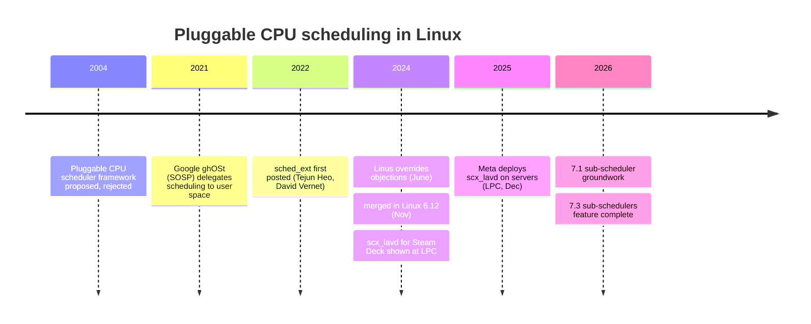
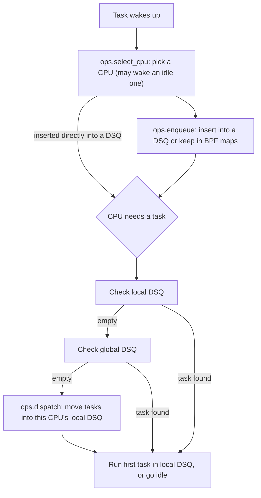
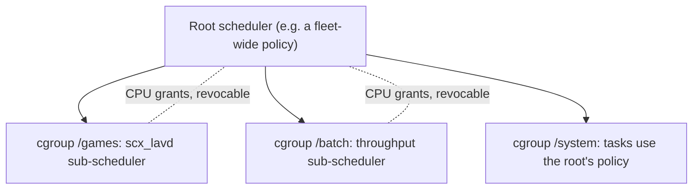

---
tags:
  - operating-systems
  - scheduling
  - sched-ext
  - ebpf
  - linux-kernel
  - frontier
status: complete
sources:
  - https://www.kernel.org/doc/html/v7.3/scheduler/sched-ext.html
  - https://research.google/pubs/ghost-fast-and-flexible-user-space-delegation-of-linux-scheduling/
  - https://lwn.net/Articles/978007
  - https://heise.de/-9949941
  - https://lwn.net/Articles/1055490/
  - https://lkml.iu.edu/2604.1/08965.html
  - https://phoronix.com/news/Linux-7.3-sched-ext
  - https://phoronix.com/news/linux-7.1-sched-ext-smt-sibling
  - https://phoronix.com/news/linux-sched-ext-scx-enq-immed
  - https://lpc.events/event/19/contributions/2099/
  - https://www.tomshardware.com/software/linux/facebook-deploys-the-steam-decks-linux-scheduler-across-its-data-centers-valves-low-latency-scheduler-perfect-for-managing-metas-workloads-at-massive-data-centers
  - https://lpc.events/event/18/contributions/1713/attachments/1425/3058/scx_lavd-lpc-mc-24.pdf
  - https://lwn.net/Articles/1082717/
created: 2026-11-26
updated: 2026-11-26
---

## Table Of Contents

---

- [[#TL;DR|TL;DR]]
- [[#The Problem|The Problem]]
- [[#Foundations|Foundations]]
    - [[#Scheduling Classes|Scheduling Classes]]
    - [[#struct_ops — Kernel Callbacks Written in BPF|struct_ops — Kernel Callbacks Written in BPF]]
    - [[#Dispatch Queues|Dispatch Queues]]
- [[#How We Got Here|How We Got Here]]
- [[#How It Works|How It Works]]
    - [[#The Scheduling Cycle|The Scheduling Cycle]]
    - [[#A Minimal Scheduler|A Minimal Scheduler]]
    - [[#Fairness With Virtual Time|Fairness With Virtual Time]]
    - [[#Safety Nets|Safety Nets]]
    - [[#Sub-Schedulers|Sub-Schedulers]]
- [[#Where It Is Now|Where It Is Now]]
- [[#Trade-offs & Open Problems|Trade-offs & Open Problems]]
- [[#Resources|Resources]]
- [[#Related Notes|Related Notes]]

## ***TL;DR***
---
*sched_ext lets you replace Linux's CPU scheduling policy with a program written in BPF and loaded at runtime, without rebooting or patching the kernel. If the program misbehaves, the kernel throws it out and falls back to the normal scheduler.*

- **What it is.** A scheduling class (`SCHED_EXT`) whose decisions are made by BPF callbacks: which CPU a waking task should use, which queue it goes on, and what each CPU runs next ([kernel docs](https://www.kernel.org/doc/html/v7.3/scheduler/sched-ext.html)).
- **Why.** One general-purpose scheduler ([[CPU Scheduling|EEVDF]]) must serve phones, game consoles and 400-core servers. sched_ext lets each workload get a policy tuned for it, and lets developers try ideas in minutes instead of kernel release cycles.
- **Safety.** The BPF verifier checks the program; a watchdog ejects a scheduler that leaves tasks runnable but unscheduled; SysRq-S reverts everything to the fair class.
- **History.** Merged in **Linux 6.12** (Nov 2024) after Linus Torvalds overrode the scheduler maintainers' objections ([LWN](https://lwn.net/Articles/978007)).
- **Status, Nov 2026.** **cgroup sub-schedulers** (several BPF schedulers, one per cgroup subtree) are "feature complete" in **Linux 7.3**. Meta runs **scx_lavd**, a scheduler written for Valve's Steam Deck, across production servers ([LPC 2025](https://lpc.events/event/19/contributions/2099/)).

## ***The Problem***
---
*A kernel scheduler is a single policy compiled into every machine, and changing it is slow, risky and political. Workloads differ more than any one policy can serve well.*

- **One policy, every machine.** The fair scheduler balances throughput, latency, fairness and energy with heuristics tuned on average workloads. A game wants frame-critical threads to never wait; a cache server wants tail latency; a batch cluster wants throughput; a hybrid laptop wants energy.
- **Experiments are expensive.** Testing a new policy at scale means building a kernel, rolling it out, rebooting machines and waiting weeks. Google and Meta both found that scheduling tweaks for one service were stuck behind fleet-wide kernel releases.
- **Upstream is conservative.** Scheduler changes affect everyone, so the maintainers are cautious; specialised policies rarely get merged.

The idea: keep the mechanism (context switching, runqueues, load tracking hooks) in the kernel, and let the *policy* be a loadable, verifiable, revertible program.

## ***Foundations***
---
*sched_ext sits in the kernel's stack of scheduling classes and is built on two existing pieces: BPF's struct_ops, which lets BPF implement a table of kernel callbacks, and a simple queue abstraction called the dispatch queue.*

### Scheduling Classes

Linux picks the next task by asking each scheduling class in priority order: stop, deadline, real-time, fair, ext, idle (see [[CPU Scheduling]]). sched_ext sits between fair and idle. Tasks with policy `SCHED_EXT` go to it; with the default flags, loading a BPF scheduler also moves every `SCHED_NORMAL`, `SCHED_BATCH` and `SCHED_IDLE` task into it. With `SCX_OPS_SWITCH_PARTIAL`, only tasks that explicitly asked for `SCHED_EXT` move ([kernel docs](https://www.kernel.org/doc/html/v7.3/scheduler/sched-ext.html)). Real-time and deadline tasks always stay with their own classes.

### struct_ops — Kernel Callbacks Written in BPF

[[eBPF]] programs normally attach to hooks. `struct_ops` lets a BPF program *be* an implementation of a kernel ops table, the way TCP congestion control algorithms already could. A sched_ext scheduler is a `struct sched_ext_ops` filled with BPF functions. Only `.name` is required; every missing callback gets a default.

### Dispatch Queues

A **dispatch queue (DSQ)** is a queue of tasks waiting to run. There are three kinds:

| DSQ | Scope | Ordering |
|---|---|---|
| `SCX_DSQ_LOCAL` | One per CPU; a CPU only ever runs tasks from its own local DSQ | FIFO |
| `SCX_DSQ_GLOBAL` | One built-in shared queue | FIFO |
| Custom DSQs | Created by the scheduler with `scx_bpf_create_dsq()` | FIFO or by virtual time (`scx_bpf_dsq_insert_vtime`) |

The scheduler's job reduces to **moving tasks into the right local DSQs at the right time**. It can also keep tasks in its own BPF maps (or a BPF arena) and only hand them over when asked.

## ***How We Got Here***
---
*Pluggable scheduling was tried for decades and refused upstream; Google's ghOSt showed delegation could be fast enough, and BPF made it safe enough. sched_ext then took two years of argument to merge.*



- **Earlier attempts.** Pluggable scheduler frameworks were proposed in the 2.6 era and refused, on the grounds that one good scheduler beats many partial ones.
- **ghOSt (SOSP 2021).** Google delegated scheduling decisions to a user-space agent over shared-memory messages, with throughput and latency comparable to the kernel scheduler, tested on Google Snap and Search ([Google Research](https://research.google/pubs/ghost-fast-and-flexible-user-space-delegation-of-linux-scheduling/)). Its gains were non-disruptive upgrades and fast policy iteration; its cost was a large out-of-tree patch.
- **sched_ext.** Tejun Heo and David Vernet (Meta), with Google engineers, proposed doing the same in BPF so policies run in-kernel with no round trip. Peter Zijlstra and other scheduler developers objected that it would fragment effort and let vendors ship closed schedulers. After a private discussion at the 2023 Maintainers Summit, Linus wrote in June 2024 that he saw "no reason to delay this any more" ([LWN](https://lwn.net/Articles/978007)). It missed 6.11 and landed in **6.12** (17 Nov 2024) ([heise](https://heise.de/-9949941)).

## ***How It Works***
---
*A BPF scheduler answers three questions through callbacks: where should this waking task run, where should it wait, and what should this idle CPU run next. The kernel keeps every mechanism and enforces the safety rules.*

### The Scheduling Cycle



Per the docs: on wakeup `select_cpu` suggests a CPU (the core ignores invalid choices); `enqueue` runs unless the task was already inserted; a CPU that needs work checks its local DSQ, then the global DSQ, then calls `dispatch`. If nothing arrives, the CPU idles, unless the previous task is still runnable and `SCX_OPS_ENQ_LAST` lets it continue. Lifecycle callbacks (`runnable`, `running`, `tick`, `stopping`, `quiescent`, `init_task`, `exit_task`) let the scheduler track tasks, and `set_weight` and `cgroup_*` pass on nice values and cgroup weights, which each scheduler may honour or ignore ([kernel docs](https://www.kernel.org/doc/html/v7.3/scheduler/sched-ext.html)).

### A Minimal Scheduler

The kernel's `scx_simple` example is a global FIFO in about 20 lines:

```c
s32 BPF_STRUCT_OPS(simple_select_cpu, struct task_struct *p,
                   s32 prev_cpu, u64 wake_flags)
{
        bool direct = false;
        s32 cpu = scx_bpf_select_cpu_dfl(p, prev_cpu, wake_flags, &direct);

        if (direct)   /* an idle CPU was found: put the task straight on it */
                scx_bpf_dsq_insert(p, SCX_DSQ_LOCAL, SCX_SLICE_DFL, 0);
        return cpu;
}

void BPF_STRUCT_OPS(simple_enqueue, struct task_struct *p, u64 enq_flags)
{
        /* otherwise, everyone waits in one shared FIFO */
        scx_bpf_dsq_insert(p, SCX_DSQ_GLOBAL, SCX_SLICE_DFL, enq_flags);
}

SEC(".struct_ops")
struct sched_ext_ops simple_ops = {
        .select_cpu = (void *)simple_select_cpu,
        .enqueue    = (void *)simple_enqueue,
        .name       = "simple",
};
```

In plain words: when a task wakes, use the kernel's default idle-CPU search; if it found an idle CPU, queue the task directly on that CPU with the default time slice. Otherwise, put it at the back of one global line that every CPU pulls from. Loading this with its user-space loader switches the whole machine to FIFO scheduling; killing the loader switches it back.

### Fairness With Virtual Time

A FIFO ignores priorities. The usual fix is **weighted virtual time**: each task's `vtime` advances by the CPU time it used, scaled down by its weight, and the DSQ runs the smallest `vtime` first.

$$\Delta vtime = t_{used} \times \frac{100}{w}$$

*In words: a task's place in line moves back by the time it ran, divided by how important it is (weight 100 is nice 0).* Two tasks each run 5 ms. Task A has weight 100: $5 \times 100/100 = 5$ ms. Task B has weight 200 (higher priority): $5 \times 100/200 = 2.5$ ms. B's vtime moved back half as far, so it gets picked sooner and ends up with about twice the CPU. This is the same idea as CFS's `vruntime`; `scx_simple` has a vtime mode that does exactly this.

### Safety Nets

| Failure | What the kernel does |
|---|---|
| Program fails verification | Never loads |
| A runnable task isn't scheduled before the watchdog timeout | Error: scheduler ejected, all tasks revert to the fair class, debug dump written |
| Loader process exits | Scheduler unloaded, fair class takes over |
| Admin presses SysRq-S | Same revert; SysRq-D dumps state without stopping |
| Load, unload, recovery | **Bypass mode** runs tasks with a simple built-in policy (5 ms default slice) |

Dumps appear in the loader's output and the `sched_ext_dump` tracepoint; counters such as `SCX_EV_REENQ_REPEAT` under `/sys/kernel/sched_ext/root/events` flag schedulers that keep re-deciding the same placement ([kernel docs](https://www.kernel.org/doc/html/v7.3/scheduler/sched-ext.html)). The guarantee is *liveness and revertibility*, not good performance: a correct but bad scheduler can still make the machine slow.

### Sub-Schedulers

Until 2026, one BPF scheduler owned the whole machine. **Sub-schedulers** let several attach to the cgroup tree, up to 4 levels deep. Each task belongs to the scheduler of its nearest cgroup ancestor with one; each instance has its own time slice, watchdog and bypass mode; a parent's `dispatch` calls `scx_bpf_sub_dispatch()` to let a child fill a CPU ([LWN, Jan 2026](https://lwn.net/Articles/1055490/)). In 7.3, a parent can grant and **revoke per-CPU capabilities** (enqueue, preemption, frequency control) to children, and tasks their scheduler can't run get a small "rescue" bandwidth budget instead of stalling ([Phoronix](https://phoronix.com/news/Linux-7.3-sched-ext)).



This replaces static partitioning with cpusets: the parent decides how much CPU each child gets, dynamically.

## ***Where It Is Now***
---
*As of November 2026, sched_ext is two years old, used in production at Meta and on gaming desktops, and its 2026 work has been about composition (sub-schedulers) and making it fit with the rest of the scheduler.*

**Kernel releases.**

| Release | sched_ext changes |
|---|---|
| 6.12 (Nov 2024) | Merged |
| 7.1 (Jun 2026) | Sub-scheduler groundwork (dispatch, bypass, watchdog per scheduler); `scx_bpf_dsq_reenq()` on any DSQ; `SCX_ENQ_IMMED` (run now or re-enqueue); `ops.dequeue()` fires exactly once; kfunc checks moved to verifier time; idle SMT siblings preferred ([pull request](https://lkml.iu.edu/2604.1/08965.html)) |
| 7.3 (Oct 2026) | Sub-schedulers "feature complete": enqueue path, revocable CPU capabilities, rescue execution, typed arena pointers, NMI-safe abort; `scx_qmap` demonstrates hierarchical scheduling ([Phoronix, Aug 2026](https://phoronix.com/news/Linux-7.3-sched-ext)) |
| 7.4 (rc, due Dec 2026) | Andrea Righi's proxy-execution support (`SCX_OPS_ENQ_BLOCKED`) targeted at the for-7.4 branch (see [[CPU Scheduling]]) |

**Schedulers in use.** The out-of-tree `sched-ext/scx` repository holds the production schedulers, many with Rust user-space halves:

- **scx_lavd** (Latency-criticality Aware Virtual Deadline): written by Changwoo Min at Igalia for Valve's Steam Deck to avoid dropped frames ([LPC 2024](https://lpc.events/event/18/contributions/1713/attachments/1425/3058/scx_lavd-lpc-mc-24.pdf)). It infers which threads are latency-critical from wake-up and blocking chains.
- **Meta's fleet.** At LPC in December 2025, David Dai and Ryan Newton described running scx_lavd across Meta servers, including messaging backends and caching services, as a "one size fits most" default; changes for big topologies were neutral or positive on the Deck ([LPC 2025](https://lpc.events/event/19/contributions/2099/), [Tom's Hardware](https://www.tomshardware.com/software/linux/facebook-deploys-the-steam-decks-linux-scheduler-across-its-data-centers-valves-low-latency-scheduler-perfect-for-managing-metas-workloads-at-massive-data-centers)).
- Others: **scx_layered** (Meta; per-workload layers with their own policies), **scx_bpfland** and **scx_rustland** (Andrea Righi; interactive desktops, the latter making decisions in user-space Rust), **scx_rusty** (load balancing in user space).

## ***Trade-offs & Open Problems***
---
*sched_ext trades the scheduler's single shared policy for many specialised ones. That buys speed of iteration and fit, and costs fragmentation, debugging difficulty and constant work to keep new core features compatible.*

| Gain | Cost |
|---|---|
| Policies change in seconds, no reboot | Behaviour now depends on which scheduler is loaded; bug reports get harder |
| Workload-specific wins (gaming, tail latency) | Gains may never flow back into the default scheduler, the core of the 2024 objection |
| Kernel guarantees revert on failure | Only liveness is guaranteed; a slow scheduler is still slow until ejected |
| BPF keeps it in-kernel, no user-space round trip | Verifier limits shape what algorithms are practical; complex state lives in maps and arenas |
| Sub-schedulers replace static cpusets | A new trust boundary inside one machine: children must not starve siblings |

**Open problems.**

- **Keeping up with the core.** Every new scheduler feature (proxy execution, deadline servers, time-slice extension) must be made to work with sched_ext, and until it does, the two are often exclusive ([LWN, Jul 2026](https://lwn.net/Articles/1082717/)).
- **Isolation between sub-schedulers.** Revocable grants and rescue budgets are the first answers to a buggy child scheduler; how strong the isolation must be for multi-tenant use is open.
- **Real-time interaction.** sched_ext sits below the RT class; latency-sensitive BPF schedulers still lose to any RT task, and its interplay with [[PREEMPT_RT and Real-Time Linux]] is mostly unexplored.
- **Feedback upstream.** Whether ideas proven in BPF (latency-criticality inference, cache-aware placement) get folded into EEVDF is a social question as much as a technical one.

## ***Resources***
---
*Read the kernel docs for the model and scx_simple for code; the LPC talks show what production schedulers actually do.*

**Kernel and design**
- [Extensible Scheduler Class](https://www.kernel.org/doc/html/v7.3/scheduler/sched-ext.html): kernel.org docs, v7.3.
- [sched_ext v7.1 pull request](https://lkml.iu.edu/2604.1/08965.html): Tejun Heo, Apr 2026.
- [cgroup sub-scheduler support](https://lwn.net/Articles/1055490/): Tejun Heo patchset, Jan 2026.
- [Sub-schedulers feature complete in 7.3](https://phoronix.com/news/Linux-7.3-sched-ext): Phoronix, Aug 2026.
- [Idle SMT sibling preference](https://phoronix.com/news/linux-7.1-sched-ext-smt-sibling) and [SCX_ENQ_IMMED](https://phoronix.com/news/linux-sched-ext-scx-enq-immed): Phoronix, 2026.

**History**
- [ghOSt: Fast and Flexible User-Space Delegation of Linux Scheduling](https://research.google/pubs/ghost-fast-and-flexible-user-space-delegation-of-linux-scheduling/): Humphries et al., Google, SOSP 2021.
- [Extensible scheduler class to be merged](https://lwn.net/Articles/978007): LWN, Jun 2024.
- [Linux 6.12: scheduler now expandable](https://heise.de/-9949941): heise.

**Production**
- [scx_lavd at LPC 2024](https://lpc.events/event/18/contributions/1713/attachments/1425/3058/scx_lavd-lpc-mc-24.pdf): Changwoo Min, Igalia.
- [Making a Steam Deck scheduler work on large servers](https://lpc.events/event/19/contributions/2099/): Dai and Newton, Meta, LPC 2025.
- [Meta deploys the Steam Deck's scheduler](https://www.tomshardware.com/software/linux/facebook-deploys-the-steam-decks-linux-scheduler-across-its-data-centers-valves-low-latency-scheduler-perfect-for-managing-metas-workloads-at-massive-data-centers): Tom's Hardware, Dec 2025.

## Related Notes

- [[CPU Scheduling]] — The class stack, EEVDF and the policies sched_ext replaces.
- [[eBPF]] — The verifier, struct_ops, maps and arenas that sched_ext is built from.
- [[Processes and Threads]] — The tasks being scheduled and their states.
- [[Containers, Namespaces and cgroups]] — The cgroup tree sub-schedulers attach to.
- [[Locks and Synchronization]] — Priority inversion and why proxy execution matters.
- [[PREEMPT_RT and Real-Time Linux]] — The real-time classes that sit above sched_ext.
- [[NUMA]] — Topology that schedulers like scx_lavd must handle on large servers.
- [[Kernel Architectures]] — Policy-in-a-module as a step toward extensible kernels.
- [[Interrupts and Exceptions]] — Ticks, IPIs and wakeups that drive the scheduling cycle.
