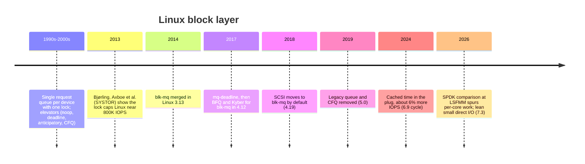
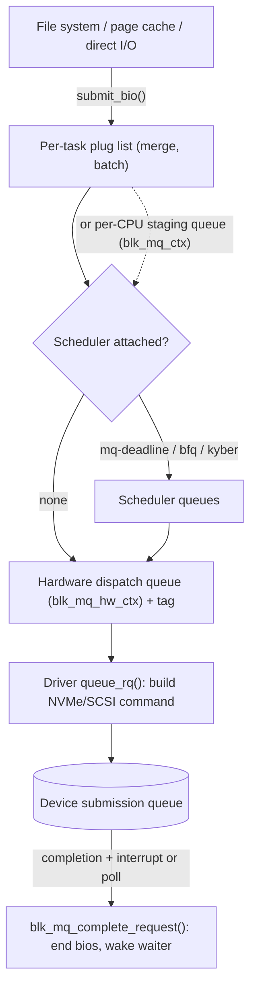

---
tags:
  - operating-systems
  - storage
  - block-layer
  - blk-mq
  - io-scheduler
  - linux
status: complete
sources:
  - https://docs.kernel.org/_sources/block/blk-mq.rst.txt
  - https://docs.kernel.org/7.0/block/switching-sched.html
  - https://kernel.org/doc/html/v6.2/block/bfq-iosched.html
  - https://lwn.net/SubscriberLink/720675/8f93ff3b425a7fb5
  - https://lwn.net/Articles/767987
  - https://arxiv.org/pdf/1504.07481
  - https://lkml.iu.edu/hypermail/linux/kernel/1311.1/00328.html
  - https://lkml.indiana.edu/hypermail/linux/kernel/1905.2/02090.html
  - https://phoronix.com/news/Linux-7.3-Faster-Small-Direct
  - https://phoronix.com/news/Linux-Caching-Time-Block-IO
  - https://www.phoronix.com/news/Axboe-60p-Faster-Per-Core-Perf
  - https://lore.kernel.org/lkml/20190828220600.2527417-2-tj@kernel.org/t/
created: 2026-11-26
updated: 2026-11-26
---

## Table Of Contents

---

- [[#TL;DR|TL;DR]]
- [[#The Problem|The Problem]]
- [[#Foundations|Foundations]]
    - [[#Bios, Requests and Queues|Bios, Requests and Queues]]
    - [[#Little's Law and Queue Depth|Little's Law and Queue Depth]]
- [[#How We Got Here|How We Got Here]]
- [[#How It Works|How It Works]]
    - [[#The Path of a Read|The Path of a Read]]
    - [[#blk-mq: Two Levels of Queues|blk-mq: Two Levels of Queues]]
    - [[#Plugging and Merging|Plugging and Merging]]
    - [[#The Four Schedulers|The Four Schedulers]]
    - [[#Sharing a Device Between cgroups|Sharing a Device Between cgroups]]
- [[#Where It Is Now|Where It Is Now]]
- [[#Trade-offs & Open Problems|Trade-offs & Open Problems]]
- [[#Resources|Resources]]
- [[#Related Notes|Related Notes]]

## ***TL;DR***

---

*The block layer sits between file systems and storage drivers. It turns read and write requests on byte ranges into queued, merged, scheduled commands for a device, and since 2013 it does this with per-CPU queues (blk-mq) so it can keep up with SSDs that do millions of operations per second.*

- **Why multiqueue:** the old design had "a single queue to store block IO requests with a single lock", which "did not scale well" and capped Linux at about 800,000 IOPS; blk-mq reached over 10 million on a null device ([kernel docs](https://docs.kernel.org/_sources/block/blk-mq.rst.txt), [scsi-mq paper](https://arxiv.org/pdf/1504.07481)).
- **Shape:** per-CPU **software staging queues** feed **hardware dispatch queues** that match the device's own submission queues; every in-flight request carries an integer **tag** ([kernel docs](https://docs.kernel.org/_sources/block/blk-mq.rst.txt)).
- **Schedulers:** `none` (no reordering, typical for NVMe), `mq-deadline` (read/write deadlines), `bfq` (fair share and low latency for desktops and slow disks) and `kyber` (latency targets for fast devices) ([LWN](https://lwn.net/SubscriberLink/720675/8f93ff3b425a7fb5), [BFQ docs](https://kernel.org/doc/html/v6.2/block/bfq-iosched.html)).
- **Late 2026:** work is about CPU per I/O, not reordering: Jens Axboe reported patches worth about 60% more per-core I/O after an SPDK comparison at LSFMM (May 2026), and Linux 7.3 added a lean iomap direct-I/O path that took 4K reads on PCIe Gen5 from 1.92M to 2.19M IOPS ([Phoronix](https://phoronix.com/news/Linux-7.3-Faster-Small-Direct)).

## ***The Problem***

---

*Storage devices accept commands, not files. Something has to batch the stream of small requests from many CPUs, merge neighbors, decide what goes first, and track what is in flight, without itself becoming the slowest part of the path.*

The job changed under the block layer's feet:

| Era | Device | What hurt | What the block layer had to do |
|---|---|---|---|
| Spinning disk | ~100-200 random IOPS, ms seeks | Seek time | Sort and merge requests to minimize head movement (elevators) |
| SATA SSD | ~100K IOPS, one queue of 32 | Queue lock contention | Stop reordering; avoid the global lock |
| NVMe SSD | Millions of IOPS, up to 64K queues | CPU cycles per I/O | Per-CPU queues, no locks, minimal code per request |

At NVMe speed, software overhead is the budget. A drive doing 2 million IOPS leaves 500 ns per I/O for the whole kernel path if one core drives it; the [[Kernel Architectures]] note puts a monolithic kernel's read overhead at about 1% of an 80 µs NVMe access, but that changes completely as device latency falls toward 10 µs.

## ***Foundations***

---

*A file system issues `bio`s (contiguous I/O on a device), the block layer bundles them into `request`s, and a driver turns requests into device commands. Queue depth and latency then fix throughput through Little's law.*

### Bios, Requests and Queues

- **`struct bio`:** one I/O operation on a contiguous range of sectors, described as a list of memory segments (`bio_vec`: page, offset, length). File systems, the [[Page Cache and Memory Reclaim|page cache]] writeback code, swap and direct I/O all submit bios.
- **`struct request`:** what the driver sees. One request holds one or more merged bios for adjacent sectors.
- **Request queue (`struct request_queue`):** per device. Holds the scheduler, limits (max sectors per request, alignment, segment counts) and the blk-mq contexts.
- **Tag:** "every request is identified by an integer, ranging from 0 to the dispatch queue size", and the driver hands the tag back on completion so the kernel finds the request without searching ([kernel docs](https://docs.kernel.org/_sources/block/blk-mq.rst.txt)). For NVMe the tag is effectively the command ID.

### Little's Law and Queue Depth

For a device with a fixed per-I/O latency, throughput is set by how many I/Os are in flight:

$$\text{IOPS} = \frac{\text{queue depth}}{\text{latency per I/O}}$$

In words: if each I/O takes $L$ seconds and you always keep $QD$ of them outstanding, you finish $QD / L$ per second.

*Worked example:* an NVMe read that takes 80 µs at queue depth 1 gives $1 / 80\,\mu s = 12{,}500$ IOPS. At queue depth 32 it gives $32 / 80\,\mu s = 400{,}000$ IOPS, as long as the device has the internal parallelism to keep latency flat. This is why NVMe offers many deep queues and why the block layer must let many CPUs submit at once without serializing on a lock.

## ***How We Got Here***

---

*Linux's block layer spent its first twenty years optimizing disk head movement through one locked queue. Flash made that work pointless and the lock fatal, so the layer was rebuilt around per-CPU queues and, by 2019, the old one was deleted.*



- **The lock problem:** in the old design, "insertions, removals and IO scheduling operations involving the request queue require obtaining a global lock"; every lock handoff bounced cache lines between cores and across NUMA nodes, and "the Linux block layer is limited to 800,000 IOP/s" no matter how many cores were added ([Caldwell, scsi-mq paper, 2015](https://arxiv.org/pdf/1504.07481), summarizing Bjørling et al., SYSTOR 2013).
- **blk-mq (3.13):** Axboe's pull request for 3.13 added the multiqueue core ([LKML, Nov 2013](https://lkml.iu.edu/hypermail/linux/kernel/1311.1/00328.html)); the SYSTOR prototype scaled to "over 10 million IOP/s" (12 million on the `null_blk` driver, which discards data, so it measures software overhead) ([scsi-mq paper](https://arxiv.org/pdf/1504.07481)).
- **Schedulers (4.12):** multiqueue at first "lacks an I/O scheduler designed to work with multiqueue devices"; deadline was ported, and BFQ and Kyber were both merged for 4.12 ([LWN, April 2017](https://lwn.net/SubscriberLink/720675/8f93ff3b425a7fb5)).
- **The end of the legacy path:** with SCSI on blk-mq in 4.19, "the legacy API can be expected to go away" ([LWN, Oct 2018](https://lwn.net/Articles/767987)); it and its schedulers, CFQ included, were gone by 5.0 ([LKML, May 2019](https://lkml.indiana.edu/hypermail/linux/kernel/1905.2/02090.html)).

## ***How It Works***

---

*A bio enters through `submit_bio()`, is merged in a per-task plug or a per-CPU software queue, may pass through a scheduler, and is dispatched to a hardware queue that maps to the device's submission queue. The completion interrupt ends the request on the CPU that submitted it.*

### The Path of a Read



### blk-mq: Two Levels of Queues

| Level | Structure | Count | Purpose |
|---|---|---|---|
| Software staging queue | `struct blk_mq_ctx` | Per CPU or per NUMA node; "each queue has its own lock" | Collect and merge requests without cross-CPU contention |
| Hardware dispatch queue | `struct blk_mq_hw_ctx` | Matches the device's queues, "not more than the number of cores" | Last stop before the driver; holds a dispatch list for requests the device refused |

From the [kernel docs](https://docs.kernel.org/_sources/block/blk-mq.rst.txt): with no scheduler and nothing to merge, blk-mq takes "the shortest path possible: send it directly to the hardware queue." If the device is full, requests wait on the hardware context's dispatch list, which is served first on the next run. Scheduling "happens only between requests in the same queue", so a scheduler orders I/O per hardware queue, not globally.

A minimal driver fills in one callback (simplified):

```c
static blk_status_t mydrv_queue_rq(struct blk_mq_hw_ctx *hctx,
                                   const struct blk_mq_queue_data *bd)
{
        struct request *rq = bd->rq;
        struct mycmd *cmd = blk_mq_rq_to_pdu(rq);   /* per-request driver data */

        blk_mq_start_request(rq);
        cmd->id   = rq->tag;                          /* tag doubles as command ID */
        cmd->lba  = blk_rq_pos(rq);                   /* start sector */
        cmd->len  = blk_rq_bytes(rq);
        if (!mydrv_post(hctx->driver_data, cmd))      /* ring full? */
                return BLK_STS_RESOURCE;              /* blk-mq retries later */
        return BLK_STS_OK;
}
```

*In plain words: take the request blk-mq hands you, use its tag as the hardware command ID, write the command into the device's ring, and say "busy" if the ring is full so the core requeues it. Completion later looks the request up by tag.*

### Plugging and Merging

A task about to issue several I/Os opens a **plug** (`blk_start_plug()`); bios collect on a per-task list and are flushed together on `blk_finish_plug()` or when the task sleeps. Adjacent requests merge: the kernel docs' example turns sectors 3-6, 6-7 and 7-9 into one request for 3-9, and note "this technique of merging requests is called plugging" ([kernel docs](https://docs.kernel.org/_sources/block/blk-mq.rst.txt)). The plug is also a cheap place to cache per-batch state: caching the current time there removed repeated clock reads and gave "around a 6% boost to IOPS" ([Phoronix](https://phoronix.com/news/Linux-Caching-Time-Block-IO)).

### The Four Schedulers

The active scheduler is chosen per device in sysfs, shown in brackets: `cat /sys/block/sda/queue/scheduler` gives `[mq-deadline] kyber bfq none`, and `echo none > ...` switches it ([kernel docs](https://docs.kernel.org/7.0/block/switching-sched.html)).

| Scheduler | Idea | Best for | Cost |
|---|---|---|---|
| **none** | No reordering; straight to the hardware queue | Fast NVMe, where the device schedules internally | Lowest |
| **mq-deadline** | Sorted queues plus per-request deadlines; reads preferred, writes not starved | SATA SSDs and disks, general servers | About 0.7 µs per request ([BFQ docs](https://kernel.org/doc/html/v6.2/block/bfq-iosched.html)) |
| **bfq** | Each process or cgroup gets a budget "measured in number of sectors", scheduled by B-WF2Q+ in proportion to its weight; `low_latency` on by default | Desktops, slow disks, guaranteeing a share to a cgroup | About 1.9 µs per request; 400K IOPS ceiling on an i7-4850HQ, 80K on a Cortex-A53 |
| **kyber** | Separate sync and async queues; limits how many I/Os reach the device, tuned against target latencies ("2ms for read requests and 10ms for writes") | Fast multiqueue devices, throughput-sensitive servers | Under 1,000 lines; low |

*Worked example (BFQ docs' numbers):* at 1.9 µs per request, one core can schedule at most $1 / 1.9\,\mu s \approx 526{,}000$ requests per second through BFQ; at 0.7 µs, mq-deadline allows about 1.43 million. A PCIe Gen5 drive doing 2.19M 4K reads per second ([Phoronix](https://phoronix.com/news/Linux-7.3-Faster-Small-Direct)) would saturate either scheduler on a single core, which is why NVMe usually runs with `none`.

BFQ's fairness is by bandwidth, not time: a group with weight 200 gets twice the bandwidth of one with weight 100. On disks it reports "up to 30% higher throughput than CFQ" for sequential workloads, while on flash and random workloads it matches the other schedulers ([BFQ docs](https://kernel.org/doc/html/v6.2/block/bfq-iosched.html)).

### Sharing a Device Between cgroups

Schedulers reorder within a queue; isolating tenants is the job of the cgroup v2 `io` controller ([[Containers, Namespaces and cgroups]]): `io.max` sets hard bandwidth and IOPS caps, `io.weight` gives proportional shares (implemented by BFQ or by the cost-model controller `io.cost`, posted by Tejun Heo in 2019 ([LKML](https://lore.kernel.org/lkml/20190828220600.2527417-2-tj@kernel.org/t/))), and `io.latency` protects a group's latency target by throttling others. Writeback throttling separately keeps background flushes from flooding the queue ahead of reads.

## ***Where It Is Now***

---

*As of November 2026, the block layer's correctness and structure are settled, and the fight is over nanoseconds per I/O: user-space stacks like SPDK set the bar, and kernel developers are trimming allocation, locking and state-machine code from the submission and completion paths.*

- **The SPDK benchmark as a target (May 2026):** after an LSFMM+BPF presentation comparing Linux's per-core I/O overhead with SPDK, Jens Axboe posted patches reported to give about 60% more per-core I/O performance. They extend io_uring registered buffers to hold a ready-to-use `struct bio` that is DMA-mapped in advance, so O_DIRECT submits it directly with no bio allocation or DMA map/unmap per I/O; they touch io_uring, the NVMe PCI driver and the block layer, and were not yet upstream when reported ([Phoronix, 10 May 2026](https://www.phoronix.com/news/Axboe-60p-Faster-Per-Core-Perf)). See [[NVMe and User-Space Storage]] for SPDK itself.
- **Lean small direct I/O (7.3, released Oct 2026):** a simplified iomap path for direct reads no larger than the file system block size, written by Fengnan Chang (ByteDance), removed a "significant bottleneck" of allocations and state-machine logic: 4K random reads went from 1.92M to 2.19M IOPS on PCIe Gen5 NVMe, with up to 10% gains on ext4 and XFS through [[io_uring]] ([Phoronix, July 2026](https://phoronix.com/news/Linux-7.3-Faster-Small-Direct)).
- **Polling over interrupts:** with `IORING_SETUP_IOPOLL` and NVMe poll queues, completions are reaped by spinning on the completion queue rather than taking an interrupt per I/O; the trade-off is covered in [[Interrupts and Exceptions]].
- **Default practice:** NVMe devices typically run `none`; SATA and SCSI disks run `mq-deadline` or `bfq`, chosen by distribution udev rules.

## ***Trade-offs & Open Problems***

---

*Every layer between the application and the device buys a feature (merging, fairness, accounting, cgroup control) with CPU time per I/O. On a disk that time was free; on a 2-million-IOPS SSD it is the bottleneck.*

| Tension | Detail |
|---|---|
| Fairness vs overhead | BFQ gives per-cgroup bandwidth guarantees but costs about 2.7x mq-deadline's CPU per request and can cap IOPS on small CPUs ([BFQ docs](https://kernel.org/doc/html/v6.2/block/bfq-iosched.html)) |
| Kernel scheduling vs device scheduling | NVMe drives reorder internally, so a host scheduler mostly adds latency, but without one the host cannot favor reads or protect tenants |
| Interrupts vs polling | Polling cuts latency and raises IOPS but burns a core when idle |
| Generality vs bypass | The block layer serves every device and file system; SPDK and `io_uring` NVMe passthrough skip it for speed ([[NVMe and User-Space Storage]]) |
| Per-queue vs global ordering | Schedulers only order within a hardware queue, so global priorities across many queues are approximate |

Open problems:
- **Closing the SPDK gap** without giving up the kernel's protection, accounting and file system integration.
- **Isolation on shared NVMe:** device-internal garbage collection and write amplification make latency hard to predict, which limits what `io.latency` or Kyber can promise ([[Flash and Log-Structured File Systems]]).
- **Zoned and computational storage** move placement and some processing to the device, changing what "scheduling" means.

## ***Resources***

---

*The kernel's blk-mq and BFQ docs are short and precise; LWN covers each scheduler's arrival; the scsi-mq paper summarizes why the old design hit a wall.*

**Foundations**
- [Kernel docs: Multi-Queue Block IO Queueing Mechanism (blk-mq)](https://docs.kernel.org/_sources/block/blk-mq.rst.txt)
- [Kernel docs: BFQ (Budget Fair Queueing)](https://kernel.org/doc/html/v6.2/block/bfq-iosched.html)
- [Kernel docs: Switching Scheduler](https://docs.kernel.org/7.0/block/switching-sched.html)
- [Caldwell: Improving Block-level Efficiency with scsi-mq (2015)](https://arxiv.org/pdf/1504.07481), summarizing Bjørling, Axboe, Nellans, Bonnet, "Linux Block IO: Introducing Multi-queue SSD Access on Multi-core Systems" (SYSTOR 2013)

**History**
- [Axboe: block IO core pull for 3.13 (Nov 2013)](https://lkml.iu.edu/hypermail/linux/kernel/1311.1/00328.html)
- [LWN: Two new block I/O schedulers for 4.12 (April 2017)](https://lwn.net/SubscriberLink/720675/8f93ff3b425a7fb5)
- [LWN: Converting to the multiqueue block layer (Oct 2018)](https://lwn.net/Articles/767987)
- [LKML: Setting up default iosched in 5.0+ (May 2019)](https://lkml.indiana.edu/hypermail/linux/kernel/1905.2/02090.html)

**Where it is now**
- [Phoronix: Caching time in the block plug (+6% IOPS)](https://phoronix.com/news/Linux-Caching-Time-Block-IO)
- [Phoronix: Axboe's patches for 60% more per-core I/O (May 2026)](https://www.phoronix.com/news/Axboe-60p-Faster-Per-Core-Perf)
- [Phoronix: Linux 7.3 removes a small direct I/O bottleneck (July 2026)](https://phoronix.com/news/Linux-7.3-Faster-Small-Direct)

## ***Related Notes***

---

- [[NVMe and User-Space Storage]]: the devices blk-mq was built for, and the stacks that bypass it.
- [[io_uring]]: the submission interface that drives blk-mq hardest, with polling and passthrough.
- [[File Systems]]: the main producers of bios.
- [[Page Cache and Memory Reclaim]]: writeback, the other big source of block I/O.
- [[Interrupts and Exceptions]]: completion interrupts, MSI-X per queue, and polling.
- [[Containers, Namespaces and cgroups]]: the cgroup v2 `io` controller.
- [[CPU Scheduling]]: the CPU-side analogue of fair queueing.
- [[Locks and Synchronization]]: why one queue lock capped a whole machine.
- [[Flash and Log-Structured File Systems]]: what the device does with the writes after the block layer lets go.
- [[Kernel Architectures]]: the VFS-to-driver path in a monolithic kernel.
