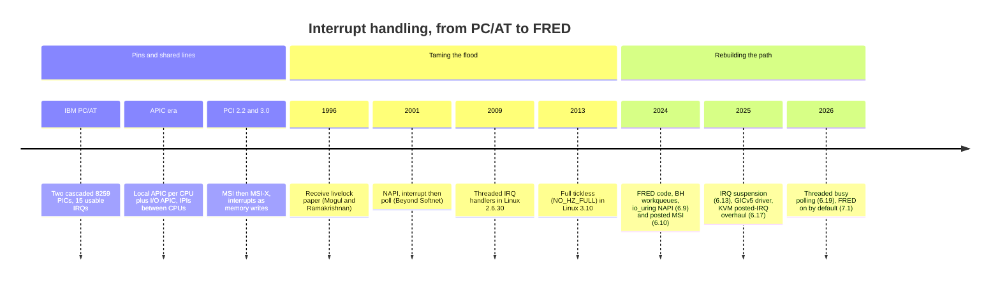
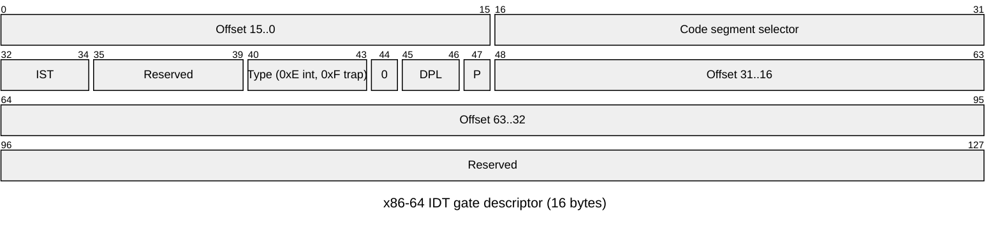
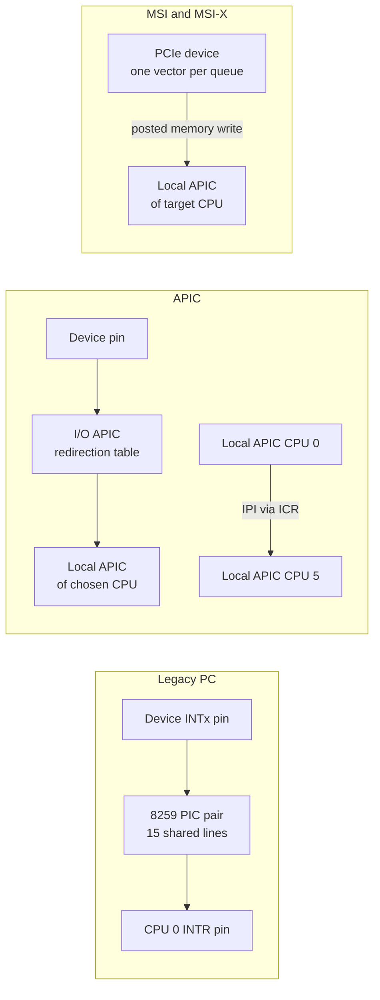
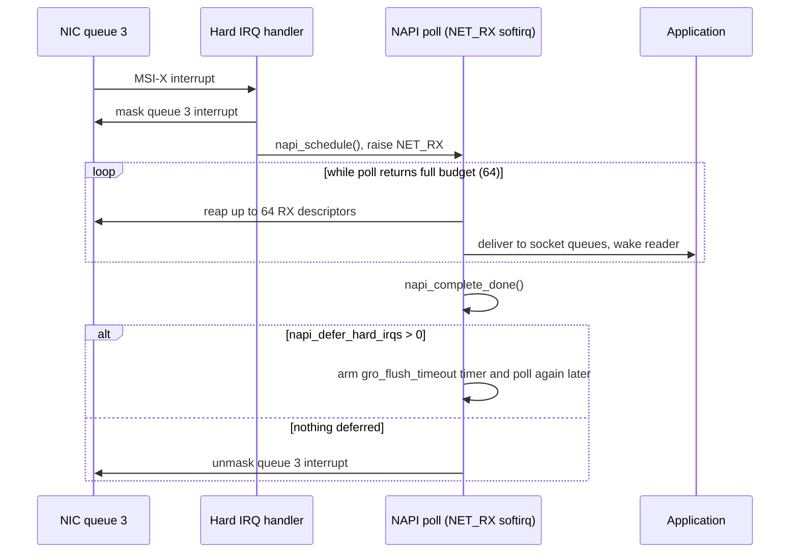

---
tags:
  - operating-systems
  - i-o-and-networking
  - interrupts-and-exceptions
status: draft
sources:
  - https://osdev.wiki/wiki/Exceptions?oldid=1664
  - https://wiki.osdev.org/Interrupt_Descriptor_Table
  - https://wiki.osdev.org/8259_PIC
  - https://wiki.osdev.org/APIC
  - https://wiki.osdev.org/AArch64_Exceptions
  - https://raw.githubusercontent.com/torvalds/linux/master/arch/x86/include/asm/irq_vectors.h
  - https://raw.githubusercontent.com/torvalds/linux/master/kernel/softirq.c
  - https://raw.githubusercontent.com/torvalds/linux/master/include/linux/interrupt.h
  - https://raw.githubusercontent.com/torvalds/linux/master/include/linux/workqueue.h
  - https://raw.githubusercontent.com/torvalds/linux/master/include/linux/netdevice.h
  - https://raw.githubusercontent.com/torvalds/linux/master/arch/x86/entry/entry_fred.c
  - https://docs.kernel.org/7.1/_sources/core-api/genericirq.rst.txt
  - https://docs.kernel.org/PCI/msi-howto.html
  - https://docs.kernel.org/core-api/irq/irq-affinity.html
  - https://docs.kernel.org/7.1/_sources/core-api/irq/managed_irq.rst.txt
  - https://docs.kernel.org/7.1/networking/napi.html
  - https://docs.kernel.org/6.19/networking/napi.html
  - https://docs.kernel.org/7.1/_sources/timers/no_hz.rst.txt
  - https://docs.kernel.org/admin-guide/lockup-watchdogs.html
  - https://docs.kernel.org/6.10/arch/x86/x86_64/fred.html
  - https://docs.kernel.org/7.1/_sources/arch/x86/x86_64/fred.rst.txt
  - https://usenix.org/legacy/publications/library/proceedings/sd96/mogul.html
  - https://www.usenix.org/conference/als-01/beyond-softnet
  - https://lwn.net/Articles/324980/
  - https://kernelnewbies.org/Linux_2_6_30
  - https://lwn.net/Articles/549580
  - https://lwn.net/Articles/960041
  - https://kernelnewbies.org/Linux_6.9
  - https://www.phoronix.com/news/Intel-FRED-Merged-Linux-6.9
  - https://lkml.iu.edu/hypermail/linux/kernel/2405.1/04908.html
  - https://kernelnewbies.org/Linux_6.10
  - https://phoronix.com/news/Linux-6.12-Does-Real-Time
  - https://lwn.net/Articles/972389
  - https://lwn.net/Articles/1008399
  - https://lkml.iu.edu/hypermail/linux/kernel/2501.2/03405.html
  - https://tangled.org/tjh.dev/kernel/commit/c18d4b190a46651726c9a952667c74d2deb33c28
  - https://lists.openwall.net/netdev/2025/10/28/314
  - https://lore.kernel.org/all/171018617546.28701.3866737610241624331.pr-tracker-bot@kernel.org/T/
  - https://www.phoronix.com/news/Linux-7.1-Enabled-Intel-FRED
  - https://www.linuxjournal.com/content/linux-kernel-71-officially-released-new-ntfs-driver-intel-fred-and-major-code-cleanup
  - https://www.tomshardware.com/pc-components/cpus/amd-adopts-fred-together-with-intel-for-zen-6-architecture-replacement-for-decades-old-idt-can-improve-performance-and-stability
  - https://lwn.net/Articles/1036800
  - https://mirrors.lzu.edu.cn/git/linux-net/src/commit/3253cb49cbad4772389d6ef55be75db1f97da910
  - https://lkml.iu.edu/hypermail/linux/kernel/2602.0/08669.html
  - https://www.phoronix.com/news/Linux-6.0-KVM
  - https://lwn.net/Articles/1016580/
  - https://mirrors.lzu.edu.cn/git/linux-net/-/commit/f02b1bcc73a17602903480562571069f0dff9f24
  - https://lwn.net/Articles/1041616/
  - https://lkml.indiana.edu/hypermail/linux/kernel/2507.2/02422.html
  - https://lwn.net/Articles/1026119/
  - https://kernelnewbies.org/Linux_6.17
  - https://www.helpnetsecurity.com/2026/02/09/linux-kernel-6-19-released/
  - https://www.github.com/Irqbalance/irqbalance
  - https://madsys.cs.tsinghua.edu.cn/publication/skyloft-a-general-high-efficient-scheduling-framework-in-user-space/
  - https://www.usenix.org/conference/nsdi25/presentation/guo
created: 2026-11-26
updated: 2026-11-26
---

## Table Of Contents

---

- [[#TL;DR|TL;DR]]
- [[#The Problem|The Problem]]
- [[#Foundations|Foundations]]
    - [[#Interrupts vs Exceptions|Interrupts vs Exceptions]]
    - [[#Faults, Traps and Aborts|Faults, Traps and Aborts]]
    - [[#Interrupt Context|Interrupt Context]]
    - [[#Edge vs Level Triggering|Edge vs Level Triggering]]
- [[#How We Got Here|How We Got Here]]
- [[#How It Works|How It Works]]
    - [[#The x86 IDT and Vectors|The x86 IDT and Vectors]]
    - [[#The ARM64 Exception Vector Table|The ARM64 Exception Vector Table]]
    - [[#From PIC to APIC to MSI-X|From PIC to APIC to MSI-X]]
    - [[#The Linux Generic IRQ Layer|The Linux Generic IRQ Layer]]
    - [[#Top Half and Bottom Half|Top Half and Bottom Half]]
    - [[#Softirqs and ksoftirqd|Softirqs and ksoftirqd]]
    - [[#NAPI and the Interrupt-Polling Trade-off|NAPI and the Interrupt-Polling Trade-off]]
    - [[#Coalescing and Busy Polling|Coalescing and Busy Polling]]
    - [[#IRQ Affinity and irqbalance|IRQ Affinity and irqbalance]]
    - [[#NMIs and Inter-Processor Interrupts|NMIs and Inter-Processor Interrupts]]
    - [[#Timer Interrupts and Tickless Kernels|Timer Interrupts and Tickless Kernels]]
- [[#Where It Is Now|Where It Is Now]]
    - [[#FRED Replaces IDT Delivery on x86|FRED Replaces IDT Delivery on x86]]
    - [[#Tasklets Are Being Retired|Tasklets Are Being Retired]]
    - [[#IRQ Suspension and Threaded Busy Polling|IRQ Suspension and Threaded Busy Polling]]
    - [[#Interrupts in Virtual Machines|Interrupts in Virtual Machines]]
    - [[#Keeping Interrupts Off Isolated CPUs|Keeping Interrupts Off Isolated CPUs]]
    - [[#New Interrupt Controllers and User Interrupts|New Interrupt Controllers and User Interrupts]]
- [[#Trade-offs & Open Problems|Trade-offs & Open Problems]]
- [[#Resources|Resources]]
- [[#Related Notes|Related Notes]]

## ***TL;DR***
---
*Interrupts are how hardware gets the CPU's attention; exceptions are how the CPU reports a problem with the instruction it is running. Both enter the kernel through a table of handlers, and almost everything interesting about them is how little work to do at that moment and how to push the rest somewhere safer.*

- **Two kinds of event, one entry path:** an **interrupt** comes from outside the instruction stream (a NIC, a disk, a timer, another CPU) and arrives at any time. An **exception** is caused by the instruction itself (divide by zero, a [[Virtual Memory and Paging|page fault]], a breakpoint). Both make the CPU save state and jump through a handler table: the **IDT** on x86, the **vector table at VBAR_EL1** on ARM64.
- **Faults, traps, aborts:** a fault re-runs the faulting instruction after the handler fixes things (page faults), a trap resumes at the next instruction (breakpoints, system calls), an abort cannot be resumed (double fault, machine check) ([OSDev](https://osdev.wiki/wiki/Exceptions?oldid=1664)).
- **Wiring evolved from pins to messages:** two cascaded 8259 PICs gave 15 lines; APICs added per-CPU delivery and inter-processor interrupts; **MSI/MSI-X** turned interrupts into memory writes, up to 2048 per device, each aimable at a different CPU ([kernel MSI howto](https://docs.kernel.org/PCI/msi-howto.html)).
- **Do little in the handler:** Linux splits work into a **top half** (the hard IRQ handler, interrupts masked, no sleeping) and a **bottom half** (softirqs, tasklets, workqueues, threaded IRQs). Under heavy load an interrupt per event causes **receive livelock** ([Mogul and Ramakrishnan, 1996](https://usenix.org/legacy/publications/library/proceedings/sd96/mogul.html)), which is why networking switches to polling under load (**NAPI**).
- **Where it is now (Nov 2026):** x86 is moving off the 1980s IDT to **FRED**, on by default since Linux 7.1 (June 2026) on Panther Lake, with AMD Zen 6 adopting it too. Tasklets are being converted to **BH workqueues** (added in 6.9). Networking gained **IRQ suspension** (6.13) and **threaded busy polling** (6.19), and virtualization relies on **posted interrupts** to skip VM exits.

## ***The Problem***
---
*A CPU runs one instruction stream, but the world outside it is asynchronous and the instructions themselves can fail. The OS needs a way to react to both immediately, without losing events, without corrupting whatever was running, and without letting a flood of events stop all useful work.*

| Problem | What goes wrong without a good answer | Example |
|---|---|---|
| Devices finish work at unpredictable times | Polling every device wastes the CPU; waiting too long adds latency | A disk completes a read; a packet arrives |
| The running instruction can't proceed | The program crashes, or the OS can't implement features such as demand paging | Touching a page that is not in memory raises a page fault; see [[Virtual Memory and Paging]] |
| Handlers interrupt arbitrary code | A handler that sleeps or takes the wrong lock deadlocks the kernel | A handler fires while the interrupted code holds the same spinlock; see [[Locks and Synchronization]] |
| Too many interrupts | The CPU spends all its time entering and leaving handlers and the application starves | "Receive livelock": the system "spends all its time processing interrupts, to the exclusion of other necessary tasks" ([Mogul and Ramakrishnan, USENIX 1996](https://usenix.org/legacy/publications/library/proceedings/sd96/mogul.html)) |
| Many CPUs | Which CPU should take which interrupt, and how does one CPU poke another? | A TLB shootdown must reach every CPU that may cache a mapping |

The scale makes the last two concrete. A 10 Gb/s link carrying minimum-size Ethernet frames delivers one frame every 84 bytes on the wire (64-byte frame plus 20 bytes of preamble and inter-frame gap), so

$$
r = \frac{10 \times 10^9 \text{ bit/s}}{84 \times 8 \text{ bit}} \approx 14.88 \times 10^6 \text{ packets/s}
$$

*In plain English: at 10 GbE line rate a new packet arrives about every 67 nanoseconds.* No CPU can take an interrupt that often, which is why the rest of this note is mostly about batching, deferring and sometimes not using interrupts at all.

## ***Foundations***
---
*Four ideas carry the rest of the note: the difference between an interrupt and an exception, the three flavours of exception, what "interrupt context" forbids, and how a signal on a wire becomes an event.*

#### **Interrupts vs Exceptions**

| | Interrupt (asynchronous) | Exception (synchronous) |
|---|---|---|
| Caused by | Something outside the current instruction: a device, a timer, another CPU | The current instruction |
| When it arrives | Between any two instructions | Exactly at the instruction that caused it |
| Can be masked? | Ordinary ones yes (x86 `IF`, ARM `PSTATE.I`); NMIs are the exception | No; you can't ignore a divide by zero |
| Examples | NIC receive, disk completion, timer tick, IPI | Page fault, divide error, invalid opcode, breakpoint, `syscall` |

The word "trap" is overloaded. In OS textbooks it often means any entry into the kernel, including [[System Calls and the User-Kernel Boundary|system calls]]. On x86 it has the narrow meaning below. ARM calls everything an "exception" and then classifies it as synchronous, IRQ, FIQ or SError ([OSDev AArch64](https://wiki.osdev.org/AArch64_Exceptions)).

#### **Faults, Traps and Aborts**
x86 sorts exceptions by where execution resumes ([OSDev Exceptions](https://osdev.wiki/wiki/Exceptions?oldid=1664)):

| Kind | Saved instruction pointer points to | Resumable? | Examples (vector) |
|---|---|---|---|
| **Fault** | The faulting instruction, so it can be retried | Yes, once the handler fixes the cause | #DE divide error (0), #UD invalid opcode (6), #GP general protection (13), #PF page fault (14) |
| **Trap** | The instruction after the trapping one | Yes | #BP breakpoint (3); #DB debug (1) can be fault or trap |
| **Abort** | Not reliable | No, the handler can only report and stop | #DF double fault (8), #MC machine check (18) |

The page fault is the classic fault: the handler maps the missing page and returns, and the CPU re-executes the load as if nothing happened. That single property is what makes demand paging, copy-on-write and swapping possible; see [[Virtual Memory and Paging]].

#### **Interrupt Context**
When a hardware interrupt handler runs, it has borrowed the CPU from whatever was running. It is not a process, so it cannot block, sleep or be scheduled out, and it must not take a lock that could already be held by the code it interrupted unless that code disabled interrupts first. On x86 an **interrupt gate** disables further interrupts on entry, while a **trap gate** does not ([OSDev IDT](https://wiki.osdev.org/Interrupt_Descriptor_Table)). This is why kernel code uses `spin_lock_irqsave()` for data shared with handlers, and why long work is pushed out of the handler; see [[Locks and Synchronization]] and [[Processes and Threads]].

#### **Edge vs Level Triggering**
A device signals either by an **edge** (a transition, a one-shot event that can be missed if nobody latches it) or a **level** (the line stays asserted until the device is serviced, so the handler must quiet the device before unmasking or it fires again immediately). Linux encodes the right sequence in its flow handlers: `handle_level_irq` masks and acks first, then runs the handler and unmasks; `handle_edge_irq` acks and re-runs the handler if another edge arrived meanwhile; `handle_fasteoi_irq` just runs the handler and sends an end-of-interrupt ([genericirq docs](https://docs.kernel.org/7.1/_sources/core-api/genericirq.rst.txt)). Message-signalled interrupts are edge-like by nature: each one is a single memory write.

## ***How We Got Here***
---
*The history is a steady move from interrupts as a scarce, shared, global resource to interrupts as cheap, per-CPU, per-queue messages, and then, when even that was too many, to switching interrupts off and polling.*



| When | Step | Problem it answered | Source |
|---|---|---|---|
| IBM PC/AT | Master and slave 8259 PICs, slave chained through IRQ 2, 15 usable lines; vectors must be remapped to 0x20+ in protected mode to avoid colliding with CPU exceptions | A single 8-line PIC was not enough | [OSDev 8259](https://wiki.osdev.org/8259_PIC) |
| APIC era | Per-CPU local APIC plus chipset I/O APIC; interrupts can be routed to any CPU and CPUs can interrupt each other | Multiprocessor PCs | [OSDev APIC](https://wiki.osdev.org/APIC) |
| PCI 2.2 / 3.0 | MSI (up to 32 vectors) then MSI-X (up to 2048, independently targeted) | Shared pin interrupts, and interrupts racing ahead of the DMA data they announce | [Kernel MSI howto](https://docs.kernel.org/PCI/msi-howto.html) |
| 1996 | Receive livelock described; fix is to "schedule network interrupt handling as carefully as it schedules process execution" | Interrupt storms starving all useful work | [Mogul and Ramakrishnan](https://usenix.org/legacy/publications/library/proceedings/sd96/mogul.html) |
| 2001 | NAPI: take one interrupt, then poll with interrupts off until the queue drains | Livelock in Linux networking | [Salim, Olsson, Kuznetsov, ALS 2001](https://www.usenix.org/conference/als-01/beyond-softnet) |
| June 2009 | Threaded interrupt handlers (`request_threaded_irq`) in Linux 2.6.30 | Long handlers hurting latency; complex hardirq/softirq locking | [Gleixner patch, LWN](https://lwn.net/Articles/324980/), [kernelnewbies 2.6.30](https://kernelnewbies.org/Linux_2_6_30) |
| May 2013 | `NO_HZ_FULL`: no periodic tick on a CPU running a single task | The 100 to 1000 Hz tick causing jitter for HPC and real-time work | [LWN, May 2013](https://lwn.net/Articles/549580) |
| 2024 to 2026 | FRED, BH workqueues, posted MSI, IRQ suspension, threaded busy polling | See [[#Where It Is Now|Where It Is Now]] | Below |

## ***How It Works***
---
*Follow one interrupt from the wire to the application: the controller turns a signal into a vector, the CPU looks the vector up in a table and jumps, Linux's generic IRQ layer finds the driver, the driver does the minimum and schedules the rest, and the network stack decides whether to keep taking interrupts or to poll.*

#### **The x86 IDT and Vectors**
x86 has 256 vectors. The **Interrupt Descriptor Table** has one 16-byte gate per vector in long mode, so the table is 4 KB; the `LIDT` instruction loads its address and size into the IDTR register ([OSDev IDT](https://wiki.osdev.org/Interrupt_Descriptor_Table)).



- **Offset** is the handler's address, split across three fields for historical reasons.
- **IST** picks one of seven known-good stacks from the Interrupt Stack Table, used for events such as NMI and double fault where the current stack can't be trusted.
- **DPL** says which privilege level may invoke the vector with a software `int n`; **P** marks the entry present.

Linux's layout, from [`arch/x86/include/asm/irq_vectors.h`](https://raw.githubusercontent.com/torvalds/linux/master/arch/x86/include/asm/irq_vectors.h):

| Vectors | Use |
|---|---|
| 0 to 31 | CPU exceptions, fixed by the architecture (NMI is vector 2) |
| 32 (0x20) to 127 | Device interrupts (`FIRST_EXTERNAL_VECTOR = 0x20`) |
| 128 (0x80) | Legacy `int $0x80` 32-bit system call entry |
| 129 to `FIRST_SYSTEM_VECTOR`-1 | More device interrupts |
| `FIRST_SYSTEM_VECTOR` to 255 | System vectors, e.g. `LOCAL_TIMER_VECTOR` 0xec, `CALL_FUNCTION_VECTOR` 0xfc, `RESCHEDULE_VECTOR` 0xfd, `SPURIOUS_APIC_VECTOR` 0xff, and `POSTED_MSI_NOTIFICATION_VECTOR` 0xeb when posted MSI is built in |

On 64-bit x86 each CPU has its own IDT. Only about 200 device vectors exist per CPU, which is one reason Linux spreads device interrupts across CPUs and why vector exhaustion is a real concern on machines with many queues.

#### **The ARM64 Exception Vector Table**
ARM64 does not have one entry per cause. Instead `VBAR_EL1` points to a 2 KB-aligned table of **16 entries, 128 bytes each**: four kinds of exception times four "where did it come from" groups ([OSDev AArch64](https://wiki.osdev.org/AArch64_Exceptions)).

| Taken from | Synchronous | IRQ | FIQ | SError |
|---|---|---|---|---|
| Current EL, using SP_EL0 | 0x000 | 0x080 | 0x100 | 0x180 |
| Current EL, using SP_ELx | 0x200 | 0x280 | 0x300 | 0x380 |
| Lower EL, AArch64 | 0x400 | 0x480 | 0x500 | 0x580 |
| Lower EL, AArch32 | 0x600 | 0x680 | 0x700 | 0x780 |

The handler then reads **ESR_EL1** (Exception Syndrome Register) to learn the exact cause: the exception class in bits 26 to 31 (data abort, SVC system call, illegal instruction and so on) and class-specific detail in the ISS field. So x86 decodes the cause in hardware by vector number, while ARM64 decodes it in software from a syndrome register. FRED, below, moves x86 toward the ARM model.

#### **From PIC to APIC to MSI-X**



- **8259 PIC:** 8 inputs per chip, two chips cascaded for 15 usable IRQs, and the handler must send an end-of-interrupt command (0x20) to the PIC, to both chips for slave IRQs ([OSDev 8259](https://wiki.osdev.org/8259_PIC)).
- **APIC:** every CPU has a **local APIC** (with its own timer and a Local Vector Table) and the chipset has an **I/O APIC** that redirects each input line to a chosen CPU and vector. The local APIC's Interrupt Command Register sends **IPIs** to other CPUs ([OSDev APIC](https://wiki.osdev.org/APIC)).
- **MSI / MSI-X:** the device signals by writing to a special address. Two wins: MSIs "are never shared", so the kernel doesn't call every handler on a line, and "the interrupt-generating write cannot pass the data writes", so when the interrupt arrives the DMA'd data is already in memory. MSI allows up to 32 vectors; MSI-X 1 to 2048, each with its own target CPU ([kernel MSI howto](https://docs.kernel.org/PCI/msi-howto.html)). That is what makes one interrupt per NIC queue or NVMe queue per CPU possible.

```c
/* Ask for one vector per CPU, spread across CPUs, any type the device supports */
nvec = pci_alloc_irq_vectors(pdev, 1, num_online_cpus(),
                             PCI_IRQ_ALL_TYPES | PCI_IRQ_AFFINITY);
for (i = 0; i < nvec; i++)
        request_irq(pci_irq_vector(pdev, i), my_queue_irq, 0, "mydev", &q[i]);
```

*In plain words: the driver asks the PCI core for as many vectors as it can get (falling back from MSI-X to MSI to a legacy pin), lets the kernel spread them across CPUs, then installs one handler per queue.* `PCI_IRQ_AFFINITY` makes these **affinity-managed** interrupts, whose placement user space can't override ([managed IRQ docs](https://docs.kernel.org/7.1/_sources/core-api/irq/managed_irq.rst.txt)).

#### **The Linux Generic IRQ Layer**
Above the hardware, Linux describes every interrupt with an `irq_desc` holding its state, a **flow handler** (level, edge, fasteoi) and an `irq_chip` with the controller's primitives (mask, unmask, ack, eoi). Architecture entry code calls `desc->handle_irq()`, which uses only those primitives, so drivers never touch the controller ([genericirq docs](https://docs.kernel.org/7.1/_sources/core-api/genericirq.rst.txt)). Drivers see a small API: `request_irq()`, `request_threaded_irq()`, `free_irq()`, `enable_irq()`, `disable_irq()`.

```c
static irqreturn_t mydev_hardirq(int irq, void *data)
{
        struct mydev *d = data;
        if (!mydev_irq_pending(d))
                return IRQ_NONE;          /* not ours (shared line)        */
        mydev_mask_irq(d);                /* quiet the device              */
        return IRQ_WAKE_THREAD;           /* run the thread function next  */
}

static irqreturn_t mydev_thread(int irq, void *data)
{
        struct mydev *d = data;
        mydev_process_completions(d);     /* may sleep, take mutexes       */
        mydev_unmask_irq(d);
        return IRQ_HANDLED;
}

request_threaded_irq(irq, mydev_hardirq, mydev_thread, IRQF_ONESHOT, "mydev", d);
```

*In plain words: the primary handler runs in hard-interrupt context, checks the interrupt is really for this device, silences it, and asks for the thread. The thread function runs in a per-handler kernel thread that the scheduler treats like any task, so it can sleep and can be given real-time priority.* This is the model Thomas Gleixner proposed in 2009: a primary handler that returns `IRQ_WAKE_THREAD` and a thread function in a per-device kernel thread, to move long work out of hard IRQ context and simplify locking ([LWN, Mar 2009](https://lwn.net/Articles/324980/)).

#### **Top Half and Bottom Half**
The **top half** is the hard IRQ handler. Everything that can wait a little goes to a **bottom half**. Linux has several, and choosing among them is the main design decision for a driver:

| Mechanism | Runs in | Can sleep? | Concurrency | Status late 2026 |
|---|---|---|---|---|
| Hard IRQ handler | Hard interrupt context, that line masked | No | One at a time per line | Always present; keep it tiny |
| Softirq | Right after hard IRQs exit, or in `ksoftirqd` | No | The same softirq can run on several CPUs at once | Fixed set of 10, not for drivers |
| Tasklet | Inside the `TASKLET`/`HI` softirqs | No | "strictly serialized wrt itself, but not wrt another tasklets" ([interrupt.h](https://raw.githubusercontent.com/torvalds/linux/master/include/linux/interrupt.h)) | Being converted away |
| BH workqueue (`WQ_BH`) | Softirq context of the queueing CPU, in queue order | No | Per-CPU | Added in Linux 6.9 as the tasklet replacement |
| Threaded IRQ | A kernel thread per handler | Yes | Scheduled like a task | Since 2.6.30; all handlers threaded on PREEMPT_RT |
| Workqueue | `kworker` threads | Yes | Configurable | General-purpose deferred work |

Rule of thumb: if it must run soon and never sleeps, a BH workqueue or NAPI; if it may sleep or needs a mutex, a threaded handler or an ordinary workqueue.

```c
/* Tasklet replacement: a work item on the system BH workqueue */
INIT_WORK(&d->bh_work, mydev_bh_fn);          /* once, at probe time      */
queue_work(system_bh_wq, &d->bh_work);        /* from the hard IRQ handler */
```

*In plain words: instead of `tasklet_schedule()`, the handler queues a work item onto `system_bh_wq`, which runs it in softirq context on the same CPU.* The workqueue docs call BH workqueues "a convenience interface to softirq" whose items "cannot sleep" (see [`workqueue.h`](https://raw.githubusercontent.com/torvalds/linux/master/include/linux/workqueue.h)).

#### **Softirqs and ksoftirqd**
There are exactly ten softirqs, statically defined: `HI, TIMER, NET_TX, NET_RX, BLOCK, IRQ_POLL, TASKLET, SCHED, HRTIMER, RCU` ([softirq.c](https://raw.githubusercontent.com/torvalds/linux/master/kernel/softirq.c)). When the last hard IRQ on a CPU returns, pending softirqs run immediately. If they keep re-raising themselves, the kernel stops and hands them to the per-CPU `ksoftirqd` thread so normal tasks get a turn:

```c
#define MAX_SOFTIRQ_TIME  msecs_to_jiffies(2)
#define MAX_SOFTIRQ_RESTART 10
...
	pending = local_softirq_pending();
	if (pending) {
		if (time_before(jiffies, end) && !need_resched() &&
		    --max_restart)
			goto restart;

		wakeup_softirqd();
	}
```

*In plain words: after a round of softirq handlers, if more work is pending, loop again, but at most 10 times, for at most 2 ms, and never if a task is waiting to run. Otherwise wake `ksoftirqd`, which the scheduler treats as an ordinary thread.* The source comment says these limits "have been established via experimentation" to balance latency against fairness: softirqs should run "as soon as possible, but they should not be able to lock up the box". This is Mogul's livelock fix in miniature: past a point, interrupt-driven work becomes scheduled work; see [[CPU Scheduling]].

#### **NAPI and the Interrupt-Polling Trade-off**
NAPI (2001) applies the same idea to network receive ([Beyond Softnet](https://www.usenix.org/conference/als-01/beyond-softnet)). Take one interrupt, mask it, then poll the queue from softirq context until it is empty, and only then unmask. Each poll handles at most a **budget** of packets (the default weight is `NAPI_POLL_WEIGHT = 64`, from [`netdevice.h`](https://raw.githubusercontent.com/torvalds/linux/master/include/linux/netdevice.h)), so one busy queue can't monopolise the CPU ([NAPI docs](https://docs.kernel.org/7.1/networking/napi.html)).



```c
static int mydrv_poll(struct napi_struct *napi, int budget)
{
        struct myq *q = container_of(napi, struct myq, napi);
        int done = mydrv_rx(q, budget);          /* process <= budget packets */

        if (done < budget && napi_complete_done(napi, done))
                mydrv_unmask_rxtx_irq(q);        /* queue drained: back to IRQs */
        return done;                              /* == budget: poll me again   */
}
```

*In plain words: return the full budget and NAPI calls you again without any interrupt; return less, say you're done, and only then turn the interrupt back on.* The docs insist the interrupt stays masked while NAPI is scheduled and is unmasked only after a successful `napi_complete_done()` ([NAPI docs](https://docs.kernel.org/7.1/networking/napi.html)).

**Why it works, as a cost model.** Let $r$ be the packet rate, $k$ the packets handled per interrupt, $c_{irq}$ the fixed cost of one interrupt (entry, exit, cache disruption) and $c_{pkt}$ the per-packet work:

$$
U = \frac{r}{k}\, c_{irq} + r\, c_{pkt}
$$

*In plain English: CPU time per second is interrupts per second times the cost of each interrupt, plus packets per second times the cost of each packet. Batching only shrinks the first term.*

**Worked example** (costs are illustrative assumptions, not measurements): $r$ = 14.88 Mpps (10 GbE, minimum frames), $c_{irq}$ = 2 µs, $c_{pkt}$ = 50 ns.

| Packets per interrupt $k$ | Interrupts/s | Interrupt CPU | Packet CPU | Total $U$ (CPUs) |
|---|---|---|---|---|
| 1 | 14.88 M | 29.8 | 0.74 | **30.5**: livelock on any one core |
| 8 | 1.86 M | 3.7 | 0.74 | 4.5 |
| 64 | 232,500 | 0.47 | 0.74 | **1.2** |

With one interrupt per packet the interrupt term alone needs about 30 cores. At $k$ = 64 the fixed cost falls below the per-packet cost, and further gains must come from cheaper per-packet work (XDP, [[Kernel Bypass Networking]]) or from spreading queues over cores with MSI-X.

#### **Coalescing and Busy Polling**
Batching can be pushed further in three places:

- **Hardware coalescing:** the NIC waits for N packets or T microseconds before raising an interrupt. Lower CPU, higher latency.
- **Software coalescing:** `napi_defer_hard_irqs` is the number of consecutive empty polls allowed before NAPI goes back to hardware interrupts, and `gro_flush_timeout` is the timer that re-polls in the meantime ([NAPI docs](https://docs.kernel.org/7.1/networking/napi.html)).
- **Busy polling:** the application's own thread polls the NAPI instance from `recvmsg()`/`epoll_wait()` (`SO_BUSY_POLL`, the `net.core.busy_poll` sysctls, epoll's `EPIOCSPARAMS`, or io_uring, which gained NAPI busy polling in Linux 6.9 ([io_uring 6.9 pull](https://lore.kernel.org/all/171018617546.28701.3866737610241624331.pr-tracker-bot@kernel.org/T/))). With `SO_PREFER_BUSY_POLL` the driver keeps device IRQs masked as long as the application keeps polling; the pledge is revoked if `gro_flush_timeout` passes without a poll. See [[io_uring]].

The spectrum runs from pure interrupts (lowest CPU at low load, worst under load) through NAPI and coalescing to pure polling (lowest latency, a core at 100% forever). Most recent kernel work, below, is about getting polling's latency without its idle cost.

#### **IRQ Affinity and irqbalance**
Each IRQ has a set of CPUs it may be delivered to, visible in `/proc/irq/N/smp_affinity` (hex mask) and `smp_affinity_list` (CPU list). Writing `0f` restricts IRQ 44 to CPUs 0 to 3; writing `f0` moves it to 4 to 7 ([irq-affinity docs](https://docs.kernel.org/core-api/irq/irq-affinity.html)). Good placement puts a queue's interrupt on the same core (or at least the same NUMA node) as the thread consuming its data, so the packet is still in that core's cache.

**irqbalance** is a user-space daemon that does this automatically: it finds the highest-volume interrupt sources and assigns each to a single CPU, aiming to spread load while reducing cache misses in handlers ([irqbalance](https://www.github.com/Irqbalance/irqbalance)). It cannot move **affinity-managed** interrupts, which drivers spread themselves at allocation time and which shut down and restart as CPUs go offline and online ([managed IRQ docs](https://docs.kernel.org/7.1/_sources/core-api/irq/managed_irq.rst.txt)).

#### **NMIs and Inter-Processor Interrupts**
- **NMI (vector 2 on x86)** is delivered even when ordinary interrupts are disabled. Linux uses it where it must interrupt code that has interrupts off: the **hard-lockup detector** fires a perf NMI every `watchdog_thresh` seconds (10 by default) and complains if a CPU's hrtimer heartbeat hasn't advanced ([lockup watchdog docs](https://docs.kernel.org/admin-guide/lockup-watchdogs.html)). NMI handlers can't take ordinary locks, because the code they interrupted might hold them.
- **IPIs** are interrupts one CPU sends another through its local APIC (or GIC on ARM). Linux's system vectors include `RESCHEDULE_VECTOR` ("please run the scheduler", used by [[CPU Scheduling]] to wake an idle or preempt a busy CPU) and `CALL_FUNCTION_VECTOR` (run this function on that CPU, used by `smp_call_function()`) ([irq_vectors.h](https://raw.githubusercontent.com/torvalds/linux/master/arch/x86/include/asm/irq_vectors.h)). The most expensive common user is the **TLB shootdown**: after changing a mapping, the kernel must IPI every CPU that might cache it and wait; see [[Virtual Memory and Paging]].

#### **Timer Interrupts and Tickless Kernels**
Classically each CPU took a periodic **scheduling-clock tick** 100 to 1000 times a second to account time, run timers, drive RCU and make scheduling decisions ([LWN, 2013](https://lwn.net/Articles/549580)). Linux now offers three modes ([NO_HZ docs](https://docs.kernel.org/7.1/_sources/timers/no_hz.rst.txt)):

| Mode | Tick stops when | Cost | Typical use |
|---|---|---|---|
| `CONFIG_HZ_PERIODIC` | Never | Wasted wake-ups; a battery device could drain "easily 2-3 times as fast" | Rare |
| `CONFIG_NO_HZ_IDLE` (default) | The CPU is idle | Slightly slower idle entry and exit | Almost everyone |
| `CONFIG_NO_HZ_FULL` + `nohz_full=` | Idle, or exactly one runnable task | Costlier user/kernel transitions (RCU must be told); a residual tick about once per second; RCU callbacks offloaded | HPC, trading, real-time, packet processing |

The docs' extreme example: a mainframe running 1,500 OS instances "might find that half of its CPU time was consumed" by unnecessary ticks. One CPU must always keep its tick for timekeeping, and the `nohz_full` set is fixed at boot.

## ***Where It Is Now***
---
*As of November 2026 the x86 entry path itself is being replaced, the oldest Linux bottom half is on its way out, and networking has settled on a hybrid where the application polls while busy and interrupts return only when it goes idle. Virtualization and CPU isolation are the other active fronts.*

#### **FRED Replaces IDT Delivery on x86**
- **What it is.** Flexible Return and Event Delivery replaces both "event delivery through the interrupt descriptor table" and "event return via the IRET instruction" ([kernel FRED docs](https://docs.kernel.org/7.1/_sources/arch/x86/x86_64/fred.rst.txt)). Event delivery "atomically save[s] and restore[s] full supervisor/user context", which removes transient states around `%cr2` and `%dr6`, lets `ERETS`/`ERETU` unblock NMIs explicitly, and makes `SWAPGS` unnecessary (it raises #UD under FRED). Four **stack levels** replace the non-reentrant IST, and two new return instructions, `ERETU` (to ring 3) and `ERETS` (stay in ring 0), replace `IRET` ([kernel FRED docs, 6.10](https://docs.kernel.org/6.10/arch/x86/x86_64/fred.html)).
- **Dispatch moves to software.** FRED reports an event **type** and a **vector**, and "the first level dispatching is event type based, and the second level dispatching is event vector based". System calls arrive through the same path as an `EVENT_TYPE_OTHER` event, which is why the [[System Calls and the User-Kernel Boundary|system call]] and interrupt entry code are now one switch:

```c
switch (regs->fred_ss.type) {
case EVENT_TYPE_EXTINT:   return fred_extint(regs);          /* device interrupt   */
case EVENT_TYPE_NMI:      ...  return fred_exc_nmi(regs);
case EVENT_TYPE_HWEXC:    return fred_hwexc(regs, error_code); /* #PF, #GP, ...     */
case EVENT_TYPE_SWINT:    return fred_intx(regs);            /* int $n             */
case EVENT_TYPE_OTHER:    return fred_other(regs);           /* syscall, sysenter  */
...
}
```

*In plain words: instead of the CPU indexing a 256-entry table, every event lands in one entry point with its type and vector saved, and Linux's C code picks the handler* ([`entry_fred.c`](https://raw.githubusercontent.com/torvalds/linux/master/arch/x86/entry/entry_fred.c)).
- **Timeline.** Linux support was merged for **Linux 6.9** (released 12 May 2024) but was opt-in with `fred=on` ([Phoronix](https://www.phoronix.com/news/Intel-FRED-Merged-Linux-6.9), [kernelnewbies 6.9](https://kernelnewbies.org/Linux_6.9)). **Linux 7.1** (released 14 June 2026) **enables FRED by default** on supporting hardware; the merge message says it was opt-in "out of fear of it breaking machines left and right in the case of a hw bug" ([Phoronix, Apr 2026](https://www.phoronix.com/news/Linux-7.1-Enabled-Intel-FRED), [Linux Journal, Jun 2026](https://www.linuxjournal.com/content/linux-kernel-71-officially-released-new-ntfs-driver-intel-fred-and-major-code-cleanup)). First beneficiaries are Intel Core Ultra Series 3 "Panther Lake"; Diamond Rapids Xeons and AMD Zen 6 are expected to follow. AMD adopted FRED through the x86 Ecosystem Advisory Group instead of its own Supervisor Entry Extensions ([Tom's Hardware, Feb 2026](https://www.tomshardware.com/pc-components/cpus/amd-adopts-fred-together-with-intel-for-zen-6-architecture-replacement-for-decades-old-idt-can-improve-performance-and-stability)). Public, independent benchmark numbers for FRED were not found for this note; Phoronix reports gains mainly for I/O-heavy work.

#### **Tasklets Are Being Retired**
- In January 2024 a use-after-free in one-shot tasklets led Linus Torvalds to argue for "a workqueue that worked more like a tasklet". Tejun Heo's `WQ_BH` workqueues were the result, and LWN titled its coverage "The end of tasklets" ([LWN, Feb 2024](https://lwn.net/Articles/960041)). They landed in **Linux 6.9** together with the first tasklet conversions ([kernelnewbies 6.9](https://kernelnewbies.org/Linux_6.9)).
- The plan: convert the 500+ tasklet users, then run BH work directly from a softirq and delete the tasklet API ([LWN](https://lwn.net/Articles/960041)). Conversions are still flowing in 2026, for example DMA engine drivers in February 2026 ([LKML](https://lkml.iu.edu/hypermail/linux/kernel/2602.0/08669.html)); the tasklet API still exists in mainline.
- On **PREEMPT_RT** (merged into mainline for Linux 6.12, Sept 2024 ([Phoronix](https://phoronix.com/news/Linux-6.12-Does-Real-Time))), `local_bh_disable()` used to take a per-CPU "softirq BKL". Explicit `local_lock_nested_bh()` locks replaced the implicit protection, starting with networking ([LWN, May 2024](https://lwn.net/Articles/972389)), and in September 2025 a commit allowed PREEMPT_RT to drop the softirq lock entirely, with `CONFIG_PREEMPT_RT_NEEDS_BH_LOCK` as a fallback ([commit 3253cb49](https://mirrors.lzu.edu.cn/git/linux-net/src/commit/3253cb49cbad4772389d6ef55be75db1f97da910), [LWN series](https://lwn.net/Articles/1036800)). The remaining users of that lock were the tasklet and BH-workqueue cancellation paths, which got new handshakes.

#### **IRQ Suspension and Threaded Busy Polling**
- **IRQ suspension (Linux 6.13, released 19 Jan 2025).** With preferred busy polling, an epoll-based application drives NAPI itself; a new per-NAPI `irq-suspend-timeout` keeps device IRQs suspended for as long as `epoll_wait()` keeps finding events, while the short `gro_flush_timeout` brings IRQs back quickly once traffic stops ([LWN, Feb 2025](https://lwn.net/Articles/1008399), [NAPI docs](https://docs.kernel.org/7.1/networking/napi.html), [6.13 release](https://lkml.iu.edu/hypermail/linux/kernel/2501.2/03405.html)). The aim is busy-polling latency at close to interrupt-deferral CPU cost, with a claimed efficiency and power gain of "as much as 30%". It is set only through netlink and requires `prefer_busy_poll`.
- **Threaded busy polling (Linux 6.19, Feb 2026).** A NAPI instance can be set to `"threaded": "busy-poll"`, so its kernel thread polls continuously and never re-arms the interrupt; the docs suggest it for forwarding and AF_XDP and warn it keeps the core at 100% ([commit, Nov 2025](https://tangled.org/tjh.dev/kernel/commit/c18d4b190a46651726c9a952667c74d2deb33c28), [6.19 NAPI docs](https://docs.kernel.org/6.19/networking/napi.html), [6.19 release](https://www.helpnetsecurity.com/2026/02/09/linux-kernel-6-19-released/)). This is in-kernel polling of the kind that used to require [[Kernel Bypass Networking]].

#### **Interrupts in Virtual Machines**
- **The cost.** Without help, delivering an interrupt to a guest, or a guest sending an IPI, causes a **VM exit** into the hypervisor. See [[Virtualization and Hypervisors]].
- **Posted interrupts** let the IOMMU and CPU record a pending interrupt in a memory descriptor and deliver it straight into a running vCPU. **Intel IPI virtualization** removes VM exits when a vCPU sends an IPI; KVM support arrived in Linux 6.0, alongside AMD's x2AVIC raising the vCPU limit from 255 to 511 ([Phoronix](https://www.phoronix.com/news/Linux-6.0-KVM)).
- **2025 overhaul.** Sean Christopherson's series reworked KVM's device posted-IRQ code, which he called a candidate for "the most convoluted code in KVM" ([LWN, Apr 2025](https://lwn.net/Articles/1016580/)). It merged for **Linux 6.17** (released 28 Sept 2025): shared SVM/VMX code deduplicated, AVIC bugs fixed, IPI virtualization disabled on CPUs hit by AMD erratum #1235, and a `CONFIG_KVM_IOAPIC` option to drop emulated PIC/IOAPIC/PIT ([kvm-x86-irqs-6.17 merge](https://mirrors.lzu.edu.cn/git/linux-net/-/commit/f02b1bcc73a17602903480562571069f0dff9f24), [kernelnewbies 6.17](https://kernelnewbies.org/Linux_6.17)).
- **Posted MSI on bare metal (Linux 6.10, July 2024).** The same trick used for the host: device MSIs set bits in a memory bitmap, one notification interrupt (vector 0xeb) harvests up to three rounds of them and coalesces EOIs. The author measured "throughput improvements between 10% and 130%" on servers with many NVMe queues per CPU, but it is opt-in (`posted_msi`) because it hurts when interrupts are sparse ([x86/irq pull for 6.10](https://lkml.iu.edu/hypermail/linux/kernel/2405.1/04908.html), [kernelnewbies 6.10](https://kernelnewbies.org/Linux_6.10)).

#### **Keeping Interrupts Off Isolated CPUs**
`nohz_full` CPUs still receive IPIs from housekeeping CPUs, for example kernel TLB flushes and kernel-text patching. Valentin Schneider's series **defers** those IPIs until the isolated CPU next enters the kernel; in his tests interfering IPIs per isolated CPU over six hours dropped from about 200 to zero, at some cost to kernel entry on some Xeons ([LWN, v6, Oct 2025](https://lwn.net/Articles/1041616/)). As of this note it was still under review; its merge status could not be confirmed. For device interrupts, `isolcpus=managed_irq` is only a best-effort hint ([managed IRQ docs](https://docs.kernel.org/7.1/_sources/core-api/irq/managed_irq.rst.txt)).

#### **New Interrupt Controllers and User Interrupts**
- **Arm GICv5**, which Marc Zyngier called "quite a departure from the previous ones", got a host driver (IRS, ITS and IWB components, with IPIs built on LPIs) pulled in July 2025 for the 6.17 cycle, initially without power management or kexec ([GICv5 pull](https://lkml.indiana.edu/hypermail/linux/kernel/2507.2/02422.html), [LWN, Jun 2025](https://lwn.net/Articles/1026119/)).
- **User interrupts.** Intel's UINTR delivers interrupts directly to user space, skipping the kernel. Mainline Linux support was not found for this note. Research uses it anyway: **Skyloft** (SOSP 2024) handles timer interrupts in user space for microsecond-scale preemption ([Skyloft](https://madsys.cs.tsinghua.edu.cn/publication/skyloft-a-general-high-efficient-scheduling-framework-in-user-space/)), and an NSDI 2025 study found UINTR matches or beats existing preemption mechanisms "at all but the highest preemption rates" but is "not a panacea" ([Guo et al.](https://www.usenix.org/conference/nsdi25/presentation/guo)). See [[sched_ext and Pluggable Scheduling]] for the kernel-side counterpart.

## ***Trade-offs & Open Problems***
---
*Every mechanism here trades latency against CPU cost and against isolation. The open questions are how to get polling latency without burning idle cores, and how to keep the remaining interrupts from disturbing work that wants a CPU to itself.*

| Approach | Latency | CPU cost at low load | CPU cost at high load | Main risk |
|---|---|---|---|---|
| Interrupt per event | Lowest at low load | Lowest | Explodes (livelock) | Starves applications |
| NAPI (interrupt then poll) | Good | Low | Bounded by budget | Softirq competes with the app for the core |
| Hardware/software coalescing | Adds the coalescing delay | Low | Low | Tail latency |
| Preferred busy poll + IRQ suspension | Near busy-poll | Low (IRQs return when idle) | Low | Tuning three timeouts correctly |
| Threaded or app busy polling / kernel bypass | Lowest and steadiest | A full core per poller, forever | Low per packet | Wasted cores and power |

Open problems worth tracking:
- **Polling vs power.** Polling wins latency but costs a core and energy; IRQ suspension narrows the gap only for epoll-shaped applications. A general adaptive policy is still open.
- **Bottom-half sprawl.** Softirqs, tasklets, BH workqueues, threaded IRQs and workqueues overlap. Tasklet removal is underway, but softirqs remain, and Sebastian Siewior has argued for moving users to threaded handlers or regular workqueues instead, while Heo notes those don't serve the lowest-latency cases ([LWN](https://lwn.net/Articles/960041)).
- **Isolation.** `nohz_full` still leaves a once-a-second tick and stray IPIs; deferral helps but adds work on every kernel entry ([LWN](https://lwn.net/Articles/1041616/)).
- **Vector space and affinity.** With many queues and many CPUs, 256 x86 vectors per CPU, managed affinity that user space can't change, and irqbalance's view of load can all disagree.
- **Security at the boundary.** Entry code is where [[Transient Execution Attacks and Mitigations]] add their costs; FRED's simpler, atomic transitions are partly a robustness argument ([kernel FRED docs](https://docs.kernel.org/7.1/_sources/arch/x86/x86_64/fred.rst.txt)). How much it saves once mitigations are applied is not yet well documented.

## ***Resources***
---
*Start with the receive-livelock paper for why any of this matters, then the kernel's NAPI and generic IRQ docs for how Linux does it, then the LWN articles on tasklets and IRQ suspension and the FRED docs for where it is going.*

**Primary papers**
- [Eliminating Receive Livelock in an Interrupt-Driven Kernel](https://usenix.org/legacy/publications/library/proceedings/sd96/mogul.html): Mogul and Ramakrishnan, USENIX 1996. The founding argument for scheduling interrupt work.
- [Beyond Softnet](https://www.usenix.org/conference/als-01/beyond-softnet): Salim, Olsson, Kuznetsov, ALS 2001. NAPI.
- [Skyloft](https://madsys.cs.tsinghua.edu.cn/publication/skyloft-a-general-high-efficient-scheduling-framework-in-user-space/): SOSP 2024. User-space timer interrupts for µs preemption.
- [The Benefits and Limitations of User Interrupts for Preemptive Userspace Scheduling](https://www.usenix.org/conference/nsdi25/presentation/guo): Guo et al., NSDI 2025.

**Kernel documentation and source**
- [Linux generic IRQ handling](https://docs.kernel.org/7.1/_sources/core-api/genericirq.rst.txt): irq_desc, irq_chip, flow handlers.
- [NAPI](https://docs.kernel.org/7.1/networking/napi.html): polling, coalescing, busy polling, IRQ suspension, threaded NAPI.
- [MSI howto](https://docs.kernel.org/PCI/msi-howto.html), [IRQ affinity](https://docs.kernel.org/core-api/irq/irq-affinity.html), [Affinity managed interrupts](https://docs.kernel.org/7.1/_sources/core-api/irq/managed_irq.rst.txt).
- [NO_HZ: Reducing Scheduling-Clock Ticks](https://docs.kernel.org/7.1/_sources/timers/no_hz.rst.txt) and [Lockup watchdogs](https://docs.kernel.org/admin-guide/lockup-watchdogs.html).
- [FRED](https://docs.kernel.org/7.1/_sources/arch/x86/x86_64/fred.rst.txt): the architecture as Linux uses it.
- Source: [`softirq.c`](https://raw.githubusercontent.com/torvalds/linux/master/kernel/softirq.c), [`irq_vectors.h`](https://raw.githubusercontent.com/torvalds/linux/master/arch/x86/include/asm/irq_vectors.h), [`entry_fred.c`](https://raw.githubusercontent.com/torvalds/linux/master/arch/x86/entry/entry_fred.c), [`interrupt.h`](https://raw.githubusercontent.com/torvalds/linux/master/include/linux/interrupt.h).

**Hardware references**
- [OSDev: Exceptions](https://osdev.wiki/wiki/Exceptions?oldid=1664), [IDT](https://wiki.osdev.org/Interrupt_Descriptor_Table), [8259 PIC](https://wiki.osdev.org/8259_PIC), [APIC](https://wiki.osdev.org/APIC), [AArch64 Exceptions](https://wiki.osdev.org/AArch64_Exceptions).

**LWN and news (dated)**
- [Add support for threaded interrupt handlers](https://lwn.net/Articles/324980/): Gleixner, Mar 2009.
- [(Nearly) full tickless operation in 3.10](https://lwn.net/Articles/549580): Corbet, May 2013.
- [The end of tasklets](https://lwn.net/Articles/960041): Corbet, Feb 2024.
- [Smarter IRQ suspension in the networking stack](https://lwn.net/Articles/1008399): Corbet, Feb 2025.
- [KVM: iommu: Overhaul device posted IRQs support](https://lwn.net/Articles/1016580/): Christopherson, Apr 2025.
- [Defer some IPIs until a user->kernel transition](https://lwn.net/Articles/1041616/): Schneider, Oct 2025.
- [Coalesced interrupt delivery with posted MSI](https://lkml.iu.edu/hypermail/linux/kernel/2405.1/04908.html): x86/irq pull for 6.10, May 2024.
- [Linux 7.1 enables FRED by default](https://www.phoronix.com/news/Linux-7.1-Enabled-Intel-FRED): Phoronix, Apr 2026.
- [AMD adopts FRED for Zen 6](https://www.tomshardware.com/pc-components/cpus/amd-adopts-fred-together-with-intel-for-zen-6-architecture-replacement-for-decades-old-idt-can-improve-performance-and-stability): Tom's Hardware, Feb 2026.

## Related Notes

- [[System Calls and the User-Kernel Boundary]] — System calls use the same entry machinery; under FRED they are one more event type.
- [[Virtual Memory and Paging]] — The page fault is the most important fault, and TLB shootdowns are the most expensive IPIs.
- [[Processes and Threads]] — Interrupt context is not a process; threaded IRQs and `ksoftirqd` turn interrupt work back into threads.
- [[CPU Scheduling]] — Softirq limits, `ksoftirqd`, reschedule IPIs and the scheduling-clock tick all feed the scheduler.
- [[Locks and Synchronization]] — Why handlers can't sleep, `spin_lock_irqsave()`, and PREEMPT_RT's removal of the softirq lock.
- [[Kernel Bypass Networking]] — The far end of the interrupt-to-polling spectrum.
- [[io_uring]] — Gained NAPI busy polling in Linux 6.9.
- [[Virtualization and Hypervisors]] — Posted interrupts and IPI virtualization exist to avoid VM exits.
- [[Transient Execution Attacks and Mitigations]] — Mitigations add cost at exactly the kernel entry and exit points described here.
- [[sched_ext and Pluggable Scheduling]] — Kernel-side custom scheduling, the counterpart to user-interrupt schedulers like Skyloft.
- [[Linux in Networking]] — Existing vault note on the Linux network stack, including NAPI.
- [[The Boot Process]] — Where the IDT and interrupt controllers are first set up.
