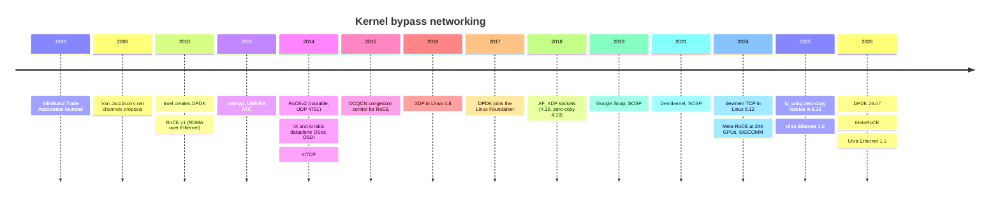
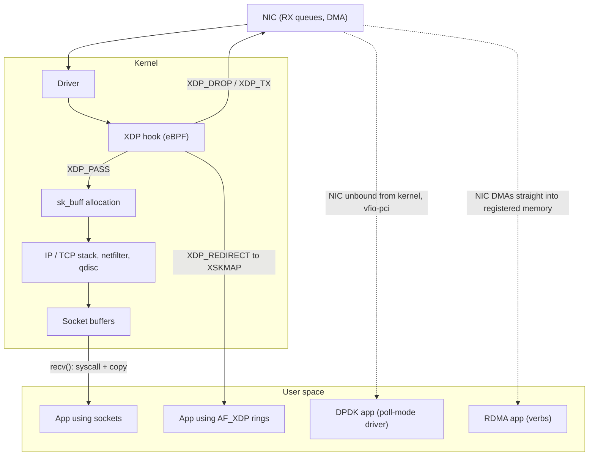
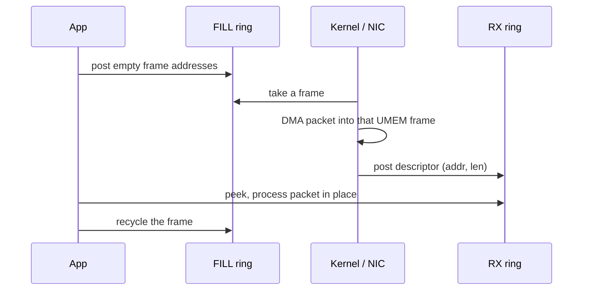

---
tags:
  - operating-systems
  - networking
  - kernel-bypass
  - dpdk
  - xdp
  - rdma
  - io
status: draft
sources:
  - https://lwn.net/Articles/629155/
  - https://www.redhat.com/en/blog/pushing-limits-kernel-networking
  - https://www.usenix.org/conference/atc12/technical-sessions/presentation/rizzo
  - https://www.usenix.org/conference/nsdi14/technical-sessions/presentation/jeong
  - https://doc.dpdk.org/guides-25.11/prog_guide/ethdev/ethdev.html
  - https://doc.dpdk.org/guides-20.11/linux_gsg/sys_reqs.html
  - https://doc.dpdk.org/guides/prog_guide/ring_lib.html
  - https://courses.grainger.illinois.edu/ece598hpn/fa2023/papers/xdp.pdf
  - https://kernelnewbies.org/Linux_4.8
  - https://docs.kernel.org/networking/af_xdp.html
  - https://lwn.net/Articles/750845/
  - https://man7.org/linux/man-pages/man3/ibv_post_send.3.html
  - https://en.wikipedia.org/wiki/RDMA_over_Converged_Ethernet
  - https://en.wikipedia.org/wiki/InfiniBand
  - https://www.microsoft.com/en-us/research/publication/congestion-control-for-large-scale-rdma-deployments/
  - https://lwn.net/Articles/169961/
  - https://www.linuxfoundation.org/press/press-release/networking-industry-leaders-join-forces-to-expand-new-open-source-community-to-drive-development-of-the-dpdk-project
  - https://www.dpdk.org/dpdk-at-15-from-intels-internal-experiment-to-open-source-foundation/
  - https://usenix.org/conference/osdi14/technical-sessions/presentation/belay
  - https://www.usenix.org/node/186141
  - https://research.google/pubs/pub48630/
  - https://courses.grainger.illinois.edu/ece598hpn/fa2023/papers/snap.pdf
  - https://homes.cs.washington.edu/~patelp1/papers/demikernel-sosp21.pdf
  - https://github.com/Xilinx-CNS/onload
  - https://raw.githubusercontent.com/F-Stack/f-stack/dev/README.md
  - https://docs.kernel.org/6.12/networking/devmem.html
  - https://docs.kernel.org/networking/iou-zcrx.html
  - https://kernelnewbies.org/Linux_6.12
  - https://kernelnewbies.org/Linux_6.15
  - https://qmonnet.github.io/whirl-offload/2023/11/05/dyk-prog-size-limit
  - https://mails.dpdk.org/archives/dev/2025-November/328799.html
  - https://mails.dpdk.org/archives/dev/2026-July/342093.html
  - https://core.dpdk.org/roadmap
  - https://netdevconf.info/0x1A/sessions/talk/io_uring-zcrx-progress-and-next-steps.html
  - https://netdevconf.info/0x1A/docs/netdev-0x1a-paper41-talk-paper.pdf
  - https://www.linuxfoundation.org/press/uec-launches-spec-1.0
  - https://ultraethernet.org/specification
  - https://www.networkworld.com/article/4235340/ultra-ethernet-1-1-extends-the-specification-to-scale-up-networks-and-adds-programmable-congestion-control.html
  - https://engineering.fb.com/wp-content/uploads/2024/08/sigcomm24-final246.pdf
  - https://engineering.fb.com/2026/08/24/networking-traffic/metaroce-rdma-transport-ai-ethernet/
  - https://www.delloro.com/news/ethernet-extends-lead-in-ai-scale-out-networks-despite-strong-infiniband-rebound/
  - https://blogs.nvidia.com/blog/bluefield-4-ai-factory/
  - https://www.servethehome.com/nvidia-bluefield-4-processor-at-hot-chips-2026/
created: 2026-11-26
updated: 2026-11-26
---

## Table Of Contents

---

- [[#TL;DR|TL;DR]]
- [[#The Problem|The Problem]]
- [[#Foundations|Foundations]]
    - [[#The Per-Packet Budget|The Per-Packet Budget]]
    - [[#Where the Kernel Spends It|Where the Kernel Spends It]]
    - [[#Four Tricks Every Bypass Uses|Four Tricks Every Bypass Uses]]
- [[#How We Got Here|How We Got Here]]
- [[#How It Works|How It Works]]
    - [[#DPDK: Take the NIC Away From the Kernel|DPDK: Take the NIC Away From the Kernel]]
    - [[#XDP: Run Code Before the Stack|XDP: Run Code Before the Stack]]
    - [[#AF_XDP: A Fast Lane to User Space|AF_XDP: A Fast Lane to User Space]]
    - [[#RDMA: Let the NIC Read and Write Memory|RDMA: Let the NIC Read and Write Memory]]
    - [[#User-Space Stacks and Dataplane OSes|User-Space Stacks and Dataplane OSes]]
    - [[#Partial Bypass: Keep TCP, Skip the Copy|Partial Bypass: Keep TCP, Skip the Copy]]
    - [[#Choosing One|Choosing One]]
- [[#Where It Is Now|Where It Is Now]]
- [[#Trade-offs & Open Problems|Trade-offs & Open Problems]]
- [[#Resources|Resources]]
- [[#Related Notes|Related Notes]]

## ***TL;DR***
---
*Kernel bypass networking moves packet processing out of the kernel's general-purpose network stack, either into user space (DPDK, AF_XDP, RDMA) or into a tiny program run at the driver (XDP). It exists because at 100 Gbps and above the kernel's per-packet costs (system calls, interrupts, allocation, copies, locks) are larger than the time between packets.*

- **The budget.** On 10G, minimum-size packets arrive every **67.2 ns** (14.88 Mpps); on 100G every **6.72 ns**. A single cache miss costs about 32 ns ([LWN, 2015](https://lwn.net/Articles/629155/)). The stock kernel forwards about **1–2 Mpps per core**.
- **The tricks.** Poll instead of interrupts, process in batches, preallocate buffers, share memory between NIC and application so nothing is copied, and give each core its own queue so nothing is locked.
- **The main options.**
    - **DPDK:** the NIC is handed to a user-space poll-mode driver. Fastest per core (about 43.5 Mpps dropping packets), but burns cores and loses the kernel's tools.
    - **XDP:** an [[eBPF]] program runs in the driver before any socket buffer exists. About 24 Mpps per core, and stays inside the kernel's security model.
    - **AF_XDP:** XDP redirects chosen packets into shared rings that a user process reads, with zero copies.
    - **RDMA:** the NIC itself reads and writes remote memory; the CPU on the far side isn't involved. The fabric of AI training clusters (RoCEv2, InfiniBand).
- **The trend in 2026.** *Partial* bypass inside Linux ([[io_uring]] zero-copy receive, devmem TCP) keeps TCP and kernel tooling but removes the copy, while AI fabrics push RDMA toward new transports (Ultra Ethernet 1.1, Meta's MetaRoCE) that spray packets and drop lossless-Ethernet requirements.

## ***The Problem***
---
*The Linux network stack is built for generality: every protocol, firewall rule, socket option and tool works on every packet. That generality costs hundreds of nanoseconds per packet, and network links have grown faster than CPU cores.*

A packet through the normal path takes an interrupt ([[Interrupts and Exceptions]]), gets an `sk_buff` allocated for it ([[Memory Allocators]]), passes through queueing disciplines, netfilter and the protocol stack under several locks, and is finally copied into the application's buffer when it calls `recv()` across the [[System Calls and the User-Kernel Boundary|system-call boundary]]. Each step is reasonable; together they don't fit.

Measured costs from Jesper Brouer's analysis ([LWN, Jan 2015](https://lwn.net/Articles/629155/)):

| Operation | Cost |
|---|---|
| System call | ~42 ns (~75 ns with SELinux and auditing) |
| Cache miss | ~32 ns |
| Atomic (`LOCK`-prefixed) instruction | ~8.25 ns |
| Spinlock lock + unlock | ~16 ns |
| Slab alloc + free | ~19 ns alone, ~77 ns inside the real stack |
| qdisc locking per packet (6 atomics) | ~48 ns |
| Size of an `sk_buff` | 4 cache lines |

Red Hat measured the result: kernel routing at about **1.2–1.6 Mpps on one CPU**, needing about 9 CPUs to approach 10G line rate ([Red Hat, 2015](https://www.redhat.com/en/blog/pushing-limits-kernel-networking)). For TCP, connection handling alone ate 70–80% of CPU cycles in mTCP's measurements ([NSDI 2014](https://www.usenix.org/conference/nsdi14/technical-sessions/presentation/jeong)). Links went from 10G to 400G; single-core speed did not go up 40x.

## ***Foundations***
---
*Every kernel-bypass design starts from the same arithmetic (how many nanoseconds you get per packet) and the same diagnosis of where the kernel spends them. The designs differ only in which costs they remove and what they give up to do it.*

### The Per-Packet Budget

*At line rate with small packets, the time between packets is shorter than a handful of memory accesses.*

$$
t_{\text{pkt}} = \frac{(64 + 20)\ \text{bytes} \times 8\ \text{bits/byte}}{\text{link rate}}
$$

**In plain English:** a minimum Ethernet frame is 64 bytes, plus 20 bytes of preamble and inter-frame gap that still occupy the wire. Divide those 672 bits by the link speed to get how long you have before the next packet arrives.

| Link | Packets per second | Time per packet | Cycles at 3 GHz |
|---|---|---|---|
| 10G | 14.88 M | 67.2 ns | ~200 |
| 100G | 148.8 M | 6.72 ns | ~20 |
| 400G | 595 M | 1.68 ns | ~5 |

**Worked example.** One core dropping packets in the kernel's earliest netfilter hook manages 4.8 Mpps, about 208 ns per packet ([XDP paper](https://courses.grainger.illinois.edu/ece598hpn/fa2023/papers/xdp.pdf)). To drop a 100G flood of 148.8 Mpps you'd need $148.8 / 4.8 \approx 31$ cores. With XDP (24 Mpps per core) it's about 6.2 cores; with DPDK (43.5 Mpps) about 3.4. Real traffic has larger packets, so real budgets are looser, but DDoS floods and packet processors (load balancers, firewalls, routers) do see small packets at line rate.

### Where the Kernel Spends It

*netmap's 2012 diagnosis still holds: per-packet allocation, per-packet system calls and per-packet copies.*

Luigi Rizzo named three costs ([netmap, ATC 2012](https://www.usenix.org/conference/atc12/technical-sessions/presentation/rizzo)):

1. **Dynamic allocation** of a buffer and metadata for every packet.
2. **System call overhead**, paid per packet or per small batch.
3. **Memory copies** between kernel and user buffers.

Add two more from the LWN analysis: **interrupts** (a context switch per packet or per small burst) and **locking and atomics** on shared queues.

### Four Tricks Every Bypass Uses

*Remove the cost, don't optimise it: preallocate, batch, share memory, and give every core private queues.*

| Trick | Removes | How |
|---|---|---|
| **Polling** | Interrupt and wake-up cost | A core spins reading the NIC's descriptor ring |
| **Batching** | Per-packet call overhead | Receive and transmit 32+ packets per call |
| **Preallocated, shared buffers** | Allocation and copies | A fixed pool of buffers the NIC DMAs into and the app reads in place; [[Virtual Memory and Paging|huge pages]] keep TLB misses down |
| **Per-core queues** | Locks and cache-line bouncing | NIC hashes flows to hardware queues (RSS); each queue owned by one core |

With these, netmap moved 14.88 Mpps on a single 900 MHz core, more than 20x the conventional socket API ([ATC 2012](https://www.usenix.org/conference/atc12/technical-sessions/presentation/rizzo)).

## ***How We Got Here***
---
*Bypass has two family trees: HPC interconnects that let the NIC write memory directly (InfiniBand, RDMA), and Ethernet packet processing that pulled the NIC into user space (netmap, DPDK) and then back toward the kernel (XDP, AF_XDP, io_uring zero-copy).*



- **2006, net channels.** Van Jacobson proposed lockless rings that move packet processing toward the application; his prototype used 14% CPU against a 50% baseline ([LWN](https://lwn.net/Articles/169961/)). Linux didn't adopt it, but every later design reuses the idea.
- **2010–2017, DPDK.** Intel built DPDK internally in 2010, moved development to dpdk.org around 2013–2014, and handed it to the Linux Foundation in April 2017 ([Linux Foundation](https://www.linuxfoundation.org/press/press-release/networking-industry-leaders-join-forces-to-expand-new-open-source-community-to-drive-development-of-the-dpdk-project); [DPDK at 15](https://www.dpdk.org/dpdk-at-15-from-intels-internal-experiment-to-open-source-foundation/)). DPDK's own retrospective says early versions ran about 10x faster than the kernel stack, later about 40x.
- **2014, the research dataplanes.** IX and Arrakis (both OSDI 2014 best papers) argued the OS should become a *control plane* that sets up protected hardware queues and then gets out of the way. IX reported up to 3.6x key-value throughput; Arrakis 2–5x lower latency ([IX](https://usenix.org/conference/osdi14/technical-sessions/presentation/belay); [Arrakis](https://www.usenix.org/node/186141)). This is the exokernel idea from [[Kernel Architectures]] applied to networking.
- **2016–2018, the kernel answers.** Instead of losing fast networking to user space, Linux added XDP (4.8, October 2016, [kernelnewbies](https://kernelnewbies.org/Linux_4.8)) and AF_XDP (4.18, 2018; [LWN](https://lwn.net/Articles/750845/)).
- **RDMA's parallel line.** InfiniBand dates from the 1999 merger of two I/O standards efforts ([Wikipedia](https://en.wikipedia.org/wiki/InfiniBand)). RoCE (2010) and the routable RoCEv2 (2014) brought the same verbs to Ethernet ([Wikipedia](https://en.wikipedia.org/wiki/RDMA_over_Converged_Ethernet)), which needed new congestion control (DCQCN, SIGCOMM 2015) once Microsoft ran it at datacentre scale.

## ***How It Works***
---
*Each mechanism moves the line between kernel and application to a different place: DPDK removes the kernel entirely, XDP runs a small program inside it, AF_XDP shares rings across it, and RDMA moves the work into the NIC.*



### DPDK: Take the NIC Away From the Kernel

*DPDK unbinds the NIC from its kernel driver, maps its registers and queues into a user process through VFIO, and drives it from a core that does nothing but poll.*

- **Poll-mode drivers (PMDs)** read and write the NIC's descriptor rings directly, with no interrupts except for link changes. Each RX queue is polled by exactly one core ("lcore"), so the API is lock-free; calls are burst-oriented to spread overhead ([DPDK ethdev guide](https://doc.dpdk.org/guides-25.11/prog_guide/ethdev/ethdev.html)).
- **Two app models:** *run-to-completion* (one core receives, processes, transmits) or *pipeline* (cores pass packets to each other over rings).
- **Hugepages** (2 MB or 1 GB) back the packet buffer pools so the NIC's DMA targets and the app's accesses hit few TLB entries; pages are reserved per NUMA node, ideally at boot ([DPDK system requirements](https://doc.dpdk.org/guides-20.11/linux_gsg/sys_reqs.html)).
- **`rte_ring`** is a fixed-size lockless FIFO that needs one 32-bit compare-and-swap per operation (a linked-list queue needs several), with single- and multi-producer/consumer modes ([ring library](https://doc.dpdk.org/guides/prog_guide/ring_lib.html)). It also backs the buffer pool (mempool).

The heart of every DPDK app is a loop like this:

```c
for (;;) {
    uint16_t n = rte_eth_rx_burst(port, queue, bufs, 32);  /* up to 32 packets, no syscall */
    for (uint16_t i = 0; i < n; i++)
        process(bufs[i]);                                  /* touch packet in place */
    uint16_t sent = rte_eth_tx_burst(port, queue, bufs, n);
    while (sent < n)
        rte_pktmbuf_free(bufs[sent++]);                    /* return unsent buffers to the pool */
}
```

**In plain words:** ask the NIC's ring for up to 32 packets; it returns immediately, with zero if nothing arrived. Process them where the NIC put them, hand them back to the transmit ring, and free any the ring had no room for. The core runs at 100% even when idle; that is the price of never sleeping.

### XDP: Run Code Before the Stack

*XDP runs a verified eBPF program in the driver "at the earliest possible moment" after a packet arrives, before an `sk_buff` exists, and lets it decide the packet's fate.*

The program returns one of five verdicts ([XDP paper, CoNEXT 2018](https://courses.grainger.illinois.edu/ece598hpn/fa2023/papers/xdp.pdf)):

| Action | Effect |
|---|---|
| `XDP_DROP` | Discard now; cheapest possible drop (DDoS filtering) |
| `XDP_TX` | Send back out the same NIC (load balancers) |
| `XDP_PASS` | Continue into the normal stack |
| `XDP_REDIRECT` | Send to another NIC, another CPU, or an AF_XDP socket |
| `XDP_ABORTED` | Error path; drop and trace |

```c
SEC("xdp")
int drop_udp(struct xdp_md *ctx) {
    void *data = (void *)(long)ctx->data, *end = (void *)(long)ctx->data_end;
    struct ethhdr *eth = data;
    if ((void *)(eth + 1) > end) return XDP_PASS;          /* verifier demands bounds checks */
    if (eth->h_proto != bpf_htons(ETH_P_IP)) return XDP_PASS;
    struct iphdr *ip = (void *)(eth + 1);
    if ((void *)(ip + 1) > end) return XDP_PASS;
    return ip->protocol == IPPROTO_UDP ? XDP_DROP : XDP_PASS;
}
```

**In plain words:** look at the raw packet bytes the NIC just wrote; every pointer must be checked against the end of the packet or the [[eBPF]] verifier refuses to load the program. Drop UDP, pass everything else. Load it with `ip link set dev eth0 xdp obj prog.o`. XDP needs no special hardware and works alongside the normal stack ([kernelnewbies 4.8](https://kernelnewbies.org/Linux_4.8)), so unmatched traffic keeps every kernel feature.

### AF_XDP: A Fast Lane to User Space

*AF_XDP is the kernel's own DPDK-style path: an XDP program redirects selected packets into memory the application owns, and four shared rings pass buffer ownership back and forth without copies or per-packet system calls.*

From the [kernel docs](https://docs.kernel.org/networking/af_xdp.html):

- **UMEM:** a region the application allocates and splits into equal frames. The NIC DMAs packets straight into it in zero-copy mode.
- **Four single-producer/single-consumer rings:**

| Ring | Producer → consumer | Carries |
|---|---|---|
| FILL | app → kernel | Empty frames for the NIC to receive into |
| RX | kernel → app | Descriptors of received packets |
| TX | app → kernel | Packets to send |
| COMPLETION | kernel → app | Frames whose transmission finished |

- An AF_XDP socket binds to one NIC queue; an XDP program sends packets to it via an `XSKMAP`. With no program loaded, nothing arrives.
- `XDP_USE_NEED_WAKEUP` means the app makes a system call only when the kernel flags that it needs a kick, so a busy socket runs with almost none.



### RDMA: Let the NIC Read and Write Memory

*RDMA moves the whole transport into the NIC: the application posts work requests describing memory to read or write, and the NIC moves the bytes, possibly into a remote machine's memory without its CPU noticing.*

From the [`ibv_post_send` man page](https://man7.org/linux/man-pages/man3/ibv_post_send.3.html):

- **Queue pairs (QPs)** hold send and receive work queues; finished work appears on a **completion queue (CQ)** the app polls.
- **Memory registration** (`ibv_reg_mr`) pins a buffer and gives it keys: an `lkey` for local use, an `rkey` a peer needs to access it remotely.
- **Two-sided ops:** `SEND` matches a `RECV` the receiver posted earlier, like a message.
- **One-sided ops:** `RDMA_WRITE`, `RDMA_READ` and atomics (`CMP_AND_SWP`, `FETCH_AND_ADD`) act on remote memory given its address and `rkey`. The remote CPU runs no code.

```c
struct ibv_send_wr wr = {
    .opcode = IBV_WR_RDMA_WRITE,
    .sg_list = &local_sge, .num_sge = 1,       /* local buffer + lkey */
    .send_flags = IBV_SEND_SIGNALED,           /* ask for a completion */
    .wr.rdma = { .remote_addr = raddr, .rkey = rkey },
};
ibv_post_send(qp, &wr, &bad_wr);               /* rings a doorbell, no kernel entry */
while (ibv_poll_cq(cq, 1, &wc) == 0) ;         /* spin until the NIC reports done */
```

**Transports.** *InfiniBand* is its own fabric. *RoCEv2* carries the same verbs over UDP/IP on port **4791**, so it routes across ordinary Ethernet, but it wants a lossless network via Priority Flow Control (PFC), which can cause head-of-line blocking and deadlocks ([Wikipedia](https://en.wikipedia.org/wiki/RDMA_over_Converged_Ethernet)). DCQCN added ECN-based congestion control to tame this ([SIGCOMM 2015](https://www.microsoft.com/en-us/research/publication/congestion-control-for-large-scale-rdma-deployments/)). RDMA is the backbone of [[GPU Cluster Infrastructure]] and [[Distributed Training]].

### User-Space Stacks and Dataplane OSes

*Raw packets are not enough for most apps; they need TCP. A family of systems puts a full stack in user space on top of DPDK or RDMA.*

| System | Approach | Notable numbers |
|---|---|---|
| **mTCP** (NSDI 2014) | User-space TCP on fast packet I/O | ~25x Linux for small transactions ([NSDI](https://www.usenix.org/conference/nsdi14/technical-sessions/presentation/jeong)) |
| **F-Stack** (Tencent) | FreeBSD's TCP/IP stack ported onto DPDK | Claims 10M concurrent connections, 5M requests/s ([README](https://raw.githubusercontent.com/F-Stack/f-stack/dev/README.md)) |
| **Onload** (AMD Solarflare) | Intercepts BSD socket calls; unmodified apps go faster; `ef_vi` for raw access | Binary-compatible ([repo](https://github.com/Xilinx-CNS/onload)) |
| **Snap** (Google, SOSP 2019) | Networking as a user-space "microkernel" service with schedulable engines | On over half of Google's machines; 5M ops/s per core vs <100K for gRPC ([paper](https://courses.grainger.illinois.edu/ece598hpn/fa2023/papers/snap.pdf)) |
| **Demikernel** (SOSP 2021) | Rust library OS with one API over DPDK and RDMA backends | ~50 ns overhead per I/O ([paper](https://homes.cs.washington.edu/~patelp1/papers/demikernel-sosp21.pdf)) |

These are the [[Unikernels and Library OSes|library OS]] idea in practice: the OS sets up hardware, then the app links its own stack.

### Partial Bypass: Keep TCP, Skip the Copy

*Newer Linux features keep the kernel's TCP and its tooling but stop copying payloads, by having the NIC split headers from data and steer the data straight to its final buffer.*

- **devmem TCP (Linux 6.12, Nov 2024):** payloads land in a dmabuf, e.g. GPU memory, while headers go to host memory for the kernel's TCP. Needs NIC header split and flow steering; the app reads with `recvmsg(MSG_SOCK_DEVMEM)`. Payloads are invisible to tcpdump and BPF ([kernel docs](https://docs.kernel.org/6.12/networking/devmem.html)).
- **io_uring zero-copy receive, "zcrx" (Linux 6.15, May 2025):** the same split, but payloads land in user memory, and buffers come back to the kernel through a refill ring. Set up with `io_uring_register_ifq()` and `IORING_OP_RECV_ZC` ([kernel docs](https://docs.kernel.org/networking/iou-zcrx.html)). See [[io_uring]].

### Choosing One

*Pick by what you're willing to give up: tooling, cores, or generality.*

| | Kernel sockets | XDP | AF_XDP | DPDK | RDMA |
|---|---|---|---|---|---|
| Per-core drop rate | 4.8 Mpps | 24 Mpps | near DPDK | 43.5 Mpps | n/a (NIC does it) |
| Keeps kernel tools and security model | Yes | Yes | Partly | No | Partly |
| Dedicated spinning cores | No | No | Optional | Yes | Optional |
| Full TCP | Yes | No | No (bring your own) | No (bring your own) | Own transport |
| Typical use | Everything | DDoS, load balancing | Packet processing, NFV | Telco, NFV, appliances | Storage, AI training |

Drop rates from the [XDP paper](https://courses.grainger.illinois.edu/ece598hpn/fa2023/papers/xdp.pdf).

## ***Where It Is Now***
---
*As of November 2026, DPDK is steady infrastructure, the kernel's own zero-copy paths are maturing, and the action has moved to RDMA for AI clusters, where new Ethernet transports are replacing lossless-fabric designs.*

**DPDK.** 25.11 (November 2025) is the current long-term release, supported for three years ([announcement](https://mails.dpdk.org/archives/dev/2025-November/328799.html)). 26.07 (July 2026, 868 commits from 132 authors) added a selective-Rx API, a hardened BPF validator and RISC-V vector paths ([announcement](https://mails.dpdk.org/archives/dev/2026-July/342093.html)). 26.11 was scheduled for 25 November 2026 and was at its second release candidate as of that week ([roadmap](https://core.dpdk.org/roadmap)).

**io_uring zcrx.** At Netdev 0x1A (July 2026) Pavel Begunkov covered refill-queue exhaustion, sharing one NIC queue between processes, and memory-pressure signalling ([talk](https://netdevconf.info/0x1A/sessions/talk/io_uring-zcrx-progress-and-next-steps.html)). On 200G NICs, moving from 4 KB to 32 KB receive pages cut CPU use by about 40% ([paper](https://netdevconf.info/0x1A/docs/netdev-0x1a-paper41-talk-paper.pdf)). The pitch is explicit: line-rate receive *without* giving up the Linux stack.

**RDMA for AI.**

- **Ethernet is winning.** Ethernet made up more than two-thirds of AI scale-out switch sales in 2025 and held about two-thirds in Q1 2026, though InfiniBand sales tripled with 800G upgrades ([Dell'Oro, Jun 2026](https://www.delloro.com/news/ethernet-extends-lead-in-ai-scale-out-networks-despite-strong-infiniband-rebound/)).
- **Meta's path.** Meta ran RoCEv2 on 24K-GPU clusters (Llama 3 trained on 16K GPUs) and turned DCQCN *off* at 400G, relying on PFC plus admission control in the collective library ([SIGCOMM 2024](https://engineering.fb.com/wp-content/uploads/2024/08/sigcomm24-final246.pdf)). In August 2026 it described **MetaRoCE**, a new transport that keeps the verbs API but sprays packets across paths, accepts out-of-order delivery straight into memory, uses selective acks per path and needs **no PFC**; it keeps about 86% throughput at 1% loss ([Meta, Aug 2026](https://engineering.fb.com/2026/08/24/networking-traffic/metaroce-rdma-transport-ai-ethernet/)).
- **Ultra Ethernet.** Spec 1.0 (June 2025) defined a new transport for AI and HPC over Ethernet with multipath spraying, new congestion control and a libfabric API ([Linux Foundation](https://www.linuxfoundation.org/press/uec-launches-spec-1.0)). Version 1.1 (12 October 2026) added a scale-up profile for lossless links, programmable congestion control, in-network collectives and a verbs mapping ([UEC](https://ultraethernet.org/specification); [Network World](https://www.networkworld.com/article/4235340/ultra-ethernet-1-1-extends-the-specification-to-scale-up-networks-and-adds-programmable-congestion-control.html)).

**DPUs.** The other route is to put a whole computer on the NIC. NVIDIA's BlueField-4 (announced October 2025) pairs a Grace CPU with an 800 Gb/s ConnectX-9; at Hot Chips 2026 it was shown with 64 Neoverse V2 cores and NVMe-over-Fabrics at 1.6 Tb/s on 8 cores ([NVIDIA](https://blogs.nvidia.com/blog/bluefield-4-ai-factory/); [ServeTheHome, Aug 2026](https://www.servethehome.com/nvidia-bluefield-4-processor-at-hot-chips-2026/)). Here the "bypassed" stack runs on the DPU, isolated from the host. Compare [[Disaggregated Systems]].

## ***Trade-offs & Open Problems***
---
*Bypass trades generality, safety and efficiency at low load for speed at high load. The long-running direction is to win back the kernel's benefits without paying its per-packet costs.*

| You gain | You give up |
|---|---|
| Line-rate small-packet processing on few cores | Cores spinning at 100% even when idle (DPDK, polled RDMA) |
| Microsecond latency | tcpdump, iptables, `ss`, BPF tracing: they can't see bypassed traffic |
| No copies | Huge pages, pinned memory, NIC-specific setup (header split, flow steering) |
| Custom stacks tuned to the app | Re-implementing TCP, security and isolation yourself |

**Open problems.**

- **Polling vs efficiency.** Snap's options show the bind: dedicated spinning cores can't shrink with load; interrupt-driven "spreading" pays wake-up latency; "compacting" reacts slowly to bursts ([Snap](https://courses.grainger.illinois.edu/ece598hpn/fa2023/papers/snap.pdf)). This interacts with [[CPU Scheduling]].
- **Safety.** DPDK gives a process raw device access (contained by VFIO and the IOMMU); XDP keeps safety through the [[eBPF]] verifier, whose limits (1M verified instructions for privileged programs, 4,096 unprivileged) cap program complexity ([qmonnet](https://qmonnet.github.io/whirl-offload/2023/11/05/dyk-prog-size-limit)).
- **RDMA congestion control.** PFC brings head-of-line blocking and deadlocks; DCQCN proved hard to tune at 400G. MetaRoCE and Ultra Ethernet bet on spraying and new congestion control instead; which wins is open.
- **Portability.** Every bypass API is different. Demikernel's unified API costs 17–26% of peak throughput against raw APIs ([paper](https://homes.cs.washington.edu/~patelp1/papers/demikernel-sosp21.pdf)).
- **Observability.** As more bytes skip the kernel (devmem, zcrx, DPUs), debugging needs new tools; zcrx's design keeps headers in the kernel partly for this reason.
- **Virtualized NICs.** Bypass inside VMs depends on SR-IOV and passthrough; see [[Virtualization and Hypervisors]].

## ***Resources***
---
*Read LWN's 2015 analysis for the cost model, the netmap and XDP papers for the two design philosophies, and the kernel's AF_XDP and zcrx docs for where Linux is heading. Meta's papers show RDMA at AI scale.*

**Cost model and foundations**
- [Improving Linux networking performance](https://lwn.net/Articles/629155/): LWN, Jan 2015.
- [Pushing the limits of kernel networking](https://www.redhat.com/en/blog/pushing-limits-kernel-networking): Red Hat, Sep 2015.
- [Van Jacobson's network channels](https://lwn.net/Articles/169961/): LWN, Jan 2006.
- [netmap: a novel framework for fast packet I/O](https://www.usenix.org/conference/atc12/technical-sessions/presentation/rizzo): Rizzo, USENIX ATC 2012.

**Papers**
- [The eXpress Data Path](https://courses.grainger.illinois.edu/ece598hpn/fa2023/papers/xdp.pdf): Høiland-Jørgensen et al., CoNEXT 2018.
- [IX: A Protected Dataplane OS](https://usenix.org/conference/osdi14/technical-sessions/presentation/belay): Belay et al., OSDI 2014.
- [Arrakis: The OS is the Control Plane](https://www.usenix.org/node/186141): Peter et al., OSDI 2014.
- [mTCP](https://www.usenix.org/conference/nsdi14/technical-sessions/presentation/jeong): Jeong et al., NSDI 2014.
- [Snap: a Microkernel Approach to Host Networking](https://research.google/pubs/pub48630/): Marty et al., SOSP 2019.
- [The Demikernel Datapath OS](https://homes.cs.washington.edu/~patelp1/papers/demikernel-sosp21.pdf): Zhang et al., SOSP 2021.
- [Congestion Control for Large-Scale RDMA Deployments](https://www.microsoft.com/en-us/research/publication/congestion-control-for-large-scale-rdma-deployments/): Zhu et al., SIGCOMM 2015.
- [RDMA over Ethernet for Distributed AI Training at Meta Scale](https://engineering.fb.com/wp-content/uploads/2024/08/sigcomm24-final246.pdf): Gangidi et al., SIGCOMM 2024.

**Docs**
- [AF_XDP](https://docs.kernel.org/networking/af_xdp.html), [io_uring zero copy Rx](https://docs.kernel.org/networking/iou-zcrx.html), [Device Memory TCP](https://docs.kernel.org/6.12/networking/devmem.html): kernel.org.
- [DPDK ethdev / PMD guide](https://doc.dpdk.org/guides-25.11/prog_guide/ethdev/ethdev.html) and [ring library](https://doc.dpdk.org/guides/prog_guide/ring_lib.html): dpdk.org.
- [ibv_post_send(3)](https://man7.org/linux/man-pages/man3/ibv_post_send.3.html): rdma-core.

**Where it is now**
- [MetaRoCE](https://engineering.fb.com/2026/08/24/networking-traffic/metaroce-rdma-transport-ai-ethernet/): Meta Engineering, Aug 2026.
- [Evolution of io_uring Zero-Copy Receive](https://netdevconf.info/0x1A/docs/netdev-0x1a-paper41-talk-paper.pdf): Begunkov, Netdev 0x1A, 2026.
- [Ultra Ethernet specifications](https://ultraethernet.org/specification): UEC.

## Related Notes

- [[eBPF]] — The verified in-kernel programs XDP runs.
- [[io_uring]] — Asynchronous I/O and its zero-copy receive path.
- [[Interrupts and Exceptions]] — The per-packet interrupt cost polling avoids.
- [[System Calls and the User-Kernel Boundary]] — The per-call cost batching and shared rings avoid.
- [[Memory Allocators]] — The slab allocations behind every `sk_buff`.
- [[Virtual Memory and Paging]] — Huge pages, pinning and the IOMMU.
- [[CPU Scheduling]] — Why dedicated polling cores fight the scheduler.
- [[Kernel Architectures]] — Exokernels and "the OS as control plane".
- [[Unikernels and Library OSes]] — User-space stacks as library OSes.
- [[Locks and Synchronization]] — The atomics and locks per-core queues avoid.
- [[Virtualization and Hypervisors]] — SR-IOV and VFIO for bypass inside VMs.
- [[GPU Cluster Infrastructure]] — RDMA fabrics in AI clusters.
- [[Distributed Training]] — The collective traffic RDMA carries.
- [[Disaggregated Systems]] — DPUs and moving work off the host.
- [[TCP]] — The protocol user-space stacks reimplement.
