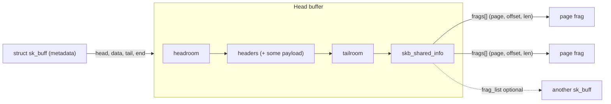
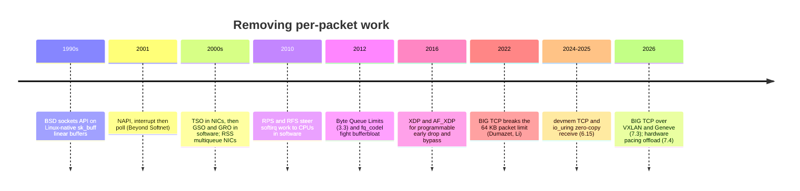
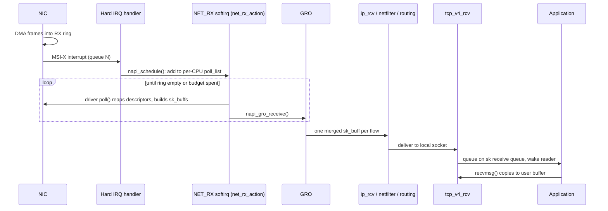
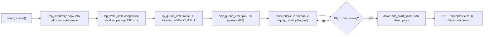

---
tags:
  - operating-systems
  - networking
  - linux
  - sk_buff
  - napi
  - gro
  - gso
  - tcp
status: complete
sources:
  - https://docs.kernel.org/networking/skbuff.html
  - https://docs.kernel.org/networking/segmentation-offloads.html
  - https://docs.kernel.org/6.6/networking/scaling.html
  - https://kernel.org/doc/html/v6.17/admin-guide/sysctl/net.html
  - https://docs.kernel.org/7.3/networking/devmem.html
  - https://www.linuxjournal.com/node/1312
  - https://www.linuxjournal.com/content/queueing-linux-network-stack
  - https://blog.packagecloud.io/illustrated-guide-monitoring-tuning-linux-networking-stack-receiving-data
  - https://lwn.net/SubscriberLink/884104/89d8ccf8f52ad9dc
  - https://www.usenix.org/conference/als-01/beyond-softnet
  - https://netdevconf.org/0x1A/docs/netdev-0x1a-paper40-talk-slides/State%20of%20the%20union%20in%20TCP%20land%20in%202026%20-%20Google%20Slides.pdf
  - https://lkml.iu.edu/2606.2/01922.html
  - https://phoronix.com/news/Linux-7.3-Networking
  - https://phoronix.com/news/Linux-7.4-Networking
created: 2026-11-26
updated: 2026-11-26
---

## Table Of Contents

---

- [[#TL;DR|TL;DR]]
- [[#The Problem|The Problem]]
- [[#Foundations|Foundations]]
    - [[#The sk_buff|The sk_buff]]
    - [[#Sockets, Protocols and Devices|Sockets, Protocols and Devices]]
- [[#How We Got Here|How We Got Here]]
- [[#How It Works|How It Works]]
    - [[#The Receive Path|The Receive Path]]
    - [[#Spreading Work Across CPUs|Spreading Work Across CPUs]]
    - [[#The Transmit Path|The Transmit Path]]
    - [[#Batching: GRO, GSO and TSO|Batching: GRO, GSO and TSO]]
    - [[#TCP in the Kernel|TCP in the Kernel]]
- [[#Where It Is Now|Where It Is Now]]
- [[#Trade-offs & Open Problems|Trade-offs & Open Problems]]
- [[#Resources|Resources]]
- [[#Related Notes|Related Notes]]

## ***TL;DR***

---

*The Linux networking stack moves packets between a NIC's DMA rings and sockets. Its whole design is about paying the per-packet cost (interrupts, allocation, header parsing, locks) as few times as possible: poll instead of interrupt (NAPI), handle many packets as one (GRO, GSO, TSO, BIG TCP), and keep each flow on one CPU (RSS, RPS, RFS, XPS).*

- **`sk_buff`:** the metadata structure for one packet. It "does not hold any packet data"; it points at a head buffer plus optional page fragments, and clones share data instead of copying it ([kernel docs](https://docs.kernel.org/networking/skbuff.html)).
- **Receive:** NIC DMA, one interrupt, then a NAPI poll in softirq context pulls a batch from the ring, GRO merges segments, and IP and TCP hand the data to a socket queue ([packagecloud](https://blog.packagecloud.io/illustrated-guide-monitoring-tuning-linux-networking-stack-receiving-data)).
- **Transmit:** TCP builds big segments, a queueing discipline (qdisc) orders them, Byte Queue Limits keep the driver ring short, and the NIC or GSO cuts them to MTU size ([Linux Journal](https://www.linuxjournal.com/content/queueing-linux-network-stack)).
- **Late 2026:** BIG TCP now works over VXLAN and Geneve (7.3), NICs can own packet pacing (7.4), payloads can land straight in GPU memory (devmem TCP), and the global RTNL lock keeps shrinking, while maintainers say they are "completely overwhelmed" by AI-generated patches ([Phoronix](https://phoronix.com/news/Linux-7.3-Networking)).

## ***The Problem***

---

*A 100 Gb/s NIC delivers a packet every few hundred nanoseconds, roughly the cost of a few cache misses. A stack that does any real work per packet cannot keep up, so the problem is how to give every packet full TCP/IP semantics while doing the expensive parts per batch.*

Line rate turns into a per-packet time budget. On Ethernet, each 1,500-byte frame occupies 1,538 bytes of wire time (14-byte header, 4-byte FCS, 8-byte preamble, 12-byte inter-frame gap):

$$\text{packets/s} = \frac{\text{link rate}}{8 \times 1538}, \qquad \text{budget per packet} = \frac{1}{\text{packets/s}}$$

In words: divide the link speed in bits by the bits each full-size frame takes; the inverse is how long you have per packet.

*Worked example:* at 100 Gb/s, $10^{11} / (8 \times 1538) \approx 8.1$ million packets per second, so about **123 ns per packet**. At 3 GHz that is roughly 370 cycles, less than one trip through a typical interrupt, a slab allocation and a TCP lookup. With 64-byte frames (84 bytes on the wire) it is 148.8 Mpps and under 7 ns each.

The costs that do not scale are well known ([LWN on BIG TCP](https://lwn.net/SubscriberLink/884104/89d8ccf8f52ad9dc)):

| Per-packet cost | Where it comes from | How the stack amortizes it |
|---|---|---|
| Interrupts | One IRQ per received frame | NAPI polling, interrupt coalescing ([[Interrupts and Exceptions]]) |
| Allocation | One `sk_buff` plus buffer per packet ([[Memory Allocators]]) | Page pools, recycling, larger packets |
| Header processing | IP and TCP parsing, checksums, routing, netfilter | GRO and GSO: process one super-packet per flow |
| Cache misses and locks | Socket state touched from many CPUs ([[Locks and Synchronization]]) | RSS, RFS, XPS: keep a flow on one core |
| Copies | Kernel buffer to user buffer | Zero-copy send, [[io_uring]] zero-copy receive, devmem TCP |

## ***Foundations***

---

*Two ideas carry the whole stack: a packet descriptor (`sk_buff`) that lets every layer add or strip headers without copying, and a layered path from socket to protocol to device, each layer with its own queue.*

### The sk_buff

The `sk_buff` is metadata only; the bytes live in a **head buffer** reached through `skb->head`, with optional page fragments hung off a `struct skb_shared_info` at the end of that buffer ([kernel docs](https://docs.kernel.org/networking/skbuff.html)):



- **Headroom and tailroom** are reserved up front. Alan Cox explained the 1996 choice: "Linux chooses to use linear buffers and save space in advance", because "linear buffers make many other operations much faster" than BSD-style mbuf chains ([Linux Journal, 1996](https://www.linuxjournal.com/node/1312)).
- **Pointer moves instead of copies:** `skb_reserve()` makes headroom, `skb_put()` grows data at the tail, `skb_push()` prepends a header into the headroom, `skb_pull()` strips one on receive ([Linux Journal, 1996](https://www.linuxjournal.com/node/1312)).
- **Fragments:** `skb_shared_info` "holds an array of pointers to read-only data in the (page, offset, length) format", so a 64 KB payload can be a list of pages rather than one copy ([kernel docs](https://docs.kernel.org/networking/skbuff.html)).
- **Clones:** `skb_clone()` copies no data ("caller gets a new metadata struct"); `skb_shared_info.dataref` counts how many skbs share the bytes. TCP keeps the original for retransmission and sends a clone ([kernel docs](https://docs.kernel.org/networking/skbuff.html)).

```c
/* Building a UDP packet in a driver-style path */
skb = alloc_skb(len + LL_MAX_HEADER + 28, GFP_ATOMIC);
skb_reserve(skb, LL_MAX_HEADER + 28);   /* room for IP + UDP + link headers */
memcpy(skb_put(skb, len), payload, len);/* payload grows toward the tail */
uh = skb_push(skb, sizeof(*uh));        /* UDP header goes in front, no copy */
```

*In plain words: reserve space at the front once, write the payload, then let each layer below slide `data` backwards to write its header in place.*

### Sockets, Protocols and Devices

| Layer | Kernel object | Queue it owns |
|---|---|---|
| Application | file descriptor ([[System Calls and the User-Kernel Boundary]]) | none |
| Socket | `struct socket` / `struct sock` (e.g. `tcp_sock`) | receive queue, write queue, out-of-order queue |
| Protocol | `ip_rcv`, `tcp_v4_rcv`, `udp_rcv`, netfilter hooks | per-CPU backlog (RPS) |
| Traffic control | qdisc (`pfifo_fast` default, `fq`, `fq_codel`) | one or more qdisc queues per TX queue |
| Device | `struct net_device`, driver, `struct napi_struct` | DMA descriptor rings |

The kernel's own default qdisc is `pfifo_fast` ([sysctl docs](https://kernel.org/doc/html/v6.17/admin-guide/sysctl/net.html)), which Dan Siemon called "far from the best choice" because it is deep and not flow-aware ([Linux Journal, 2013](https://www.linuxjournal.com/content/queueing-linux-network-stack)).

## ***How We Got Here***

---

*Linux networking began as a straight port of the BSD socket model with Linux-specific linear buffers, then spent twenty-five years removing per-packet work as link speeds grew a thousandfold.*



- **NAPI (2001):** receive livelock, where interrupts starve the code that drains packets, led to "take one interrupt, then poll with interrupts off" ([Beyond Softnet](https://www.usenix.org/conference/als-01/beyond-softnet)); the [[Interrupts and Exceptions]] note covers it in depth.
- **Bufferbloat (2012):** deep driver rings plus TSO let one bulk flow park hundreds of milliseconds of data in front of interactive packets; BQL ("> 3.3.0") limits the bytes in the ring instead of the descriptor count ([Linux Journal, 2013](https://www.linuxjournal.com/content/queueing-linux-network-stack)).
- **BIG TCP (2022):** IPv4 and IPv6 lengths live in a 16-bit field, capping packets at 64 KB; BIG TCP uses IPv6 jumbograms (RFC 2675) internally and showed "nearly 50%" more throughput with 185,000-byte packets ([LWN](https://lwn.net/SubscriberLink/884104/89d8ccf8f52ad9dc)).

## ***How It Works***

---

*On receive, the stack batches in NAPI, merges in GRO and then runs protocol code per super-packet. On transmit, TCP builds super-packets, the qdisc schedules them, and the NIC or GSO splits them at the last moment. Each flow stays on one CPU end to end.*

### The Receive Path



1. **DMA and interrupt:** the NIC writes frames into a ring buffer in RAM and raises an IRQ; the handler only calls `napi_schedule`, which "sets a bit and adds the NAPI structure" to a per-CPU poll list ([packagecloud](https://blog.packagecloud.io/illustrated-guide-monitoring-tuning-linux-networking-stack-receiving-data)).
2. **Poll in softirq:** `net_rx_action` calls the driver's poll function under a budget: `dev_weight` (default 64 packets per NAPI poll) and `netdev_budget` / `netdev_budget_usecs` across all devices per cycle, so networking cannot monopolize the CPU ([sysctl docs](https://kernel.org/doc/html/v6.17/admin-guide/sysctl/net.html)). Heavy load moves this work to `ksoftirqd` threads.
3. **GRO:** the driver hands each skb to `napi_gro_receive`, which holds it to merge with others of the same flow ([packagecloud](https://blog.packagecloud.io/illustrated-guide-monitoring-tuning-linux-networking-stack-receiving-data)).
4. **Steering:** with RPS on, `enqueue_to_backlog` puts packets on another CPU's backlog and wakes it with an IPI; otherwise they go straight up ([packagecloud](https://blog.packagecloud.io/illustrated-guide-monitoring-tuning-linux-networking-stack-receiving-data)).
5. **Protocols:** `ip_rcv` runs netfilter hooks and the routing decision; local traffic goes to `tcp_v4_rcv` or `udp_rcv`, which find the socket by hash lookup and append to its receive queue.
6. **Socket:** the reader wakes (via `epoll` or a blocked `recvmsg()`) and copies data to user space, freeing the skbs.

### Spreading Work Across CPUs

A flow's packets should be processed on one CPU, ideally the one running the application that reads them ([kernel scaling docs](https://docs.kernel.org/6.6/networking/scaling.html)):

| Mechanism | Hardware or software | How the CPU is picked |
|---|---|---|
| **RSS** | NIC | Hash of the 4-tuple (usually Toeplitz); "a 128-entry indirection table where each entry stores a queue number", indexed by the hash's low 7 bits |
| **RPS** | Kernel | "logically a software implementation of RSS": flow hash modulo the configured CPU list |
| **RFS** | Kernel | The CPU where the application last read the flow, to "increase datacache hitrate"; moves only when no packets are in flight, to avoid reordering |
| **aRFS** | NIC, programmed by kernel | "Accelerated RFS is to RFS what RSS is to RPS": the driver installs a NIC filter for the application's CPU |
| **XPS** | Kernel | Maps the sending CPU or the socket's RX queue to a TX queue, fixed per flow until `ooo_okay` |

### The Transmit Path



The driver ring "does not contain the packet data", only descriptors pointing at skbs. BQL caps the bytes queued there at the minimum that avoids starvation: in Siemon's example the ring could hold 384,000 bytes, but BQL held it to 3,012, pushing the rest back into the qdisc where `fq_codel` can keep latency low. "It can't be too small, or throughput suffers; it can't be too big, or latency suffers" ([Linux Journal, 2013](https://www.linuxjournal.com/content/queueing-linux-network-stack)).

### Batching: GRO, GSO and TSO

The rule the kernel docs set: segmentation in software must always be available before a hardware offload is enabled, so a packet rerouted to a lesser device can still be sent ([segmentation docs](https://docs.kernel.org/networking/segmentation-offloads.html)).

| Offload | Direction | Who does it | What it does |
|---|---|---|---|
| **TSO** | TX | NIC | Splits one large TCP frame into MSS-sized frames using `gso_size`; needs checksum offload |
| **GSO** | TX | Kernel | "a pure software offload": the same split, done just before the driver |
| **USO** | TX | NIC or kernel | Splits a large UDP send into separate datagrams ("not IP fragments") |
| **Partial GSO** | TX | NIC + kernel | Kernel fixes outer headers, NIC segments the inner flow; for tunnels |
| **GRO** | RX | Kernel (or NIC "hardware GRO") | "the complement to GSO": merges a flow's segments so they re-segment to the same sequence |
| **BIG TCP** | Both | Kernel | Lets GRO and TSO packets exceed 64 KB, using an IPv6 hop-by-hop jumbo length internally |

*Worked example:* a 64 KB GSO packet with a 1,448-byte MSS carries $\lceil 65{,}536 / 1{,}448 \rceil = 46$ segments. The stack runs routing, netfilter and qdisc logic once instead of 46 times. BIG TCP's 185,000-byte packets ([LWN](https://lwn.net/SubscriberLink/884104/89d8ccf8f52ad9dc)) raise that to about 128 segments per traversal, cutting per-byte overhead almost threefold again.

### TCP in the Kernel

- **State:** each connection is a `tcp_sock` holding sequence numbers, windows, the retransmit queue (cloned skbs) and congestion-control state (CUBIC by default; BBR is pluggable). Google's TCP maintainers regrouped its fields by access pattern and shrank it by a cache line, 64 bytes per socket, in 2025-2026 ([Dumazet, Netdev 0x1A](https://netdevconf.org/0x1A/docs/netdev-0x1a-paper40-talk-slides/State%20of%20the%20union%20in%20TCP%20land%20in%202026%20-%20Google%20Slides.pdf)).
- **Locking:** a socket is owned either by a process (in a syscall) or by softirq; packets arriving while user space holds it go to a per-socket backlog processed on release. This is why RFS matters: the softirq and the reader should be the same core.
- **Pacing and small queues:** the `fq` qdisc and TCP's own pacing space packets out by rate; Linux 7.4 adds a `pacing_offload` attribute so a NIC can do this timing itself (IDPF first) ([Phoronix](https://phoronix.com/news/Linux-7.4-Networking)).
- **Newer protocol features:** AccECN (RFC 9741) core support landed in 6.18, PSP encryption runs in the TCP datapath, and a "TCP DDP" design has the NIC write payload into pre-registered user or GPU memory while the kernel keeps TCP state, cutting CPU by about 50-66% versus software zero-copy ([Dumazet, Netdev 0x1A](https://netdevconf.org/0x1A/docs/netdev-0x1a-paper40-talk-slides/State%20of%20the%20union%20in%20TCP%20land%20in%202026%20-%20Google%20Slides.pdf)).

## ***Where It Is Now***

---

*As of November 2026 (Linux 7.3 released, 7.4 in its release candidates), the stack's work is in three places: bigger batches and more offload, payloads that never touch host memory, and dismantling the global RTNL lock so thousands of containers can configure networking in parallel.*

- **BIG TCP for overlays (7.3, merged Aug 2026):** the over-64 KB path now works through VXLAN and Geneve tunnels, which matters for Kubernetes CNIs ([Phoronix](https://phoronix.com/news/Linux-7.3-Networking)); one independent test measured about +15% on VXLAN at standard MTU (secondary source, configuration-dependent).
- **Linux 7.4 (merged late Oct 2026):** hardware pacing offload, "up to 70%" gains for mixed BIG TCP and non-BIG TCP paths, TCP cache-efficiency work, Meta's second-generation MPNIC driver, and large [[io_uring]] zero-copy receive buffers on Meta's FBNIC ([Phoronix](https://phoronix.com/news/Linux-7.4-Networking)).
- **Device memory networking:** devmem TCP binds a GPU or accelerator dma-buf to NIC queues; with header split, headers go to host memory for normal TCP processing and "packet payloads go directly from the NIC to device memory". TX works too, via `MSG_ZEROCOPY` ([kernel docs](https://docs.kernel.org/7.3/networking/devmem.html)). Linux 7.2 extended devmem TX to netkit devices ([7.2 pull request](https://lkml.iu.edu/2606.2/01922.html)).
- **RTNL removal:** "Work on removing rtnl_lock protection throughout the stack continues" (7.2: IPv6 multicast routing config, ethtool, qdisc dumps) ([7.2 pull request](https://lkml.iu.edu/2606.2/01922.html)). See [[Containers, Namespaces and cgroups]] for why per-namespace configuration speed matters.
- **Maintainer load:** Jakub Kicinski's 7.3 pull said "We are completely overwhelmed, of course", as AI-generated fixes flooded netdev and some were diverted to 7.4 ([Phoronix](https://phoronix.com/news/Linux-7.3-Networking)).

## ***Trade-offs & Open Problems***

---

*Batching buys throughput with latency and burstiness; offload buys CPU with visibility and portability; generality keeps every feature (netfilter, tc, BPF, namespaces) on the path, which is exactly what bypass stacks throw away.*

| Tension | Detail |
|---|---|
| Throughput vs latency | Bigger GRO/TSO batches and deeper rings raise throughput but add queueing delay; BQL and fq_codel claw some back ([Linux Journal](https://www.linuxjournal.com/content/queueing-linux-network-stack)) |
| Offload vs visibility | With devmem TCP the kernel cannot read payloads, so loopback, software checksums, tcpdump and BPF payload inspection stop working ([kernel docs](https://docs.kernel.org/7.3/networking/devmem.html)) |
| Compatibility vs packet size | BIG TCP jumbograms confuse tools that assume the TCP header follows the IP header, so it is off by default ([LWN](https://lwn.net/SubscriberLink/884104/89d8ccf8f52ad9dc)) |
| Generality vs per-packet cost | Netfilter, tc, namespaces and BPF hooks all sit on the path; [[Kernel Bypass Networking]] (DPDK, AF_XDP) skips them for raw speed |
| Softirq vs the scheduler | Softirq work runs in whatever task it interrupts and evades [[CPU Scheduling]] accounting; threaded NAPI and busy polling move it into schedulable threads |

Open problems:
- **Lock scalability:** RTNL is still a global mutex for much configuration; each subsystem must be converted separately.
- **Memory bandwidth, not CPU:** at 400-800 Gb/s, copying payload through host DRAM becomes the limit, pushing designs toward zero-copy and device memory.
- **Review capacity:** the patch flood shows that human review, not code, is now the bottleneck ([Phoronix](https://phoronix.com/news/Linux-7.3-Networking)).

## ***Resources***

---

*The kernel's own docs describe the data structures and offloads precisely; the packagecloud guide walks the receive path function by function; LWN and Netdev talks carry the current state.*

**Foundations**
- [Kernel docs: struct sk_buff](https://docs.kernel.org/networking/skbuff.html)
- [Alan Cox: Network Buffers and Memory Management (Linux Journal, 1996)](https://www.linuxjournal.com/node/1312)
- [Kernel docs: Segmentation Offloads](https://docs.kernel.org/networking/segmentation-offloads.html)
- [Kernel docs: Scaling in the Linux Networking Stack (RSS, RPS, RFS, XPS)](https://docs.kernel.org/6.6/networking/scaling.html)
- [Kernel docs: /proc/sys/net sysctls](https://kernel.org/doc/html/v6.17/admin-guide/sysctl/net.html)

**Deep dives**
- [packagecloud: Monitoring and Tuning the Linux Networking Stack: Receiving Data](https://blog.packagecloud.io/illustrated-guide-monitoring-tuning-linux-networking-stack-receiving-data)
- [Dan Siemon: Queueing in the Linux Network Stack (Linux Journal, 2013)](https://www.linuxjournal.com/content/queueing-linux-network-stack)
- [Salim, Olsson, Kuznetsov: Beyond Softnet (ALS 2001)](https://www.usenix.org/conference/als-01/beyond-softnet)
- [LWN: Going big with TCP packets (Feb 2022)](https://lwn.net/SubscriberLink/884104/89d8ccf8f52ad9dc)

**Where it is now**
- [Eric Dumazet: State of the union in TCP land (Netdev 0x1A, July 2026)](https://netdevconf.org/0x1A/docs/netdev-0x1a-paper40-talk-slides/State%20of%20the%20union%20in%20TCP%20land%20in%202026%20-%20Google%20Slides.pdf)
- [Kernel docs: Device Memory TCP](https://docs.kernel.org/7.3/networking/devmem.html)
- [Networking pull request for 7.2 (June 2026)](https://lkml.iu.edu/2606.2/01922.html)
- [Phoronix: Linux 7.3 networking](https://phoronix.com/news/Linux-7.3-Networking) and [Linux 7.4 networking](https://phoronix.com/news/Linux-7.4-Networking)

## ***Related Notes***

---

- [[Interrupts and Exceptions]]: NAPI, softirqs, busy polling and threaded NAPI in depth.
- [[Kernel Bypass Networking]]: DPDK, XDP, AF_XDP and RDMA, the paths that skip this stack.
- [[io_uring]]: asynchronous sockets and zero-copy receive.
- [[eBPF]]: XDP, tc-BPF and socket programs hooked into the stack.
- [[Memory Allocators]]: slab caches and page pools behind every `sk_buff`.
- [[Containers, Namespaces and cgroups]]: network namespaces, veth and netkit.
- [[CPU Scheduling]]: softirq time, `ksoftirqd` and polling cores.
- [[Locks and Synchronization]]: socket locks and the RTNL mutex.
- [[System Calls and the User-Kernel Boundary]]: `socket()`, `sendmsg()`, `recvmsg()`.
- [[Linux in Networking]]: existing vault link collection on Linux networking internals.
- [[TCP]]: the protocol this stack implements.
