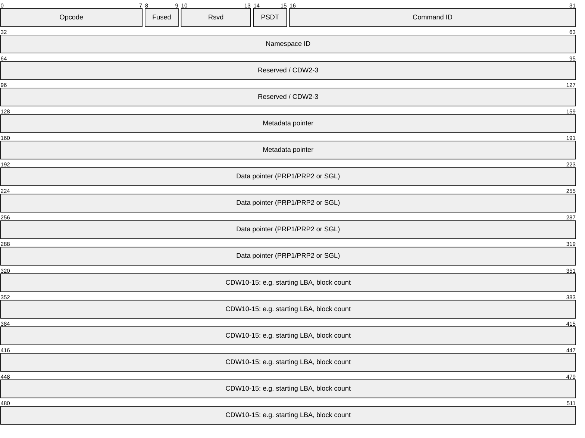
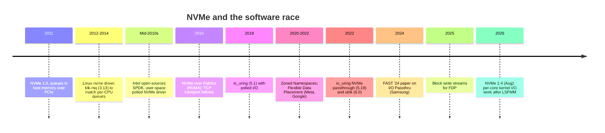
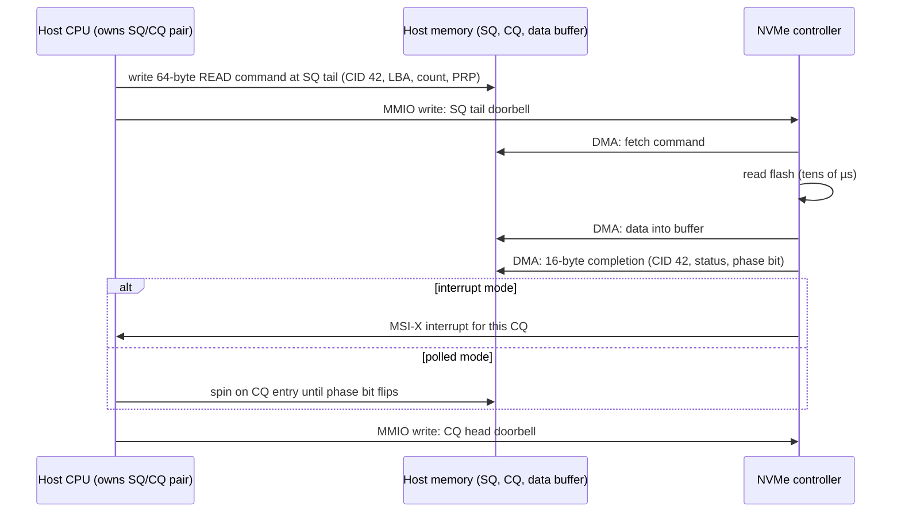
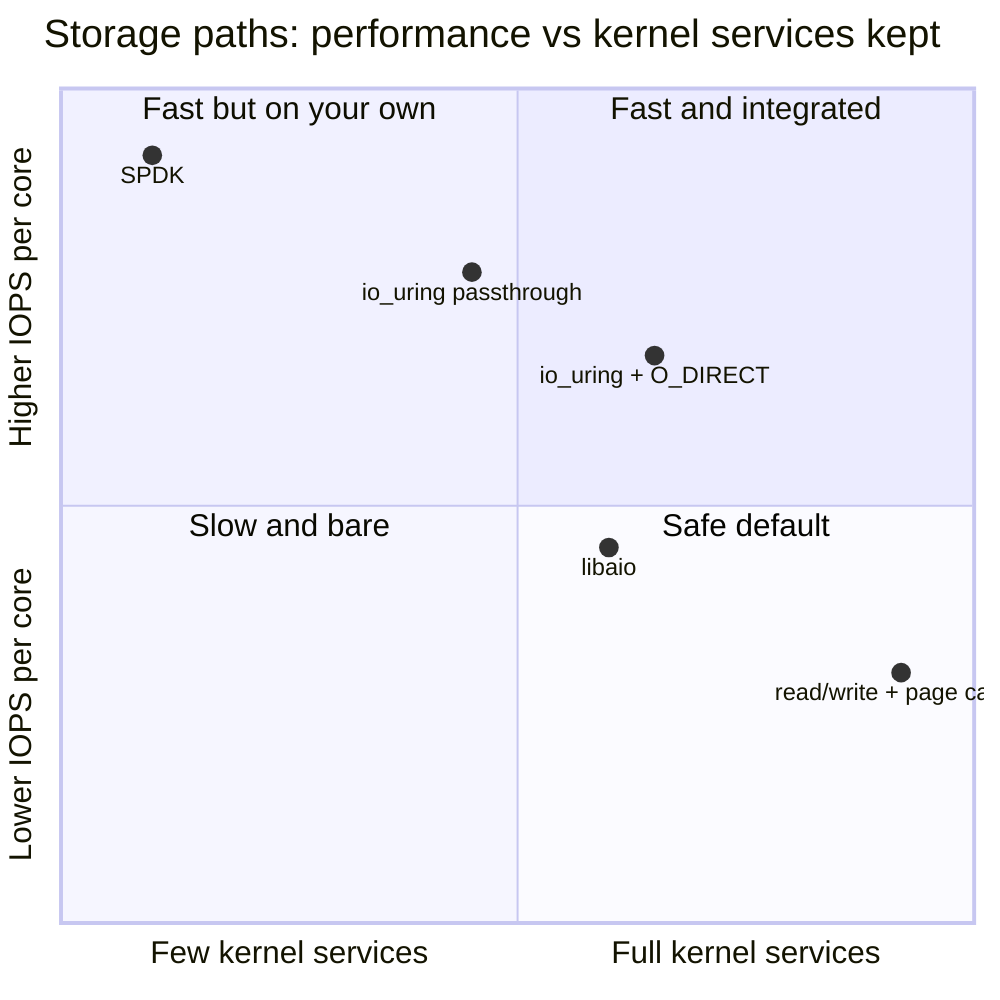

---
tags:
  - operating-systems
  - storage
  - nvme
  - spdk
  - io_uring
  - kernel-bypass
status: complete
sources:
  - https://nvmexpress.org/wp-content/uploads/NVM-Express-Base-Specification-2.0e-2024.07.29-Ratified.pdf
  - https://wiki.osdev.org/NVMe
  - https://blogs.oracle.com/linux/overview-of-nvme-architecture
  - https://www.intel.com/content/www/us/en/developer/articles/tool/introduction-to-the-storage-performance-development-kit-spdk.html
  - https://www.usenix.org/conference/fast24/presentation/joshi
  - https://www.usenix.org/system/files/fast24-joshi.pdf
  - https://docs.kernel.org/6.18/block/ublk.html
  - https://lists.infradead.org/pipermail/linux-nvme/2025-May/056053.html
  - https://www.snia.org/sites/default/files/technical-work/whitepapers/IntroductiontoStorageDataPlacementwithFDP.pdf
  - https://assets.theregister.com/2026/08/04/20268/
  - https://phoronix.com/news/Linux-7.3-Faster-Small-Direct
  - https://www.phoronix.com/news/Axboe-60p-Faster-Per-Core-Perf
created: 2026-11-26
updated: 2026-11-26
---

## Table Of Contents

---

- [[#TL;DR|TL;DR]]
- [[#The Problem|The Problem]]
- [[#Foundations|Foundations]]
    - [[#Queues, Doorbells and the Phase Bit|Queues, Doorbells and the Phase Bit]]
    - [[#Namespaces and Controllers|Namespaces and Controllers]]
- [[#How We Got Here|How We Got Here]]
- [[#How It Works|How It Works]]
    - [[#One Read, Step by Step|One Read, Step by Step]]
    - [[#The Linux NVMe Driver|The Linux NVMe Driver]]
    - [[#SPDK: The Driver in User Space|SPDK: The Driver in User Space]]
    - [[#io_uring Passthrough|io_uring Passthrough]]
    - [[#ublk: Block Devices Served from User Space|ublk: Block Devices Served from User Space]]
    - [[#Choosing a Path|Choosing a Path]]
- [[#Where It Is Now|Where It Is Now]]
- [[#Trade-offs & Open Problems|Trade-offs & Open Problems]]
- [[#Resources|Resources]]
- [[#Related Notes|Related Notes]]

## ***TL;DR***

---

*NVMe is the interface flash SSDs speak over PCIe: many deep queues of fixed-size commands in host memory, with a doorbell write to submit and a completion entry to finish. Because the device is so fast, the remaining cost is software, and the storage world now argues about how much of the kernel to keep on the path.*

- **Interface:** up to 65,535 I/O queue pairs, each up to 65,536 entries; 64-byte commands, 16-byte completions; no locks needed if each CPU owns a queue ([NVMe base spec](https://nvmexpress.org/wp-content/uploads/NVM-Express-Base-Specification-2.0e-2024.07.29-Ratified.pdf), [OSDev](https://wiki.osdev.org/NVMe)).
- **Kernel path:** file system, [[Block Layer and IO Schedulers|blk-mq]] and the `nvme` driver, with one queue pair per CPU; general, safe, and shared across processes.
- **User-space paths:** **SPDK** unbinds the kernel driver and polls the queues from user space with no interrupts, locks or syscalls ([Intel](https://www.intel.com/content/www/us/en/developer/articles/tool/introduction-to-the-storage-performance-development-kit-spdk.html)); **io_uring passthrough** sends raw NVMe commands through the kernel driver while skipping the block layer ([FAST '24](https://www.usenix.org/conference/fast24/presentation/joshi)); **ublk** lets a user-space program *be* a block device.
- **Late 2026:** NVMe 2.4 adds live migration of SSDs exported to VMs and post-quantum security ([The Register, Aug 2026](https://assets.theregister.com/2026/08/04/20268/)); Linux keeps trimming per-I/O CPU to close the gap with SPDK ([Phoronix](https://www.phoronix.com/news/Axboe-60p-Faster-Per-Core-Perf)).

## ***The Problem***

---

*SATA and SCSI were designed for disks: one command queue, a few dozen commands, and a host controller in the middle. Flash can serve hundreds of thousands to millions of operations per second at tens of microseconds each, so the interface and the software stack, not the medium, became the limit.*

| Interface | Queues | Commands per queue | Typical 4K read latency | Bottleneck |
|---|---|---|---|---|
| SATA (AHCI) | 1 | 32 | ~100 µs (SSD) | One queue, controller register reads |
| SAS (SCSI) | 1 per device | Tagged queue, often a few hundred | ~100 µs | Protocol and HBA overhead |
| NVMe over PCIe | Up to 65,535 | Up to 65,536 | ~10-80 µs | Host CPU per I/O |

Once the device takes 10-20 µs, a kernel path costing several microseconds per I/O is a large share of total latency and caps how many I/Os one core can drive. The [[Kernel Architectures]] note's estimate (about 1% overhead on an 80 µs read) rises toward 10-20% on the fastest drives, and at millions of IOPS the CPU, not the SSD, runs out first.

## ***Foundations***

---

*NVMe is a shared-memory protocol: the host writes commands into rings in its own RAM and rings a doorbell register; the device fetches commands by DMA, does the work, writes completions into another ring, and optionally sends an interrupt.*

### Queues, Doorbells and the Phase Bit

- **Submission queue (SQ):** a ring of 64-byte commands in host memory. The host writes a command at the tail and then writes the new tail index to the SQ's **doorbell** register on the device.
- **Completion queue (CQ):** a ring of 16-byte entries the device writes. Each entry carries the command ID, status, the SQ head (so the host knows which slots it can reuse) and a **phase tag** bit.
- **Phase tag:** the device inverts the bit each time it wraps around the CQ, so the host can tell a fresh entry from a stale one by comparing the bit, with no device register read. The host then writes the CQ head doorbell to free the slots ([OSDev](https://wiki.osdev.org/NVMe)).
- **Admin queue:** queue 0 carries management commands (create queues, identify, firmware). I/O queues carry reads, writes, flushes and so on.



*In plain words: every NVMe command is the same 64-byte shape. The first 4 bytes say what to do and give the command an ID; then come the namespace, where the data lives in host memory (PRP page lists or scatter-gather lists), and six command-specific dwords, which for a read hold the starting block and the count.*

### Namespaces and Controllers

- **Namespace:** a range of logical blocks the controller exposes, like a LUN. Linux shows `/dev/nvme0n1` (controller 0, namespace 1) as a block device and `/dev/ng0n1` as a generic character device for passthrough.
- **Controller:** the PCIe function that owns the queues. Multi-controller subsystems and NVMe over Fabrics (RDMA, TCP, Fibre Channel) carry the same command set over a network.
- **Command sets:** NVM (ordinary blocks), Zoned Namespaces (sequential-write zones; see [[Flash and Log-Structured File Systems]]) and Key-Value, all sharing the queueing model.

## ***How We Got Here***

---

*NVMe arrived in 2011 to strip the storage protocol to the bone; within a few years the software above it became the bottleneck, which produced SPDK in user space and, in reaction, a decade of kernel work to keep up.*



- **SPDK (mid-2010s):** Intel's Storage Performance Development Kit moved the NVMe driver into the application: polled, lockless, one thread per core, no interrupts or context switches ([Intel](https://www.intel.com/content/www/us/en/developer/articles/tool/introduction-to-the-storage-performance-development-kit-spdk.html)). It is the storage cousin of DPDK in [[Kernel Bypass Networking]].
- **io_uring (2019):** gave the kernel batched submission and completion polling (`IORING_SETUP_IOPOLL`), closing much of the gap without leaving the kernel ([[io_uring]]).
- **I/O Passthru (2022-2024):** Samsung engineers upstreamed a way to send any NVMe command asynchronously via io_uring, so new device features (FDP, ZNS, computational storage) are usable without waiting for block-layer abstractions ([FAST '24](https://www.usenix.org/conference/fast24/presentation/joshi)).

## ***How It Works***

---

*All three paths drive the same SQ and CQ rings. They differ in who builds the command, who owns the queue, and whether completion is noticed by interrupt or by polling.*

### One Read, Step by Step



Only two MMIO writes per I/O touch the device (and with batching, one doorbell write can cover many commands). Everything else is ordinary memory traffic, which is why the cost lands on the host's CPU and caches.

### The Linux NVMe Driver

- **Queue mapping:** the driver creates I/O queue pairs, usually one per CPU, and registers them as blk-mq hardware contexts; a CPU submits only to its own SQ, so no lock is needed ([Oracle](https://blogs.oracle.com/linux/overview-of-nvme-architecture)).
- **Tags as command IDs:** the blk-mq tag of a request becomes the NVMe command ID, so a completion maps straight back to its request ([[Block Layer and IO Schedulers]]).
- **Interrupts and polling:** each CQ gets its own MSI-X vector aimed at the submitting CPU ([[Interrupts and Exceptions]]); optional poll queues have no interrupt, and [[io_uring]] with `IOPOLL` reaps them by spinning.
- **Scheduler:** NVMe usually runs with the `none` scheduler, since the drive reorders internally.

### SPDK: The Driver in User Space

SPDK takes the device away from the kernel (bound to `vfio-pci`) and maps its BAR and queues into one process ([Intel](https://www.intel.com/content/www/us/en/developer/articles/tool/introduction-to-the-storage-performance-development-kit-spdk.html)):

| Kernel cost | How SPDK removes it |
|---|---|
| Syscall per submission | Application writes the SQ and doorbell directly |
| Interrupt per completion | A poller thread spins on the CQ |
| Locks and shared queues | One queue pair per thread; message passing between cores |
| Page cache and copies | Data goes straight to pinned, hugepage-backed DMA buffers ([[Virtual Memory and Paging]]) |

```c
/* SPDK: submit a read and poll for its completion on this thread's qpair */
spdk_nvme_ns_cmd_read(ns, qpair, buf, lba, 8 /* blocks */, read_done, ctx, 0);
while (!ctx->done)
        spdk_nvme_qpair_process_completions(qpair, 0); /* reap all ready CQEs */
```

*In plain words: the read call builds the NVMe command and rings the doorbell from user space; the loop checks this thread's completion queue and runs `read_done` when the phase bit says the entry is fresh. No system call, no interrupt.*

What you give up: no file system, no page cache, no sharing the device with other processes, dedicated cores that spin at 100% even when idle, and a privileged process with direct DMA access (contained by the IOMMU).

### io_uring Passthrough

Passthrough keeps the kernel driver but skips the block layer. The application opens the generic char device `/dev/ng0n1` and submits `IORING_OP_URING_CMD`, whose SQE carries a raw NVMe command; the driver puts it on an NVMe queue and completes it through the io_uring CQ ([FAST '24](https://www.usenix.org/conference/fast24/presentation/joshi)):

- **Keeps:** kernel ownership of the device, permissions, multiple processes, io_uring batching, polling and registered buffers.
- **Skips:** bios, request merging, schedulers, and the block layer's view of what commands exist, so new NVMe features work immediately.
- **Where it sits:** between the full kernel stack and SPDK in both speed and convenience. The FAST '24 paper measured 16-40% more peak IOPS than the io_uring block path; on one core with a tuned kernel, about 5M IOPS (saturating the SSD) against 3.83M, and on two devices passthrough and SPDK both reached 10M IOPS against 7.55M for the block path. The char interface appeared in 5.13 and io_uring passthrough in 5.19 ([FAST '24 PDF](https://www.usenix.org/system/files/fast24-joshi.pdf)).

### ublk: Block Devices Served from User Space

ublk is the reverse direction: the kernel exposes `/dev/ublkbN`, and a user-space server receives each block request over io_uring and completes it however it likes, for example from a network or a compressed image ([kernel docs](https://docs.kernel.org/6.18/block/ublk.html)). It replaces older NBD and TCMU designs with io_uring's batching, and it lets storage logic be written in a memory-safe language outside the kernel.

### Choosing a Path



*Positions are qualitative, from the designs described above; actual numbers depend on drives, CPUs and kernel versions.*

## ***Where It Is Now***

---

*As of November 2026, NVMe is universal from phones to AI clusters, the spec is adding virtualization and security, and the kernel is chasing SPDK's per-core numbers while giving applications passthrough for new device features.*

- **NVMe 2.4 (published 4 Aug 2026):** live migration of NVMe subsystems exported to virtual machines, post-quantum cryptography for security protocols, and SSD power telemetry ([The Register](https://assets.theregister.com/2026/08/04/20268/)). The previous release, 2.3 (Aug 2025), focused on data-center reliability and management.
- **Kernel per-core push:** after an LSFMM+BPF 2026 comparison with SPDK, Jens Axboe reported patches worth about 60% more per-core I/O by keeping a ready-made, pre-DMA-mapped bio in each registered buffer so O_DIRECT skips bio allocation and DMA map/unmap ([Phoronix, May 2026](https://www.phoronix.com/news/Axboe-60p-Faster-Per-Core-Perf)); Linux 7.3 made small direct reads on PCIe Gen5 go from 1.92M to 2.19M IOPS ([Phoronix](https://phoronix.com/news/Linux-7.3-Faster-Small-Direct)). Details in [[Block Layer and IO Schedulers]].
- **Data placement:** Flexible Data Placement lets the host tag writes so the SSD groups data with similar lifetimes, cutting write amplification ([SNIA](https://www.snia.org/sites/default/files/technical-work/whitepapers/IntroductiontoStorageDataPlacementwithFDP.pdf)); Linux gained "block write streams" mapped to FDP, usable per I/O from io_uring ([linux-nvme, May 2025](https://lists.infradead.org/pipermail/linux-nvme/2025-May/056053.html)).
- **GPUs and storage:** GPU-direct storage and device-memory networking ([[Linux Networking Stack]]) push data from SSDs or NICs straight to accelerator memory, extending the bypass idea to [[Heterogeneous Memory and GPU Drivers|GPU drivers]].

## ***Trade-offs & Open Problems***

---

*Each path trades kernel services (sharing, protection, caching, file systems, observability) for CPU per I/O. The right answer depends on whether one application owns the drive and whether its cores are cheaper than its latency.*

| Choice | Gain | Cost |
|---|---|---|
| Kernel block path | Sharing, file systems, page cache, cgroup I/O control, tooling | Most CPU per I/O |
| io_uring + polling | Fewer syscalls and interrupts, same kernel stack | Spinning cores, still the block layer |
| io_uring passthrough | New NVMe features immediately, less code per I/O | No file system, raw device semantics; needs device permissions |
| SPDK | Lowest CPU per I/O, full control | Exclusive device, dedicated busy cores, rewrite the app, weaker observability |
| ublk | Storage logic in user space, safely | Extra hop per I/O through io_uring |

Open problems:
- **Closing the gap in the kernel** without losing what the kernel provides (see [[Block Layer and IO Schedulers]]).
- **Predictable latency:** SSD garbage collection causes tail-latency spikes no host path can hide; FDP and ZNS move placement to the host to fix it ([[Flash and Log-Structured File Systems]]).
- **Security of direct access:** user-space drivers rely on the IOMMU for isolation, and passthrough exposes the whole command set, so permissions must be careful.
- **Fabrics and disaggregation:** NVMe over TCP and RDMA make remote flash look local, at the cost of network tail latency.

## ***Resources***

---

*The NVMe spec and OSDev wiki explain the queues; Intel's SPDK introduction explains user-space polling; the FAST '24 passthrough paper explains the middle path.*

**Foundations**
- [NVM Express Base Specification 2.0e (2024)](https://nvmexpress.org/wp-content/uploads/NVM-Express-Base-Specification-2.0e-2024.07.29-Ratified.pdf)
- [OSDev wiki: NVMe](https://wiki.osdev.org/NVMe)
- [Oracle Linux blog: Overview of NVMe architecture](https://blogs.oracle.com/linux/overview-of-nvme-architecture)

**User-space and passthrough**
- [Intel: Introduction to the Storage Performance Development Kit (SPDK)](https://www.intel.com/content/www/us/en/developer/articles/tool/introduction-to-the-storage-performance-development-kit-spdk.html)
- [Joshi et al.: I/O Passthru, Upstreaming a flexible and efficient I/O Path in Linux (FAST '24)](https://www.usenix.org/conference/fast24/presentation/joshi) ([PDF](https://www.usenix.org/system/files/fast24-joshi.pdf))
- [Kernel docs: Userspace block device driver (ublk)](https://docs.kernel.org/6.18/block/ublk.html)

**Where it is now**
- [SNIA: Introduction to Storage Data Placement with FDP](https://www.snia.org/sites/default/files/technical-work/whitepapers/IntroductiontoStorageDataPlacementwithFDP.pdf)
- [linux-nvme: Block write streams with NVMe FDP (May 2025)](https://lists.infradead.org/pipermail/linux-nvme/2025-May/056053.html)
- [The Register: NVMe 2.4 brings virtualization to locally attached SSDs (Aug 2026)](https://assets.theregister.com/2026/08/04/20268/)
- [Phoronix: Axboe's 60% per-core I/O patches (2026)](https://www.phoronix.com/news/Axboe-60p-Faster-Per-Core-Perf)

## ***Related Notes***

---

- [[Block Layer and IO Schedulers]]: blk-mq, the kernel layer passthrough and SPDK skip.
- [[io_uring]]: polling, registered buffers and `URING_CMD`.
- [[Kernel Bypass Networking]]: DPDK and RDMA, the networking side of the same idea.
- [[Interrupts and Exceptions]]: MSI-X per queue versus polling.
- [[Virtual Memory and Paging]]: pinned and huge pages, IOMMU mappings for DMA.
- [[Flash and Log-Structured File Systems]]: what happens inside the SSD, ZNS and FDP.
- [[File Systems]]: what you give up when you bypass the block layer.
- [[Virtualization and Hypervisors]]: SR-IOV, VFIO and NVMe live migration.
- [[Linux Networking Stack]]: devmem TCP and device-to-device data paths.
- [[Heterogeneous Memory and GPU Drivers]]: GPU-direct storage.
