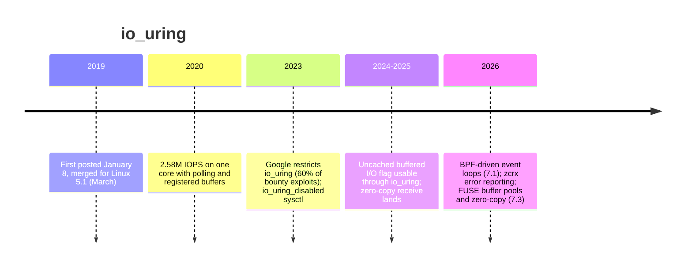
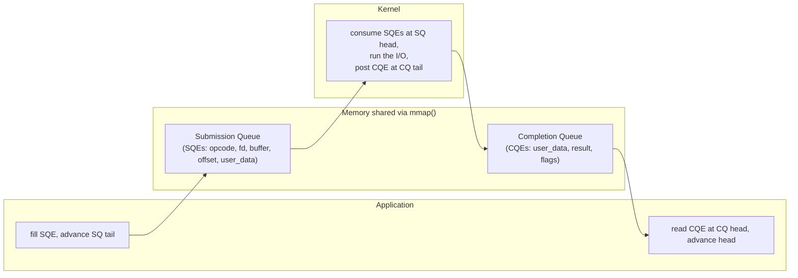
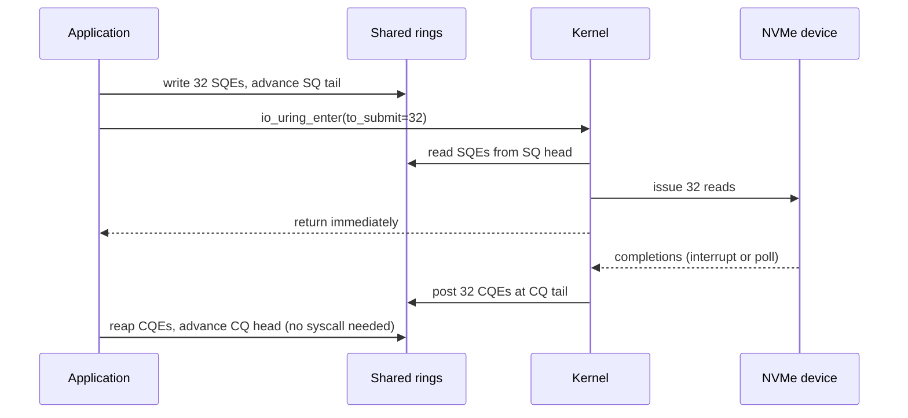

---
tags:
  - operating-systems
  - io
  - io-uring
  - linux-kernel
  - async-io
  - networking
status: complete
sources:
  - https://archives.kernel-recipes.org/wp-content/uploads/2025/01/kernel-recipes-2019-axboe.pdf
  - https://man7.org/linux/man-pages/man7/io_uring.7.html
  - https://lore.kernel.org/io-uring/4af91b50-4a9c-8a16-9470-a51430bd7733@kernel.dk/
  - https://mail.phoronix.com/news/Google-Restricting-IO_uring
  - https://lkml.iu.edu/hypermail/linux/kernel/2308.2/00994.html
  - https://docs.kernel.org/networking/iou-zcrx.html
  - https://lwn.net/Articles/1073434/
  - https://lwn.net/Articles/1062286/
  - https://lwn.net/Articles/1003083
  - https://phoronix.com/review/linux-73-features
created: 2026-11-26
updated: 2026-11-26
---

## Table Of Contents

---

- [[#TL;DR|TL;DR]]
- [[#The Problem|The Problem]]
- [[#Foundations|Foundations]]
    - [[#Sync, Readiness and Completion|Sync, Readiness and Completion]]
    - [[#What a System Call Costs|What a System Call Costs]]
- [[#How We Got Here|How We Got Here]]
- [[#How It Works|How It Works]]
    - [[#Two Rings in Shared Memory|Two Rings in Shared Memory]]
    - [[#A Read, Step by Step|A Read, Step by Step]]
    - [[#Going Faster|Going Faster]]
    - [[#Beyond Files|Beyond Files]]
- [[#Where It Is Now|Where It Is Now]]
- [[#Trade-offs & Open Problems|Trade-offs & Open Problems]]
- [[#Resources|Resources]]
- [[#Related Notes|Related Notes]]

## ***TL;DR***

---

*io_uring is Linux's asynchronous I/O interface: the application and kernel share two ring buffers, one for requests and one for completions, so a program can queue many operations and collect results with few or no system calls. It made truly async file I/O practical on Linux and has grown into a general async system call engine, at the price of a large and frequently exploited attack surface.*

- **Design:** a submission queue (SQ) and completion queue (CQ) in memory mapped into both the process and the kernel; `io_uring_enter()` submits and reaps in one call ([Axboe, Kernel Recipes 2019](https://archives.kernel-recipes.org/wp-content/uploads/2025/01/kernel-recipes-2019-axboe.pdf)).
- **Speed:** with polling and registered buffers and files, one core drove 2.58 million 512-byte random reads per second in 2020 ([Axboe](https://lore.kernel.org/io-uring/4af91b50-4a9c-8a16-9470-a51430bd7733@kernel.dk/)).
- **Security cost:** about 60% of exploits submitted to Google's bug bounty in 2023 involved io_uring, and Google disabled or restricted it on ChromeOS, Android and its servers ([Phoronix](https://mail.phoronix.com/news/Google-Restricting-IO_uring)).
- **2026:** BPF programs can now drive an io_uring event loop (slated for Linux 7.1) ([LWN](https://lwn.net/Articles/1062286/)), and zero-copy network receive keeps maturing ([kernel docs](https://docs.kernel.org/networking/iou-zcrx.html)).

## ***The Problem***

---

*Fast NVMe drives and networks can do millions of operations per second, but the classic Unix I/O model spends one or more system calls per operation and blocks a thread while it waits. Linux's earlier async interface only worked for a narrow case.*

- **Blocking calls** (`read()`, `write()`) tie up a thread per outstanding I/O; at high queue depths that means thousands of threads and context switches (see [[Processes and Threads]]).
- **Readiness APIs** (`epoll`) work for sockets but not for regular files: a file is always "ready", and the read itself may still block on disk.
- **Linux AIO** (`libaio`, `io_submit()`) was effectively limited to `O_DIRECT`, which Axboe called "fairly niche"; buffered I/O was not truly asynchronous, and the interface had high system call and copy overhead ([Kernel Recipes 2019](https://archives.kernel-recipes.org/wp-content/uploads/2025/01/kernel-recipes-2019-axboe.pdf)).
- **System calls got more expensive** after the 2018 transient-execution mitigations (see [[Transient Execution Attacks and Mitigations]]), making "one syscall per I/O" a bigger tax.

io_uring set out to provide buffered async I/O, polled I/O, an API "easy to use" yet powerful, low latency, high IOPS and fewer system calls ([Kernel Recipes 2019](https://archives.kernel-recipes.org/wp-content/uploads/2025/01/kernel-recipes-2019-axboe.pdf)).

## ***Foundations***

---

*There are three ways to wait for I/O: block, ask "is it ready?", or ask "tell me when it's done". io_uring is the third model, and its main trick is paying for system calls once per batch instead of once per operation.*

### Sync, Readiness and Completion

| Model | Linux API | Who does the I/O | Works for files? |
|---|---|---|---|
| Synchronous | `read()`, `write()` | The calling thread, which blocks | Yes |
| Readiness (reactor) | `select`, `poll`, `epoll` | The program, after being told it won't block | No (files are always "ready") |
| Completion (proactor) | Linux AIO, io_uring, Windows IOCP | The kernel, which reports when done | AIO: only `O_DIRECT`; io_uring: yes |

### What a System Call Costs

Each crossing into the kernel (see [[System Calls and the User-Kernel Boundary]]) has a fixed cost $s$. If a program submits $b$ operations per crossing and each operation costs $w$ of real work, the per-operation cost is roughly

$$c(b) = \frac{s}{b} + w$$

In words: batching spreads the fixed crossing cost over many operations; with no crossing at all (kernel-side polling), the $s/b$ term disappears.

*Worked example (illustrative numbers):* suppose a crossing costs $s = 1\ \mu s$ and the work per 4 KB read is $w = 1.5\ \mu s$. One read per call costs $2.5\ \mu s$, so one core tops out near 400,000 reads/s. Batching 32 reads per `io_uring_enter()` gives $1/32 + 1.5 \approx 1.53\ \mu s$, about 650,000 reads/s, a 63% gain from the same core. Removing per-I/O page pinning with registered buffers saves another roughly 100 ns per I/O by Axboe's estimate ([Kernel Recipes 2019](https://archives.kernel-recipes.org/wp-content/uploads/2025/01/kernel-recipes-2019-axboe.pdf)).

## ***How We Got Here***

---

*io_uring started in 2019 as a fix for Linux's poor async file I/O and kept absorbing operations until it could run almost any I/O-related system call asynchronously. Its rise was matched by a run of serious security bugs, which led to off switches and restrictions.*



- **Merge:** first posted January 8, 2019, merged March 8, 2019 for v5.1-rc1 ([Kernel Recipes 2019](https://archives.kernel-recipes.org/wp-content/uploads/2025/01/kernel-recipes-2019-axboe.pdf)). An early internal Facebook cache service went from 1.7M to 2.3M queries per second.
- **Security backlash (2023):** Google reported paying about $1 million for io_uring bugs, disabled it on ChromeOS and production servers, blocked it for Android apps with seccomp, and worked on disabling it by default in GKE Autopilot, judging it safe only for trusted components ([Phoronix](https://mail.phoronix.com/news/Google-Restricting-IO_uring)).
- **Off switch:** the `kernel.io_uring_disabled` sysctl (patch by Jeff Moyer, original work by Matteo Rizzo, 2023) lets admins allow everyone (0), only members of `io_uring_group` (1), or no one (2) to create rings ([patch](https://lkml.iu.edu/hypermail/linux/kernel/2308.2/00994.html)).

## ***How It Works***

---

*The application writes requests into a submission ring and reads results from a completion ring; both rings live in memory the kernel can see too. The kernel picks up requests on `io_uring_enter()` or by polling, runs them inline or on worker threads, and posts completions tagged with the caller's cookie.*

### Two Rings in Shared Memory



- `io_uring_setup(entries, params)` returns a ring file descriptor; the SQ ring, CQ ring and SQE array are mapped with `mmap()` at fixed offsets ([Kernel Recipes 2019](https://archives.kernel-recipes.org/wp-content/uploads/2025/01/kernel-recipes-2019-axboe.pdf)).
- Ownership is split: the app produces at the SQ tail and consumes at the CQ head; the kernel does the opposite. Tails are published with release stores and read with acquire loads, so no locks are needed ([io_uring(7)](https://man7.org/linux/man-pages/man7/io_uring.7.html)).
- Requests can complete in any order. `user_data` is "custom data that is passed unchanged from submission to completion", which is how the app matches a CQE to its request ([io_uring(7)](https://man7.org/linux/man-pages/man7/io_uring.7.html)).

### A Read, Step by Step

Using liburing, the usual helper library:

```c
struct io_uring ring;
io_uring_queue_init(64, &ring, 0);                  /* 64-entry rings */

struct io_uring_sqe *sqe = io_uring_get_sqe(&ring); /* grab a free SQE */
io_uring_prep_read(sqe, fd, buf, 4096, 0);          /* read 4 KB at offset 0 */
io_uring_sqe_set_data64(sqe, 42);                   /* our cookie */
io_uring_submit(&ring);                             /* one io_uring_enter() */

struct io_uring_cqe *cqe;
io_uring_wait_cqe(&ring, &cqe);                     /* wait for a completion */
if (cqe->user_data == 42 && cqe->res >= 0)
    printf("read %d bytes\n", cqe->res);            /* res < 0 is -errno */
io_uring_cqe_seen(&ring, cqe);                      /* advance CQ head */
```

In plain words: the program fills in a request form in shared memory, tells the kernel "there's work" once, and later reads a result slip that carries its own tag. Queue 64 forms before the single `io_uring_submit()` and the same one system call starts 64 reads. Requests can be ordered: `IOSQE_IO_LINK` runs a chain only while each step succeeds, and `IOSQE_IO_DRAIN` waits for everything before it ([Kernel Recipes 2019](https://archives.kernel-recipes.org/wp-content/uploads/2025/01/kernel-recipes-2019-axboe.pdf)).



### Going Faster

| Feature | Flag | What it removes |
|---|---|---|
| Kernel-side submission polling | `IORING_SETUP_SQPOLL` | The submit system call: a kernel thread watches the SQ, sleeping after `sq_thread_idle` ms and setting a wake-up flag |
| Completion polling | `IORING_SETUP_IOPOLL` | Interrupts: the kernel polls the device, trading CPU for latency; NVMe and XFS files |
| Registered buffers | `IORING_REGISTER_BUFFERS` | Pinning user pages on every I/O (about 100 ns) |
| Registered files | `IORING_REGISTER_FILES` | Atomic file reference counting per I/O |

All from [Kernel Recipes 2019](https://archives.kernel-recipes.org/wp-content/uploads/2025/01/kernel-recipes-2019-axboe.pdf). Combining them, Axboe measured 2.58M IOPS per core at queue depth 128 and 290K at queue depth 1 (512-byte random `O_DIRECT` reads, Optane SSD, kernel 5.9-rc1, August 2020) ([Axboe](https://lore.kernel.org/io-uring/4af91b50-4a9c-8a16-9470-a51430bd7733@kernel.dk/)).

### Beyond Files

- **Networking:** sockets (accept, send, receive) go through the same rings. **Zero-copy receive (zcrx)** splits packets at the TCP header: headers go through the normal kernel TCP stack while payloads land directly in user memory, with "no strict alignment requirements". It needs NIC support for header/data split, flow steering and RSS, configured out of band with ethtool ([kernel docs](https://docs.kernel.org/networking/iou-zcrx.html)). Unlike [[Kernel Bypass Networking|DPDK]], the kernel stays in charge of the protocol.
- **Caching control:** the `RWF_DONTCACHE` flag for uncached buffered I/O can be set through io_uring ([LWN](https://lwn.net/Articles/1003083)); see [[Page Cache and Memory Reclaim]].
- **FUSE:** user-space file systems use io_uring for their kernel channel; Linux 7.3 added buffer pools and zero-copy handling there ([Phoronix](https://phoronix.com/review/linux-73-features)).

## ***Where It Is Now***

---

*As of November 2026, io_uring is the standard high-performance I/O path on Linux for databases, storage engines and proxies, and it is becoming programmable with BPF. Its security story is still "trusted code only" in many large deployments.*

- **BPF-driven loops (Linux 7.1):** Pavel Begunkov's series lets a BPF struct_ops program replace the normal event loop when `io_uring_enter()` is called, submitting SQEs and editing rings via kfuncs and returning `IOU_LOOP_CONTINUE` or `IOU_LOOP_STOP`; Axboe applied it March 17, 2026. A narrower `IORING_OP_BPF` from Ming Lei was also under review. Readers noted BPF needs `CAP_SYS_ADMIN`, unlike io_uring itself ([LWN, March 2026](https://lwn.net/Articles/1062286/); see [[eBPF]]).
- **zcrx maturing:** a May 2026 series by Clément Léger (Meta) adds CQE notifications when zero-copy runs out of buffers or falls back to copying, plus stats in shared memory, because errors were previously invisible to the user ([LWN, May 2026](https://lwn.net/Articles/1073434/)).
- **Restrictions remain:** the 2023 controls (Google's restrictions, the `io_uring_disabled` sysctl) are the baseline for hardened systems ([Phoronix](https://mail.phoronix.com/news/Google-Restricting-IO_uring); [patch](https://lkml.iu.edu/hypermail/linux/kernel/2308.2/00994.html)).

## ***Trade-offs & Open Problems***

---

*io_uring wins on throughput and system call count, and loses on complexity and attack surface. It also bypasses tools that watch system calls, which matters for security monitoring.*

| Benefit | Cost |
|---|---|
| Batched or zero system calls per I/O | A second, huge kernel API (dozens of opcodes) to secure and maintain |
| True async buffered file I/O | Work that can't complete inline is handed to kernel worker threads, so CPU use moves out of the calling thread |
| Polling for lowest latency | Burns a CPU core per poller |
| One interface for files, sockets and more | Operations don't appear as individual system calls, so seccomp filters and syscall-based monitoring miss them |
| Registered resources | Pinned memory and long-lived kernel state per ring |

Open problems:
- **Security:** Google's assessment that it "still has severe vulnerabilities and provides strong exploitation primitives" drove the off switch ([Phoronix](https://mail.phoronix.com/news/Google-Restricting-IO_uring)); memory-safe kernel code ([[Rust in the Linux Kernel]]) and [[Kernel Security Hardening]] are long-term answers.
- **Fallbacks:** because platforms block it (Android apps via seccomp, Google's servers entirely), portable software must keep a non-io_uring path ([Phoronix](https://mail.phoronix.com/news/Google-Restricting-IO_uring); see [[Containers, Namespaces and cgroups]]).
- **API surface vs BPF:** whether new behavior should be new opcodes or BPF programs is unresolved ([LWN](https://lwn.net/Articles/1062286/)).

## ***Resources***

---

*Axboe's 2019 slides explain the design and its reasons; the man page shows the ring protocol; LWN covers what changed in 2026.*

- [Jens Axboe, Faster IO through io_uring (Kernel Recipes 2019)](https://archives.kernel-recipes.org/wp-content/uploads/2025/01/kernel-recipes-2019-axboe.pdf)
- [io_uring(7) man page](https://man7.org/linux/man-pages/man7/io_uring.7.html)
- [Axboe's 2.58M IOPS per core results (2020)](https://lore.kernel.org/io-uring/4af91b50-4a9c-8a16-9470-a51430bd7733@kernel.dk/)
- [Phoronix: Google limiting io_uring use (2023)](https://mail.phoronix.com/news/Google-Restricting-IO_uring) and [io_uring_disabled sysctl patch](https://lkml.iu.edu/hypermail/linux/kernel/2308.2/00994.html)
- [Linux kernel docs: io_uring zero copy Rx](https://docs.kernel.org/networking/iou-zcrx.html) and [zcrx notifications series (May 2026)](https://lwn.net/Articles/1073434/)
- [LWN: BPF comes to io_uring at last (March 2026)](https://lwn.net/Articles/1062286/)

## ***Related Notes***

---

- [[System Calls and the User-Kernel Boundary]]: the cost io_uring amortizes.
- [[Interrupts and Exceptions]]: what completion polling avoids.
- [[Kernel Bypass Networking]]: DPDK, XDP and RDMA, the alternatives that leave the kernel out.
- [[eBPF]]: BPF-driven io_uring loops.
- [[Page Cache and Memory Reclaim]]: buffered and uncached I/O.
- [[File Systems]]: what most io_uring reads and writes land on.
- [[Block Layer and IO Schedulers]]: blk-mq queues, plugging and polling below io_uring's storage I/O.
- [[NVMe and User-Space Storage]]: NVMe queues, `URING_CMD` passthrough, ublk and SPDK.
- [[Processes and Threads]]: the thread-per-request model io_uring replaces.
- [[Containers, Namespaces and cgroups]]: seccomp restrictions on io_uring.
- [[Kernel Security Hardening]]: why io_uring is often disabled.
