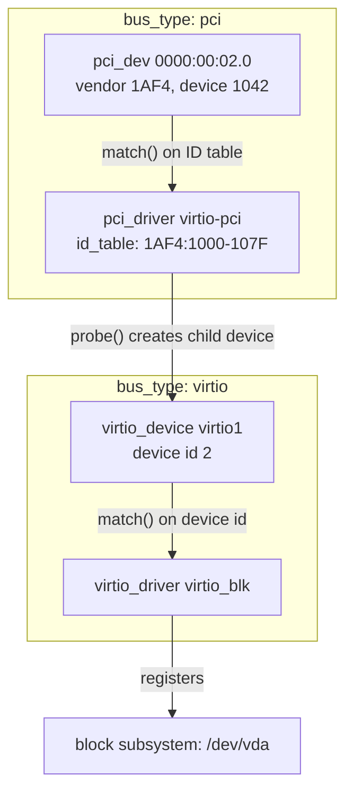
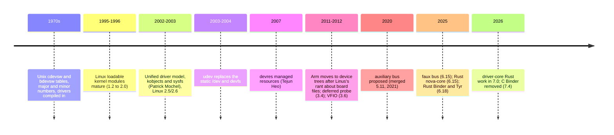
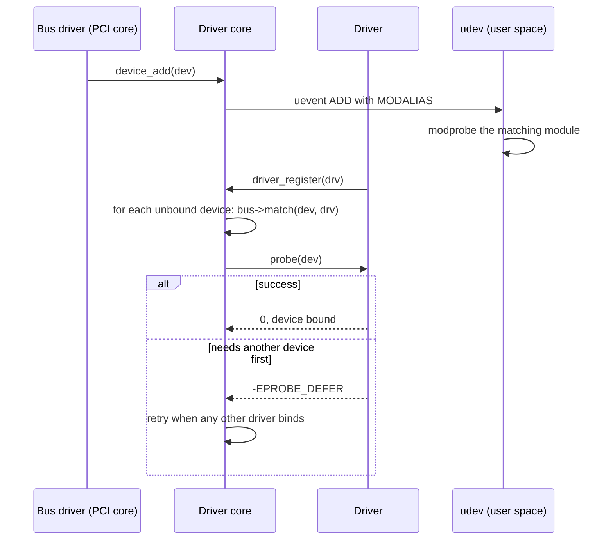

---
tags:
  - operating-systems
  - kernels-and-architecture
  - device-drivers
status: draft
sources:
  - https://docs.kernel.org/driver-api/driver-model/overview.html
  - https://docs.kernel.org/driver-api/driver-model/binding.html
  - https://docs.kernel.org/driver-api/driver-model/devres.html
  - https://docs.kernel.org/driver-api/infrastructure.html
  - https://docs.kernel.org/PCI/pci.html
  - https://docs.kernel.org/core-api/dma-api-howto.html
  - https://docs.kernel.org/driver-api/vfio.html
  - https://docs.kernel.org/driver-api/uio-howto.html
  - https://docs.kernel.org/devicetree/usage-model.html
  - https://docs.kernel.org/process/stable-api-nonsense.html
  - https://docs.kernel.org/driver-api/auxiliary_bus.html
  - https://docs.kernel.org/power/runtime_pm.html
  - https://github.com/torvalds/linux/blob/master/drivers/base/dd.c
  - https://github.com/torvalds/linux/blob/master/include/linux/device/driver.h
  - https://lwn.net/Kernel/LDD3/
  - https://pages.cs.wisc.edu/~remzi/OSTEP/file-devices.pdf
  - https://pdos.csail.mit.edu/6.1810/2024/xv6/book-riscv-rev4.pdf
  - https://web.stanford.edu/~engler/osdi2001-errors.pdf
  - https://dl.acm.org/doi/10.1145/945445.945466
  - https://docs.oasis-open.org/virtio/virtio/v1.3/virtio-v1.3.html
  - https://lkml.iu.edu/hypermail/linux/kernel/2502.1/01814.html
  - https://phoronix.com/news/linux-7.0-driver-core
  - https://phoronix.com/news/NVIDIA-Nova-Linux-7.4-Changes
  - https://www.phoronix.com/news/NVIDIA-Nova-Rust-Linux-7.3
  - https://phoronix.com/news/Linux-7.4-Rust
  - https://lwn.net/Articles/1055590/
  - https://fuchsia.dev/fuchsia-src/concepts/drivers/driver_framework
created: 2026-11-26
updated: 2026-11-26
---

## Table Of Contents

---

- [[#TL;DR|TL;DR]]
- [[#The Problem|The Problem]]
- [[#Foundations|Foundations]]
    - [[#What a Driver Does|What a Driver Does]]
    - [[#Device Classes - Character, Block, Network|Device Classes - Character, Block, Network]]
    - [[#Discoverable and Non-Discoverable Buses|Discoverable and Non-Discoverable Buses]]
    - [[#The Driver Model - Bus, Device, Driver, Class|The Driver Model - Bus, Device, Driver, Class]]
- [[#How We Got Here|How We Got Here]]
- [[#How It Works|How It Works]]
    - [[#Talking to Hardware - MMIO, Port I/O and Barriers|Talking to Hardware - MMIO, Port I/O and Barriers]]
    - [[#Interrupts|Interrupts]]
    - [[#DMA and the IOMMU|DMA and the IOMMU]]
    - [[#A PCI Driver in Code|A PCI Driver in Code]]
    - [[#Matching and Probing|Matching and Probing]]
    - [[#Worked Example - Reading a Real modalias|Worked Example - Reading a Real modalias]]
    - [[#sysfs, uevents and udev|sysfs, uevents and udev]]
    - [[#Device Trees, ACPI and Platform Devices|Device Trees, ACPI and Platform Devices]]
    - [[#Resource Management - devres and Deferred Probe|Resource Management - devres and Deferred Probe]]
    - [[#Power Management|Power Management]]
    - [[#Drivers Outside the Kernel - UIO, VFIO and User-Space Drivers|Drivers Outside the Kernel - UIO, VFIO and User-Space Drivers]]
- [[#Where It Is Now|Where It Is Now]]
- [[#Trade-offs & Open Problems|Trade-offs & Open Problems]]
- [[#Resources|Resources]]
- [[#Related Notes|Related Notes]]

## ***TL;DR***
---
*A device driver is the kernel code that knows one kind of hardware: it pokes the device's registers, handles its interrupts and sets up its DMA, and presents it to the rest of the kernel through a standard interface (a block device, a network interface, a GPU). The Linux driver model is the framework that discovers devices, matches them to drivers, and tracks the whole tree in sysfs.*

- **Drivers are most of the kernel, and most of its bugs.** The `drivers/` tree is the largest part of Linux's source, and a 2001 study of Linux found error rates in drivers 3 to 7 times higher than in the rest of the kernel ([Chou et al., SOSP 2001](https://web.stanford.edu/~engler/osdi2001-errors.pdf)); a 2003 study attributed 85% of Windows XP crashes to drivers ([Nooks, Swift et al., SOSP 2003](https://dl.acm.org/doi/10.1145/945445.945466)).
- **Three objects: bus, device, driver.** A **bus** (PCI, USB, platform, virtio...) finds **devices** and knows how to match them against **drivers**' ID tables. On a match the driver's `probe()` runs and the device is **bound**. Everything appears under `/sys`, and a uevent tells `udev` to load modules and create `/dev` nodes ([driver model overview](https://docs.kernel.org/driver-api/driver-model/overview.html)).
- **Three ways to talk to hardware:** memory-mapped registers (MMIO), interrupts for "something happened", and DMA so the device reads and writes RAM itself, fenced by the IOMMU.
- **No stable in-kernel API.** Linux deliberately changes internal driver interfaces freely and fixes every in-tree driver when it does; the price is that out-of-tree drivers break ([stable-api-nonsense](https://docs.kernel.org/process/stable-api-nonsense.html)).
- **Where it is now (Nov 2026):** drivers are where Rust is landing: Nova (NVIDIA), Tyr (Arm Mali), Binder and others are in tree, and the driver core gained more Rust support in Linux 7.0 ([Phoronix](https://phoronix.com/news/linux-7.0-driver-core)). The "faux" bus (6.15) replaced fake platform devices, and user-space drivers through VFIO keep growing for VMs and storage.

## ***The Problem***
---
*The kernel must run on millions of hardware combinations it was not written for, each device with its own registers and quirks, and code for all of it runs with full privilege. The driver model exists to make that tractable: find devices automatically, keep device-specific code in small separable units, and give the rest of the kernel a uniform view.*

| Challenge | Why it's hard | What the driver model provides |
|---|---|---|
| Variety | Tens of thousands of device IDs across PCI, USB, I2C, SPI, platform buses | Per-bus matching from ID tables; drivers as loadable modules |
| Discovery | Some buses announce devices (PCI, USB), others don't (most on-chip peripherals) | Bus enumeration plus firmware descriptions (ACPI, device tree) |
| Hotplug | Devices come and go at runtime (USB, Thunderbolt, PCIe hotplug) | Uniform add/remove events, reference-counted device objects |
| Ordering | A display needs its regulator, clock and I2C bus first | Deferred probe, device links |
| Power | Laptops must suspend devices individually and system-wide | Bus-mediated PM callbacks, runtime PM |
| Safety | A driver bug can corrupt any kernel memory; a device can DMA anywhere | Managed resources (`devres`), IOMMU, and now Rust |

## ***Foundations***
---
*A driver turns register writes and interrupts into an abstract device the kernel understands. Devices come in a few classes, they hang off buses that may or may not be able to enumerate them, and Linux models all of it as one tree of reference-counted objects.*

#### **What a Driver Does**

From the hardware side, a device is a set of **registers** (status, command, data), a way to raise an **interrupt**, and often a **DMA engine** that reads and writes memory directly. OSTEP's canonical device has exactly that: status, command and data registers, and a protocol of "poll status, write data, write command, wait" ([OSTEP ch. 36](https://pages.cs.wisc.edu/~remzi/OSTEP/file-devices.pdf)).

From the kernel side, a driver plugs that device into a **subsystem**: the block layer, the network stack, DRM for GPUs, ALSA for sound, input for keyboards. Subsystems define the interface ("submit this request", "transmit this packet") and drivers implement it. So a driver has two faces: one toward hardware, one toward a kernel framework.

#### **Device Classes - Character, Block, Network**

| Class | User-space view | Kernel interface | Examples |
|---|---|---|---|
| Character | `/dev/ttyS0`, `/dev/input/event3`; read/write/ioctl as a stream | `struct file_operations` | Serial ports, input devices, GPUs' control nodes |
| Block | `/dev/nvme0n1`; random access in fixed-size blocks, cached | `struct block_device_operations` + blk-mq queues | Disks, SSDs ([[Block Layer and IO Schedulers]]) |
| Network | No `/dev` node; an interface name like `eth0` used through sockets | `struct net_device_ops` | NICs ([[Linux Networking Stack]]) |

Each `/dev` node has a **major number** (which driver) and **minor number** (which instance), a Unix convention from the 1970s.

#### **Discoverable and Non-Discoverable Buses**

- **Discoverable:** PCI/PCIe devices have a standard configuration space holding a vendor ID, device ID and class code that the kernel reads by scanning bus/device/function addresses. USB devices return descriptors when asked. The kernel can find everything without being told.
- **Non-discoverable:** a system-on-chip's UART, I2C controller or GPIO block sits at a fixed address with no ID register to read. Someone must describe it: on PCs and Arm servers, **ACPI** tables from firmware; on most Arm, RISC-V and embedded boards, a **device tree** ([device tree usage model](https://docs.kernel.org/devicetree/usage-model.html)). Linux represents these as **platform devices** on the "platform" pseudo-bus.

#### **The Driver Model - Bus, Device, Driver, Class**

Linux 2.6 introduced a unified **driver model** so every bus works the same way ([overview](https://docs.kernel.org/driver-api/driver-model/overview.html), [binding](https://docs.kernel.org/driver-api/driver-model/binding.html)):

| Object | C struct | Role |
|---|---|---|
| Bus type | `struct bus_type` | Enumerates devices, defines `match()` between device and driver, runs `probe`/`remove` |
| Device | `struct device` (embedded in `struct pci_dev`, `struct usb_device`...) | One piece of hardware; has a parent, so devices form a tree |
| Driver | `struct device_driver` (embedded in `struct pci_driver`...) | Code plus an ID table of devices it supports |
| Class | `struct class` | A user-facing grouping by function ("net", "block", "input") regardless of bus |

Every one of these embeds a **kobject**, a reference-counted object that appears as a directory in sysfs. Reference counting matters because a USB device can be unplugged while a program still has it open: the `struct device` must outlive the hardware until the last user lets go.



The diagram shows a real binding from the VM this note was written on: one driver's `probe()` can create devices on another bus, so drivers stack.

## ***How We Got Here***
---
*Early Unix had a fixed table of drivers compiled into the kernel. Linux added loadable modules in the 1990s, a unified device model and sysfs in 2.6, hotplug and udev, device trees for Arm, and is now adding Rust and user-space drivers.*



- **Static tables.** Classic Unix kernels had arrays `cdevsw[]` and `bdevsw[]` indexed by major number; adding a driver meant recompiling. Linux modules (`insmod`, `modprobe`) let drivers load at runtime.
- **The 2.6 driver model** gave every bus the same structure, which made power management possible: the kernel finally knew the parent-child tree and could suspend children before parents. sysfs exported that tree; **udev** (2003, Greg Kroah-Hartman and others) created `/dev` nodes from kernel events instead of shipping thousands of static ones.
- **Arm's board-file crisis.** Each Arm board had C code describing its devices; by 2011 Linus Torvalds complained about the churn, and Arm moved to **device trees**, data files compiled into a blob the boot loader passes in (see [[Boot Process]]).
- **Isolation research.** Nooks (2003) wrapped Linux drivers in lightweight protection domains and recovered from most driver faults ([Swift et al.](https://dl.acm.org/doi/10.1145/945445.945466)). Microkernels run drivers as user processes ([[Microkernels and seL4]]); Windows added a user-mode driver framework; Fuchsia runs all drivers in user space ([Fuchsia driver framework](https://fuchsia.dev/fuchsia-src/concepts/drivers/driver_framework)). Linux chose instead to keep drivers in the kernel and make them safer in place: managed resources, static analysis, the IOMMU, and now Rust ([[Rust in the Linux Kernel]]).

## ***How It Works***
---
*Bottom up: how a driver touches hardware, then the driver model's discovery and binding machinery, then everything around it: sysfs and udev, firmware descriptions, resource management, power, and drivers that live in user space.*

#### **Talking to Hardware - MMIO, Port I/O and Barriers**

- **MMIO.** A device's registers appear at physical addresses (PCI BARs, "base address registers", say where). The driver maps them with `ioremap()` (or `pci_iomap()`) and accesses them with `readl()`/`writel()`, never plain pointer dereferences: these accessors stop the compiler from merging or reordering the accesses and include the barriers the architecture needs.
- **Port I/O** (`inb`/`outb`) is the x86's separate 64 KiB I/O space, used by legacy devices.
- **Ordering.** Writing a DMA descriptor to RAM and then ringing a doorbell register must happen in that order as seen by the device. `writel()` guarantees prior normal memory writes are visible to the device first; `writel_relaxed()` skips that for speed when no DMA is involved. These are the same memory-ordering questions as between CPUs ([[Lock-Free Data Structures and Memory Ordering]]), with a device as the other observer.

#### **Interrupts**

A driver calls `request_irq()` (or `devm_request_irq()`) with a handler. Modern PCIe devices use **MSI-X**: each interrupt is a memory write the device sends, so one NIC can have a separate vector per queue, each steered to a different CPU. Work that may sleep goes into a **threaded IRQ** handler or a workqueue, leaving the hard handler to acknowledge the device and return quickly. The full mechanism is in [[Interrupts and Exceptions]].

#### **DMA and the IOMMU**

DMA lets a device copy data to or from RAM without the CPU. The driver must give the device **bus addresses**, which may differ from physical addresses, and must handle caches on CPUs where DMA isn't cache-coherent. The DMA API hides this ([DMA API howto](https://docs.kernel.org/core-api/dma-api-howto.html)):

| API | Use | What it does |
|---|---|---|
| `dma_alloc_coherent()` | Long-lived shared structures (descriptor rings) | Allocates memory both CPU and device see consistently |
| `dma_map_single()` / `dma_unmap_single()` | One buffer for one transfer (a packet) | Returns a bus address; flushes or invalidates caches; may use a bounce buffer |
| `dma_map_sg()` | Scattered pages for one transfer | Maps a scatter-gather list, possibly merging it via the IOMMU |

An **IOMMU** (Intel VT-d, AMD-Vi, Arm SMMU) gives devices their own page tables. Without one, a buggy or malicious device (or a Thunderbolt peripheral) can DMA anywhere in RAM. With one, the device can only reach what the driver mapped. The same hardware lets a hypervisor give a device directly to a VM ([[Virtualization and Hypervisors]]).

#### **A PCI Driver in Code**

A minimal PCI driver, following the kernel's [PCI driver guide](https://docs.kernel.org/PCI/pci.html):

```c
static const struct pci_device_id mydev_ids[] = {
    { PCI_DEVICE(0x1234, 0x5678) },        /* vendor, device */
    { }
};
MODULE_DEVICE_TABLE(pci, mydev_ids);      /* exported for modalias matching */

static int mydev_probe(struct pci_dev *pdev, const struct pci_device_id *id)
{
    void __iomem *regs;
    int err;

    err = pcim_enable_device(pdev);        /* managed: undone automatically */
    if (err)
        return err;
    pci_set_master(pdev);                  /* allow the device to do DMA */
    err = dma_set_mask_and_coherent(&pdev->dev, DMA_BIT_MASK(64));
    if (err)
        return err;
    regs = pcim_iomap(pdev, 0, 0);         /* map BAR 0 */
    if (!regs)
        return -ENOMEM;
    err = devm_request_irq(&pdev->dev, pdev->irq, mydev_irq, 0, "mydev", pdev);
    if (err)
        return err;
    return register_with_subsystem(pdev, regs); /* e.g. a net_device or gendisk */
}

static struct pci_driver mydev_driver = {
    .name = "mydev", .id_table = mydev_ids,
    .probe = mydev_probe, .remove = mydev_remove,
};
module_pci_driver(mydev_driver);
```

In plain words: the driver declares which vendor/device IDs it handles; when the PCI bus finds a match, `probe()` enables the device, lets it do DMA, maps its registers, hooks its interrupt and registers it with a subsystem. The `pcim_`/`devm_` prefixes mean "managed": if `probe()` fails halfway or the device is removed later, everything acquired is released automatically, in reverse order.

#### **Matching and Probing**

The core logic is in [drivers/base/dd.c](https://github.com/torvalds/linux/blob/master/drivers/base/dd.c):



Matching runs in both directions: adding a device tries all registered drivers on that bus, and registering a driver tries all unbound devices. Probing can run **asynchronously** to speed boot, and a user can force binding through sysfs (`bind`, `unbind`, `driver_override`), which is how devices are handed to VFIO.

#### **Worked Example - Reading a Real modalias**

How does the system know which module to load for a device it has never seen? Each device publishes a **modalias** string; each module carries patterns from its `MODULE_DEVICE_TABLE`; `modprobe` matches them. From the cloud VM this note was written on (`cat /sys/bus/pci/devices/0000:00:02.0/modalias`):

```
pci:v00001AF4d00001042sv00001AF4sd00001042bc01sc80i00
```

| Field | Value | Meaning |
|---|---|---|
| `v` | `00001AF4` | Vendor 0x1AF4, the ID used by virtio devices |
| `d` | `00001042` | Device 0x1042 = 0x1040 + 2; modern virtio devices are 0x1040 plus the virtio device type, and type 2 is block ([virtio 1.3 spec](https://docs.oasis-open.org/virtio/virtio/v1.3/virtio-v1.3.html)) |
| `sv`, `sd` | `1AF4`, `1042` | Subsystem vendor and device |
| `bc`, `sc`, `i` | `01`, `80`, `00` | Class 0x01 (mass storage), subclass 0x80 ("other"), programming interface 0 |

The same VM shows the other virtio types following the formula: `1041` (type 1, network), `1045` (type 5, memory balloon) and `1053` (0x1053 − 0x1040 = 0x13 = 19, vsock). `virtio-pci` binds the PCI device and creates a `virtio` bus device whose modalias is `virtio:d00000002v00001AF4`, which in turn loads and binds `virtio_blk`. Two buses, two matches, one disk.

#### **sysfs, uevents and udev**

sysfs exposes the driver model as directories:

- `/sys/devices/...`: the physical tree (parent → child).
- `/sys/bus/<bus>/devices` and `/sys/bus/<bus>/drivers`: per-bus views; each device has a `driver` symlink once bound.
- `/sys/class/<class>/`: functional views (`/sys/class/net/eth0`, `/sys/class/block/vda`).

When a device appears, the kernel sends a **uevent** over netlink with variables such as `ACTION=add`, `DEVPATH`, `SUBSYSTEM` and `MODALIAS`. `systemd-udevd` loads modules by modalias, runs rules (naming network interfaces predictably, setting permissions, creating `/dev/disk/by-uuid/` symlinks), while **devtmpfs** has the kernel create the basic `/dev` node itself so early boot works before udev runs.

#### **Device Trees, ACPI and Platform Devices**

On a board with a device tree, a node like

```dts
uart0: serial@fe201000 {
    compatible = "arm,pl011", "arm,primecell";
    reg = <0xfe201000 0x200>;
    interrupts = <GIC_SPI 121 IRQ_TYPE_LEVEL_HIGH>;
    clocks = <&clk_uart>;
};
```

becomes a platform device whose `compatible` strings are matched against drivers' `of_device_id` tables, most specific first. The driver reads its register range (`reg`), interrupt and clock from the node. ACPI does the same with `_HID` identifiers and AML methods; a driver can support both through the unified `fwnode`/`device_property` API.

Not every "device" is hardware. For a purely software construct Linux 6.15 added the **faux bus**, a minimal bus for drivers that just need a `struct device` to hang sysfs files or firmware loading on, replacing the old habit of creating fake platform devices ([faux bus patch, Feb 2025](https://lkml.iu.edu/hypermail/linux/kernel/2502.1/01814.html)). The **auxiliary bus** (5.11) lets one big driver (say, a NIC that also does RDMA) split into pieces bound by different subsystem drivers ([auxiliary bus](https://docs.kernel.org/driver-api/auxiliary_bus.html)).

#### **Resource Management - devres and Deferred Probe**

Error paths are where drivers leak. A probe that acquires ten resources needs ten unwind steps in the right order, on every failure path and in `remove()`. **devres** (device-managed resources) records each `devm_*` allocation on the device and frees them all, in reverse, when probing fails or the driver unbinds ([devres](https://docs.kernel.org/driver-api/driver-model/devres.html)). That removes most hand-written cleanup.

**Deferred probe** handles ordering without a global dependency graph: a driver whose supplier (a regulator, a clock, a GPIO) isn't ready returns `-EPROBE_DEFER`, and the core retries it later. Newer **device links** (`fw_devlink`) read supplier relationships from the device tree or ACPI and simply don't probe a consumer until its suppliers are bound, avoiding repeated retries.

#### **Power Management**

Because the driver model knows the tree, it can suspend children before parents and resume parents before children. Drivers implement `struct dev_pm_ops` callbacks for system sleep (`suspend`, `resume`) and **runtime PM** (`runtime_suspend`, `runtime_resume`), which powers a device down whenever it's idle, reference-counted by `pm_runtime_get()`/`pm_runtime_put()` ([runtime PM](https://docs.kernel.org/power/runtime_pm.html)).

#### **Drivers Outside the Kernel - UIO, VFIO and User-Space Drivers**

| Approach | How it works | Used for |
|---|---|---|
| **UIO** | A small kernel stub exposes MMIO via `mmap()` and interrupts via `read()` on `/dev/uioN` ([UIO howto](https://docs.kernel.org/driver-api/uio-howto.html)) | Simple industrial devices, FPGAs; no DMA protection |
| **VFIO** | Gives a user process a whole device (or IOMMU group) with its MMIO, interrupts as eventfds, and DMA restricted by the IOMMU ([VFIO](https://docs.kernel.org/driver-api/vfio.html)) | Device passthrough to VMs (QEMU, Firecracker, cloud hypervisors); DPDK and SPDK |
| **FUSE / CUSE, `uinput`, `usbfs`** | Kernel forwards file-system, char-device, input or USB operations to a user process | User-space file systems, virtual input devices, libusb |

VFIO is the important one: with the IOMMU confining DMA, a crashed user-space driver can't corrupt the kernel. [[Kernel Bypass Networking]] and [[NVMe and User-Space Storage]] build on it.

## ***Where It Is Now***
---
*As of November 2026, the driver story is about Rust moving from experiment to the default for some new drivers, the driver core growing safe abstractions for it, and continued cleanup of how devices that aren't really hardware are modelled.*

- **Rust drivers in tree.** Binder (6.18, and the only Binder from 7.4), the Nova NVIDIA GPU driver (nova-core from 6.15, growing each release through 7.3 and 7.4), the Tyr Arm Mali GPU driver (6.18), `null_blk` and PHY drivers ([Phoronix: Nova in 7.3](https://www.phoronix.com/news/NVIDIA-Nova-Rust-Linux-7.3), [Nova in 7.4](https://phoronix.com/news/NVIDIA-Nova-Linux-7.4-Changes)). Linux 7.4 adds about 17,000 lines of Rust ([Phoronix](https://phoronix.com/news/Linux-7.4-Rust)). See [[Rust in the Linux Kernel]] for the status table.
- **Driver-core Rust abstractions.** The Rust `Device`, `Driver` and bus bindings encode the device model's lifetimes in types: a bound device can be used only while bound, and `Devres<T>` ties a resource (like an MMIO mapping) to the binding so it becomes inaccessible after unbind. Linux 7.0's driver-core pull continued this work ([Phoronix, 7.0 driver core](https://phoronix.com/news/linux-7.0-driver-core)).
- **Abstractions are the bottleneck.** A new Rust driver can only use a subsystem once someone has written safe bindings for it; in February 2026 Tyr was waiting on GEM shmem, GPUVM, io-pgtable and job-scheduler abstractions ([LWN](https://lwn.net/Articles/1055590/)).
- **Device modelling cleanup.** The faux bus (6.15) and auxiliary bus replace misuse of platform devices, and `fw_devlink` is on by default, cutting deferred-probe churn on Arm boards.
- **Out-of-tree pressure.** NVIDIA's open kernel modules and vendor Android kernels still live outside mainline and must chase every internal API change; Linux's answer remains "get it upstream" ([stable-api-nonsense](https://docs.kernel.org/process/stable-api-nonsense.html)).

## ***Trade-offs & Open Problems***
---
*Linux bet on in-kernel drivers with no stable internal API. That bet buys speed and lets the kernel improve freely, but it puts the least-reviewed code in the most privileged place.*

| Choice | Gain | Cost |
|---|---|---|
| Drivers in the kernel | Fast: no context switches per I/O, direct access to kernel subsystems | One driver bug can crash or compromise the whole system |
| Drivers in user space (microkernels, Fuchsia, VFIO) | Fault isolation; restartable drivers | IPC and context-switch overhead; needs an IOMMU to contain DMA |
| No stable in-kernel API | Internal APIs can be fixed and improved; all in-tree drivers updated together | Out-of-tree drivers break each release; vendors must upstream |
| Firmware-described hardware (DT, ACPI) | One kernel image boots many boards | The kernel inherits firmware's mistakes; quirk tables grow |
| Deferred probe | No global ordering needed | Boot-time retries; hard-to-debug missing-supplier hangs |
| Rust drivers | Lifetimes, locking and error paths checked at compile time | Every subsystem needs bindings first; two languages to review |

Open problems:

- **Untrusted devices.** Thunderbolt and CXL devices, and the device side of confidential VMs, mean the kernel must treat devices as potential attackers, not just buggy hardware. Hardening drivers' parsing of device-provided data is ongoing ([[Confidential Computing]]).
- **Driver quality at scale.** Thousands of drivers have one or no active maintainer; many CVEs each year are driver bugs.
- **GPU and accelerator drivers** are now among the largest and most complex code in the kernel, with their own memory managers ([[Heterogeneous Memory and GPU Drivers]]).

## ***Resources***
---
*Start with the kernel's driver-model overview and the PCI guide, read `drivers/base/dd.c` for binding, use Linux Device Drivers (LDD3) for concepts despite its age, and the two classic papers for why drivers matter so much.*

**Kernel documentation and source**
- [Driver model overview](https://docs.kernel.org/driver-api/driver-model/overview.html), [Driver binding](https://docs.kernel.org/driver-api/driver-model/binding.html), [Devres](https://docs.kernel.org/driver-api/driver-model/devres.html), [Driver infrastructure API](https://docs.kernel.org/driver-api/infrastructure.html).
- [How to write Linux PCI drivers](https://docs.kernel.org/PCI/pci.html), [Dynamic DMA mapping guide](https://docs.kernel.org/core-api/dma-api-howto.html).
- [VFIO](https://docs.kernel.org/driver-api/vfio.html), [UIO howto](https://docs.kernel.org/driver-api/uio-howto.html), [Auxiliary bus](https://docs.kernel.org/driver-api/auxiliary_bus.html), [Runtime PM](https://docs.kernel.org/power/runtime_pm.html).
- [Device tree usage model](https://docs.kernel.org/devicetree/usage-model.html).
- [The Linux Kernel Driver Interface ("stable API nonsense")](https://docs.kernel.org/process/stable-api-nonsense.html): Greg Kroah-Hartman.
- [drivers/base/dd.c](https://github.com/torvalds/linux/blob/master/drivers/base/dd.c) and [include/linux/device/driver.h](https://github.com/torvalds/linux/blob/master/include/linux/device/driver.h).

**Books and courses**
- [Linux Device Drivers, 3rd ed.](https://lwn.net/Kernel/LDD3/): Corbet, Rubini, Kroah-Hartman (2005, free). APIs dated, concepts not.
- [OSTEP ch. 36, I/O Devices](https://pages.cs.wisc.edu/~remzi/OSTEP/file-devices.pdf): the canonical device and polling vs interrupts vs DMA.
- [xv6 book](https://pdos.csail.mit.edu/6.1810/2024/xv6/book-riscv-rev4.pdf), ch. 5: the UART and virtio disk drivers, MIT 6.1810.

**Papers**
- [An Empirical Study of Operating Systems Errors](https://web.stanford.edu/~engler/osdi2001-errors.pdf): Chou, Yang, Chelf, Hallem, Engler, SOSP 2001.
- [Improving the Reliability of Commodity Operating Systems (Nooks)](https://dl.acm.org/doi/10.1145/945445.945466): Swift, Bershad, Levy, SOSP 2003.

**Specs and other systems**
- [Virtio 1.3 specification](https://docs.oasis-open.org/virtio/virtio/v1.3/virtio-v1.3.html): the paravirtual devices every VM uses.
- [Fuchsia driver framework](https://fuchsia.dev/fuchsia-src/concepts/drivers/driver_framework): all drivers in user space.

**2025–2026 news**
- [faux bus patch](https://lkml.iu.edu/hypermail/linux/kernel/2502.1/01814.html), Feb 2025.
- [Linux 7.0 driver core](https://phoronix.com/news/linux-7.0-driver-core), [Nova in 7.3](https://www.phoronix.com/news/NVIDIA-Nova-Rust-Linux-7.3), [Nova in 7.4](https://phoronix.com/news/NVIDIA-Nova-Linux-7.4-Changes), [Rust in 7.4](https://phoronix.com/news/Linux-7.4-Rust): Phoronix.
- [The future for Tyr](https://lwn.net/Articles/1055590/): LWN, Feb 2026.

## Related Notes

- [[Kernel Architectures]] — Why monolithic kernels run drivers in kernel mode, and the alternatives.
- [[Microkernels and seL4]] — Drivers as isolated user-space servers.
- [[Rust in the Linux Kernel]] — Nova, Tyr, Binder and the Rust driver abstractions.
- [[Interrupts and Exceptions]] — IRQs, MSI-X, threaded handlers, softirqs.
- [[Boot Process]] — Initcalls, where built-in drivers probe, and firmware tables (ACPI, device tree).
- [[Block Layer and IO Schedulers]] — The subsystem block drivers plug into.
- [[Linux Networking Stack]] — The subsystem network drivers plug into; NAPI.
- [[NVMe and User-Space Storage]] — An NVMe driver's queues, and SPDK over VFIO.
- [[Kernel Bypass Networking]] — DPDK and AF_XDP: user-space drivers for NICs.
- [[Virtualization and Hypervisors]] — Virtio, IOMMU and device passthrough.
- [[Heterogeneous Memory and GPU Drivers]] — DRM and device memory.
- [[Lock-Free Data Structures and Memory Ordering]] — Barriers and descriptor rings shared with devices.
- [[Kernel Observability and Tracing]] — Tracing driver probes and interrupts.
- [[Confidential Computing]] — Hardening drivers against malicious devices and hypervisors.
