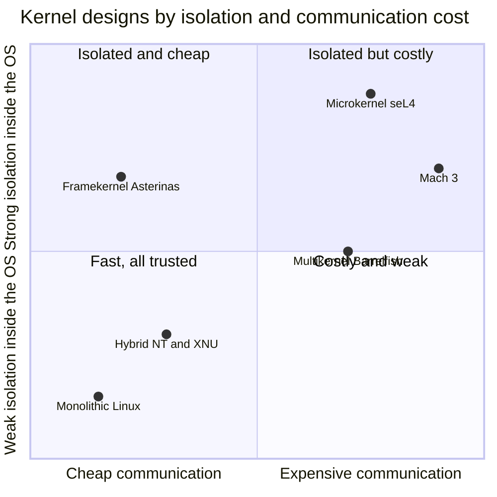
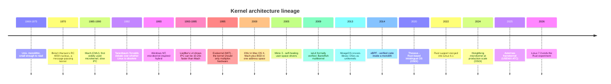
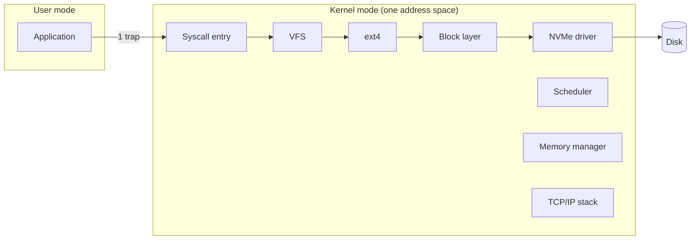
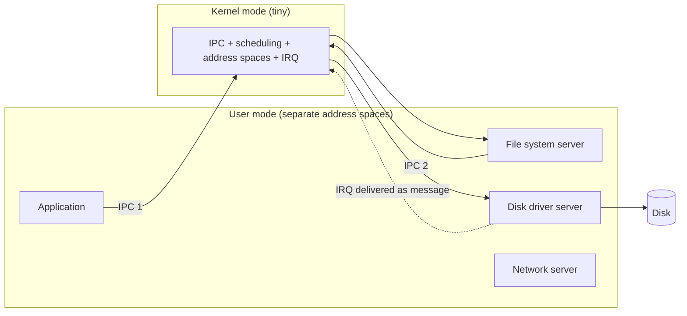

---
tags:
  - operating-systems
  - kernels
  - kernel-architecture
  - microkernel
  - monolithic-kernel
status: draft
sources:
  - https://pages.cs.wisc.edu/~remzi/OSTEP/
  - https://www.cs.vu.nl/~ast/reliable-os/
  - https://dl.acm.org/doi/10.1145/224056.224075
  - https://dl.acm.org/doi/10.1145/224057.224076
  - https://dl.acm.org/doi/10.1145/1629575.1629579
  - https://www.cs.jhu.edu/~huang/cs624/spring22/readings/seL4.pdf
  - https://sel4.systems/performance.html
  - https://www.usenix.org/conference/osdi24/presentation/chen-haibo
  - https://www.usenix.org/conference/atc25/presentation/peng-yuke
  - https://arxiv.org/html/2506.03876v1
  - https://www.trustworthy.systems/publications/papers/Heiser_26.pdf
  - https://phoronix.com/news/linux-7.0-rust
  - https://phoronix.com/news/Linux-7.3-Released
  - https://arxiv.org/abs/2104.12721
created: 2026-11-26
updated: 2026-11-26
---

## Table Of Contents

---

- [[#TL;DR|TL;DR]]
- [[#The Problem|The Problem]]
- [[#Foundations|Foundations]]
    - [[#What Every Kernel Must Do|What Every Kernel Must Do]]
    - [[#The Two Questions That Define an Architecture|The Two Questions That Define an Architecture]]
- [[#How We Got Here|How We Got Here]]
- [[#How It Works|How It Works]]
    - [[#Monolithic Kernels|Monolithic Kernels]]
    - [[#Microkernels|Microkernels]]
    - [[#Hybrid Kernels|Hybrid Kernels]]
    - [[#Exokernels and Library OSes|Exokernels and Library OSes]]
    - [[#Multikernels|Multikernels]]
    - [[#Language-Based Kernels and Framekernels|Language-Based Kernels and Framekernels]]
    - [[#The Cost of Crossing a Boundary|The Cost of Crossing a Boundary]]
- [[#Where It Is Now|Where It Is Now]]
- [[#Trade-offs & Open Problems|Trade-offs & Open Problems]]
- [[#Resources|Resources]]
- [[#Related Notes|Related Notes]]

## ***TL;DR***
---
*A kernel architecture is a decision about two things: how much code runs with full hardware privilege, and how the pieces of the OS talk to each other. Every design trades speed of communication against how much a single bug can break.*

- **Monolithic** (Linux, FreeBSD): the whole OS (scheduler, memory manager, file systems, drivers, network stack) runs in one privileged address space and talks by plain function calls. Fastest and simplest to extend; one driver bug can take down everything.
- **Microkernel** (seL4, QNX, Minix 3, L4 family): the kernel keeps only address spaces, threads, IPC and interrupts. Drivers, file systems and network stacks run as user-space servers and talk by message passing. Small trusted base, faults are contained; every service call costs IPC. See [[Microkernels and seL4]].
- **Hybrid** (Windows NT, Apple's XNU): microkernel-shaped design, but most services moved back into kernel space for speed. In practice these behave like monolithic kernels with a cleaner internal structure.
- **Exokernel / library OS** (MIT Aegis/ExOS, unikernels): the kernel only multiplexes hardware securely; abstractions like files and sockets live in a library linked into the app. See [[Unikernels and Library OSes]].
- **Multikernel** (Barrelfish): treat a many-core machine as a distributed system, one kernel per core, sharing state by messages instead of shared memory.
- **Language-based / framekernel** (Theseus, Asterinas): one address space like a monolith, but Rust's type system, not the MMU, separates a small trusted core from the rest.
- **Now (Nov 2026):** monolithic Linux dominates servers, phones and the cloud, and is absorbing ideas instead of being replaced: Rust became a permanent part of the kernel in Linux 7.0 (April 2026), and [[eBPF]] lets verified code extend the kernel safely. Microkernels own safety- and security-critical niches (seL4 in cars and drones, QNX in vehicles) and one is now mainstream at scale: Huawei's HongMeng runs on tens of millions of devices.

## ***The Problem***
---
*The kernel is the only code that can touch hardware directly, so a bug there is a bug in everything. Architecture is how a designer decides what lives in that dangerous zone.*

A CPU has (at least) two modes. In **kernel mode** code can run privileged instructions, program devices, and change page tables. In **user mode** it can't; it has to ask the kernel through a [[System Calls and the User-Kernel Boundary|system call]]. Whatever runs in kernel mode is trusted completely: a stray pointer write in a USB driver can corrupt the scheduler's data, and a security hole in a file system parser hands an attacker the whole machine.

That creates a tension every OS designer faces:

| Goal | Pulls toward |
|---|---|
| Speed: services talk to each other constantly | Put everything in one address space, call functions directly |
| Reliability: a driver crash shouldn't crash the OS | Isolate components so faults stay local |
| Security: a smaller trusted computing base (TCB) has fewer holes | Keep as little code privileged as possible |
| Extensibility: add file systems, drivers, schedulers without rebooting | Loadable modules, or swappable user-space servers |
| Verifiability: prove the kernel correct | Keep the kernel tiny |

The numbers make the stakes concrete. Heiser puts seL4 at roughly 10–12 thousand lines of code and mainstream monolithic OSes at about three orders of magnitude larger ([Heiser 2026](https://www.trustworthy.systems/publications/papers/Heiser_26.pdf)). Every line of that larger TCB is code where a bug is a whole-system bug. Studies of Linux have long found drivers to be the buggiest part of the kernel, and drivers are exactly what a monolithic kernel runs privileged.

## ***Foundations***
---
*Whatever the architecture, a kernel must provide the same handful of mechanisms. The architectures differ in which of those mechanisms are inside the privileged core and how the rest talk to it.*

### What Every Kernel Must Do

| Mechanism | What it means | Vault note |
|---|---|---|
| Protection | Separate user from kernel, and one process from another | [[System Calls and the User-Kernel Boundary]] |
| Address spaces | Give each process its own view of memory | [[Virtual Memory and Paging]] |
| Execution | Threads, context switches, deciding who runs | [[Processes and Threads]], [[CPU Scheduling]] |
| Events | Take interrupts and exceptions from hardware | [[Interrupts and Exceptions]] |
| Communication | Let components and processes exchange data | IPC, shared memory, pipes |
| Resource management | Memory allocation, devices, files, network | [[Memory Allocators]], [[File Systems]] |

A useful split, from Per Brinch Hansen and later Jochen Liedtke: **mechanism** (how to switch address spaces, how to send a message) versus **policy** (which process runs next, which page to evict). Liedtke's principle for microkernels: a concept belongs in the kernel only if moving it outside would stop the system from being built securely ([Liedtke 1995](https://dl.acm.org/doi/10.1145/224056.224075)).

### The Two Questions That Define an Architecture

1. **Where is the isolation boundary?** Hardware (MMU and privilege rings), language (type and memory safety), or none inside the kernel.
2. **How do components communicate?** Function calls in one address space, messages across address spaces, or shared memory between cores.



*Placement is qualitative. The interesting corner is top-left (strong isolation, cheap communication), which is what language-based kernels and fast microkernel IPC both chase.*

## ***How We Got Here***
---
*The history is a pendulum: monolithic Unix, then microkernels promising structure, then a performance backlash, then fast second-generation microkernels, and now safe languages offering isolation without the IPC bill.*



- **Unix (1970s)** was monolithic because it was small: a few thousand lines in one address space were easy to understand. It grew by accretion.
- **Mach (CMU, late 1980s)** moved Unix services into user-space servers over a general-purpose IPC system with ports and rights. It was elegant and slow: IPC was heavy, cache-unfriendly and called constantly, so Mach-based Unix lost badly to monoliths on real workloads. That gave microkernels a reputation they spent two decades fighting.
- **The Tanenbaum–Torvalds debate (January 1992)** on comp.os.minix crystallized the argument. Tanenbaum called monolithic Linux "a giant step back into the 1970s"; Torvalds answered that the microkernel design cost too much in performance and complexity for what it bought. Linux's success settled the commercial question; the technical one stayed open.
- **L4 (Liedtke, 1993–1995)** showed that Mach was slow because of its implementation, not because of the microkernel idea. By shrinking the kernel to the minimum and hand-tuning IPC to the hardware, L4 cut IPC cost by an order of magnitude ([Liedtke, "On µ-Kernel Construction", SOSP 1995](https://dl.acm.org/doi/10.1145/224056.224075)). L4 descendants (OKL4, Fiasco, NOVA, seL4) shipped in billions of mobile baseband chips.
- **Hybrids (NT 1993, XNU 2000)** kept a microkernel's layered structure but ran file systems, drivers and networking in kernel mode for speed. NT's graphics subsystem even moved into the kernel in NT 4.0.
- **Exokernel (MIT, 1995)** argued the opposite direction: kernel abstractions themselves are the problem, because a fixed file or memory abstraction is wrong for some app. The kernel should securely multiplex raw resources (pages, disk blocks, network packets) and let **library operating systems** build abstractions ([Engler, Kaashoek, O'Toole, SOSP 1995](https://dl.acm.org/doi/10.1145/224057.224076)).
- **seL4 (2009)** proved a microkernel's C code correct against its specification, which is only feasible because the kernel is about 8,700 lines ([Klein et al., SOSP 2009](https://www.cs.jhu.edu/~huang/cs624/spring22/readings/seL4.pdf)).
- **Barrelfish (2009)** argued that on many-core and heterogeneous hardware, shared-memory kernels hit cache-coherence walls, so an OS should be built like a distributed system ([Baumann et al., SOSP 2009](https://dl.acm.org/doi/10.1145/1629575.1629579)).
- **Safe languages (2020s)**: Rust offers memory safety without garbage collection, which reopened the question of whether isolation needs the MMU at all.

## ***How It Works***
---
*Each architecture is best understood by following one request, say a `read()` from a file, through it. What changes is how many protection boundaries the request crosses and what each crossing costs.*

### Monolithic Kernels

Everything privileged lives in one address space. A `read()` traps into the kernel once; from there VFS calls the file system, which calls the block layer, which calls the driver, all as ordinary function calls sharing data structures.



- **Modularity without isolation.** Linux has loadable kernel modules: you can add a driver at runtime, but it runs with full privilege in the same address space. Modularity is about packaging, not protection.
- **Extension without modules.** [[eBPF]] lets user space push small, verified programs into hooks across the kernel. It's the monolith's answer to "make the kernel extensible without trusting the extension".
- **Why it wins:** no IPC, shared data structures, the compiler can inline across subsystems, and a huge ecosystem of drivers. Linux runs on nearly every server, every Android phone and most embedded Linux devices.
- **Why it hurts:** every one of tens of millions of lines is trusted. Mitigations are bolted on: [[Kernel Security Hardening]] (KASLR, CFI, LSMs), and now [[Rust in the Linux Kernel]] to make new drivers memory-safe.

### Microkernels

The kernel keeps only what can't be done safely outside it: address spaces, threads and scheduling, IPC, interrupt delivery, and access control (usually capabilities). Everything else is a user-space server.



- The same `read()` now costs at least two IPC round trips (app → file system, file system → driver), each with address-space switches.
- In exchange, a crashed driver is just a crashed process. Minix 3's reincarnation server restarts failed drivers transparently; QNX has run car infotainment and industrial control this way for decades.
- The TCB for a given application is the kernel plus only the servers it depends on.
- Details and the seL4 case: [[Microkernels and seL4]].

### Hybrid Kernels

"Hybrid" is mostly a marketing category. Windows NT has a layered design (a small kernel, an executive of managers, a hardware abstraction layer) and an IPC mechanism (ALPC), but drivers, file systems, networking and much of the graphics stack run in kernel mode. XNU combines Mach (tasks, threads, IPC, virtual memory) with a BSD layer (processes, POSIX, networking, VFS) and IOKit drivers, all in one kernel address space. Performance and failure behavior are those of a monolith. Apple has been moving the other direction since 2019: DriverKit lets many drivers run in user space as system extensions.

### Exokernels and Library OSes

An exokernel does secure multiplexing and nothing else: it tracks who owns which physical page, disk block and network flow, and checks access, but doesn't define files or sockets. Each application links a **library OS** that implements those abstractions however suits it. MIT's Aegis/ExOS showed large speedups for apps that customized their own abstractions (a web server that laid out files on disk for its own access pattern, for example).

The pure exokernel never went mainstream, but its two ideas did:
- **Library OSes** came back as **unikernels** (MirageOS, Unikraft) and as compatibility layers (Drawbridge, Gramine). See [[Unikernels and Library OSes]].
- **Moving the data path out of the kernel** is what [[Kernel Bypass Networking]] (DPDK, RDMA) and [[io_uring]]'s shared rings do, under the control of a conventional kernel.

### Multikernels

Barrelfish ran one kernel instance (a "CPU driver") per core. OS state such as page-table mappings was replicated per core and kept consistent by explicit messages, like replicas in a distributed system, rather than shared under locks. The argument: cache coherence is itself message passing in hardware, it doesn't scale cleanly to hundreds of cores or heterogeneous chips, so make the messages explicit ([Baumann et al. 2009](https://dl.acm.org/doi/10.1145/1629575.1629579)). The ideas live on in research and in seL4's multikernel configuration, where verification across cores is in progress ([Heiser 2026](https://www.trustworthy.systems/publications/papers/Heiser_26.pdf)). For the distributed-systems view of replicated state, see [[Replication]].

### Language-Based Kernels and Framekernels

If the compiler can prove a component never touches memory it doesn't own, you don't need a separate address space to contain it. Singularity (Microsoft Research, C#) tried this in the 2000s; Rust made it practical without a garbage collector.

**Asterinas** calls its version a **framekernel**: one address space and function-call speed like a monolith, but only a small "OS framework" (OSTD) may use `unsafe` Rust. Drivers, file systems and the scheduler policy are written in safe Rust against OSTD's APIs ([Peng et al., USENIX ATC 2025](https://arxiv.org/html/2506.03876v1)).

```rust
// The idea of a framekernel in one line of policy:
// OS services are compiled with this attribute, so the compiler
// rejects any `unsafe` block outside the trusted framework crate.
#![deny(unsafe_code)]
```

The attribute shown is standard Rust; Asterinas enforces the rule at crate level so that only OSTD may contain `unsafe`. Its numbers:

| Metric (Asterinas paper) | Value |
|---|---|
| TCB as share of codebase | about 14% (10,571 of 75,285 LoC) |
| Same measure for Tock / Theseus / RedLeaf | 43.8% / 62.4% / 66.1% |
| Linux syscalls supported | 210+ |
| Nginx, Redis vs Linux (single core, QEMU) | 1.17x, 1.31x throughput |
| SQLite vs Linux | about 0.85x (IOMMU and small-write overhead) |

The catch: language isolation is only as strong as the compiler, the `unsafe` core, and the hardware. It doesn't protect against [[Transient Execution Attacks and Mitigations|Spectre-class]] side channels, and DMA from devices needs the IOMMU regardless.

### The Cost of Crossing a Boundary

The whole monolith-versus-microkernel argument comes down to one quantity: how much of an operation's time goes to crossing protection boundaries.

$$
\text{overhead} = \frac{n_{\text{cross}} \cdot c_{\text{cross}}}{T_{\text{work}} + n_{\text{cross}} \cdot c_{\text{cross}}}
$$

**In plain words:** multiply how many times a request crosses into another protection domain ($n$) by what each crossing costs ($c$), and compare that to the useful work the request does ($T_{\text{work}}$).

**Worked example.** seL4 on an x86-64 Skylake at 3.4 GHz measures an IPC call at about 742 cycles and the reply at about 598 cycles, so one round trip is about 1,340 cycles, or roughly 0.39 µs ([seL4 performance page](https://sel4.systems/performance.html)).

- A 4 KiB read that hits the page cache does maybe 1 µs of real work. On a microkernel it makes two round trips (app → FS server, FS server → cache or driver): $2 \times 0.39 = 0.79$ µs of crossing. Overhead $= 0.79 / (1 + 0.79) \approx 44\%$.
- The same read from an NVMe SSD does about 80 µs of work (device latency dominates). Overhead $= 0.79 / 80.79 \approx 1\%$.

So microkernel cost matters for chatty, cache-hot paths and disappears for I/O-bound ones. That's why fast IPC (L4's lesson) and fewer crossings (batching, shared-memory rings, putting hot paths in the same domain) decide whether a microkernel is competitive. Mach's IPC was an order of magnitude slower, which turned that 44% into a multiple.

## ***Where It Is Now***
---
*As of November 2026, there is no single winner. Linux keeps winning the general-purpose market by absorbing safer techniques, microkernels have won where assurance matters, and Rust is making the boundary between the two blurrier.*

**Linux, the monolith, keeps adapting**
- Linux 7.0 (released April 2026) formally ended the "Rust experiment": Miguel Ojeda's patch says "Rust is here to stay" ([Phoronix, Feb 2026](https://phoronix.com/news/linux-7.0-rust)). New drivers, notably GPU drivers, are increasingly written in Rust. See [[Rust in the Linux Kernel]].
- Linux 7.3 (18 Oct 2026) is the expected 2026 long-term-support kernel ([Phoronix](https://phoronix.com/news/Linux-7.3-Released)).
- Extensibility without trust is going through [[eBPF]], including pluggable schedulers via [[sched_ext and Pluggable Scheduling|sched_ext]], rather than through architectural change.

**Microkernels in production**
- **HongMeng** (Huawei, OSDI 2024): a general-purpose, Linux-ABI-compatible microkernel deployed on "tens of millions of devices" (routers, cars, phones). Its paper argues classic microkernel techniques (frequent IPC, duplicated state across servers, capabilities hiding kernel objects) cost too much, and relaxes them with configurable isolation classes and policy-free kernel paging ([Chen et al.](https://www.usenix.org/conference/osdi24/presentation/chen-haibo)).
- **seL4** is in cars (NIO's ONVO L60), drones and secure communications, and completed its AArch64 confidentiality proof in August 2026 ([Heiser 2026](https://www.trustworthy.systems/publications/papers/Heiser_26.pdf)). See [[Microkernels and seL4]].
- **QNX** remains a large automotive and embedded microkernel; **Zircon** (Google Fuchsia) is a capability-based microkernel running on Nest devices.

**Research directions (2024–2026)**
- **Framekernels and Rust OSes:** Asterinas (Linux-compatible, about 14% TCB) shows language-based isolation can match a monolith on some benchmarks ([USENIX ATC 2025](https://www.usenix.org/conference/atc25/presentation/peng-yuke)).
- **Specialization:** unikernels like Unikraft run off-the-shelf apps 1.7x–2.7x faster than Linux guests in about 1 MB images ([Kuenzer et al., EuroSys 2021](https://arxiv.org/abs/2104.12721)), and in 2026 are being sold as dense sandboxes for AI agents. See [[Unikernels and Library OSes]].
- **Verification:** seL4 shows full-kernel proofs are possible for a microkernel; verified components for larger systems are the next step. See [[Formally Verified OS Components]].

| Architecture | Representative 2026 systems | Where it dominates |
|---|---|---|
| Monolithic | Linux 7.x, FreeBSD, OpenBSD | Servers, cloud, Android, desktops (Linux) |
| Hybrid | Windows NT kernel, XNU | Windows PCs, Apple devices |
| Microkernel | seL4, QNX, HongMeng, Zircon, Minix 3 | Cars, avionics, defense, Huawei devices |
| Library OS / unikernel | Unikraft, MirageOS, Nanos, Gramine | Serverless, sandboxes, confidential computing |
| Framekernel / Rust OS | Asterinas, Theseus, Redox | Research and early adopters |

## ***Trade-offs & Open Problems***
---
*Each architecture buys one property by paying in another, and the open questions are about getting isolation cheaply and keeping huge kernels trustworthy.*

| Choice | You get | You pay |
|---|---|---|
| Monolithic | Fastest paths, one address space, huge driver ecosystem | Enormous TCB; one bug can compromise everything |
| Microkernel | Fault isolation, small verifiable TCB, restartable drivers | IPC on every cross-service call; harder to share state; smaller ecosystem |
| Hybrid | Structured design, near-monolithic speed | Isolation mostly on paper, since services run privileged |
| Exokernel / library OS | App-specific abstractions, minimal kernel | Each app carries its own OS; hard to share resources fairly; weak multi-app story |
| Multikernel | Scales without shared-memory coherence | Replicated state is complex; few production systems |
| Framekernel | Monolith speed with a small trusted core | Trust rests on the compiler and `unsafe` audit; no side-channel isolation |

Open problems worth tracking:
- **Drivers are the weak point everywhere.** They are most of the code and most of the bugs. Rust drivers in Linux, user-space drivers in microkernels and DriverKit, and verified driver frameworks (seL4's LionsOS) are three answers to the same problem.
- **Compatibility is the moat.** Any new architecture must run Linux binaries to matter; HongMeng and Asterinas both chose Linux ABI compatibility. How much of the Linux ABI can be reproduced faithfully, without its bugs, is unresolved.
- **Hardware isolation keeps getting cheaper and more varied:** tagged TLBs, PKU/MPK memory keys, CHERI capabilities, confidential-computing enclaves. Each one changes the cost of crossing a boundary and so the balance between designs.
- **Multicore verification.** seL4's proofs cover single-core configurations; verifying concurrency in a kernel remains hard. See [[Locks and Synchronization]] and [[Read-Copy-Update (RCU)]].
- **Side channels ignore architecture.** Spectre-class attacks cross address spaces and language boundaries alike. See [[Transient Execution Attacks and Mitigations]].

## ***Resources***
---
*Start with OSTEP for the mechanisms, then read Liedtke and the exokernel paper side by side for the two opposite reactions to Mach, and finish with HongMeng and Asterinas for where the argument stands now.*

**Textbooks and courses**
- [Operating Systems: Three Easy Pieces](https://pages.cs.wisc.edu/~remzi/OSTEP/): Remzi and Andrea Arpaci-Dusseau. Free; the virtualization and concurrency parts underpin this note.
- [Tanenbaum: Reliable OS / Minix 3](https://www.cs.vu.nl/~ast/reliable-os/): the case for microkernels from the other side of the 1992 debate.

**Primary papers**
- [On µ-Kernel Construction](https://dl.acm.org/doi/10.1145/224056.224075): Jochen Liedtke, SOSP 1995.
- [Exokernel: An Operating System Architecture for Application-Level Resource Management](https://dl.acm.org/doi/10.1145/224057.224076): Engler, Kaashoek, O'Toole, SOSP 1995.
- [The Multikernel: A New OS Architecture for Scalable Multicore Systems](https://dl.acm.org/doi/10.1145/1629575.1629579): Baumann et al., SOSP 2009.
- [seL4: Formal Verification of an OS Kernel](https://www.cs.jhu.edu/~huang/cs624/spring22/readings/seL4.pdf): Klein et al., SOSP 2009.
- [Microkernel Goes General: Performance and Compatibility in the HongMeng Production Microkernel](https://www.usenix.org/conference/osdi24/presentation/chen-haibo): Chen et al., OSDI 2024.
- [Asterinas: A Linux ABI-Compatible, Rust-Based Framekernel OS with a Small and Sound TCB](https://arxiv.org/html/2506.03876v1): Peng et al., USENIX ATC 2025.
- [Unikraft: Fast, Specialized Unikernels the Easy Way](https://arxiv.org/abs/2104.12721): Kuenzer et al., EuroSys 2021.

**Current state**
- [seL4: Operating Systems With the Reliability of Mathematics](https://www.trustworthy.systems/publications/papers/Heiser_26.pdf): Gernot Heiser, IEEE Reliability Magazine, June 2026.
- [seL4 performance figures](https://sel4.systems/performance.html): IPC cycle counts used in the worked example.
- [Linux 7.0 officially concluding the Rust experiment](https://phoronix.com/news/linux-7.0-rust): Phoronix, Feb 2026.
- [Linux 7.3 released](https://phoronix.com/news/Linux-7.3-Released): Phoronix, Oct 2026.

## Related Notes

- [[Microkernels and seL4]] — The microkernel design in depth, and the verified kernel that proved it can be fast.
- [[Unikernels and Library OSes]] — The exokernel's library-OS idea, revived for the cloud.
- [[eBPF]] — How a monolithic kernel became safely programmable.
- [[System Calls and the User-Kernel Boundary]] — The crossing every architecture is built around.
- [[Processes and Threads]] — The execution abstraction every kernel provides.
- [[Virtual Memory and Paging]] — Address spaces, the hardware isolation mechanism behind most designs.
- [[CPU Scheduling]] — Policy that monoliths keep inside and microkernels sometimes push out.
- [[Interrupts and Exceptions]] — How hardware events reach the kernel, or a user-space driver.
- [[Locks and Synchronization]] — What shared-memory kernels need and multikernels try to avoid.
- [[Read-Copy-Update (RCU)]] — Linux's answer to scaling shared kernel data.
- [[Rust in the Linux Kernel]] — Memory safety arriving in the monolith.
- [[Kernel Security Hardening]] — Mitigations a large TCB needs.
- [[Transient Execution Attacks and Mitigations]] — Side channels that cross every kind of boundary.
- [[Virtualization and Hypervisors]] — A hypervisor is a kernel for kernels, often microkernel-shaped.
- [[MicroVMs and Sandboxing]] — Isolation for untrusted code without a full OS.
- [[Kernel Bypass Networking]] — Moving the data path out of the kernel, the exokernel way.
- [[io_uring]] — Fewer boundary crossings through shared rings.
- [[sched_ext and Pluggable Scheduling]] — Swappable policy in a monolith.
- [[Formally Verified OS Components]] — Proofs beyond seL4.
- [[Replication]] — The distributed-systems idea behind multikernel state.
