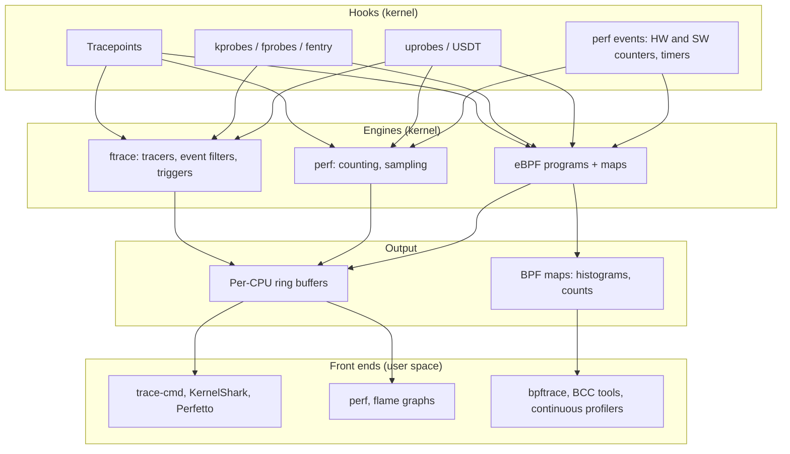
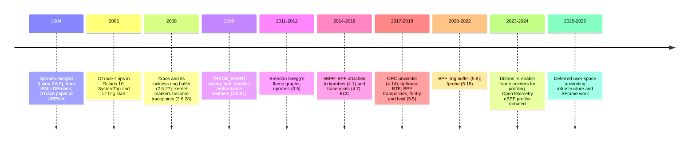

---
tags:
  - operating-systems
  - kernels-and-architecture
  - observability
  - tracing
status: draft
sources:
  - https://docs.kernel.org/trace/ftrace.html
  - https://docs.kernel.org/trace/tracepoints.html
  - https://docs.kernel.org/trace/events.html
  - https://docs.kernel.org/trace/kprobes.html
  - https://docs.kernel.org/trace/uprobetracer.html
  - https://docs.kernel.org/trace/fprobe.html
  - https://docs.kernel.org/trace/ring-buffer-design.html
  - https://docs.kernel.org/staging/static-keys.html
  - https://docs.kernel.org/arch/x86/orc-unwinder.html
  - https://man7.org/linux/man-pages/man2/perf_event_open.2.html
  - https://perfwiki.github.io/main/
  - https://github.com/bpftrace/bpftrace
  - https://github.com/iovisor/bcc
  - https://www.brendangregg.com/flamegraphs.html
  - https://www.brendangregg.com/bpf-performance-tools-book.html
  - https://www.usenix.org/legacy/event/usenix04/tech/general/full_papers/cantrill/cantrill.pdf
  - https://research.google/pubs/google-wide-profiling-a-continuous-profiling-infrastructure-for-data-centers/
  - https://lwn.net/Articles/365835/
  - https://lwn.net/Articles/370423/
  - https://www.brendangregg.com/blog/2024-03-17/the-return-of-the-frame-pointers.html
  - https://fedoraproject.org/wiki/Changes/fno-omit-frame-pointer
  - https://sourceware.org/binutils/wiki/sframe
  - https://github.com/open-telemetry/opentelemetry-ebpf-profiler
  - https://perfetto.dev/docs/
  - https://lttng.org/docs/
created: 2026-11-26
updated: 2026-11-26
---

## Table Of Contents

---

- [[#TL;DR|TL;DR]]
- [[#The Problem|The Problem]]
- [[#Foundations|Foundations]]
    - [[#Counting, Tracing and Sampling|Counting, Tracing and Sampling]]
    - [[#Static and Dynamic Instrumentation|Static and Dynamic Instrumentation]]
    - [[#The Layers - Probes, Buffers, Front Ends|The Layers - Probes, Buffers, Front Ends]]
- [[#How We Got Here|How We Got Here]]
- [[#How It Works|How It Works]]
    - [[#Tracepoints and Static Keys|Tracepoints and Static Keys]]
    - [[#What Tracing Costs - Measured|What Tracing Costs - Measured]]
    - [[#ftrace - the Function Tracer and tracefs|ftrace - the Function Tracer and tracefs]]
    - [[#kprobes, fprobes and uprobes|kprobes, fprobes and uprobes]]
    - [[#The Ring Buffer|The Ring Buffer]]
    - [[#perf_events - Counters and Sampling|perf_events - Counters and Sampling]]
    - [[#Stack Traces - Frame Pointers, ORC, DWARF and SFrame|Stack Traces - Frame Pointers, ORC, DWARF and SFrame]]
    - [[#BPF Tracing - Programs at the Probe|BPF Tracing - Programs at the Probe]]
    - [[#Choosing a Tool|Choosing a Tool]]
- [[#Where It Is Now|Where It Is Now]]
- [[#Trade-offs & Open Problems|Trade-offs & Open Problems]]
- [[#Resources|Resources]]
- [[#Related Notes|Related Notes]]

## ***TL;DR***
---
*Kernel observability is the set of hooks that let you see what the kernel is doing in production without rebuilding or rebooting it: fixed tracepoints compiled into the code, dynamic probes that can be placed on almost any instruction, hardware and software event counters, and a fast per-CPU ring buffer to record it all. eBPF turned these hooks into a programmable, safe, always-on analysis platform.*

- **Three kinds of data:** *counts* (how many context switches?), *traces* (every event, with timestamps and arguments), and *samples* (where is the CPU spending time, checked N times per second). Each has a different cost profile.
- **Two kinds of hooks:** **static** tracepoints, placed by kernel developers with stable-ish names and typed fields (this note's VM has 2,305 of them in 105 subsystems), and **dynamic** probes (kprobes, fprobes, uprobes) attachable to functions or instructions at runtime ([tracepoints](https://docs.kernel.org/trace/tracepoints.html), [kprobes](https://docs.kernel.org/trace/kprobes.html)).
- **Off means almost free.** Disabled tracepoints are a no-op instruction patched in with *static keys*; turning two syscall tracepoints on took a `getppid()` from about 85–110 ns to about 230–260 ns on this note's VM, and turning them off restored it.
- **Three main interfaces:** **ftrace** (via the `tracefs` file system, built into the kernel), **perf** (`perf_event_open()`: counters, sampling, tracepoints), and **eBPF** (run a verified program at any hook and aggregate in kernel maps), with front ends such as `trace-cmd`, `perf`, `bpftrace` and BCC ([ftrace](https://docs.kernel.org/trace/ftrace.html), [perf_event_open(2)](https://man7.org/linux/man-pages/man2/perf_event_open.2.html), [bpftrace](https://github.com/bpftrace/bpftrace)).
- **Where it is now (Nov 2026):** the hard open problem is cheap *user-space* stack traces: distributions re-enabled frame pointers (Fedora 38, Ubuntu 24.04), and the kernel is adding deferred user unwinding with an eye to the compact SFrame format; continuous fleet-wide profiling with eBPF (for example the OpenTelemetry eBPF profiler) has become a standard practice.

## ***The Problem***
---
*Performance and correctness bugs in an OS often appear only under production load, on one machine in a thousand, for a few milliseconds. You can't attach a debugger to a production kernel, and you can't afford to log everything. Observability tools must be safe, cheap when off, and fast enough when on to leave the behaviour they measure intact.*

Questions engineers actually ask, and what answers them:

| Question | Data needed | Typical tool |
|---|---|---|
| Why is this request slow? | Latency breakdown across syscalls, scheduling, I/O | `bpftrace` histograms, `perf trace`, off-CPU analysis |
| Where is CPU time going? | Stack samples across kernel and user space | `perf record -g`, flame graphs, continuous profilers |
| Why did this task wait 40 ms? | Scheduler events: wakeups, switches, run-queue delay | `sched_switch`/`sched_wakeup` tracepoints, `runqlat` |
| Which code path hit this function? | Stack trace at a function entry | kprobe or fprobe with stack, function graph tracer |
| Is the CPU stalling on memory? | Hardware counters (cycles, instructions, cache misses) | `perf stat` |

Constraints that make it hard:

- **Observer effect.** Instrumentation adds latency and cache pollution; heavy tracing changes the timing it is trying to measure.
- **Safety.** Probing kernel code means running code inside the kernel at arbitrary points, including in interrupt and NMI context where locks and sleeping are forbidden ([[Lock-Free Data Structures and Memory Ordering]]).
- **Volume.** A busy server makes millions of syscalls and context switches per second; recording them all fills memory in seconds.

## ***Foundations***
---
*Pick what to collect (counts, traces or samples), decide whether the hook is compiled in or placed at runtime, and recognise the three layers every tool shares: probes, a buffer or map, and a user-space front end.*

#### **Counting, Tracing and Sampling**

| Method | Records | Cost scales with | Good for | Weakness |
|---|---|---|---|---|
| Counting | A number per event type | Event rate (cheap per event) | "How many?", rates | No detail on which or why |
| Tracing | Every event with timestamp and fields | Event rate × record size | Ordering, latency, causality | Volume; overhead at high rates |
| Sampling | A snapshot (stack, registers) every N events or every T ms | Sample rate, not event rate | CPU profiles at any load | Statistical; misses short rare events |
| In-kernel aggregation (eBPF) | Histograms and counts computed at the probe | Event rate × program cost, but tiny output | Latency distributions, per-key stats | Must decide what to aggregate up front |

#### **Static and Dynamic Instrumentation**

- **Static tracepoints** are written into the source by maintainers at meaningful points (`sched_switch`, `block_rq_issue`, `tcp_retransmit_skb`), with named, typed fields and a format the tools can read. They survive refactoring and are reasonably stable across versions, but only exist where someone thought to put them.
- **Dynamic probes** attach at runtime to almost any kernel function (**kprobes**, **fprobes**, BPF `fentry`) or any user-space instruction (**uprobes**). Nothing has to be planned ahead, but the probe point is an implementation detail that can be renamed, inlined away or change arguments between kernel versions.
- **User-space static probes (USDT)** are the user-space equivalent of tracepoints, compiled into programs like PostgreSQL, Python and the JVM as no-op instructions plus an ELF note that tools can find and turn into uprobes.

#### **The Layers - Probes, Buffers, Front Ends**



## ***How We Got Here***
---
*Solaris DTrace (2004–2005) showed what safe, production-wide dynamic tracing could be. Linux arrived at the same capability in pieces: kprobes, ftrace, tracepoints and perf in 2004–2009, then eBPF from 2014 tied them together.*



- **Before 2004.** Linux had `printk`, `/proc` counters, `strace` (built on `ptrace`, which stops the traced process at every syscall and is very slow), and `oprofile` for sampling. Kernel developers resisted static tracepoints as clutter.
- **DTrace changed expectations.** Sun's DTrace (Cantrill, Shapiro, Leventhal) gave Solaris administrators a safe language (D) to attach probes anywhere in production, with aggregation in the kernel ([USENIX 2004](https://www.usenix.org/legacy/event/usenix04/tech/general/full_papers/cantrill/cantrill.pdf)). Its licence kept it out of Linux, and SystemTap's approach (compiling scripts into kernel modules) was powerful but risky and awkward.
- **Linux's building blocks.** Steven Rostedt's ftrace and ring buffer, Mathieu Desnoyers's tracepoints, and the perf_events subsystem (Ingo Molnar, Thomas Gleixner, Peter Zijlstra and others) landed in 2008–2009 ([LWN on the TRACE_EVENT macro](https://lwn.net/Articles/370423/)). perf unified hardware counters, software events and tracepoints under one system call.
- **eBPF closed the gap.** Attaching verified BPF programs to kprobes (4.1) and tracepoints gave Linux DTrace-like safe, in-kernel aggregation. Brendan Gregg's BCC tools and later bpftrace's one-line language made it usable ([BPF Performance Tools](https://www.brendangregg.com/bpf-performance-tools-book.html)). See [[eBPF]] for the verifier, maps and program types.

## ***How It Works***
---
*Follow an event from the hook to the screen: how a tracepoint costs nothing when off, what it costs when on, how ftrace patches every function, how dynamic probes work, how the ring buffer stays lock-free, how perf samples, how stack traces are unwound, and where BPF fits.*

#### **Tracepoints and Static Keys**

A tracepoint is declared with the `TRACE_EVENT()` macro, which generates the record layout, the code to fill it and the print format ([events docs](https://docs.kernel.org/trace/events.html)). The call site in the kernel looks like an ordinary function call, for example `trace_sched_switch(preempt, prev, next, prev_state)` in the scheduler.

When nobody is listening, the call is skipped by a **static key** (jump label): the compiler emits a 5-byte `nop` at the call site, and enabling the tracepoint rewrites that `nop` into a `jmp` to the tracing code at runtime ([static keys](https://docs.kernel.org/staging/static-keys.html)). No branch, no load of a flag: the disabled cost is one no-op instruction, which is why the kernel can afford thousands of tracepoints.

The record format is self-describing. Real output from this note's VM, `/sys/kernel/tracing/events/sched/sched_switch/format` (abridged):

| Field | Offset | Size (bytes) |
|---|---|---|
| `common_type`, `common_flags`, `common_preempt_count`, `common_pid` | 0–7 | 2 + 1 + 1 + 4 |
| `char prev_comm[16]` | 8 | 16 |
| `pid_t prev_pid` | 24 | 4 |
| `int prev_prio` | 28 | 4 |
| `long prev_state` | 32 | 8 |
| `char next_comm[16]` | 40 | 16 |
| `pid_t next_pid` | 56 | 4 |
| `int next_prio` | 60 | 4 |

So each context switch recorded costs 64 bytes of payload plus a small ring-buffer header. Tools read this file to decode records without kernel headers, and BPF programs get the same layout as a typed context.

#### **What Tracing Costs - Measured**

A loop of 2 million `getppid()` system calls on this note's 4-vCPU cloud VM (Linux 6.18, Firecracker), with the `raw_syscalls:sys_enter` and `sys_exit` tracepoints recorded into the ftrace ring buffer:

| State | Time per `getppid()` (two runs) |
|---|---|
| Tracepoints off | 83.8 ns, 112.1 ns |
| Both tracepoints on, recording | 261.3 ns, 229.8 ns |
| Turned off again | 90.9 ns |

How to read it: recording two events per syscall added roughly 120–180 ns, so about 60–90 ns per recorded event (timestamp, ring-buffer reservation, copying six arguments). Turning the tracepoints off brought the cost straight back, which is the static-key design working. Scaled up: a server doing 1 million syscalls per second per core would spend about 12–18% of each core on this tracing, which is why production tools filter in the kernel or aggregate with BPF instead of recording every event.

#### **ftrace - the Function Tracer and tracefs**

ftrace is the kernel's built-in tracer, controlled entirely by writing to files in **tracefs** (mounted at `/sys/kernel/tracing`) ([ftrace docs](https://docs.kernel.org/trace/ftrace.html)):

```sh
cd /sys/kernel/tracing
echo 1 > events/sched/sched_switch/enable        # turn on one tracepoint
echo 'prev_pid == 1234' > events/sched/sched_switch/filter   # filter in the kernel
echo function_graph > current_tracer             # trace every kernel function call
echo vfs_read > set_graph_function               # ...but only under vfs_read
cat trace_pipe                                   # stream the results
```

The **function tracer** works because the kernel is compiled with `-pg`/`-mfentry`, which puts a call at the start of every function. At boot those calls are patched to `nop`s; enabling function tracing patches selected ones back to calls into ftrace (`CONFIG_DYNAMIC_FTRACE`). The **function graph** tracer also hooks returns, giving call trees with per-function durations. Other built-in tracers measure the longest interrupts-off or preemption-off sections and wakeup latency, which is how real-time kernels are tuned ([[PREEMPT_RT and Real-Time Linux]]). `trace-cmd` and KernelShark are friendlier front ends to the same files; **histogram triggers** can aggregate inside ftrace without BPF.

#### **kprobes, fprobes and uprobes**

- **kprobes** ([docs](https://docs.kernel.org/trace/kprobes.html)) replace the first byte of the probed instruction with a breakpoint (`int3` on x86). When it hits, the trap handler runs the probe handler, then single-steps or emulates the displaced instruction and continues. Where possible the kprobe is "optimised" into a jump. **kretprobes** hijack the return address to catch function returns. They work almost anywhere, except in functions marked unsafe to probe (`NOKPROBE_SYMBOL`), such as the breakpoint handler itself.
- **fprobes** ([docs](https://docs.kernel.org/trace/fprobe.html)) and BPF's **fentry/fexit** use the ftrace call site at function entry instead of a breakpoint: much cheaper, but only at function boundaries.
- **uprobes** ([docs](https://docs.kernel.org/trace/uprobetracer.html)) do the same for user-space code: the kernel writes a breakpoint into the page of the executable as mapped (copy-on-write, so the file on disk is unchanged) and handles the trap. Each hit costs a trap into the kernel, typically a microsecond or two, which is why tracing a hot user-space function this way is noticeably slower than tracing kernel functions.

Not every kernel has all of these: this note's VM was built without `CONFIG_KPROBES` and `CONFIG_FPROBE`, and exposes no hardware performance counters, both common in minimal cloud and microVM kernels, so only tracepoints, the function tracer and software perf events were available there.

#### **The Ring Buffer**

ftrace and perf both write into **per-CPU ring buffers** so that writers on different CPUs never contend, and writers never take locks, which makes them safe in NMI context ([ring buffer design](https://docs.kernel.org/trace/ring-buffer-design.html)):

- A writer **reserves** space with local atomic operations on its own CPU's buffer, fills the record, then **commits** it. A nested writer (an interrupt arriving mid-write) simply reserves the next slot; the outer writer's commit is deferred until the nested one finishes.
- The buffer is a list of pages. In overwrite mode (ftrace's default, "flight recorder") the oldest page is dropped when full; in producer-consumer mode new events are dropped and counted as lost.
- Readers swap whole pages out of the ring, so the reader never blocks the writer.

Default size on this note's VM was 1,410 KB per CPU, which held about 60,000 syscall events of the 8 million generated in the test above: in flight-recorder mode you see the most recent slice, not the whole run.

#### **perf_events - Counters and Sampling**

`perf_event_open()` opens one event as a file descriptor ([man page](https://man7.org/linux/man-pages/man2/perf_event_open.2.html), [perf wiki](https://perfwiki.github.io/main/)):

- **Hardware events** from the CPU's performance monitoring unit (PMU): cycles, instructions, cache misses, branch mispredictions.
- **Software events** maintained by the kernel: task clock, context switches, page faults, CPU migrations.
- **Tracepoints**, kprobes and uprobes, as events.

Each event can be **counted** (read the total) or **sampled**: every N events or at a fixed frequency, the PMU raises an interrupt (an NMI on x86) and the kernel writes a sample (instruction pointer, PID, optionally a stack trace and registers) into a ring buffer that the `perf` tool maps into user space. `perf stat` counts, `perf record` samples, `perf report` and flame graphs ([Gregg](https://www.brendangregg.com/flamegraphs.html)) visualise.

Sampling cost is set by the rate, not by the workload:

$$\text{samples} = f \times N_{\text{CPU}} \times t \qquad \text{overhead} \approx \frac{\text{samples} \times c_{\text{sample}}}{N_{\text{CPU}} \times t} = f \times c_{\text{sample}}$$

In words: the share of CPU time spent sampling is the sampling frequency times the cost of one sample, whatever the machine is doing. Worked example: profiling 64 CPUs at 99 Hz for 30 s takes $99 \times 64 \times 30 = 190{,}080$ samples. If each sample with a stack trace costs about 2 µs, that is 0.38 CPU-seconds out of 1,920, or $99 \times 2\,\mu s \approx 0.02\%$ overhead. (99 Hz rather than 100 Hz avoids sampling in lock-step with timer-driven work.) This low, predictable cost is why always-on fleet-wide profiling is practical, a point Google made with its Google-Wide Profiling system in 2010 ([GWP](https://research.google/pubs/google-wide-profiling-a-continuous-profiling-infrastructure-for-data-centers/)).

On this note's VM, the hardware events returned "No such file or directory": the hypervisor doesn't expose the PMU to the guest. The task-clock software event worked and measured 95.6 ns per `getppid()`, consistent with the timing above.

#### **Stack Traces - Frame Pointers, ORC, DWARF and SFrame**

A profile is only as good as its stack traces, and getting them cheaply is surprisingly hard:

| Method | How it walks the stack | Cost at sample time | Catch |
|---|---|---|---|
| Frame pointers | Follow the chain of saved frame-pointer registers | Very cheap | Compilers omit them by default (`-fomit-frame-pointer`), freeing a register; costs ~1–2% in some code |
| ORC (kernel only) | Kernel-generated compact unwind tables (from `objtool`) | Cheap | Only for the kernel itself ([ORC](https://docs.kernel.org/arch/x86/orc-unwinder.html)) |
| DWARF (`.eh_frame`) | Interpret debug unwind info | Too slow and complex in the kernel; perf copies raw stack memory to user space and unwinds later | Copies kilobytes per sample |
| LBR / shadow stacks | Hardware records recent branches or return addresses | Cheap | Limited depth, CPU-specific |
| SFrame | Compact "simple frame" unwind tables emitted by the GNU toolchain ([SFrame](https://sourceware.org/binutils/wiki/sframe)) | Designed to be cheap enough for the kernel to use on user stacks | Needs toolchain, distro and kernel support together |

User-space stacks are the hard case. Because most distribution binaries were built without frame pointers, profilers saw broken user stacks for years. Fedora 38 (2023) and Ubuntu 24.04 rebuilt their packages with frame pointers specifically to fix profiling ([Fedora change](https://fedoraproject.org/wiki/Changes/fno-omit-frame-pointer), [Gregg, 2024](https://www.brendangregg.com/blog/2024-03-17/the-return-of-the-frame-pointers.html)). In the kernel, **deferred user unwinding** collects the user stack once, just before the task returns to user space, instead of in NMI context where user memory may be paged out; that infrastructure is the base for SFrame-based unwinding (this note's 6.18 VM kernel has `CONFIG_UNWIND_USER=y`).

#### **BPF Tracing - Programs at the Probe**

eBPF attaches a small verified program to any of the hooks above, so filtering and aggregation happen *at the event* and only a summary crosses to user space (details in [[eBPF]]):

```sh
# Histogram of read() sizes, per process name, computed in the kernel
bpftrace -e 'tracepoint:syscalls:sys_exit_read /args.ret > 0/ { @bytes[comm] = hist(args.ret); }'

# Run-queue latency: time from wakeup to running, as a histogram
bpftrace -e 'tracepoint:sched:sched_wakeup { @ts[args.pid] = nsecs; }
             tracepoint:sched:sched_switch /@ts[args.next_pid]/ {
               @usecs = hist((nsecs - @ts[args.next_pid]) / 1000);
               delete(@ts[args.next_pid]); }'
```

In plain words: the first line records, for each process name, a power-of-two histogram of how many bytes each successful `read()` returned. The second stores a timestamp when a task is woken and, when it actually starts running, adds the elapsed microseconds to a histogram, which is the "scheduling delay" a latency-sensitive service suffers ([[CPU Scheduling]]). Neither writes per-event records anywhere; the histograms live in BPF maps and are printed on exit. BCC ships ready-made tools on the same idea (`execsnoop`, `opensnoop`, `biolatency`, `runqlat`, `offcputime`) ([BCC](https://github.com/iovisor/bcc)).

BTF type information means programs can read kernel structures by field name, and `fentry`/`fexit` programs receive typed function arguments directly, so modern BPF tracing doesn't need kernel headers installed.

#### **Choosing a Tool**

| Situation | Reach for |
|---|---|
| What is this process doing, syscall by syscall? | `strace` for a quick look (slow: uses ptrace); `perf trace` for low overhead |
| Where is CPU time going, system-wide? | `perf record -F 99 -a -g` and a flame graph, or a continuous profiler |
| Is the problem waiting, not computing? | Off-CPU analysis: `offcputime` (BCC), `sched_switch` with stacks |
| Latency distribution of disk I/O, syscalls, run-queue | `bpftrace`/BCC histograms (`biolatency`, `runqlat`) |
| Exact sequence of kernel events around a glitch | ftrace or `trace-cmd` with selected events; Perfetto or KernelShark to view ([Perfetto](https://perfetto.dev/docs/)) |
| Interrupts-off or preemption latency | ftrace `irqsoff`, `preemptoff`, `wakeup_rt` tracers |
| Long-term, low-overhead event logs on embedded or telecom systems | LTTng ([docs](https://lttng.org/docs/)) |

## ***Where It Is Now***
---
*As of November 2026, the kernel-side hooks are mature; the activity is in cheap user-space stacks, always-on fleet profiling, and making BPF-based tools the default way people look at production systems.*

- **User-space stack unwinding.** With frame pointers back in Fedora and Ubuntu packages, profilers see user stacks again; the kernel's deferred user-unwind infrastructure is in place (present in 6.18-era kernels, as on this note's VM), and SFrame support across the GNU toolchain, distributions and the kernel is the path to cheap stacks even without frame pointers ([SFrame](https://sourceware.org/binutils/wiki/sframe)).
- **Continuous profiling is standard.** Elastic donated its eBPF-based whole-system profiler to OpenTelemetry in 2024, and it continues as the OpenTelemetry eBPF profiler, sampling every process on a host without instrumenting the applications ([repo](https://github.com/open-telemetry/opentelemetry-ebpf-profiler)). Grafana Pyroscope and Parca take the same approach.
- **BPF as the default front end.** `bpftrace` and BCC tools ship in mainstream distributions, and many performance teams treat a BPF-capable kernel (BTF enabled) as a baseline requirement ([[eBPF]]).
- **Minimal kernels lose visibility.** MicroVM and appliance kernels often drop kprobes and fprobes, and VMs often hide the PMU, as this note's own test VM showed; observability in sandboxes and confidential VMs is a growing gap ([[MicroVMs and Sandboxing]], [[Confidential Computing]]).

## ***Trade-offs & Open Problems***
---
*Observability always trades insight for overhead and stability for flexibility, and the kernel community is still deciding how much of the kernel's inner structure tools may depend on.*

| Choice | Gain | Cost |
|---|---|---|
| Static tracepoints | Meaningful, typed, near-zero cost when off | Only where placed; each one is a quasi-ABI maintainers must keep |
| Dynamic probes | Anything, any time | Tied to internal function names and inlining; break across versions |
| Tracing every event | Complete picture, exact ordering | High overhead at high event rates; buffers overflow |
| Sampling | Fixed, tiny overhead | Statistical; misses rare short events |
| In-kernel aggregation (BPF) | Little data leaves the kernel | Must know the question in advance; verifier limits |
| Frame pointers everywhere | Cheap, reliable stacks | One register lost; small slowdown in some code |

Open problems:

- **Tracepoint ABI.** Tools depend on tracepoint names and fields, so changing them can break user space, which makes maintainers reluctant to add tracepoints at all. BTF-based `fentry` and CO-RE reduce but don't remove the problem.
- **Security.** Tracing reads kernel memory and timing; it needs `CAP_PERFMON`/`CAP_BPF` and is restricted by `perf_event_paranoid`, lockdown and container boundaries, which also limits what tenants can observe about their own workloads ([[Kernel Security Hardening]]).
- **Cross-layer causality.** Following one request across threads, processes, the kernel and the network still needs explicit context propagation; kernel events alone don't say which request they belong to.

## ***Resources***
---
*Read the ftrace and kprobes docs for the mechanisms, Brendan Gregg's site and BPF Performance Tools for methodology, the DTrace paper for the ideas, and the perf wiki for counters and sampling.*

**Kernel documentation**
- [ftrace](https://docs.kernel.org/trace/ftrace.html), [Event tracing](https://docs.kernel.org/trace/events.html), [Tracepoints](https://docs.kernel.org/trace/tracepoints.html).
- [Kprobes](https://docs.kernel.org/trace/kprobes.html), [Fprobe](https://docs.kernel.org/trace/fprobe.html), [Uprobe tracer](https://docs.kernel.org/trace/uprobetracer.html).
- [Lockless ring buffer design](https://docs.kernel.org/trace/ring-buffer-design.html), [Static keys](https://docs.kernel.org/staging/static-keys.html), [ORC unwinder](https://docs.kernel.org/arch/x86/orc-unwinder.html).
- [perf_event_open(2)](https://man7.org/linux/man-pages/man2/perf_event_open.2.html) and the [perf wiki](https://perfwiki.github.io/main/).

**Methodology and tools**
- [BPF Performance Tools](https://www.brendangregg.com/bpf-performance-tools-book.html): Brendan Gregg, 2019.
- [Flame graphs](https://www.brendangregg.com/flamegraphs.html) and [The Return of the Frame Pointers](https://www.brendangregg.com/blog/2024-03-17/the-return-of-the-frame-pointers.html): Brendan Gregg.
- [bpftrace](https://github.com/bpftrace/bpftrace), [BCC](https://github.com/iovisor/bcc), [Perfetto](https://perfetto.dev/docs/), [LTTng](https://lttng.org/docs/).
- [Using the TRACE_EVENT() macro](https://lwn.net/Articles/370423/): Steven Rostedt, LWN, 2010; [Debugging the kernel using ftrace](https://lwn.net/Articles/365835/): LWN, 2009.

**Papers**
- [Dynamic Instrumentation of Production Systems (DTrace)](https://www.usenix.org/legacy/event/usenix04/tech/general/full_papers/cantrill/cantrill.pdf): Cantrill, Shapiro, Leventhal, USENIX ATC 2004.
- [Google-Wide Profiling](https://research.google/pubs/google-wide-profiling-a-continuous-profiling-infrastructure-for-data-centers/): Ren et al., IEEE Micro 2010.

**Current work**
- [SFrame format](https://sourceware.org/binutils/wiki/sframe), [Fedora frame pointers change](https://fedoraproject.org/wiki/Changes/fno-omit-frame-pointer), [OpenTelemetry eBPF profiler](https://github.com/open-telemetry/opentelemetry-ebpf-profiler).

## Related Notes

- [[eBPF]] — The verifier, maps, BTF and program types that BPF tracing is built on.
- [[CPU Scheduling]] — Scheduler tracepoints and run-queue latency.
- [[Interrupts and Exceptions]] — Breakpoint traps behind kprobes and uprobes; NMIs behind PMU sampling.
- [[System Calls and the User-Kernel Boundary]] — Syscall tracepoints, `strace` versus `perf trace`.
- [[Lock-Free Data Structures and Memory Ordering]] — The lock-free per-CPU ring buffer.
- [[Device Drivers and the Driver Model]] — Tracing probes, interrupts and DMA in drivers.
- [[Block Layer and IO Schedulers]] — Block tracepoints and `biolatency`.
- [[Linux Networking Stack]] — Network tracepoints, drop monitoring.
- [[PREEMPT_RT and Real-Time Linux]] — Latency tracers used to tune real-time kernels.
- [[Boot Process]] — Initcall tracing and boot-time measurement.
- [[Kernel Security Hardening]] — Lockdown and the capabilities needed to trace.
- [[MicroVMs and Sandboxing]] — Minimal guest kernels and hidden PMUs.
- [[Linking and LTO]] — Unwind tables and frame-pointer choices made at build time.
