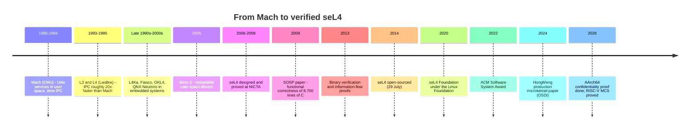
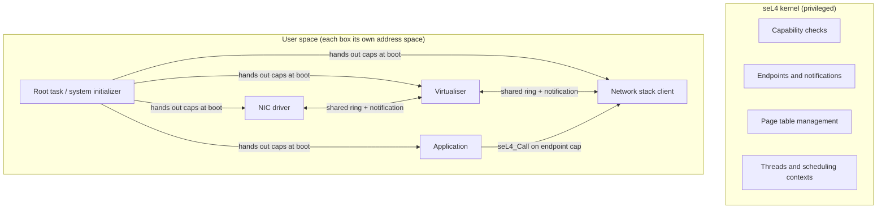
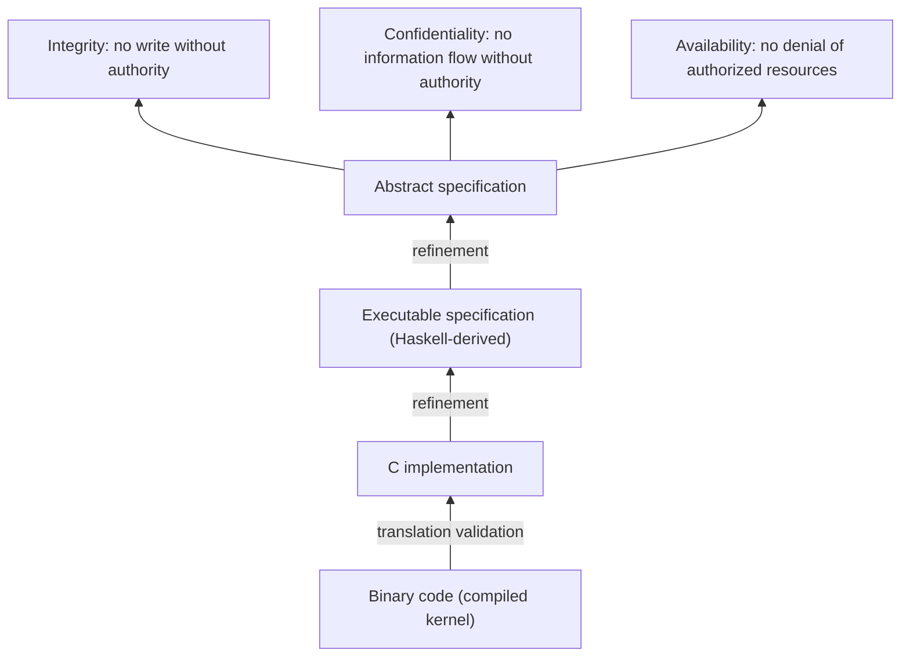

---
tags:
  - operating-systems
  - kernels
  - microkernel
  - sel4
  - formal-verification
  - capabilities
status: draft
sources:
  - https://www.cs.jhu.edu/~huang/cs624/spring22/readings/seL4.pdf
  - https://dl.acm.org/doi/10.1145/224056.224075
  - https://www.trustworthy.systems/publications/papers/Heiser_26.pdf
  - https://sel4.systems/performance.html
  - https://docs.sel4.systems/projects/sel4/verified-configurations.html
  - https://sel4.systems/news/2026.html
  - https://arxiv.org/html/2501.06234v2
  - https://trustworthy.systems/projects/LionsOS/
  - https://trustworthy.systems/projects/seL4-verification/
  - https://www.usenix.org/conference/osdi24/presentation/chen-haibo
  - https://www.cs.vu.nl/~ast/reliable-os/
created: 2026-11-26
updated: 2026-11-26
---

## Table Of Contents

---

- [[#TL;DR|TL;DR]]
- [[#The Problem|The Problem]]
- [[#Foundations|Foundations]]
    - [[#The Minimality Principle|The Minimality Principle]]
    - [[#Capabilities|Capabilities]]
    - [[#IPC Is the Hot Path|IPC Is the Hot Path]]
- [[#How We Got Here|How We Got Here]]
- [[#How It Works|How It Works]]
    - [[#seL4's Kernel Objects|seL4's Kernel Objects]]
    - [[#No Kernel Heap: Untyped Memory|No Kernel Heap: Untyped Memory]]
    - [[#IPC: Endpoints and Notifications|IPC: Endpoints and Notifications]]
    - [[#Time: The MCS Kernel|Time: The MCS Kernel]]
    - [[#What Is Proved|What Is Proved]]
    - [[#Building Systems: CAmkES, Microkit, LionsOS|Building Systems: CAmkES, Microkit, LionsOS]]
- [[#Where It Is Now|Where It Is Now]]
- [[#Trade-offs & Open Problems|Trade-offs & Open Problems]]
- [[#Resources|Resources]]
- [[#Related Notes|Related Notes]]

## ***TL;DR***
---
*A microkernel keeps only the mechanisms that can't safely live outside the kernel and pushes everything else into isolated user-space servers. seL4 is the microkernel that proved the idea can be both fast and mathematically correct.*

- **The idea:** the kernel provides address spaces, threads, IPC, interrupt delivery and access control. Drivers, file systems and network stacks are ordinary processes, so a bug in one is contained, and the trusted base is small. See [[Kernel Architectures]] for how this compares with monolithic designs.
- **The historical problem:** first-generation microkernels (Mach) were slow because IPC was slow. Jochen Liedtke's L4 showed in the 1990s that IPC could be an order of magnitude faster with a ruthlessly minimal kernel.
- **seL4** is an L4-family microkernel of roughly 10–12 thousand lines whose C implementation is **formally proved** to match its specification, with further proofs that it enforces integrity and confidentiality ([Heiser 2026](https://www.trustworthy.systems/publications/papers/Heiser_26.pdf)).
- **Design signatures:** capability-based access control, no dynamic memory allocation inside the kernel (user space hands it typed memory), and IPC in a few hundred cycles: about 742 cycles for a call on a 3.4 GHz Skylake ([seL4 performance](https://sel4.systems/performance.html)).
- **Now (Nov 2026):** AArch64 now has functional correctness, integrity and confidentiality proofs (confidentiality finished August 2026); the mixed-criticality (MCS) kernel is proved on RISC-V; seL4 17.0.0 shipped October 2026. It runs in drones, a production electric car and secure communications, and the LionsOS framework shows seL4 systems can outrun Linux on network I/O.

## ***The Problem***
---
*A monolithic kernel trusts millions of lines of code. Microkernels try to shrink what must be trusted to something small enough to understand completely, and seL4 shrinks it to something small enough to prove.*

The trusted computing base (TCB) is all the code whose bugs can break your security or reliability guarantees. In a monolithic OS it includes every driver and file system, which is where most kernel bugs live. Three things follow:

1. **Faults spread.** A NULL dereference in a sound driver panics the whole machine.
2. **Attack surface is huge.** Any privileged parsing code (file systems, network protocols, USB descriptors) is a potential full-system exploit.
3. **Assurance is impossible.** You can test tens of millions of lines; you can't prove them.

Microkernels answer by moving services out of the kernel. Each server runs in its own address space with only the rights it needs, so a compromised USB stack can't read the crypto service's keys. The kernel itself becomes small enough that a single team can know every line.

The question microkernels must also answer is cost: every interaction between services that used to be a function call is now IPC through the kernel.

## ***Foundations***
---
*Three ideas carry the whole design: put only mechanism in the kernel, control access with unforgeable capabilities, and make IPC so fast that structure costs almost nothing.*

### The Minimality Principle

Liedtke's rule: "a concept is tolerated inside the µ-kernel only if moving it outside the kernel, i.e., permitting competing implementations, would prevent the implementation of the system's required functionality" ([Liedtke 1995](https://dl.acm.org/doi/10.1145/224056.224075)). In practice that leaves:

| Kept in the kernel | Pushed to user space |
|---|---|
| Address spaces (page tables) | Paging policy, swapping, page cache |
| Threads and a basic scheduler | Higher-level scheduling policy |
| IPC | Naming, service discovery |
| Interrupt delivery (as messages) | Device drivers |
| Capability checks | Security policy, resource accounting |

Compare a monolithic kernel's [[Virtual Memory and Paging|memory manager]] or [[CPU Scheduling|scheduler]], where both mechanism and policy are inside.

### Capabilities

A **capability** is an unforgeable token that both names an object and grants specific rights to it (read, write, grant, call). A thread can only act on an object if it holds a capability for it. Capabilities live in kernel-managed tables (in seL4, **CNodes**), so user code refers to them by slot index and can't fabricate one.

This differs from Unix access control, where a process names a file by path and the kernel checks the caller's identity against the file's permissions. With capabilities:
- **No ambient authority.** A process can do only what its capabilities allow, which is what makes least privilege enforceable and reasoning about information flow possible.
- **Delegation is explicit.** Passing a capability in an IPC message grants a right; revoking it removes the right from everyone it was derived to.
- **No confused deputy.** A server acts on the capability the client handed it, not on its own broader authority.

### IPC Is the Hot Path

In a microkernel system, a file read, a network send, or a page fault handled by a user-level pager all go through IPC. So IPC cost decides whether the design is usable. L4-family kernels make IPC fast by:
- **Synchronous rendezvous:** sender and receiver meet; no kernel buffering or message queues.
- **Register-only messages:** short messages travel in CPU registers; the kernel switches threads without copying.
- **Direct process switch:** the sender's time slice is donated to the receiver, skipping the scheduler.
- **A hand-written fast path** for the common case (call/reply with a short message and no capability transfer).

## ***How We Got Here***
---
*Microkernels went from academic hope, to a performance embarrassment, to the most-deployed and best-verified kernels in the world.*



- **Mach** made the microkernel famous and infamous. Its IPC was general (ports, out-of-line memory, rights) and heavy, so systems built on it ran far slower than monolithic Unix.
- **L4** came from Liedtke's diagnosis that Mach's slowness was implementation, not concept. Minimal semantics and an architecture-tuned implementation cut IPC cost by an order of magnitude ([Liedtke 1995](https://dl.acm.org/doi/10.1145/224056.224075)). L4 variants, especially OKL4, went into billions of mobile phone baseband processors.
- **Minix 3** (Tanenbaum's group) focused on reliability: drivers as user processes, a reincarnation server that restarts them when they crash ([Minix 3 / Reliable OS](https://www.cs.vu.nl/~ast/reliable-os/)).
- **seL4** (NICTA, now UNSW's Trustworthy Systems and Proofcraft) was designed together with its proof. The 2009 paper proved that the C code implements an abstract specification, which rules out whole classes of bugs (buffer overflows, NULL dereferences, memory leaks in the kernel) by proof ([Klein et al., SOSP 2009](https://www.cs.jhu.edu/~huang/cs624/spring22/readings/seL4.pdf)). It cost about 11 person-years and around 200,000 lines of proof script for 8,500 lines of C ([Heiser 2026](https://www.trustworthy.systems/publications/papers/Heiser_26.pdf)).
- **Open source and a foundation** followed, and seL4 shifted from research artifact to a platform with commercial users and a release cadence.

## ***How It Works***
---
*seL4's design is shaped by the proof: no hidden allocation, every operation explicit, every object reachable only through a capability. That's what makes it both verifiable and fast.*

### seL4's Kernel Objects

Everything the kernel manages is an object, and every object is reached through a capability.

| Object | What it is |
|---|---|
| Untyped | A block of physical memory that can be turned into other objects |
| CNode | A table of capability slots; CNodes form a process's capability space (CSpace) |
| TCB | A thread control block: registers, priority, its CSpace and VSpace |
| Endpoint | A rendezvous point for synchronous IPC |
| Notification | An array of binary semaphores for asynchronous signals (and interrupts) |
| Reply | Holds the right to answer one call (an explicit object in MCS) |
| VSpace objects | Page tables and frames making up an address space |
| Scheduling context | A CPU-time budget and period (MCS kernel) |
| IRQ handler | The right to acknowledge and receive one interrupt |



### No Kernel Heap: Untyped Memory

seL4 has no `kmalloc`. At boot, the kernel gives the first user process (the root task) capabilities to all free physical memory as **Untyped** objects. To create a thread, a page table or an endpoint, user code **retypes** part of an Untyped:

```c
/* Turn part of an Untyped region into one new TCB object,
 * placing the capability to it in slot `free_slot` of our CNode. */
seL4_Error err = seL4_Untyped_Retype(
    untyped_cap,      /* memory to carve from              */
    seL4_TCBObject,   /* what to make                      */
    0,                /* size bits (unused for fixed-size) */
    seL4_CapInitThreadCNode, 0, 0,  /* where to put the cap */
    free_slot,        /* destination slot                  */
    1);               /* how many objects                  */
```

In plain words: the caller says "use this memory I own to build a TCB, and put the handle in this slot." Because the kernel never allocates on its own, user-level managers decide memory policy, kernel memory can't be exhausted by one client at another's expense, and the proof never has to reason about a kernel allocator. Deleting the last capability to an object returns its memory to the Untyped it came from.

### IPC: Endpoints and Notifications

**Synchronous IPC** uses endpoints. A client calls; a server waits and replies:

```c
/* Client: send one word, block until the reply arrives. */
seL4_SetMR(0, request);                          /* message register 0  */
seL4_MessageInfo_t info = seL4_MessageInfo_new(0, 0, 0, 1);
info = seL4_Call(server_ep, info);               /* send + wait atomically */
seL4_Word answer = seL4_GetMR(0);
```

`seL4_Call` sends the message and waits for the reply in one system call. Short messages stay in registers, the kernel switches directly to the server thread, and the server gets a one-shot reply right. The server answers with `seL4_ReplyRecv`, which replies and waits for the next client in one call.

**Notifications** are asynchronous: a word of bits that `seL4_Signal` sets and `seL4_Wait` collects. Interrupts arrive as notifications, so a user-space driver is just a thread waiting on one. Bulk data never goes through IPC; it moves through **shared memory** set up by mapping the same frames into two address spaces, with a notification as the doorbell. This is the same pattern as [[io_uring]]'s submission and completion rings.

**How fast?** From seL4's published numbers (default configuration, mean cycles):

| Platform | IPC call | IPC reply | Call at that clock |
|---|---|---|---|
| Armv7a Cortex-A9, 1.0 GHz | 372 | 354 | 0.37 µs |
| Armv8a Cortex-A57, 1.9 GHz | 419 | 431 | 0.22 µs |
| x86-64 Skylake, 3.4 GHz | 742 | 598 | 0.22 µs |
| RISC-V U54, 1.5 GHz | 720 | 754 | 0.48 µs |

Source: [seL4 performance](https://sel4.systems/performance.html); time is cycles divided by clock rate, e.g. $742 / 3.4\times10^9 \approx 0.22$ µs. For comparison, a Linux [[System Calls and the User-Kernel Boundary|system call]] that does almost nothing costs on the order of 0.1 µs, and a Linux pipe round trip between processes costs microseconds.

### Time: The MCS Kernel

Classic seL4 scheduled with priorities and time slices. The **mixed-criticality systems (MCS)** configuration adds **scheduling contexts**: a budget and period that act as a capability to CPU time. A thread runs only while its scheduling context has budget left. On `seL4_Call`, a passive server can run on the client's scheduling context, so a server's work is charged to whoever asked for it. This lets a flight controller and an untrusted logging service share a core without the logger stealing the controller's time. It's the microkernel version of the problem [[CPU Scheduling]] solves with deadline scheduling, and of the priority inversion problem in [[Locks and Synchronization]].

### What Is Proved

seL4's assurance is a stack of proofs in the Isabelle/HOL theorem prover:



- **Functional correctness:** every behavior of the C code is allowed by the abstract specification. No crashes, no undefined behavior, no buffer overflows in the kernel.
- **Binary correctness:** the compiled machine code matches the C semantics, so a compiler bug can't silently break the proof (AArch32 today).
- **Security properties** proved on the abstract spec carry down to the code: **integrity** (a component can't modify what it has no capability to) and **confidentiality** (information can't flow between components except where the capability setup allows).
- **Worst-case execution time** analysis bounds how long any kernel operation takes, important for real-time use.

Proof status by architecture, per the verified-configurations page (Nov 2026):

| Architecture | Functional correctness | Integrity | Confidentiality | Binary | MCS |
|---|---|---|---|---|---|
| AArch32 | Yes, incl. fast path | Yes | Yes | Yes | In progress |
| AArch64 | Yes, incl. fast path | Yes | Yes (Aug 2026) | Not listed | In progress |
| RISC-V 64 | Yes | Yes | Yes | Not listed | Functional correctness done Jun 2026 |
| x86-64 | Yes | Not listed | Not listed | Not listed | Not listed |

Sources: [verified configurations](https://docs.sel4.systems/projects/sel4/verified-configurations.html), [seL4 news 2026](https://sel4.systems/news/2026.html). Not covered by any proof: IOMMU/SMMU handling, debug interfaces, kernel boot code, and multicore configurations.

**What the proof cost, in numbers.** About 200,000 lines of proof for 8,500 lines of C is $200{,}000 / 8{,}500 \approx 23.5$ lines of proof per line of code, and about 11 person-years ([Heiser 2026](https://www.trustworthy.systems/publications/papers/Heiser_26.pdf)). The proof base has since grown to well over a million lines, maintained alongside every kernel change. That ratio is why verification needs a microkernel: the same ratio applied to a 30-million-line kernel would be absurd.

### Building Systems: CAmkES, Microkit, LionsOS

A raw seL4 system is a set of capabilities wired up at boot, which is tedious to do by hand. Frameworks generate that wiring:
- **CAmkES**: a component model; you describe components and connections, and it generates the glue and capability setup.
- **Microkit**: a simpler, static framework. The unit is a single-threaded **protection domain** (PD); PDs talk through shared memory, notifications and **protected procedure calls**, all declared in a system description file ([LionsOS paper](https://arxiv.org/html/2501.06234v2)).
- **LionsOS** (Trustworthy Systems) builds an OS for embedded systems on Microkit under "radical simplicity": each component is tiny and single-purpose. Drivers only translate between the device and a generic interface; separate virtualiser components multiplex devices between clients; all queues are single-producer, single-consumer and lock-free.

LionsOS's network driver sizes against Linux drivers for the same hardware:

| NIC | LionsOS driver | Linux driver | Ratio |
|---|---|---|---|
| i.MX8 | 569 SLOC | 4,775 SLOC | 8.4x |
| Amlogic S905X3 | 397 SLOC | 10,678 SLOC | 26.9x |
| x86 | 668 SLOC | 3,019 SLOC | 4.5x |

Source: [Heiser et al., LionsOS](https://arxiv.org/html/2501.06234v2).

For legacy drivers, LionsOS runs a small Linux guest as a **driver VM** and talks to it through the same shared-memory interfaces. See [[Virtualization and Hypervisors]].

## ***Where It Is Now***
---
*By late 2026 seL4 is a maintained product with a foundation, regular releases and production users, the proofs cover all three major 64-bit architectures, and microkernel systems are winning benchmarks they used to lose.*

**Proofs and releases (2026)**
- **June 2026:** functional correctness proof for the MCS configuration on RISC-V completed by Proofcraft; to be ported to Arm64 under DARPA's PROVERS program ([seL4 news](https://sel4.systems/news/2026.html)).
- **August 2026:** confidentiality proof on AArch64 completed, finishing the AArch64 security proofs ([seL4 news](https://sel4.systems/news/2026.html)).
- **Releases:** seL4 15.0.0 (March), 16.0.0 (July) and 17.0.0 (30 October 2026), each with Microkit and rust-sel4 updates; 17.0.0 focused on fixing unverified configurations and code outside the proofs, partly from externally reported issues ([seL4 news](https://sel4.systems/news/2026.html)).
- **Expected next:** MCS verification in 2027 and LionsOS verification by 2027; multikernel (multicore) verification in progress ([Heiser 2026](https://www.trustworthy.systems/publications/papers/Heiser_26.pdf)).

**Deployments** ([Heiser 2026](https://www.trustworthy.systems/publications/papers/Heiser_26.pdf))
- Autonomous air vehicles, including DARPA's 2021 DEF CON "steal this drone" challenge, which nobody broke.
- NIO's ONVO L60 electric car (launched 2024).
- Secure aircraft–ground voice communications.
- Commercial seL4-based OSes: Kry10 OS, Atoll (Neutrality, which joined the seL4 Foundation in March 2026), Magnetite.

**Performance: LionsOS against Linux** ([Heiser et al.](https://arxiv.org/html/2501.06234v2))
- On an i.MX8 Arm board doing UDP echo on one core, Linux plateaus around 500 Mb/s; LionsOS reaches the full 1 Gb/s with about a third of the CPU free and 3–10x lower round-trip times.
- On x86 with a 10 Gb/s NIC, Linux saturates its CPU at about 4 Gb/s; LionsOS keeps about 20% spare.
- The authors found that making IPC free barely changed the results: with shared rings and batching, IPC cost stops mattering.

**Microkernels beyond seL4**
- **HongMeng** (Huawei) runs on tens of millions of phones, cars and routers with Linux ABI compatibility. Its OSDI 2024 paper argues pure microkernel techniques cost too much for general-purpose use and relaxes them with configurable isolation classes ([Chen et al.](https://www.usenix.org/conference/osdi24/presentation/chen-haibo)).
- **QNX** remains a leading automotive microkernel; **Zircon** (Fuchsia) is a capability-based microkernel on Google's Nest devices.

## ***Trade-offs & Open Problems***
---
*The microkernel bargain is isolation and assurance in exchange for communication cost and a much smaller ecosystem. seL4 has mostly fixed the cost; the ecosystem and the scope of the proofs are the remaining limits.*

| Choice | You get | You pay |
|---|---|---|
| Services in user space | Fault containment, least privilege, restartable drivers | IPC per cross-service call; more context switches |
| Capabilities | Precise, provable access control, explicit delegation | Complex to set up by hand; need frameworks (CAmkES, Microkit) |
| No kernel heap | Predictable memory, no kernel exhaustion, provable | User-level memory managers become part of the system design |
| Static architectures (Microkit, LionsOS) | Easy to reason about and verify | Not for general-purpose, dynamic workloads |
| Formal verification | Bug classes ruled out, security properties proved | Huge proof effort; every kernel change needs proof updates; only some configurations covered |
| Linux ABI compatibility (HongMeng) | Run existing apps and drivers | Weaker isolation where state is shared for speed |

Open problems worth tracking:
- **The proof boundary.** Proofs assume correct hardware and don't cover boot code, IOMMUs or multicore. Side channels (timing, [[Transient Execution Attacks and Mitigations|transient execution]]) are outside functional correctness; seL4's time-protection research tackles timing channels but isn't in the main proofs.
- **Proving the rest of the system.** A verified kernel under unverified drivers and servers still has a large TCB for the application. LionsOS, verified drivers (Pancake) and [[Formally Verified OS Components]] aim at that.
- **Dynamic, general-purpose workloads.** seL4's strongest results are in static embedded systems. HongMeng shows the general-purpose path but trades away some isolation.
- **Ecosystem.** Driver coverage, tooling and developer familiarity lag Linux by decades. Driver VMs reuse Linux drivers at the cost of putting a Linux kernel back in the picture.
- **Multicore.** Lock-free, single-producer/single-consumer queues avoid most shared-memory locking in user space, but a verified multicore kernel is unfinished. See [[Locks and Synchronization]].

## ***Resources***
---
*Read the 2009 seL4 paper for what verification means in practice, Heiser's 2026 overview for the current state, and the LionsOS paper for how real systems are built on it.*

**Primary papers**
- [seL4: Formal Verification of an OS Kernel](https://www.cs.jhu.edu/~huang/cs624/spring22/readings/seL4.pdf): Klein et al., SOSP 2009.
- [On µ-Kernel Construction](https://dl.acm.org/doi/10.1145/224056.224075): Jochen Liedtke, SOSP 1995.
- [LionsOS: radically simple, fast and verifiable systems on seL4](https://arxiv.org/html/2501.06234v2): Heiser et al., 2025.
- [Microkernel Goes General: HongMeng](https://www.usenix.org/conference/osdi24/presentation/chen-haibo): Chen et al., OSDI 2024.

**Current state**
- [seL4: Operating Systems With the Reliability of Mathematics](https://www.trustworthy.systems/publications/papers/Heiser_26.pdf): Gernot Heiser, IEEE Reliability Magazine, June 2026.
- [seL4 news, 2026](https://sel4.systems/news/2026.html): releases, proofs and foundation news.
- [Verified configurations](https://docs.sel4.systems/projects/sel4/verified-configurations.html): what is proved on which architecture.
- [seL4 performance](https://sel4.systems/performance.html): IPC cycle counts.
- [The seL4 verification project](https://trustworthy.systems/projects/seL4-verification/) and [LionsOS project page](https://trustworthy.systems/projects/LionsOS/): Trustworthy Systems, UNSW.

**Background**
- [Minix 3 and reliable operating systems](https://www.cs.vu.nl/~ast/reliable-os/): Tanenbaum's group on self-healing microkernel systems.

## Related Notes

- [[Kernel Architectures]] — Where microkernels sit among monolithic, hybrid, exokernel and framekernel designs.
- [[Unikernels and Library OSes]] — The opposite answer: no internal isolation, maximum specialization.
- [[System Calls and the User-Kernel Boundary]] — The crossing that microkernel IPC multiplies.
- [[Processes and Threads]] — Threads and address spaces, the only abstractions seL4 keeps.
- [[Virtual Memory and Paging]] — Page tables that seL4 manages but user space allocates.
- [[CPU Scheduling]] — Scheduling contexts and mixed-criticality scheduling.
- [[Interrupts and Exceptions]] — Delivered to user-space drivers as notifications.
- [[Locks and Synchronization]] — Priority inversion, and the lock-free rings LionsOS uses instead.
- [[io_uring]] — Shared-memory rings with a doorbell, the same pattern as seL4 device frameworks.
- [[Virtualization and Hypervisors]] — seL4 as a hypervisor and driver VMs.
- [[MicroVMs and Sandboxing]] — Other ways to isolate untrusted code.
- [[Formally Verified OS Components]] — Proofs beyond the kernel.
- [[Kernel Security Hardening]] — What a monolith does instead of a small TCB.
- [[Transient Execution Attacks and Mitigations]] — Side channels outside functional correctness proofs.
- [[Formal Methods in Practice]] — Verification techniques used across systems, from TLA+ to Isabelle.
