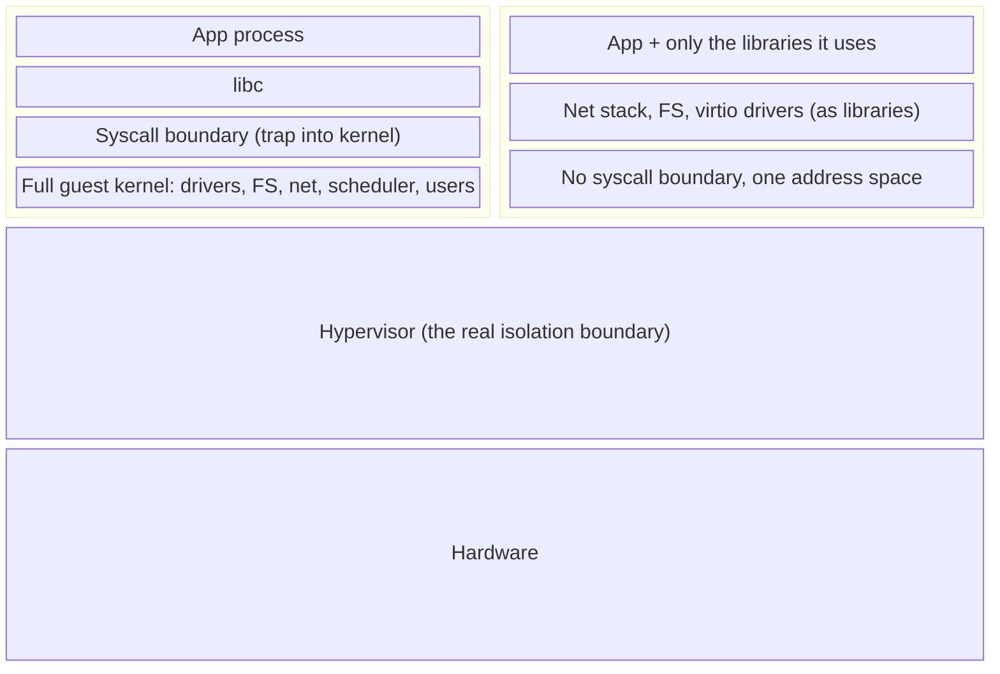
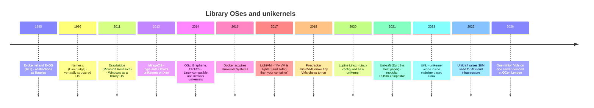

---
tags:
  - operating-systems
  - kernels
  - unikernel
  - library-os
  - virtualization
status: draft
sources:
  - https://dl.acm.org/doi/10.1145/224057.224076
  - https://sites.cs.ucsb.edu/~rich/class/cs270/papers/unikernel.pdf
  - https://queue.acm.org/detail.cfm?id=2566628
  - https://arxiv.org/abs/2104.12721
  - https://unikraft.org/docs/concepts/performance
  - https://people.cs.vt.edu/djwillia/papers/eurosys20-lupine.pdf
  - https://arxiv.org/pdf/2206.00789
  - https://www.infoq.com/news/2026/03/qcon-million-sandboxes-server
  - https://unikraft.com/blog/we-raised-6m-to-build-the-future-of-ai-cloud-infra
  - https://arxiv.org/html/2506.03876v1
created: 2026-11-26
updated: 2026-11-26
---

## Table Of Contents

---

- [[#TL;DR|TL;DR]]
- [[#The Problem|The Problem]]
- [[#Foundations|Foundations]]
    - [[#Library Operating Systems|Library Operating Systems]]
    - [[#Unikernels|Unikernels]]
    - [[#Where the Isolation Comes From|Where the Isolation Comes From]]
- [[#How We Got Here|How We Got Here]]
- [[#How It Works|How It Works]]
    - [[#Building an Image|Building an Image]]
    - [[#Running It: The VMM Matters More Than the Kernel|Running It: The VMM Matters More Than the Kernel]]
    - [[#Three Ways to Get Linux Compatibility|Three Ways to Get Linux Compatibility]]
    - [[#Where the Speed Comes From|Where the Speed Comes From]]
    - [[#Library OSes Without a Hypervisor|Library OSes Without a Hypervisor]]
- [[#Where It Is Now|Where It Is Now]]
- [[#Trade-offs & Open Problems|Trade-offs & Open Problems]]
- [[#Resources|Resources]]
- [[#Related Notes|Related Notes]]

## ***TL;DR***
---
*A library OS turns operating system services into a library you link into your program. A unikernel is the extreme case: one application and exactly the OS code it needs, compiled into a single-address-space image that boots directly on a hypervisor.*

- **The idea** comes from the 1995 exokernel: the kernel should only multiplex hardware safely, and abstractions like files and sockets should be libraries an application can pick or replace ([Engler et al., SOSP 1995](https://dl.acm.org/doi/10.1145/224057.224076)). See [[Kernel Architectures]].
- **A unikernel** links app + network stack + [[File Systems|file system]] + drivers into one image, runs in one address space with no user/kernel split, and relies on the hypervisor for isolation ([Madhavapeddy et al., ASPLOS 2013](https://sites.cs.ucsb.edu/~rich/class/cs270/papers/unikernel.pdf)).
- **What you get:** tiny images (about 1–2 MB), boot in milliseconds, a few MB of RAM, and often higher throughput than a Linux VM. Unikraft reports nginx, Redis and SQLite running 1.7x–2.7x faster than on Linux guests ([Kuenzer et al., EuroSys 2021](https://arxiv.org/abs/2104.12721)).
- **What you lose:** multiple processes, a shell, familiar debugging tools, and often full Linux compatibility.
- **Now (Nov 2026):** unikernels have found a market as dense, fast-booting sandboxes. Unikraft raised a $6M seed in October 2025 to run "millions of strongly isolated instances on a few servers", and demonstrated waking VM number 1,000,000 on one commodity server in about 10 ms at QCon London (March 2026) ([InfoQ](https://www.infoq.com/news/2026/03/qcon-million-sandboxes-server)). Research has shown Linux itself can be configured into something unikernel-like (Lupine, UKL).

## ***The Problem***
---
*A cloud VM running one service carries a whole general-purpose OS it mostly doesn't use. That costs boot time, memory, attack surface and performance.*

A typical microservice VM runs one process. Yet the guest boots a full Linux kernel with hundreds of drivers, multi-user permissions, process isolation, a shell, an init system and package manager. Each layer adds:

| Cost | Where it comes from |
|---|---|
| Boot time | Kernel init, device probing, init system, user-space startup; hundreds of ms for a minimal Linux VM |
| Memory | Kernel, [[Page Cache and Memory Reclaim|page cache]], user-space services; tens to hundreds of MB per guest |
| Attack surface | Every driver, syscall and tool in the image is reachable by an attacker |
| Run-time overhead | [[System Calls and the User-Kernel Boundary|User-kernel crossings]], data copies between buffers, generic code paths |
| Duplicated isolation | The hypervisor already isolates the VM, and the guest kernel isolates its one process again |

That last row is the key insight: if the hypervisor is the real security boundary, the guest kernel's protection between user and kernel mode protects one application from itself. Removing it is the unikernel bet.

Containers attack the same problem from the other side: share one host kernel, drop the guest. That's cheap but puts every tenant on the same large kernel attack surface. See [[Containers, Namespaces and cgroups]] and [[MicroVMs and Sandboxing]].

## ***Foundations***
---
*Two ideas combine: OS services as a library chosen per application, and the hypervisor as the only protection boundary.*

### Library Operating Systems

In a conventional OS, abstractions (files, sockets, processes, virtual memory) are fixed by the kernel and reached through system calls. In a **library OS**, those abstractions are implemented in user-level libraries linked into the application. The application calls them as ordinary functions. The underlying kernel (an exokernel, a hypervisor, or a host OS) provides only protected access to raw resources: pages, CPU time, network packets, disk blocks.

Consequences:
- Each application can use the abstraction that suits it: a database can manage its own buffer cache instead of fighting the kernel's page cache.
- Abstraction code doesn't need to be trusted by anyone but the app that links it.
- Sharing between applications (a common file system, a shared page cache) gets harder, because there's no single kernel holding shared state.

### Unikernels

A unikernel is a library OS **specialized at build time** and run as a single-purpose VM:



*Left: a normal Linux VM. Right: a unikernel VM. Both sit on the same hypervisor.*

Defining properties ([Madhavapeddy et al., 2013](https://sites.cs.ucsb.edu/~rich/class/cs270/papers/unikernel.pdf)):
- **Single address space, single application.** No user/kernel split inside the VM; the app runs at the guest's highest privilege.
- **Specialization:** dead code elimination at the OS level. Only components the app references are linked in, so an image may have no file system at all.
- **Immutable images:** configuration is compiled in; you redeploy instead of logging in to change things.
- **Paravirtual devices:** drivers target the hypervisor's virtual devices (virtio, Xen netfront), not physical hardware, so the driver set is tiny.

### Where the Isolation Comes From

| Model | Boundary between tenants | Boundary inside one tenant |
|---|---|---|
| Linux VM | Hypervisor ([[Virtualization and Hypervisors]]) | Guest kernel (user vs kernel mode) |
| Container | Host kernel namespaces and cgroups | Same host kernel |
| Unikernel VM | Hypervisor | None, or the language's type system |
| Library OS on a host kernel (gVisor-style, Gramine) | Host kernel or enclave | Library OS |

A unikernel is therefore as isolated from its neighbors as a VM, but no more isolated from itself than a single process. Memory-safe implementation languages (OCaml in MirageOS, Rust in Hermit) are a common answer to the missing internal boundary.

## ***How We Got Here***
---
*Library OSes were an academic idea in the 1990s, came back with cloud hypervisors in the 2010s, and in the 2020s became practical by meeting Linux halfway.*



- **Exokernel (1995)** proposed library OSes over a minimal kernel and showed large speedups for apps that customized their abstractions ([Engler et al.](https://dl.acm.org/doi/10.1145/224057.224076)). The world went with monolithic Linux instead.
- **Drawbridge (2011)** packaged Windows as a library OS so apps could run in a lightweight, isolated container; its ideas fed into later sandboxing work.
- **MirageOS (2013)** coined "unikernel": OCaml applications compiled with only the protocol libraries they used, booting directly on Xen. A DNS server image was a fraction of the size of a Linux appliance and booted in milliseconds ([ASPLOS 2013](https://sites.cs.ucsb.edu/~rich/class/cs270/papers/unikernel.pdf); [ACM Queue overview](https://queue.acm.org/detail.cfm?id=2566628)).
- **The compatibility wall (2014–2019).** MirageOS required rewriting apps in OCaml. OSv, Rumprun, IncludeOS and HermiTux each offered partial POSIX or Linux binary compatibility, and each hit apps that needed `fork`, signals or unusual syscalls. Tooling and debugging were weak.
- **ClickOS and LightVM (2014, 2017)** showed the density story: VMs booting in milliseconds, thousands per server ([InfoQ summary](https://www.infoq.com/news/2026/03/qcon-million-sandboxes-server)).
- **Unikraft (2021)** made unikernels modular ("micro-libraries" you combine) and compatible enough to run nginx, Redis and SQLite unmodified ([EuroSys 2021](https://arxiv.org/abs/2104.12721)).
- **Linux meets the idea halfway.** Lupine (2020) showed that a heavily trimmed Linux config gets most of the benefit ([Kuo et al.](https://people.cs.vt.edu/djwillia/papers/eurosys20-lupine.pdf)); UKL (2023) added a mode that links one application into the kernel with about 1,250 lines of kernel changes ([Raza et al.](https://arxiv.org/pdf/2206.00789)).

## ***How It Works***
---
*A unikernel is built like a statically linked program whose "standard library" includes the OS, then booted by a minimal virtual machine monitor. Most of its speed comes from specialization and from skipping work, not from any single trick.*

### Building an Image

With Unikraft, an application is configured against a menu of micro-libraries (scheduler, memory allocator, network stack, VFS, virtio drivers, a libc). The build resolves dependencies, links everything statically, and runs link-time dead code elimination:


Because the "kernel" is just more library code, a system call can become a function call. Unikraft's binary-compatibility layer still traps real `syscall` instructions from unmodified Linux ELF binaries, but a recompiled app calls the handler directly.

```c
/* In a unikernel built from source, libc's write() is linked to the
 * OS implementation directly: no trap, no mode switch, no copy across
 * a protection boundary. Conceptually: */
ssize_t write(int fd, const void *buf, size_t n) {
    return vfs_write(fd_table[fd], buf, n);   /* plain function call */
}
```

In plain words: the same `write()` that on Linux enters the kernel through a trap is here an ordinary call into the file system code linked into the same image.

### Running It: The VMM Matters More Than the Kernel

The guest's own boot is now tiny; the virtual machine monitor (VMM) that creates the VM dominates.

$$
T_{\text{boot}} = T_{\text{VMM}} + T_{\text{guest}}
$$

**In plain words:** total time to a running service is the VMM's setup time plus the guest's own initialization.

**Worked example** (Unikraft's published numbers, [performance docs](https://unikraft.org/docs/concepts/performance)): Unikraft's guest boot on Firecracker is under 1 ms, but total VM boot is about 3 ms on Firecracker, about 10 ms on QEMU's microVM machine and about 40 ms on full QEMU. So with QEMU, $T_{\text{guest}} < 1$ ms of a 40 ms total: over 97% of boot is the VMM. An Alpine Linux guest on the same Firecracker takes about 330 ms, about 110x the unikernel. This is why unikernel platforms pair with minimal VMMs like Firecracker (see [[MicroVMs and Sandboxing]]), and why Unikraft's founders found a 10 ms expected boot turned into about 30 seconds on an early cloud deployment once the surrounding control plane was included ([InfoQ](https://www.infoq.com/news/2026/03/qcon-million-sandboxes-server)).

**Density example.** At QCon London 2026, Unikraft woke VM number 1,000,000 on one commodity server and got a response in about 10 ms. Sleeping VMs are stored as compressed, differential snapshots: about 12 TB for a million, so $12\text{ TB} / 10^6 \approx 12$ MB per sleeping instance. Their sizing assumption was that about 20 of every 1,000 users are active at once, so only about 2% (20,000) of those VMs need to be running ([InfoQ](https://www.infoq.com/news/2026/03/qcon-million-sandboxes-server)).

### Three Ways to Get Linux Compatibility

| Approach | Example | How | Catch |
|---|---|---|---|
| Rewrite the app | MirageOS | App in OCaml against Mirage's libraries | Only new code; huge rewrite cost |
| Recompile against a POSIX layer | Unikraft (native), OSv, IncludeOS | Link app with the unikernel's libc and OS libs | Some syscalls missing (`fork`, some `ioctl`s) |
| Run the unmodified Linux binary | Unikraft binary-compat, HermiTux, Nanos | Trap `syscall` and emulate Linux ABI | Emulation coverage; slower paths |
| Start from Linux itself | Lupine, UKL | Specialize the Linux kernel config, or link the app into Linux | Bigger images; inherits Linux's TCB |

Asterinas, a Linux-ABI Rust framekernel, is a related bet from the OS side: re-implement Linux's syscall interface (210+ calls) in a safer kernel ([Peng et al.](https://arxiv.org/html/2506.03876v1)). See [[Kernel Architectures]].

### Where the Speed Comes From

Unikernel speedups are often attributed to "no syscalls". Lupine measured that and found otherwise ([Kuo et al., EuroSys 2020](https://people.cs.vt.edu/djwillia/papers/eurosys20-lupine.pdf)):

| Source of benefit | Lupine's finding |
|---|---|
| Kernel specialization (dropping config options) | The biggest contributor. Removing about 550 of 833 options shrank the image up to 73%, cut boot 59% (to about 23 ms) and raised throughput up to 33% vs a microVM Linux |
| Eliminating syscall mode switches (Kernel Mode Linux) | Up to 40% lower syscall latency in microbenchmarks, but only about 4% on real apps |
| Single process / single core restrictions | Mostly unnecessary: multiple address spaces cost almost nothing, SMP at most about 8% |

So the gains come from **doing less**: fewer subsystems, no generic code paths, smaller memory footprint and better cache behavior. UKL reached the same conclusion from another direction: linking Redis into Linux gave modest gains until developers also optimized the app's use of kernel internals, which gave 26% ([Raza et al.](https://arxiv.org/pdf/2206.00789)).

Unikraft's measured comparisons on Redis and nginx ([performance docs](https://unikraft.org/docs/concepts/performance)):

| Unikraft vs | Throughput gain |
|---|---|
| Linux VM | about 70–170% |
| Linux container | about 30–80% |
| Native Linux | about 10–60% (0–50% without KPTI) |
| Lupine | about 50% |
| OSv | about 25–35% |

The "without KPTI" caveat matters: part of the gain against native Linux is avoiding the page-table switches that [[Transient Execution Attacks and Mitigations|Meltdown mitigations]] add to every syscall.

### Library OSes Without a Hypervisor

The library-OS idea also runs on top of a normal host kernel:
- **gVisor** implements the Linux syscall interface in a user-space "application kernel" (the Sentry) so untrusted containers never talk to the host kernel directly. See [[MicroVMs and Sandboxing]].
- **Gramine** (formerly Graphene) runs unmodified Linux apps inside Intel SGX enclaves by providing a library OS inside the enclave, since enclaves can't make syscalls directly.
- **Kernel bypass** stacks such as DPDK and user-space TCP stacks are library OSes for the network data path only. See [[Kernel Bypass Networking]].

## ***Where It Is Now***
---
*As of November 2026 unikernels have moved from research curiosity to a niche product: high-density sandboxes for serverless functions and AI agents. Mainstream servers still run Linux VMs and containers.*

**The AI-sandbox market**
- AI agents, headless browsers and AI-generated code need many short-lived, strongly isolated environments for untrusted code with unpredictable demand. Unikraft's October 2025 $6M seed (led by Heavybit, with Vercel Ventures among others) was raised on that pitch, quoting cold starts under 10 ms and 100,000+ instances per server with scale-to-zero ([Unikraft](https://unikraft.com/blog/we-raised-6m-to-build-the-future-of-ai-cloud-infra)).
- At QCon London (March 2026), Unikraft's CEO Felipe Huici demonstrated one million VMs on one server, woken from snapshot in about 10 ms. They chose Firecracker as the VMM, rejecting QEMU as too slow and Cloud Hypervisor for CPU jitter at high VM counts ([InfoQ](https://www.infoq.com/news/2026/03/qcon-million-sandboxes-server)).
- Snapshot-and-resume after app initialization is what makes stateful scale-to-zero work: the expensive startup happens once, and every later instance resumes a memory image.

**Unikraft as a project**
- Open source under the Linux Foundation, about seven years in development as of 2026 ([InfoQ](https://www.infoq.com/news/2026/03/qcon-million-sandboxes-server)). Images under 2 MB for nginx, Redis and SQLite, running in 2–6 MB of RAM ([performance docs](https://unikraft.org/docs/concepts/performance)).

**Linux-based alternatives**
- MicroVMs running a trimmed Linux (Firecracker under AWS Lambda) give most of the density with full compatibility. For most operators that's the pragmatic choice, and Lupine's results explain why: specialization of config gets most of the gain.

**Research directions**
- Safe-language unikernels and kernels (Rust: Hermit, Asterinas, Theseus) to replace the missing internal boundary with type safety. See [[Rust in the Linux Kernel]] for the Linux side.
- Unikernels as confidential-computing guests, where a smaller TCB inside an encrypted VM matters.

## ***Trade-offs & Open Problems***
---
*Unikernels win on size, boot time and density by giving up generality. The open questions are mostly about compatibility, debugging and whether specialized Linux makes them unnecessary.*

| Choice | You get | You pay |
|---|---|---|
| Single address space | No mode switches or copies, smaller footprint | No isolation between app and OS code inside the VM; an app bug can corrupt the network stack |
| Build-time specialization | Tiny images, small attack surface | Rebuild to change anything; configuration is code |
| One application per VM | Simple, fast scheduling | No `fork`, no shell, no sidecar processes; multi-process apps need rework |
| Hypervisor as the boundary | VM-grade tenant isolation | Depends on the VMM and hypervisor being secure and fast |
| Paravirtual drivers only | Few drivers to write | Can't run on bare metal or with arbitrary devices |
| Snapshot/resume for density | Millisecond wakeups, scale to zero | Storage for snapshots; cloned state (random seeds, keys) must be refreshed on resume |

Open problems worth tracking:
- **Debugging and observability.** No `gdb` attach to a process, no `strace`, no `top`. Tooling has improved but remains the most common reason teams give up.
- **Compatibility long tail.** Every missing syscall is a failed app. Linux binary compatibility is a moving target.
- **Security inside the image.** With no user/kernel boundary, memory-safety bugs in C applications reach the whole guest. Safe languages and hardware features (memory tagging, CHERI) are candidate fixes. See [[Kernel Security Hardening]] and [[Hardware Memory Safety]].
- **Is specialized Linux enough?** Lupine and UKL suggest a trimmed Linux in a microVM gets most of the benefit with none of the compatibility cost. Unikernels' case rests on the extreme end: millions of instances and single-digit-ms cold starts.
- **Snapshot safety.** Resuming many VMs from one snapshot duplicates entropy pools and secrets unless the guest re-seeds.

## ***Resources***
---
*Read the exokernel and MirageOS papers for the idea, Unikraft for the modern design, and Lupine for the honest accounting of where the gains come from.*

**Primary papers**
- [Exokernel: An Operating System Architecture for Application-Level Resource Management](https://dl.acm.org/doi/10.1145/224057.224076): Engler, Kaashoek, O'Toole, SOSP 1995.
- [Unikernels: Library Operating Systems for the Cloud](https://sites.cs.ucsb.edu/~rich/class/cs270/papers/unikernel.pdf): Madhavapeddy et al., ASPLOS 2013.
- [Unikraft: Fast, Specialized Unikernels the Easy Way](https://arxiv.org/abs/2104.12721): Kuenzer et al., EuroSys 2021 (best paper).
- [A Linux in Unikernel Clothing (Lupine)](https://people.cs.vt.edu/djwillia/papers/eurosys20-lupine.pdf): Kuo et al., EuroSys 2020.
- [Unikernel Linux (UKL)](https://arxiv.org/pdf/2206.00789): Raza et al., EuroSys 2023.

**Explainers**
- [Unikernels: Rise of the Virtual Library Operating System](https://queue.acm.org/detail.cfm?id=2566628): Madhavapeddy and Scott, ACM Queue.

**Current state**
- [Unikraft performance](https://unikraft.org/docs/concepts/performance): boot, size, memory and throughput comparisons.
- [How to run a million sandboxes on one server](https://www.infoq.com/news/2026/03/qcon-million-sandboxes-server): InfoQ on Felipe Huici's QCon London 2026 talk.
- [We raised $6M to build the future of AI cloud infra](https://unikraft.com/blog/we-raised-6m-to-build-the-future-of-ai-cloud-infra): Unikraft, Oct 2025.

## Related Notes

- [[Kernel Architectures]] — Exokernels, library OSes and how they compare with monolithic and microkernel designs.
- [[Microkernels and seL4]] — The opposite answer: maximum internal isolation instead of none.
- [[System Calls and the User-Kernel Boundary]] — The crossing a unikernel removes, and how much that's worth.
- [[Virtualization and Hypervisors]] — The isolation layer unikernels rely on.
- [[MicroVMs and Sandboxing]] — Firecracker, gVisor and the VMMs that make unikernels fast to boot.
- [[Containers, Namespaces and cgroups]] — The shared-kernel alternative for packing many apps per server.
- [[Kernel Bypass Networking]] — Library-OS networking on top of a normal kernel.
- [[Processes and Threads]] — What a single-application image gives up.
- [[Memory Allocators]] — Swappable allocators are one of Unikraft's micro-libraries.
- [[Transient Execution Attacks and Mitigations]] — KPTI and why syscall-free paths gained extra speed.
- [[Kernel Security Hardening]] — What's missing inside a single-address-space image.
- [[Rust in the Linux Kernel]] — Safe languages as the substitute for internal isolation.
