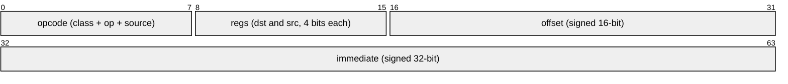
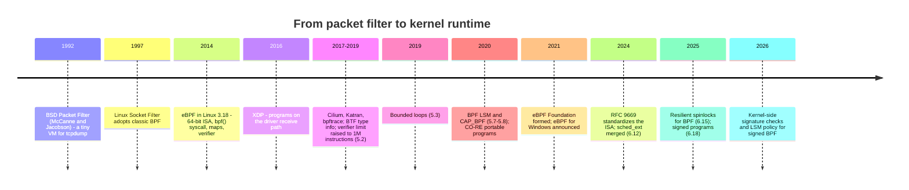
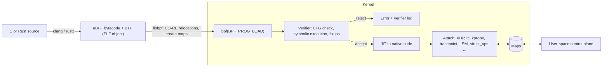

---
tags:
  - operating-systems
  - kernels
  - ebpf
  - linux
  - observability
  - networking
status: draft
sources:
  - https://arxiv.org/pdf/2410.00026
  - https://www.rfc-editor.org/rfc/rfc9669.html
  - https://www.ietf.org/blog/bpf-rfc9669/
  - https://docs.kernel.org/bpf/bpf_design_QA.html
  - https://lore.kernel.org/all/20190418012701.2965338-1-ast@kernel.org/T/
  - https://kernelnewbies.org/Linux_6.18
  - https://www.kernel.org/doc/html/latest//bpf/signing.html
  - https://lwn.net/Articles/1074083/
  - https://lwn.net/Articles/1081000/
  - https://lkml.iu.edu/hypermail/linux/kernel/2409.1/07472.html
  - https://lwn.net/Articles/1082717/
  - https://lwn.net/Articles/1004354/
  - https://lkml.iu.edu/hypermail/linux/kernel/2503.3/05531.html
  - https://www.linuxfoundation.org/hubfs/eBPF/eBPF%20In%20Production%20Report.pdf
  - https://github.com/microsoft/ebpf-for-windows
  - https://arxiv.org/pdf/2502.18832
created: 2026-11-26
updated: 2026-11-26
---

## Table Of Contents

---

- [[#TL;DR|TL;DR]]
- [[#The Problem|The Problem]]
- [[#Foundations|Foundations]]
    - [[#A Tiny Virtual Machine in the Kernel|A Tiny Virtual Machine in the Kernel]]
    - [[#Safety by Static Verification|Safety by Static Verification]]
- [[#How We Got Here|How We Got Here]]
- [[#How It Works|How It Works]]
    - [[#The Load Path|The Load Path]]
    - [[#The Verifier|The Verifier]]
    - [[#Maps, Helpers and Kfuncs|Maps, Helpers and Kfuncs]]
    - [[#Hooks: Where Programs Run|Hooks: Where Programs Run]]
    - [[#A Worked Example: XDP Packet Budget|A Worked Example: XDP Packet Budget]]
    - [[#Portability: BTF and CO-RE|Portability: BTF and CO-RE]]
    - [[#Who May Load Programs|Who May Load Programs]]
- [[#Where It Is Now|Where It Is Now]]
- [[#Trade-offs & Open Problems|Trade-offs & Open Problems]]
- [[#Resources|Resources]]
- [[#Related Notes|Related Notes]]

## ***TL;DR***
---
*eBPF lets you load small programs into a running Linux kernel and attach them to events such as packets, system calls or function entries. A verifier proves each program safe before it runs, so you extend the kernel without writing a module or rebooting.*

- **What it is:** a 64-bit instruction set with 11 registers and a small stack, executed inside the kernel after JIT compilation to native code ([Gbadamosi et al. 2024](https://arxiv.org/pdf/2410.00026)). Standardized as [RFC 9669](https://www.rfc-editor.org/rfc/rfc9669.html) (October 2024).
- **Why it's safe:** before loading, the **verifier** symbolically executes every path and rejects anything that might crash, loop forever or read memory it shouldn't. Programs can only touch the kernel through approved helpers and kfuncs.
- **What it's used for:** networking (XDP, load balancers, Kubernetes networking via Cilium), observability (profilers, tracing with bpftrace), security (runtime enforcement with LSM hooks, Tetragon), and now pluggable CPU scheduling ([[sched_ext and Pluggable Scheduling|sched_ext]], merged in Linux 6.12).
- **Why it matters architecturally:** it's how a monolithic kernel became safely programmable, a middle path between loadable modules (fast, unsafe) and user-space servers (safe, slow). See [[Kernel Architectures]].
- **Now (Nov 2026):** signed BPF programs landed in Linux 6.18 (Nov 2025) and are being extended with kernel-side metadata verification and LSM policy (2026 patch series). eBPF is mainstream production infrastructure: Meta's Katran handles every packet entering its data centers and Google runs a majority of production traffic through BPF ([eBPF Foundation, Feb 2026](https://www.linuxfoundation.org/hubfs/eBPF/eBPF%20In%20Production%20Report.pdf)).

## ***The Problem***
---
*People constantly need the kernel to do something slightly different: drop a packet earlier, count an event, enforce a policy. Before eBPF, the choices were slow, unsafe or took years.*

| Option before eBPF | Problem |
|---|---|
| Change the kernel upstream | Takes months to years to reach distributions; must be general enough for everyone |
| Write a loadable kernel module | Runs with full privilege; one bug crashes or compromises the machine; breaks across kernel versions |
| Do it in user space | Every event costs a [[System Calls and the User-Kernel Boundary|user-kernel crossing]] and copies; too slow for per-packet or per-syscall work |
| Special-purpose kernel features (iptables, ftrace, perf) | Each solves one fixed problem with its own interface |

eBPF's pitch: write a small program, have the kernel **prove** it safe, JIT it to native code, and run it at the exact point you need, at near-native speed. It's the same goal as an exokernel's "let applications customize the OS" (see [[Unikernels and Library OSes]]), achieved by moving verified code *into* the kernel rather than OS code out of it.

## ***Foundations***
---
*eBPF is two ideas together: a small, restricted instruction set that's easy to analyze and JIT, and a static verifier that rejects any program it can't prove safe.*

### A Tiny Virtual Machine in the Kernel

The eBPF machine ([RFC 9669](https://www.rfc-editor.org/rfc/rfc9669.html); [Gbadamosi et al.](https://arxiv.org/pdf/2410.00026)):

| Element | Detail |
|---|---|
| Registers | `r0`–`r10`, 64-bit. `r0` return value; `r1`–`r5` arguments; `r6`–`r9` callee-saved; `r10` read-only frame pointer |
| Stack | 512 bytes per program frame |
| Instructions | Fixed 64-bit encoding (one 128-bit wide load), RISC-like ALU, jumps, calls, loads/stores, atomics |
| Calls | To helpers, kfuncs, and BPF-to-BPF functions; tail calls to other programs |
| Execution | JIT-compiled to x86-64, arm64, RISC-V and others; interpreter as a fallback |

The registers map one-to-one onto real CPU registers on 64-bit machines, which is why the JIT output is close to hand-written code.



*One eBPF instruction is 64 bits: an 8-bit opcode, two 4-bit register numbers, a 16-bit offset and a 32-bit immediate ([RFC 9669](https://www.rfc-editor.org/rfc/rfc9669.html)).*

### Safety by Static Verification

Instead of isolating the program at run time (separate address space, as a microkernel would), eBPF proves safety **before** it runs. The verifier guarantees, for every possible path:
- The program terminates (bounded instruction count; loops must be provably bounded).
- Every memory access is in bounds and to memory of the right type (stack, map value, packet data after a bounds check, context).
- No uninitialized register or stack slot is read.
- Pointers aren't leaked to user space where that would reveal kernel addresses (for unprivileged programs).
- Helpers and kfuncs are called with arguments of the right types, and acquired resources (locks, references) are released.

This is **language-based safety without a safe language**: the bytecode is checked directly. The cost is that the verifier must reason about whatever the compiler emitted.

## ***How We Got Here***
---
*eBPF grew from a 1992 packet filter into a general-purpose in-kernel runtime, one feature at a time, driven mostly by networking and observability needs at large companies.*



- **Classic BPF (1992)** was a two-register virtual machine designed so `tcpdump` could filter packets in the kernel without copying every packet to user space. Linux adopted it for socket filters and later seccomp.
- **Extended BPF (2014)**, led by Alexei Starovoitov, widened it to 64-bit registers matching real hardware, added maps for state shared with user space, the `bpf()` system call and a much stronger verifier. It arrived in Linux 3.18 in December 2014 ([Gbadamosi et al.](https://arxiv.org/pdf/2410.00026)).
- **Networking pulled first.** XDP let programs drop or redirect packets before the kernel allocates a socket buffer, which made software DDoS mitigation and load balancers fast enough for hyperscalers.
- **Observability followed.** kprobes, uprobes and tracepoints plus maps turned eBPF into a safe, always-on profiler and tracer.
- **Programmability grew:** bounded loops, BPF-to-BPF calls, BTF type information, kfuncs, `struct_ops` (implementing kernel callback tables such as TCP congestion control in BPF), and finally whole schedulers with sched_ext ([sched_ext 6.12 pull](https://lkml.iu.edu/hypermail/linux/kernel/2409.1/07472.html)).
- **Security retreat:** repeated verifier bugs exploited from unprivileged mode led distributions to disable unprivileged eBPF by default ([Gbadamosi et al.](https://arxiv.org/pdf/2410.00026)). The focus moved to delegated privilege, signing and LSM control.

## ***How It Works***
---
*A program is compiled to bytecode in user space, checked by the verifier, JIT-compiled, and attached to a hook. It talks to the rest of the world only through maps, helpers and kfuncs.*

### The Load Path



### The Verifier

The verifier is a static analyzer in four passes: control-flow graph validation, symbolic execution of every path, then fixups and JIT ([Gbadamosi et al.](https://arxiv.org/pdf/2410.00026)).

**What it tracks, per register and stack slot:**
- **Type:** scalar, pointer to context, pointer to stack, pointer to map value, pointer to packet, possibly-NULL pointer, and so on.
- **Value range:** signed and unsigned min/max for 64-bit and 32-bit views, plus a "tnum" (tracked number) recording which bits are known 0, known 1 or unknown.
- **Liveness and precision**, so it can prune.

**How a bounds check becomes a proof.** In an XDP program, `data` and `data_end` are packet pointers. Reading 14 bytes of Ethernet header is only allowed after a comparison the verifier can use:

```c
SEC("xdp")
int drop_non_ipv4(struct xdp_md *ctx)
{
    void *data     = (void *)(long)ctx->data;
    void *data_end = (void *)(long)ctx->data_end;
    struct ethhdr *eth = data;

    if ((void *)(eth + 1) > data_end)   /* without this check, the       */
        return XDP_DROP;                /* verifier rejects the load     */

    if (eth->h_proto != bpf_htons(ETH_P_IP))
        return XDP_DROP;                /* drop everything except IPv4  */
    return XDP_PASS;                    /* hand IPv4 to the normal stack */
}
```

In plain words: on the branch where `eth + 1 <= data_end`, the verifier records that 14 bytes from `data` are readable, so `eth->h_proto` is allowed. Remove the `if` and the load is rejected with an "invalid access to packet" error. The program never needs a run-time bounds check that the verifier can't see.

**State pruning.** Exploring every path is exponential, so the verifier remembers states it has already proved safe at each instruction. If a new path arrives at an instruction with a state that is a subset of a known-safe one, it stops exploring. Over-eager pruning is a classic source of verifier soundness bugs.

**Limits.** The verifier gives up after processing 1,000,000 instructions across all paths (the limit for privileged programs since Linux 5.2; earlier kernels also capped program size at 4,096 instructions) ([verifier limits patch](https://lore.kernel.org/all/20190418012701.2965338-1-ast@kernel.org/T/)). Programs with branchy loops hit this "complexity limit" even when they're short.

**The language-verifier gap.** The verifier sometimes rejects safe programs because the compiler reorders or spills registers in ways the analysis can't follow. A study of 72 commits in Cilium, Aya and Katran found developers splitting programs, restructuring code and nudging the compiler purely to satisfy it ([Rex, 2025](https://arxiv.org/pdf/2502.18832)).

### Maps, Helpers and Kfuncs

| Interface | What it is | Stability |
|---|---|---|
| **Maps** | Kernel data structures shared by programs and user space: hash, array, per-CPU, LRU, ring buffer, LPM trie, arena (shared memory region) | UAPI, stable |
| **Helpers** | Fixed kernel functions a program type may call (`bpf_map_lookup_elem`, `bpf_ktime_get_ns`, `bpf_redirect`) | UAPI, stable |
| **Kfuncs** | Regular kernel functions exported to BPF with BTF type info; the newer way to add capabilities | Explicitly not stable, like internal kernel APIs ([BPF Design Q&A](https://docs.kernel.org/bpf/bpf_design_QA.html)) |
| **`struct_ops`** | A BPF program implements a kernel callback table (TCP congestion control, sched_ext scheduler ops) | Depends on the subsystem |

Maps are how state survives between invocations and how user space reads results: a profiler increments a per-CPU counter map on every sample, and a user-space tool reads and aggregates it.

**Locks inside BPF.** BPF programs may take `bpf_spin_lock`s under verifier rules. Because BPF programs can run at unexpected points (inside other kernel code's critical sections), deadlocks appeared that the static rules couldn't prevent. Linux 6.15 added **rqspinlock**, a resilient variant of the kernel's queued spinlock that detects deadlocks and times out at run time instead of proving their absence ([LWN](https://lwn.net/Articles/1004354/); [6.15 pull](https://lkml.iu.edu/hypermail/linux/kernel/2503.3/05531.html)). See [[Locks and Synchronization]].

### Hooks: Where Programs Run

| Area | Hooks | Typical use |
|---|---|---|
| Networking | XDP (driver receive), tc ingress/egress, socket ops, cgroup sockets, netkit | DDoS drop, load balancing, Kubernetes service routing |
| Tracing | kprobes/kretprobes, fentry/fexit, uprobes, tracepoints, perf events | Profilers, latency histograms, `bpftrace` one-liners |
| Security | BPF LSM hooks, seccomp (classic BPF) | Runtime policy, audit, blocking exec of untrusted binaries |
| Scheduling | sched_ext `struct_ops` | Custom CPU schedulers ([[sched_ext and Pluggable Scheduling]]) |
| Storage and HID | `struct_ops`, HID-BPF, NVMe offload research | Device quirks, I/O fast paths |

A one-line tracer shows how cheap this is to use:

```bash
# Count system calls by process name, system-wide, until Ctrl-C.
bpftrace -e 'tracepoint:raw_syscalls:sys_enter { @[comm] = count(); }'
```

`bpftrace` compiles the expression to eBPF, attaches it to the syscall-entry tracepoint, and keeps counts in a hash map keyed by process name.

### A Worked Example: XDP Packet Budget

Why does XDP run in the driver before the kernel allocates anything? Because at line rate there's almost no time per packet.

$$
t_{\text{packet}} = \frac{(L + 20)\times 8}{R}
$$

**In plain words:** time per packet equals the packet's bits on the wire (frame length $L$ in bytes plus 20 bytes of preamble and inter-frame gap) divided by the link rate $R$.

For minimum-size 64-byte frames on a 10 Gb/s link: $(64 + 20)\times 8 = 672$ bits, and $672 / 10^{10}\text{ b/s} = 67.2$ ns, about 14.88 million packets per second. On a 3 GHz core that's about $67.2 \times 3 \approx 200$ cycles per packet for everything. Allocating a socket buffer and walking the full network stack costs more than that, so dropping attack traffic in XDP, before any of that happens, is what lets one server absorb a flood. At 100 Gb/s the budget is 6.7 ns per packet per link, which is why the work is spread across cores and, for some NICs, offloaded to the card itself ([IETF on BPF offload](https://www.ietf.org/blog/bpf-rfc9669/)). See [[Kernel Bypass Networking]] for the alternative of skipping the kernel entirely.

### Portability: BTF and CO-RE

Kernel structures change layout between versions. **BTF** (BPF Type Format) is compact type information for the running kernel, an order of magnitude smaller than DWARF ([Gbadamosi et al.](https://arxiv.org/pdf/2410.00026)). **CO-RE** (compile once, run everywhere) records which fields a program accesses, and libbpf rewrites the offsets at load time to match the running kernel. One binary then works across kernel versions without recompiling on the target.

### Who May Load Programs

- Loading most program types needs `CAP_BPF` (since Linux 5.8) plus `CAP_PERFMON` or `CAP_NET_ADMIN` depending on type, rather than full `CAP_SYS_ADMIN`.
- Unprivileged eBPF is disabled by default on mainstream distributions after repeated verifier exploits ([Gbadamosi et al.](https://arxiv.org/pdf/2410.00026)).
- **BPF tokens** let a privileged daemon delegate specific BPF permissions to a container.
- **Signed programs (Linux 6.18):** the kernel can require a valid signature. Because libbpf rewrites programs at load time (map fds, CO-RE offsets), the design signs a small fixed **loader** program plus a frozen metadata map holding the real programs; the signature covers both, and the loader does the host-specific rewriting after verification ([kernel docs](https://www.kernel.org/doc/html/latest//bpf/signing.html); [Linux 6.18](https://kernelnewbies.org/Linux_6.18)).

## ***Where It Is Now***
---
*As of November 2026 eBPF is standard infrastructure at hyperscalers, the instruction set is an IETF standard with a Windows implementation, and the main kernel work is on trust: who may load programs, how they are signed, and how much the verifier can be relied on.*

**Production scale** (self-reported case studies, [eBPF Foundation report, Feb 2026](https://www.linuxfoundation.org/hubfs/eBPF/eBPF%20In%20Production%20Report.pdf)):

| Company | Use | Reported effect |
|---|---|---|
| Meta | Katran load balancer; Strobelight profiler | Katran handles every packet entering its data centers; Strobelight cut CPU cycles by up to 20% |
| Google | Auditing, policy, networking | BPF handles a majority of production traffic |
| Cloudflare | XDP DDoS mitigation | Mitigated attacks peaking above 7 Tbps without degradation |
| Netflix | Noisy-neighbor detection | Traces container latency jumps from 83 µs to 131 ms |
| Datadog | eBPF connection tracker | 35% lower CPU usage |
| ByteDance | netkit on about 1M servers | 10% throughput gain |

**Signing and policy (2025–2026)**
- Linux 6.18 (30 Nov 2025) added cryptographically signed BPF programs ([KernelNewbies](https://kernelnewbies.org/Linux_6.18)).
- In 2026 the design is being tightened: KP Singh's "Signed BPF + IPE Policies" series (May 2026) exposes the signature verdict to LSMs and moves metadata checking into kernel C code ([LWN](https://lwn.net/Articles/1074083/)); Daniel Borkmann's series (July 2026) has the kernel verify loader metadata at `BPF_PROG_LOAD` time so one PKCS#7 signature covers instructions plus map contents ([LWN](https://lwn.net/Articles/1081000/)). The current kernel docs describe this model: a program's verdict is either unsigned or verified, keys come from a sealed BPF keyring, and LSMs enforce policy ([kernel docs](https://www.kernel.org/doc/html/latest//bpf/signing.html)). Competing proposals (the Hornet LSM) prompted the "one signing scheme" argument.

**Scheduling with BPF**
- sched_ext (6.12) lets schedulers be BPF programs. In 2026 work continues on sub-schedulers (partly merged in 7.1) and on making sched_ext compatible with proxy execution, targeted at 7.3 ([LWN, Jul 2026](https://lwn.net/Articles/1082717/)). See [[sched_ext and Pluggable Scheduling]] and [[CPU Scheduling]].

**Beyond Linux**
- RFC 9669 (31 Oct 2024) standardizes the ISA, mainly so NIC and NVMe vendors can build offload ([IETF](https://www.ietf.org/blog/bpf-rfc9669/)).
- eBPF for Windows (Microsoft, open source, still described as a work in progress) verifies programs with the PREVAIL verifier and prefers a "native" mode that compiles verified bytecode to C and then to a signed Windows driver, because JIT output can't run under hypervisor-enforced code integrity ([GitHub](https://github.com/microsoft/ebpf-for-windows)).

**Research**
- **Rex** proposes dropping the bytecode verifier for kernel extensions written in a restricted subset of safe Rust, with a small runtime for termination and stack checks; its Memcached cache matched eBPF's throughput with 326 lines of Rust instead of 513 lines of C ([Rex](https://arxiv.org/pdf/2502.18832)). See [[Rust in the Linux Kernel]].
- Formal verification of parts of the verifier (range analysis, JITs) is active, but the whole verifier isn't verified ([Gbadamosi et al.](https://arxiv.org/pdf/2410.00026)). See [[Formally Verified OS Components]].

## ***Trade-offs & Open Problems***
---
*eBPF trades expressiveness for provable safety, and its safety is only as good as a large, fast-changing verifier. The open problems are about that verifier and about who gets to load code into everyone's kernel.*

| Choice | You get | You pay |
|---|---|---|
| Static verification | Native-speed code inside the kernel with no run-time isolation cost | Safe programs rejected; contorted code to please the verifier; complexity limit |
| Bytecode as the contract | Language-neutral, portable, standardized ISA | Verifier reasons about compiler output, not source; hard-to-read errors |
| Stable helpers vs unstable kfuncs | Fast growth of capabilities through kfuncs | Programs using kfuncs can break across kernel versions |
| Run anywhere in the kernel | Hooks on almost any event | New reentrancy and deadlock risks; programs run in contexts code didn't expect |
| Privileged-only loading | Safer after verifier exploits | Containers and unprivileged tools need delegation (tokens) |
| Signing the loader, not the program | Works with load-time relocation | More complex trust chain; still being finalized in 2026 |

Open problems worth tracking:
- **Verifier soundness.** A bug in the verifier is a kernel privilege escalation. It's a large, frequently changed C codebase without a full proof ([Gbadamosi et al.](https://arxiv.org/pdf/2410.00026)).
- **Usability.** The language-verifier gap pushes some toward safe-Rust extensions (Rex) instead of bytecode verification.
- **Trust and supply chain.** Signing, keyrings and LSM policy decide who can change kernel behavior at run time. The 2026 debate is about one scheme and where the checks live.
- **Observability's own overhead.** Always-on tracing must stay cheap; per-event probes on hot paths still cost cycles.
- **Spectre-class leaks.** The verifier adds speculation barriers and constant blinding, but speculative execution remains a concern for any code the kernel runs on behalf of user space. See [[Transient Execution Attacks and Mitigations]].

## ***Resources***
---
*Read the eBPF runtime paper for an end-to-end tour, the RFC for the instruction set, and the kernel signing doc and 2026 LWN coverage for where trust is heading.*

**Primary sources**
- [The eBPF Runtime in the Linux Kernel](https://arxiv.org/pdf/2410.00026): Gbadamosi et al., 2024. The clearest end-to-end description.
- [RFC 9669: BPF Instruction Set Architecture](https://www.rfc-editor.org/rfc/rfc9669.html): IETF, Oct 2024; [IETF blog post](https://www.ietf.org/blog/bpf-rfc9669/).
- [BPF Design Q&A](https://docs.kernel.org/bpf/bpf_design_QA.html): kernel docs on stability rules for helpers and kfuncs.
- [BPF signing](https://www.kernel.org/doc/html/latest//bpf/signing.html): kernel docs.
- [Document the verifier limits](https://lore.kernel.org/all/20190418012701.2965338-1-ast@kernel.org/T/): Alexei Starovoitov, 2019.

**Current state**
- [Linux 6.18](https://kernelnewbies.org/Linux_6.18): signed BPF programs.
- [Signed BPF + IPE Policies](https://lwn.net/Articles/1074083/) (May 2026) and [Verify BPF signed loader at load time](https://lwn.net/Articles/1081000/) (Jul 2026): LWN.
- [sched_ext initial pull for 6.12](https://lkml.iu.edu/hypermail/linux/kernel/2409.1/07472.html) and [sched_ext sub-schedulers and proxy execution](https://lwn.net/Articles/1082717/): LWN, Jul 2026.
- [Resilient Queued Spin Lock](https://lwn.net/Articles/1004354/): LWN.
- [eBPF in Production report](https://www.linuxfoundation.org/hubfs/eBPF/eBPF%20In%20Production%20Report.pdf): eBPF Foundation, Feb 2026.
- [eBPF for Windows](https://github.com/microsoft/ebpf-for-windows): Microsoft.

**Research**
- [Safe and usable kernel extensions with Rex](https://arxiv.org/pdf/2502.18832): 2025.

## Related Notes

- [[Kernel Architectures]] — eBPF as the monolithic kernel's answer to safe extensibility.
- [[Unikernels and Library OSes]] — The opposite way to customize the OS: move it into the app.
- [[System Calls and the User-Kernel Boundary]] — The crossing eBPF avoids by running at the hook.
- [[sched_ext and Pluggable Scheduling]] — Whole CPU schedulers written in BPF.
- [[CPU Scheduling]] — The kernel policy sched_ext lets you replace.
- [[Kernel Bypass Networking]] — XDP versus DPDK and RDMA.
- [[io_uring]] — Another way to cut per-operation kernel overhead, and a frequent target of BPF tracing.
- [[Interrupts and Exceptions]] — The context XDP programs run in.
- [[Locks and Synchronization]] — BPF spinlocks and the resilient queued spinlock.
- [[Containers, Namespaces and cgroups]] — cgroup hooks and Kubernetes networking with Cilium.
- [[Kernel Security Hardening]] — BPF LSM, signing and the verifier as attack surface.
- [[Transient Execution Attacks and Mitigations]] — Why the verifier inserts speculation barriers.
- [[Rust in the Linux Kernel]] — Safe Rust as an alternative to bytecode verification.
- [[Formally Verified OS Components]] — Proving the verifier and JITs correct.
- [[Kernel Observability and Tracing]] — The tracepoints, kprobes, perf events and ring buffers that BPF tracing programs attach to, and when to use ftrace or perf instead.
