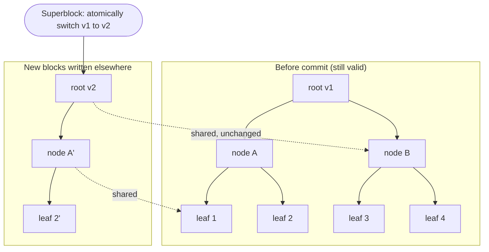
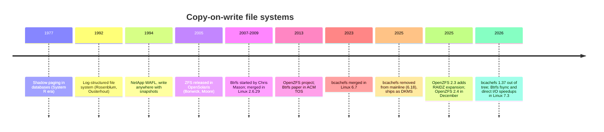
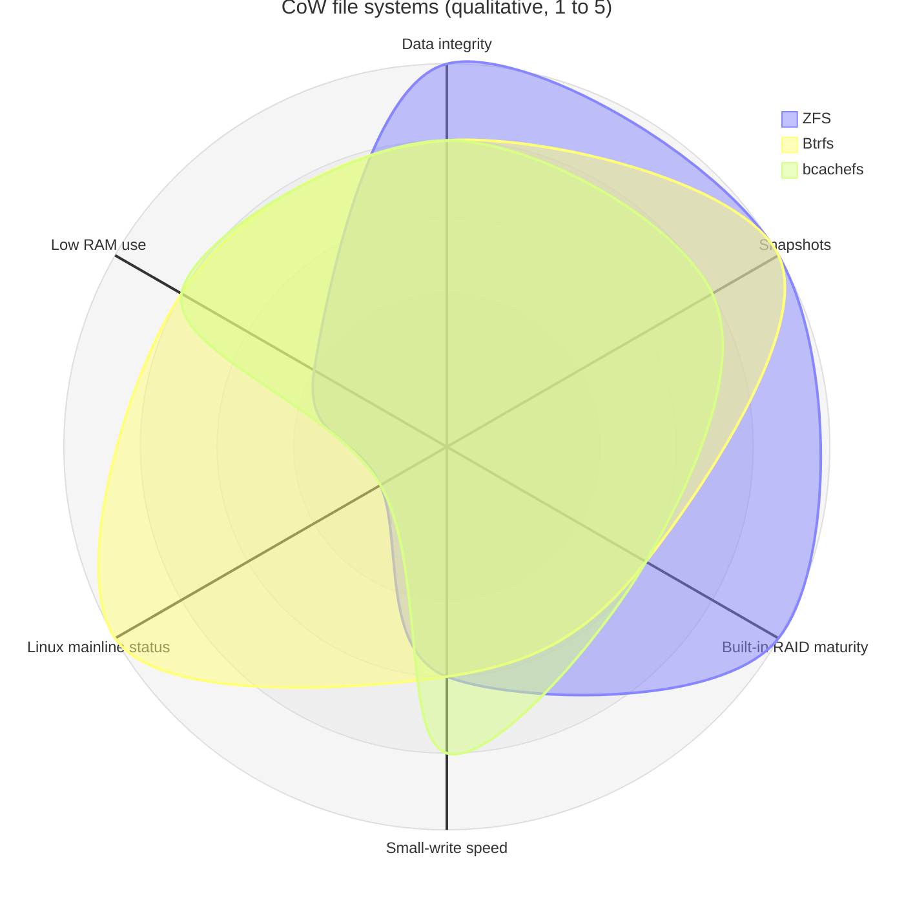

---
tags:
  - operating-systems
  - file-systems
  - storage
  - copy-on-write
  - zfs
  - btrfs
  - bcachefs
status: complete
sources:
  - https://www.ece.villanova.edu/~rperry/os/ostep/Chapters/42-file-journaling.pdf
  - https://btrfs.readthedocs.io/en/latest/dev/dev-btrfs-design.html
  - https://api.crossref.org/works/10.1145%2F2501620.2501623
  - https://static.usenix.org/events/fast10/tech/full_papers/zhang.pdf
  - https://web.mit.edu/6.1800/www/papers/zfs.pdf
  - https://lwn.net/Articles/1040120
  - https://www.theregister.com/2025/01/23/openzfs_23_raid_expansion/
  - https://github.com/openzfs/zfs/releases/tag/zfs-2.4.0
  - https://phoronix.com/review/linux-73-btrfs
  - https://itsfoss.com/news/linux-7-3-preview/
  - https://www.theregister.com/2026/03/17/bcachefs_and_apfs_news/
  - https://phoronix.com/news/Bcachefs-1.38.7-Rust-Kernel
created: 2026-11-26
updated: 2026-11-26
---

## Table Of Contents

---

- [[#TL;DR|TL;DR]]
- [[#The Problem|The Problem]]
- [[#Foundations|Foundations]]
    - [[#Shadow Paging and the Wandering Tree|Shadow Paging and the Wandering Tree]]
    - [[#Checksums in the Parent|Checksums in the Parent]]
    - [[#Snapshots and Clones by Reference Counting|Snapshots and Clones by Reference Counting]]
- [[#How We Got Here|How We Got Here]]
- [[#How It Works|How It Works]]
    - [[#ZFS|ZFS]]
    - [[#Btrfs|Btrfs]]
    - [[#bcachefs|bcachefs]]
    - [[#Making fsync Fast|Making fsync Fast]]
    - [[#Side by Side|Side by Side]]
- [[#Where It Is Now|Where It Is Now]]
- [[#Trade-offs & Open Problems|Trade-offs & Open Problems]]
- [[#Resources|Resources]]
- [[#Related Notes|Related Notes]]

## ***TL;DR***

---

*A copy-on-write (CoW) file system never overwrites live data or metadata. Every change writes new blocks and new copies of every tree node above them, then flips one root pointer, so the on-disk state is always a consistent tree. Snapshots, clones and end-to-end checksums fall out of that design almost for free; fragmentation and write amplification are the bill.*

- **Consistency:** the old tree stays valid until the root switches, so a crash leaves the previous version and no journal or fsck is needed ([OSTEP ch. 42](https://www.ece.villanova.edu/~rperry/os/ostep/Chapters/42-file-journaling.pdf)).
- **Integrity:** each block pointer carries the checksum of the block it points to, so the tree is a Merkle tree and silent corruption is detected on every read ([Zhang et al., FAST '10](https://static.usenix.org/events/fast10/tech/full_papers/zhang.pdf)).
- **The big three:** **ZFS** (Sun, 2005; pooled storage with built-in RAID), **Btrfs** (Linux mainline since 2009; everything in CoW B-trees) and **bcachefs** (2023 mainline, removed in 6.18, now an out-of-tree module) ([LWN](https://lwn.net/Articles/1040120)).
- **Late 2026:** Btrfs in Linux 7.3 got much faster direct I/O and fsync; OpenZFS 2.4 (Dec 2025) follows RAIDZ expansion in 2.3; bcachefs lives out of tree and is moving parts of its module to Rust.

## ***The Problem***

---

*Updating a file in place needs several dependent writes, and disks lie: they reorder writes, lose power mid-update and occasionally return the wrong data without an error. A file system that wants snapshots and trustworthy data has to stop trusting in-place updates.*

| Failure | In-place file system (ext4, XFS) | CoW file system |
|---|---|---|
| Crash between dependent writes | Journal replay restores metadata; data may be stale or garbage in some modes | Previous tree is intact; uncommitted changes vanish |
| Silent corruption (bit rot, misdirected or lost writes) | Undetected for data; some metadata checksums | Detected by parent-held checksums; repaired from a redundant copy if one exists |
| Snapshot of a 10 TB volume | Needs a block-layer snapshot (LVM) that slows writes | Keep the old root: instant and initially zero space |
| Rollback / clone | Copy everything | Point a new root at the shared tree |

The corruption row is not theoretical. Zhang et al. injected faults into ZFS and found that it "detects all corruptions due to the use of checksums" on disk, repairs corrupted metadata from its extra copies (ditto blocks), and by default only detects corrupted user data. In memory the picture flips: ZFS "fails to detect and recover from many corruptions", because a checksum only protects data from the moment it is computed ([FAST '10](https://static.usenix.org/events/fast10/tech/full_papers/zhang.pdf)).

## ***Foundations***

---

*Three ideas carry every CoW file system: write new copies up to the root (shadowing), store each child's checksum in its parent, and share subtrees between versions using reference counts.*

### Shadow Paging and the Wandering Tree

To change one leaf, write a new copy of the leaf, then a new copy of its parent pointing at the new leaf, and so on up to the root. Finally write the root pointer (the **superblock** or **uberblock**) in one atomic sector write. Until that last write, nothing reachable from the old root has changed ([OSTEP ch. 42](https://www.ece.villanova.edu/~rperry/os/ostep/Chapters/42-file-journaling.pdf)).



The cost is that a 4 KB change rewrites a whole path. For a tree of height $h$:

$$\text{blocks written for one isolated update} = h, \qquad \text{for } n \text{ batched updates} \le n + \sum_{\text{levels}} (\text{distinct ancestors})$$

In words: one change costs one new block per tree level; many changes committed together share most of the upper nodes, so the per-update cost falls toward one block.

*Worked example:* with fanout 256 and height 4, a lone 4 KB write rewrites 4 blocks (16 KB, 4x amplification). If one transaction updates 1,000 leaves spread across the tree, it writes 1,000 leaves, at most $\lceil 1000/256 \rceil$ to 1,000 level-2 nodes depending on locality, a handful of level-3 nodes and 1 root: between about 1,010 and about 2,010 blocks, so roughly 1x to 2x amplification. This is why CoW file systems batch changes into transactions committed every few seconds.

### Checksums in the Parent

Storing a block's checksum inside the block cannot catch a misdirected or phantom write: the wrong block still matches its own checksum. Storing it in the **parent's pointer** fixes that, and because the parent is itself checksummed by its parent, the whole tree is a Merkle tree rooted at the uberblock ([Zhang et al.](https://static.usenix.org/events/fast10/tech/full_papers/zhang.pdf)):

```c
/* Simplified ZFS-style block pointer: where the child is AND what it must hash to */
struct blkptr {
        struct dva   dva[3];        /* up to 3 copies: (vdev, offset, size) */
        uint64_t     birth_txg;     /* transaction that wrote it */
        uint8_t      checksum_type; /* fletcher4, sha256, blake3, ... */
        uint64_t     checksum[4];   /* 256-bit checksum of the child block */
};
```

*In plain words: a pointer says "the child lives here, in up to three places, was written in transaction N, and must hash to this value." A read that fails the hash tries another copy and rewrites the bad one (self-healing).*

### Snapshots and Clones by Reference Counting

A snapshot is just an extra root that keeps the old tree reachable. A block is free only when no root reaches it. ZFS avoids per-block reference counts by using birth times: a block born after the latest snapshot can be freed immediately, one born earlier goes to that snapshot's deadlist. Btrfs keeps reference counts and back-references in its extent tree, following Ohad Rodeh's scheme for "B-trees, shadowing and clones" ([Rodeh, Bacik, Mason, ACM TOS 2013](https://api.crossref.org/works/10.1145%2F2501620.2501623)). Either way, a snapshot costs nothing until data diverges.

## ***How We Got Here***

---

*Shadow paging is a 1970s database idea; WAFL and LFS brought it to file systems; ZFS and Btrfs made it mainstream with checksums and snapshots; bcachefs tried to do it faster and safer, and left the kernel over process rather than code.*



- **ZFS (2005):** Sun's design pooled disks, folded RAID into the file system and checksummed everything end to end ([ZFS paper](https://web.mit.edu/6.1800/www/papers/zfs.pdf)). Licensing (CDDL) keeps it out of the Linux tree; OpenZFS ships as an external module.
- **Btrfs (2007-2009):** Chris Mason at Oracle built a Linux-native CoW file system on Rodeh's CoW-friendly B-trees; "everything is a B-tree item" ([Btrfs design](https://btrfs.readthedocs.io/en/latest/dev/dev-btrfs-design.html)).
- **bcachefs (2015-2025):** Kent Overstreet grew it out of the bcache block cache; merged in 6.7, marked "externally maintained" in 6.17 and removed in 6.18 after disputes over development process ([LWN, Sept 2025](https://lwn.net/Articles/1040120)).

## ***How It Works***

---

*ZFS manages disks, redundancy and files as one stack with a transaction group as the unit of commit. Btrfs stores every kind of metadata as items in a family of CoW B-trees. bcachefs uses a single B+-tree design with log-structured nodes on top of a bucket allocator.*

### ZFS

| Layer | Role |
|---|---|
| **SPA** (storage pool allocator) | Pools many devices into **vdevs** (mirror, RAIDZ1-3, dRAID); allocates space; holds the **uberblock** ring |
| **DMU** (data management unit) | Transactional object store: objects of blocks addressed by block pointers; transaction groups (txgs) |
| **ZPL / ZVOL** | POSIX file system or raw block volume on top of DMU objects |
| **ARC / L2ARC** | Adaptive replacement cache in RAM (and on SSD), separate from the Linux [[Page Cache and Memory Reclaim|page cache]] |
| **ZIL / SLOG** | Intent log for synchronous writes, optionally on a fast separate device |

- **Commit:** changes accumulate in an open txg; a sync writes all new blocks, then a new uberblock into the next slot of the ring. The highest valid uberblock wins at import.
- **RAIDZ without a write hole:** RAID-5 updates parity in place, so a crash between data and parity writes corrupts a stripe (the "write hole"). RAIDZ writes every block as a full, variable-width stripe in new space, so there is never a partial-stripe overwrite.

### Btrfs

Btrfs stores everything as **items** keyed by `(objectid, type, offset)` in CoW B-trees ([Btrfs design](https://btrfs.readthedocs.io/en/latest/dev/dev-btrfs-design.html)):

| Tree | Holds |
|---|---|
| Root tree | Pointers to every other tree, including each subvolume's tree |
| FS trees (one per subvolume or snapshot) | Inodes, directory entries, file extent items |
| Extent tree | Allocated extents with reference counts and back-references |
| Chunk and device trees | Logical-to-physical mapping: which devices and RAID profile back each chunk |
| Checksum tree | Per-block data checksums (crc32c by default; xxhash, sha256, blake2 optional) |
| Free space tree | Free-space cache |

- **Subvolumes and snapshots:** a subvolume is an independent FS tree; a snapshot is a subvolume whose root starts as a copy of another's.
- **Reflinks:** `cp --reflink` shares extents between files, the per-file version of a snapshot.
- **Chunks and profiles:** space is carved into chunks with a RAID profile (single, DUP, RAID0/1/10, RAID1C3/C4, RAID5/6). Because the chunk layer sits below the CoW trees, RAID5/6 still overwrites partial stripes and has a write hole; the RAID stripe tree (design in btrfs-progs) is the long-term fix.
- **send/receive:** compares two snapshots' trees to stream only the changed extents, the basis of incremental backups.

### bcachefs

- One generic **B+-tree** with large nodes (hundreds of KB) whose contents are themselves log-structured: new keys are appended to a node and the node is rewritten only when it fills, so most updates do not shadow the whole path.
- A **journal** of btree updates gives fast commits; data is CoW at the extent level.
- Native multi-device tiering (fast SSD in front of slow disks), compression, encryption, checksums and erasure coding.

### Making fsync Fast

Committing a whole transaction for every `fsync()` would be ruinous. Each design keeps a small log for synchronous writes:

| | ZFS | Btrfs | bcachefs |
|---|---|---|---|
| Mechanism | ZIL: per-dataset intent log of synchronous operations, replayed after a crash | Log tree: per-subvolume tree of the fsynced inode's changes, replayed at mount | Btree journal |
| Fast device option | SLOG (separate log vdev) | No | Via device targets |

### Side by Side



*Scores are the note's qualitative summary of the sections above, not benchmarks.*

## ***Where It Is Now***

---

*As of November 2026: ZFS and Btrfs are both mature and still getting real performance work; bcachefs is alive but out of tree.*

| System | Latest state (Nov 2026) | Source |
|---|---|---|
| **OpenZFS** | 2.3 (Jan 2025) added RAIDZ expansion (add a disk to an existing RAIDZ vdev, without changing its parity level), Fast Dedup and Direct I/O that bypasses the ARC. 2.4.0 (18 Dec 2025) supports Linux 4.18 to 6.18 and FreeBSD 14 to 16, turns on user/group/project quotas by default, sends unaligned direct I/O through a light uncached path, adds a new allocation throttle to cut vdev fragmentation, AVX2 AES-GCM, ZIL on special vdevs and `zfs rewrite -P`. 2.4 point releases track newer kernels. | [The Register](https://www.theregister.com/2025/01/23/openzfs_23_raid_expansion/), [2.4.0 release notes](https://github.com/openzfs/zfs/releases/tag/zfs-2.4.0) |
| **Btrfs** | Linux 7.3 (Aug 2026 merge window): direct I/O now uses an iomap bounce buffer instead of falling back to buffered I/O, going from about half to close to 95% of the drive's throughput; two logging and fsync fixes are each worth about 5x; the default free-space cache moves from v1 to the v2 tree. Linux 7.4 brings more Btrfs performance work. | [Phoronix review](https://phoronix.com/review/linux-73-btrfs), [It's FOSS](https://itsfoss.com/news/linux-7-3-preview/) |
| **bcachefs** | Removed from mainline in 6.18 and shipped as a DKMS module. 1.37 (Mar 2026) improved erasure coding, unsafe-shutdown recovery and multi-device speed and added Linux 7.0 support. 1.38.7 is planned as the first release with Rust code in the kernel module; Kent Overstreet says DKMS builds of Rust modules are "not going to be practical", so distro binary packages are the target. | [The Register](https://www.theregister.com/2026/03/17/bcachefs_and_apfs_news/), [Phoronix](https://phoronix.com/news/Bcachefs-1.38.7-Rust-Kernel) |

- **The pattern:** the CoW designs are settled; the 2025-2026 work is about the costs in [[#Trade-offs & Open Problems|Trade-offs]], namely fsync latency, direct I/O, fragmentation and growing arrays in place.
- **Rust:** bcachefs is the first CoW file system moving its kernel code toward Rust, outside the tree ([[Rust in the Linux Kernel]]).

## ***Trade-offs & Open Problems***

---

*CoW turns every overwrite into an allocation. That buys consistency, snapshots and checksums, and costs fragmentation, write amplification, harder free-space accounting and painful behavior for databases and VM images.*

| Tension | Detail |
|---|---|
| Overwrites vs fragmentation | Random overwrites of a large file (databases, VM images) scatter its blocks; Btrfs offers `nodatacow` per file, which also turns off its data checksums |
| Integrity vs write amplification | Rewriting the path to the root on every change multiplies writes, especially for small synchronous updates ([[Flash and Log-Structured File Systems|flash]] suffers twice) |
| Snapshots vs free space | Deleting a file frees nothing if a snapshot still references its blocks; "how much space is free" has no simple answer |
| Built-in RAID vs simplicity | ZFS RAIDZ avoids the write hole by design; Btrfs RAID5/6 still has it |
| Licensing and governance | ZFS's CDDL keeps it out of tree; bcachefs left mainline over process ([LWN](https://lwn.net/Articles/1040120)) |

Open problems:
- **Fragmentation over time:** CoW volumes that are kept nearly full degrade, and defragmentation breaks extent sharing with snapshots.
- **Verified CoW:** the verified-file-system work in [[Formally Verified OS Components]] includes CoW designs, but nothing production-scale.
- **Flash cooperation:** CoW already writes out of place, which maps well onto zoned SSDs (Btrfs has a zoned mode) ([[Flash and Log-Structured File Systems]]).

## ***Resources***

---

*OSTEP explains why CoW is a crash-consistency technique; the Btrfs design doc and ACM TOS paper explain the B-tree version; the ZFS papers explain end-to-end integrity.*

**Foundations**
- [OSTEP ch. 42: Crash Consistency (journaling and copy-on-write)](https://www.ece.villanova.edu/~rperry/os/ostep/Chapters/42-file-journaling.pdf)
- [Btrfs documentation: Btrfs design](https://btrfs.readthedocs.io/en/latest/dev/dev-btrfs-design.html)
- [Rodeh, Bacik, Mason: BTRFS, The Linux B-Tree Filesystem (ACM TOS, 2013)](https://api.crossref.org/works/10.1145%2F2501620.2501623)
- [ZFS paper (MIT 6.1800 reading)](https://web.mit.edu/6.1800/www/papers/zfs.pdf)
- [Zhang et al.: End-to-end Data Integrity for File Systems, a ZFS Case Study (FAST '10)](https://static.usenix.org/events/fast10/tech/full_papers/zhang.pdf)

**Where it is now**
- [LWN: Bcachefs removed from the mainline kernel (Sept 2025)](https://lwn.net/Articles/1040120)
- [The Register: OpenZFS 2.3 adds RAIDZ expansion (Jan 2025)](https://www.theregister.com/2025/01/23/openzfs_23_raid_expansion/)
- [OpenZFS 2.4.0 release notes (Dec 2025)](https://github.com/openzfs/zfs/releases/tag/zfs-2.4.0)
- [Phoronix: Btrfs performance in Linux 7.3 (Aug 2026)](https://phoronix.com/review/linux-73-btrfs)
- [The Register: bcachefs 1.37 (Mar 2026)](https://www.theregister.com/2026/03/17/bcachefs_and_apfs_news/)
- [Phoronix: bcachefs 1.38.7 to bring Rust into its kernel module (Jun 2026)](https://phoronix.com/news/Bcachefs-1.38.7-Rust-Kernel)

## ***Related Notes***

---

- [[File Systems]]: inodes, the VFS, and journaling versus CoW.
- [[Flash and Log-Structured File Systems]]: the other out-of-place design, and why flash likes it.
- [[Page Cache and Memory Reclaim]]: ZFS's ARC versus the Linux page cache.
- [[Block Layer and IO Schedulers]]: what sits below the file system.
- [[Containers, Namespaces and cgroups]]: Btrfs and ZFS snapshots behind container image stores.
- [[Formally Verified OS Components]]: verified file systems.
- [[Rust in the Linux Kernel]]: memory-safe file system code.
- [[LSM Trees]]: the database world's take on log-structured, append-only storage.
