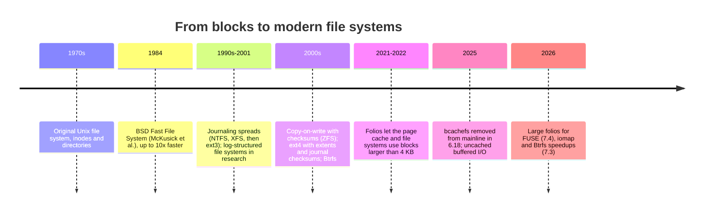
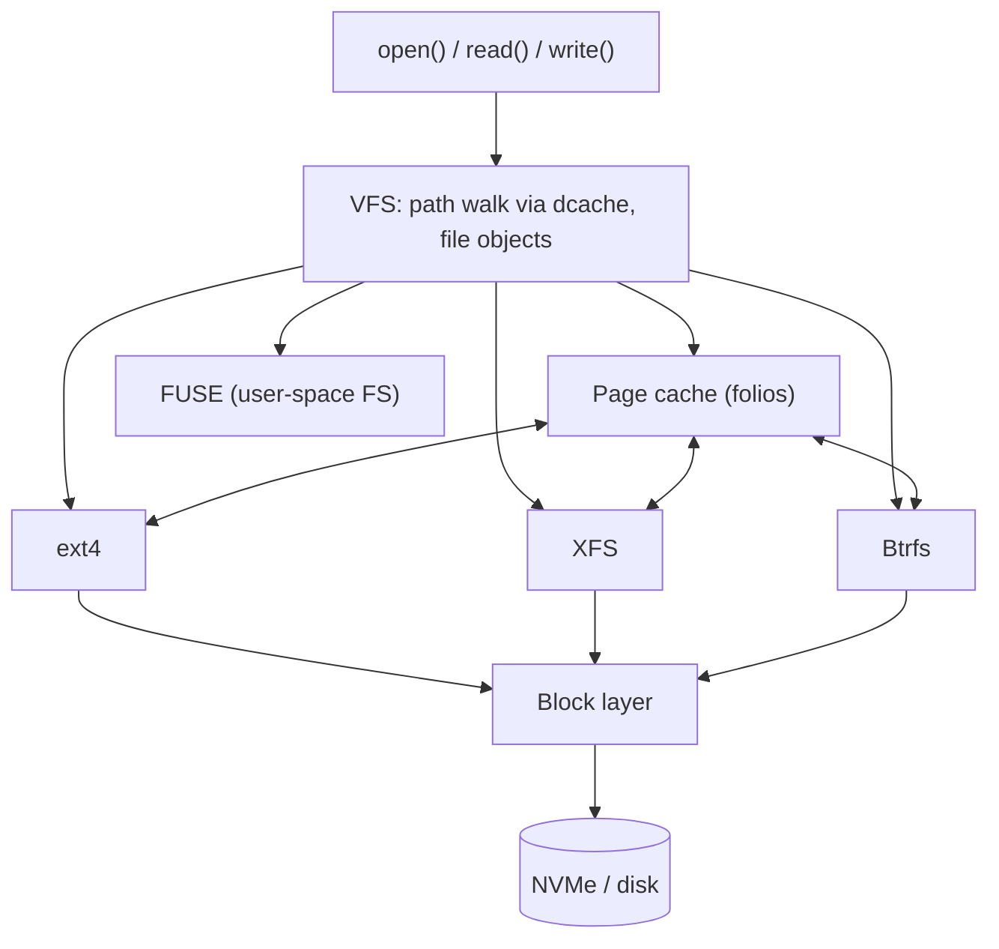
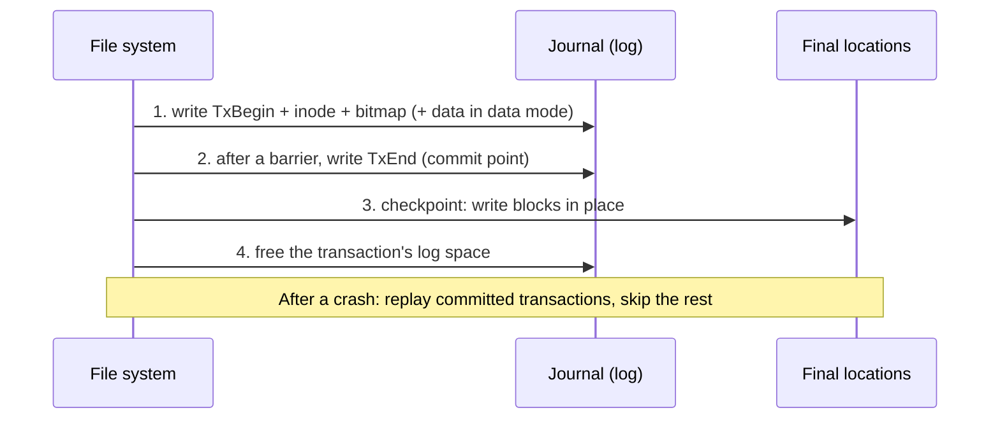

---
tags:
  - operating-systems
  - file-systems
  - storage
  - vfs
  - journaling
  - copy-on-write
status: complete
sources:
  - https://www.ece.villanova.edu/~rperry/os/ostep/Chapters/40-file-implementation.pdf
  - https://www.ece.villanova.edu/~rperry/os/ostep/Chapters/42-file-journaling.pdf
  - https://docs.kernel.org/filesystems/vfs.html
  - https://docs-archive.freebsd.org/44doc/smm/05.fastfs/paper.html
  - https://lwn.net/Articles/1040120
  - https://blogs.oracle.com/linux/intro-to-folios
  - https://phoronix.com/review/linux-73-features
  - https://www.phoronix.com/news/FUSE-Large-Folios
  - https://lwn.net/Articles/1003083
created: 2026-11-26
updated: 2026-11-26
---

## Table Of Contents

---

- [[#TL;DR|TL;DR]]
- [[#The Problem|The Problem]]
- [[#Foundations|Foundations]]
    - [[#Files, Inodes and Directories|Files, Inodes and Directories]]
    - [[#Finding a File's Blocks|Finding a File's Blocks]]
- [[#How We Got Here|How We Got Here]]
- [[#How It Works|How It Works]]
    - [[#The VFS Layer|The VFS Layer]]
    - [[#Following a Path|Following a Path]]
    - [[#Crash Consistency|Crash Consistency]]
    - [[#Journaling vs Copy-on-Write|Journaling vs Copy-on-Write]]
- [[#Where It Is Now|Where It Is Now]]
- [[#Trade-offs & Open Problems|Trade-offs & Open Problems]]
- [[#Resources|Resources]]
- [[#Related Notes|Related Notes]]

## ***TL;DR***

---

*A file system turns a device that only knows numbered blocks into named, growable files and directories that survive crashes. The core ideas are the inode (a file's metadata and block map), directories (names to inode numbers), and a crash-consistency scheme: journaling (ext4, XFS) or copy-on-write (ZFS, Btrfs).*

- **Inodes and indexes:** an inode holds a file's metadata and pointers to its data, either block pointers with indirect blocks or compact **extents** (XFS, ext4) ([OSTEP ch. 40](https://www.ece.villanova.edu/~rperry/os/ostep/Chapters/40-file-implementation.pdf)).
- **VFS:** Linux puts every file system behind one interface of superblocks, inodes, dentries and files, and caches path lookups in the dcache ([kernel docs](https://docs.kernel.org/filesystems/vfs.html)).
- **Crashes:** one append needs three writes, and a crash between them corrupts the disk. Journaling writes intent to a log first; copy-on-write never overwrites live data ([OSTEP ch. 42](https://www.ece.villanova.edu/~rperry/os/ostep/Chapters/42-file-journaling.pdf)).
- **2025-2026:** bcachefs left mainline (6.18) for an out-of-tree module ([LWN](https://lwn.net/Articles/1040120)); the big file systems chase NVMe speed with large folios and faster I/O paths ([Phoronix, 7.3](https://phoronix.com/review/linux-73-features)).

## ***The Problem***

---

*Storage hardware offers an array of fixed-size blocks with no names, no structure and no promise about what survives a power cut. Programs want named files that grow, directories, permissions, and data that is still correct after a crash, and they want it fast.*

A file system has to answer four questions well:

| Question | Mechanism |
|---|---|
| Where is byte $N$ of this file? | Inode block map or extents |
| Which file does `/home/a/notes.md` mean? | Directories mapping names to inode numbers, cached in RAM |
| Which blocks are free? | Allocation bitmaps, free-extent trees |
| What if power fails mid-update? | fsck, journaling, copy-on-write, or soft updates |

Speed shapes every answer: spinning disks punish seeks, so layouts keep related blocks together; SSDs punish small random writes and in-place overwrites; and all devices are orders of magnitude slower than RAM, so the [[Page Cache and Memory Reclaim|page cache]] sits in front of everything.

## ***Foundations***

---

*Everything on disk is either data or metadata. Metadata (inodes, directories, bitmaps, the superblock) is small but must stay consistent, because one wrong pointer can corrupt or expose unrelated data.*

### Files, Inodes and Directories

- **Inode:** a fixed-size record identified by its **i-number**, holding type, size, block count, permissions, timestamps and pointers to data. OSTEP's example uses 256-byte inodes, 16 per 4 KB block ([OSTEP ch. 40](https://www.ece.villanova.edu/~rperry/os/ostep/Chapters/40-file-implementation.pdf)).
- **Directory:** a special file whose content is a list of (name, i-number) pairs. A file's name lives in its directory, not its inode, which is why hard links work: two names, one inode.
- **Superblock:** describes the whole file system (size, where inodes start, feature flags).
- **Bitmaps / free lists:** track which inodes and blocks are allocated.

### Finding a File's Blocks

With 12 direct pointers, 4 KB blocks and 4-byte block addresses (so $4096/4 = 1024$ pointers fit in one indirect block), the largest file is ([OSTEP ch. 40](https://www.ece.villanova.edu/~rperry/os/ostep/Chapters/40-file-implementation.pdf)):

$$\text{max size} = \left(12 + 1024 + 1024^2\right) \times 4\,\text{KB}$$

In words: 12 blocks reached directly, 1,024 through one indirect block, and $1024^2$ through a double-indirect block (a block of pointers to blocks of pointers).

*Worked example:* direct pointers alone cover $12 \times 4\text{ KB} = 48$ KB. Adding the single-indirect block gives $(12 + 1024) \times 4\text{ KB} = 4{,}144$ KB, about 4 MB. Adding double-indirect gives $1{,}049{,}612 \times 4\text{ KB} \approx 4$ GB. Most files are small, so this unbalanced tree makes the common case (a few KB) cost no extra reads.

**Extents** replace per-block pointers with (start block, length) pairs. A 1 GB file laid out contiguously needs one extent instead of 262,144 pointers; XFS and ext4 use extents ([OSTEP ch. 40](https://www.ece.villanova.edu/~rperry/os/ostep/Chapters/40-file-implementation.pdf)).

## ***How We Got Here***

---

*File systems evolved by fixing the bottleneck of the day: seek-bound layouts in the 1980s, slow crash recovery in the 1990s, data integrity and snapshots in the 2000s, and now CPU overhead on fast NVMe.*

- **FFS (1984):** McKusick, Joy, Leffler and Fabry grouped data that is read together and used two block sizes so large files were fast without wasting space on small ones; "file access rates of up to ten times faster than the traditional UNIX file system" ([FFS paper](https://docs-archive.freebsd.org/44doc/smm/05.fastfs/paper.html)).
- **Journaling (1990s):** fsck on a big volume could take "many minutes or hours"; a journal makes recovery time depend on the log size, not the disk size ([OSTEP ch. 42](https://www.ece.villanova.edu/~rperry/os/ostep/Chapters/42-file-journaling.pdf)).
- **Copy-on-write (2000s):** ZFS and log-structured designs never overwrite in place, which also makes snapshots nearly free ([OSTEP ch. 42](https://www.ece.villanova.edu/~rperry/os/ostep/Chapters/42-file-journaling.pdf)).

## ***How It Works***

---

*A system call enters the VFS, which resolves the path through the dentry cache and calls into the specific file system; data moves through the page cache; metadata changes are grouped into transactions that are either journaled or written copy-on-write.*

### The VFS Layer

The Linux VFS defines four core objects, each with an operations table a file system fills in ([kernel docs](https://docs.kernel.org/filesystems/vfs.html)):

| Object | Represents | Example operations |
|---|---|---|
| **superblock** | "a mounted filesystem" | `alloc_inode`, `statfs`, `sync_fs` |
| **inode** | a file system object (file, directory, FIFO, ...) | `lookup`, `create`, `mkdir`, `rename`, `setattr` |
| **dentry** | a name linked to an inode, cached in RAM; dentries "are never saved to disc: they exist only for performance" | `d_revalidate`, `d_compare` (often NULL) |
| **file** | "a file opened by a process" | `read_iter`, `write_iter`, `mmap`, `fsync` |

A file system registers a `struct file_system_type` with `register_filesystem()`; registered types appear in `/proc/filesystems` ([kernel docs](https://docs.kernel.org/filesystems/vfs.html)). This is why ext4, XFS, Btrfs, NFS, FUSE and procfs all answer the same `open()` and `read()` [[System Calls and the User-Kernel Boundary|system calls]].

### Following a Path

Opening `/foo/bar` on a cold cache reads the root inode (inode 2 by convention), the root directory's data, `foo`'s inode, `foo`'s directory data, then `bar`'s inode: five reads before any file data ([OSTEP ch. 40](https://www.ece.villanova.edu/~rperry/os/ostep/Chapters/40-file-implementation.pdf)). Each later `read()` reads a data block and may write the inode to update its access time. The dcache exists to make this disappear: the VFS looks up each component in RAM first and calls the file system's `lookup()` only on a miss ([kernel docs](https://docs.kernel.org/filesystems/vfs.html)). Linux walks cached paths without taking locks, using [[Read-Copy-Update (RCU)|RCU]].

### Crash Consistency

Appending one 4 KB block needs three writes: the inode (new size and pointer), the data bitmap (block now used) and the data block. A crash after only some of them leaves trouble ([OSTEP ch. 42](https://www.ece.villanova.edu/~rperry/os/ostep/Chapters/42-file-journaling.pdf)):

| Written before the crash | Result |
|---|---|
| Data block only | File system fine; the user's data is lost |
| Inode only | Inode points at an unallocated block full of garbage |
| Bitmap only | Space leak: block marked used, nothing points to it |
| Inode + bitmap | Metadata consistent, but the file contains garbage |
| Inode + data | Inode and bitmap disagree |
| Bitmap + data | Block allocated but no inode points to it |

### Journaling vs Copy-on-Write

**Journaling (write-ahead logging)** writes the changes to a log first, then to their real homes ([OSTEP ch. 42](https://www.ece.villanova.edu/~rperry/os/ostep/Chapters/42-file-journaling.pdf)):

- **Data journaling** logs data too (every block written twice). **Ordered (metadata) journaling**, ext3/ext4's default, writes data to its final place *before* committing the metadata, following the rule "write the pointed-to object before the object that points to it."
- A checksum in the commit block lets the whole transaction be written at once instead of waiting before TxEnd; ext4 adopted this.
- Updates are batched into transactions committed roughly every 5 seconds.

**Copy-on-write** never overwrites live data: it writes new versions of changed blocks and of every block that points to them, then atomically switches the root pointer. The old tree is still valid until the switch, so a crash just leaves the previous version, and keeping old roots gives snapshots. ZFS and log-structured file systems work this way; Btrfs and bcachefs follow the same model.

| | Journaling (ext4, XFS) | Copy-on-write (ZFS, Btrfs, bcachefs) |
|---|---|---|
| Overwrites in place | Yes, after logging | Never |
| Snapshots | Not native | Cheap, built in |
| Data checksums | Metadata only (typically) | Data and metadata |
| Fragmentation | Low for overwrite-heavy files | Higher; random overwrites scatter blocks |
| Write amplification | Journal writes (2x in data mode) | Rewrites the path to the root on every update |

Other answers exist: **soft updates** order every write so the disk is never inconsistent, effective but complex; **optimistic crash consistency** detects problems after the fact and can be "an order of magnitude" faster on some workloads ([OSTEP ch. 42](https://www.ece.villanova.edu/~rperry/os/ostep/Chapters/42-file-journaling.pdf)).

## ***Where It Is Now***

---

*As of November 2026, Linux file system work is about NVMe-era performance (large folios, leaner I/O paths, less CPU per I/O) and about governance, after bcachefs's exit from mainline. The established choices are ext4 and XFS for journaling and Btrfs for copy-on-write.*

- **bcachefs out of tree:** marked "externally maintained" in 6.17 and removed by Linus Torvalds in 6.18; it now ships as a DKMS module, and LWN readers worried about mainline later removing helpers it relies on ([LWN, Sept 2025](https://lwn.net/Articles/1040120)).
- **Large folios everywhere:** folios let file systems use blocks larger than 4 KB and the page cache issue bigger I/O ([Oracle](https://blogs.oracle.com/linux/intro-to-folios)); FUSE was set to gain large folios in Linux 7.4, with gains on tmpfs and XFS-over-NVMe passthrough benchmarks ([Phoronix, Sept 2026](https://www.phoronix.com/news/FUSE-Large-Folios)).
- **Linux 7.3 (October 2026):** Btrfs performance work, iomap improvements that speed up ext4 and XFS, `FALLOC_FL_WRITE_ZEROES` for XFS, FUSE speedups through io_uring buffer pools and zero-copy, and FailFS, a test file system that complements NULLFS ([Phoronix](https://phoronix.com/review/linux-73-features)).
- **Caching control:** uncached buffered I/O (`RWF_DONTCACHE`) gives file system users most of `O_DIRECT`'s cache-avoidance without its alignment rules ([LWN](https://lwn.net/Articles/1003083)); see [[Page Cache and Memory Reclaim]].

## ***Trade-offs & Open Problems***

---

*Every file system picks a point between speed, integrity guarantees, space efficiency and code complexity. The hard problems left are fast devices that expose software overhead, correctness under every crash, and keeping huge codebases trustworthy.*

| Tension | Detail |
|---|---|
| Durability vs speed | `fsync()` forces barriers and journal commits; batching every ~5 s is fast but loses recent writes on a crash |
| Integrity vs overhead | Data checksums catch silent corruption but cost CPU and complicate in-place updates |
| CoW vs fragmentation | Snapshots are cheap, but databases and VM images that overwrite in place fragment badly |
| Generality vs latency | The VFS and page cache add CPU per I/O that matters at millions of IOPS; bypass paths (`O_DIRECT`, [[io_uring]], [[Kernel Bypass Networking|kernel bypass]]) trade convenience for speed |
| Upstream vs fast iteration | bcachefs shows the tension between a fast-moving file system and the kernel's release discipline ([LWN](https://lwn.net/Articles/1040120)) |

Open problems:
- **Crash-consistency bugs:** ordering rules across the page cache, journal and device caches remain a source of data-loss bugs; disks that ignore barrier requests make it worse ([OSTEP ch. 42](https://www.ece.villanova.edu/~rperry/os/ostep/Chapters/42-file-journaling.pdf)).
- **Verification:** formally verified file systems remain research-scale (see [[Formally Verified OS Components]]).
- **Safer code:** file systems are a target for [[Rust in the Linux Kernel|Rust]] experiments.

## ***Resources***

---

*OSTEP chapters 40 and 42 teach the core; the kernel's VFS overview shows how Linux wires it together; the FFS paper shows why layout matters.*

- [OSTEP ch. 40: File System Implementation](https://www.ece.villanova.edu/~rperry/os/ostep/Chapters/40-file-implementation.pdf)
- [OSTEP ch. 42: Crash Consistency: FSCK and Journaling](https://www.ece.villanova.edu/~rperry/os/ostep/Chapters/42-file-journaling.pdf)
- [Linux kernel docs: Overview of the Linux Virtual File System](https://docs.kernel.org/filesystems/vfs.html)
- [McKusick, Joy, Leffler, Fabry: A Fast File System for UNIX (1984)](https://docs-archive.freebsd.org/44doc/smm/05.fastfs/paper.html)
- [LWN: Bcachefs removed from the mainline kernel (Sept 2025)](https://lwn.net/Articles/1040120)
- [Oracle Linux blog: Intro to folios](https://blogs.oracle.com/linux/intro-to-folios)
- [Phoronix: Linux 7.3 features](https://phoronix.com/review/linux-73-features) and [FUSE large folios for 7.4](https://www.phoronix.com/news/FUSE-Large-Folios)

## ***Related Notes***

---

- [[Page Cache and Memory Reclaim]]: where file data lives in RAM and how writeback works.
- [[System Calls and the User-Kernel Boundary]]: `open()`, `read()`, `write()`, `fsync()`.
- [[io_uring]]: asynchronous file I/O and FUSE-over-io_uring.
- [[Read-Copy-Update (RCU)]]: lockless path walks in the dcache.
- [[Memory Allocators]]: inode and dentry slab caches.
- [[Virtual Memory and Paging]]: `mmap()` of files.
- [[Formally Verified OS Components]]: verified storage stacks.
- [[Rust in the Linux Kernel]]: memory-safe file system code.
