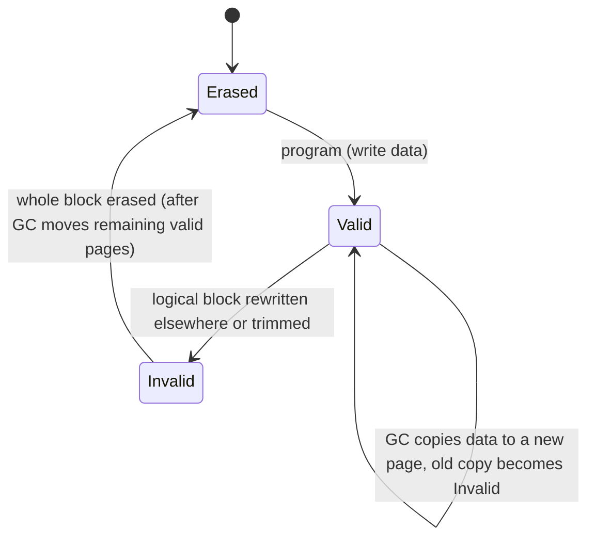
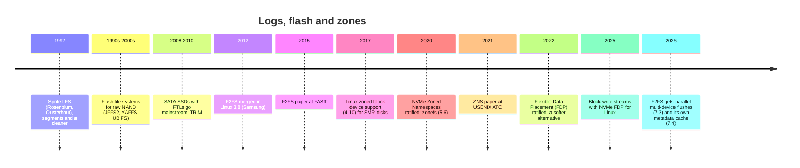

---
tags:
  - operating-systems
  - file-systems
  - storage
  - flash
  - ssd
  - log-structured
  - f2fs
  - zoned-storage
status: complete
sources:
  - https://www.ece.villanova.edu/~rperry/os/ostep/Chapters/44-file-ssd.pdf
  - https://www.cs.princeton.edu/courses/archive/fall15/cos518/papers/lfs.pdf
  - https://usenix.org/conference/fast15/technical-sessions/presentation/lee
  - https://web.stanford.edu/class/cs240/readings/f2fs.pdf
  - https://zonedstorage.io/docs/introduction/zns
  - https://zonedstorage.io/docs/linux/overview
  - https://www.pdl.cmu.edu/ftp/Storage/USENIX_ATC_2021_ZNS.pdf
  - https://www.kernel.org/doc/Documentation/filesystems/zonefs.rst
  - https://www.snia.org/sites/default/files/technical-work/whitepapers/IntroductiontoStorageDataPlacementwithFDP.pdf
  - https://btrfs.readthedocs.io/en/latest/Zoned-mode.html
  - https://lists.infradead.org/pipermail/linux-nvme/2025-May/056053.html
  - https://phoronix.com/news/Linux-7.3-F2FS
  - https://phoronix.com/news/F2FS-Linux-7.4
created: 2026-11-26
updated: 2026-11-26
---

## Table Of Contents

---

- [[#TL;DR|TL;DR]]
- [[#The Problem|The Problem]]
- [[#Foundations|Foundations]]
    - [[#How NAND Flash Behaves|How NAND Flash Behaves]]
    - [[#Write Amplification|Write Amplification]]
- [[#How We Got Here|How We Got Here]]
- [[#How It Works|How It Works]]
    - [[#The Flash Translation Layer|The Flash Translation Layer]]
    - [[#The Log-Structured File System|The Log-Structured File System]]
    - [[#F2FS|F2FS]]
    - [[#Zoned Storage|Zoned Storage]]
    - [[#Who Does the Garbage Collection?|Who Does the Garbage Collection?]]
- [[#Where It Is Now|Where It Is Now]]
- [[#Trade-offs & Open Problems|Trade-offs & Open Problems]]
- [[#Resources|Resources]]
- [[#Related Notes|Related Notes]]

## ***TL;DR***

---

*Flash cannot overwrite in place: it programs small pages but erases only large blocks, and each block survives a limited number of erases. So every SSD hides a log-structured system (the FTL) inside, and file systems that write as a log themselves (LFS, F2FS) or that hand placement to the host (zoned storage) can cut the hidden copying.*

- **Asymmetry:** read and program a page (KB), erase a block (hundreds of pages), and wear out after a bounded number of program/erase cycles ([OSTEP ch. 44](https://www.ece.villanova.edu/~rperry/os/ostep/Chapters/44-file-ssd.pdf)).
- **FTL:** the SSD's firmware maps logical blocks to physical pages, writes out of place, garbage-collects partly-dead blocks and levels wear; the copying it does is **write amplification**.
- **Log-structured file systems:** LFS (1992) wrote everything as one sequential log to use disk bandwidth; F2FS (Samsung, 2012) adapts the idea to flash with multiple logs separated by hotness ([F2FS, FAST '15](https://usenix.org/conference/fast15/technical-sessions/presentation/lee)).
- **Zoned storage:** ZNS SSDs and SMR disks expose sequential-write zones, so the host, not the firmware, decides placement and garbage collection ([zonedstorage.io](https://zonedstorage.io/docs/introduction/zns)).

## ***The Problem***

---

*A file system built for disks overwrites blocks in place and scatters small writes. On flash, every in-place update becomes an out-of-place write plus later garbage collection, which costs bandwidth, latency spikes and drive lifetime.*

Three costs stack up:

| Cost | Cause | Symptom |
|---|---|---|
| Write amplification | FTL copies live pages out of blocks it wants to erase | Device writes several times what the host wrote; throughput drops when the drive is full |
| Wear | Each block survives limited erase cycles | Drive lifetime measured in total bytes written |
| Latency spikes | Garbage collection runs in the background but competes with reads | Tail latency of reads jumps under write-heavy load ([[Block Layer and IO Schedulers]] cannot see why) |

The file system and the FTL each keep a mapping table, each do their own garbage collection, and neither knows what the other is doing. This duplication is the "log on log" problem.

## ***Foundations***

---

*Flash is organized as planes of erase blocks, each a set of pages. Pages are written once and only a whole block can be erased; the gap between the two units drives everything else.*

### How NAND Flash Behaves

From OSTEP's summary of raw flash ([OSTEP ch. 44](https://www.ece.villanova.edu/~rperry/os/ostep/Chapters/44-file-ssd.pdf)):

| Operation | Unit | Typical time | Note |
|---|---|---|---|
| Read | Page (a few KB) | Tens of µs | Fast, random access is fine |
| Program | Page | Hundreds of µs | Only to an erased page, in order within a block |
| Erase | Block (e.g. 128-256 KB in OSTEP's examples, MBs on modern chips) | Milliseconds | Sets every bit; the only way to reuse a page |

Storing more bits per cell (SLC, MLC, TLC, QLC) makes flash denser and cheaper but slower to program and lowers the number of program/erase cycles it tolerates. A page has three states: erased (free), valid (holds live data) and invalid (holds an old version, waiting for its block to be erased).

### Write Amplification

Write amplification (WA) is how many bytes the flash actually programs per byte the host writes:

$$WA = \frac{\text{bytes written to flash}}{\text{bytes written by host}}$$

When garbage collection picks a victim block in which a fraction $u$ of pages are still valid, it must copy those $u \cdot N$ pages before erasing, and only $(1-u) \cdot N$ pages of new host data then fit. So for steady-state greedy cleaning:

$$WA \approx \frac{1}{1-u}$$

In words: the fuller the blocks you clean, the more you copy for each page of space you win.

*Worked example:* if victims are on average 75% valid ($u = 0.75$), $WA = 1/0.25 = 4$: every 4 KB the host writes costs 16 KB of flash programs. If over-provisioning and good data separation get victims down to 20% valid, $WA = 1/0.8 = 1.25$. On a drive rated for 3,000 program/erase cycles, that difference is the difference between about 750 and 2,400 full-drive writes of host data.

LFS's cleaner obeys the same arithmetic on a disk, with an extra read of the segment: Rosenblum and Ousterhout give the write cost as $2/(1-u)$ ([LFS paper](https://www.cs.princeton.edu/courses/archive/fall15/cos518/papers/lfs.pdf)).

## ***How We Got Here***

---

*The log-structured idea started on disks, to turn small random writes into large sequential ones. Flash made out-of-place writing mandatory, first hidden inside SSD firmware, then exposed again to file systems that could do it better.*

- **LFS (1992):** disks were fast sequentially but slow to seek, and caches absorbed most reads, so Rosenblum and Ousterhout wrote all changes sequentially in large segments; Sprite LFS could use 70% of disk bandwidth for writing where Unix file systems managed 5-10% ([LFS paper](https://www.cs.princeton.edu/courses/archive/fall15/cos518/papers/lfs.pdf)).
- **F2FS (2012):** Samsung designed a flash-friendly file system for phones and SSDs; it became a standard choice for Android data partitions ([F2FS paper](https://web.stanford.edu/class/cs240/readings/f2fs.pdf)).
- **Zoned storage (2017-2021):** host-managed SMR disks and then ZNS SSDs exposed append-only zones; the ATC '21 ZNS paper argued this removes the "block interface tax" of on-device mapping, over-provisioning and garbage collection ([ZNS paper](https://www.pdl.cmu.edu/ftp/Storage/USENIX_ATC_2021_ZNS.pdf)).

## ***How It Works***

---

*Inside a conventional SSD, the FTL runs a log-structured store. A log-structured file system runs another one above it. Zoned storage removes the inner one by making the host write sequentially and reset zones itself.*

### The Flash Translation Layer

([OSTEP ch. 44](https://www.ece.villanova.edu/~rperry/os/ostep/Chapters/44-file-ssd.pdf))

- **Mapping:** a page-level table maps each logical block address (LBA) to a physical page. Writes always go to the next free page of an open block (log-structured); the old page is marked invalid. The table lives in the SSD's DRAM, about 1 byte of DRAM per KB of flash for 4-byte entries per 4 KB page, which is why cheap drives use hybrid or cached mappings.
- **Garbage collection:** pick a block with few valid pages, copy them elsewhere, erase it.
- **Wear leveling:** move long-lived cold data off young blocks so every block wears evenly.
- **Over-provisioning:** keep spare capacity the host cannot see, so GC always has free blocks and victims are emptier (lower $u$).
- **TRIM / discard:** the host tells the drive which LBAs are dead, so GC does not copy data the file system has already freed.

### The Log-Structured File System

LFS buffers all updates (data, inodes, directories) in memory and writes them as one large **segment** to the end of the log ([LFS paper](https://www.cs.princeton.edu/courses/archive/fall15/cos518/papers/lfs.pdf)):

| Structure | Purpose |
|---|---|
| Segment | Large unit of sequential write (data plus metadata) |
| Inode map (imap) | Inodes move on every write, so a map from inode number to current location is itself written in the log |
| Checkpoint region | Fixed location pointing at the latest imap pieces; written periodically, alternating two copies |
| Segment summary | Per-block owner info so the cleaner can tell live from dead |
| Cleaner | Reads partly-dead segments, writes live blocks to new segments, frees the old ones; LFS's cost-benefit policy prefers cold segments even if fuller |

The imap solves the **wandering tree** problem that [[Copy-on-Write File Systems]] face: without it, moving one data block would force rewriting its inode, the directory and every ancestor.

### F2FS

F2FS is LFS redesigned for flash and for FTLs that already exist ([F2FS paper](https://web.stanford.edu/class/cs240/readings/f2fs.pdf)):

- **Flash-aware layout:** the volume is divided into segments, sections and zones that line up with the FTL's units, so F2FS's cleaning aligns with the device's.
- **Node Address Table (NAT):** like LFS's imap, a table maps node IDs to block addresses, so updating a data block rewrites its direct node and one NAT entry, not a chain up to the root.
- **Multi-head logging:** six active logs (hot, warm and cold, for node and for data blocks) separate data by expected lifetime, so whole segments tend to die together and $u$ stays low.
- **Adaptive logging:** normal logging into clean segments while space is plentiful; **threaded logging** (filling holes in dirty segments) when the disk is nearly full, to avoid cleaning storms.
- **Roll-forward recovery:** `fsync()` writes only the file's data and direct node blocks, not a full checkpoint; recovery replays them.

### Zoned Storage

A zoned device divides its capacity into **zones** (typically hundreds of MB to over 1 GB on ZNS SSDs) with these rules ([zonedstorage.io](https://zonedstorage.io/docs/introduction/zns)):

- Each zone has a **write pointer**; writes must land exactly at it (sequential only).
- Reads can go anywhere written.
- A **zone reset** rewinds the write pointer and erases the zone; this is the host's garbage-collection lever.
- **Zone append** lets many writers append to a zone without coordinating offsets; the device returns where the data landed.

Linux exposes zoned devices through the block layer since 4.10, with `zonefs` (each zone as a file), `dm-zoned` (a conventional-looking device on top), and native zoned modes in F2FS and Btrfs ([Linux zoned storage overview](https://zonedstorage.io/docs/linux/overview), [zonefs docs](https://www.kernel.org/doc/Documentation/filesystems/zonefs.rst)).

### Who Does the Garbage Collection?

| Approach | Mapping table | Garbage collection | Host changes |
|---|---|---|---|
| Conventional SSD + ext4/XFS | In the SSD | In the SSD, blind to file system | None |
| Conventional SSD + F2FS | Both | Both, F2FS tries to align with the FTL | File system |
| FDP SSD | In the SSD | In the SSD, guided by host placement hints | Tag writes with a placement handle |
| ZNS SSD + zoned F2FS/Btrfs | Host only | Host only (zone reset) | File system or application must write sequentially |

FDP keeps the block interface but lets the host say which writes belong together, so the SSD can keep them in the same erase units ([SNIA](https://www.snia.org/sites/default/files/technical-work/whitepapers/IntroductiontoStorageDataPlacementwithFDP.pdf)); see [[NVMe and User-Space Storage]] for how Linux passes those hints.

## ***Where It Is Now***

---

*As of November 2026: F2FS is still the flash file system that gets steady work, mostly for phones; zoned storage is supported end to end in Linux but niche; FDP is the lighter placement hint that needs almost no software change.*

| Area | State (Nov 2026) | Source |
|---|---|---|
| **F2FS, Linux 7.3** | Flushes to multiple devices in parallel (from Samsung's Yonggil Song), uses less memory per inode, and completes writes asynchronously, cutting one completion path from about 10 ms to 150 µs on an Arm Cortex-A520 | [Phoronix](https://phoronix.com/news/Linux-7.3-F2FS) |
| **F2FS, Linux 7.4** | A dedicated metadata cache outside the VFS page cache (groundwork for large folios and block sizes that differ from the page size), dynamic on-disk layouts, opt-in multigrain timestamps, zoned-device fixes for write splitting and GC holes, stronger consistency checks | [Phoronix](https://phoronix.com/news/F2FS-Linux-7.4) |
| **Btrfs zoned mode** | Supported since Linux 5.12 on host-managed SMR and ZNS; single and DUP profiles only, no `nodatacow` or `fallocate`, and GC can still cause intermittent ENOSPC. The docs still call it rough at the edges. | [Btrfs docs](https://btrfs.readthedocs.io/en/latest/Zoned-mode.html) |
| **FDP in Linux** | The block "write streams" series (v16, May 2025, from Samsung, Meta and Christoph Hellwig) passes a stream per write from io_uring or inode write hints down to NVMe FDP placement handles | [linux-nvme](https://lists.infradead.org/pipermail/linux-nvme/2025-May/056053.html) |
| **NVMe 2.4 (Aug 2026)** | Adds controller rate limiting and other management features; placement itself is unchanged | [[NVMe and User-Space Storage]] |

- **The pattern:** the industry is settling on two levels of host help. ZNS hands the host the whole log; FDP only asks for hints. F2FS sits in between, a log-structured file system that runs on either.
- **What to watch:** large folios in F2FS (the 7.4 metadata cache is the first step), and whether FDP hints spread from passthrough users into ordinary file systems.

## ***Trade-offs & Open Problems***

---

*Moving placement knowledge up to the host cuts write amplification and tail latency but makes software harder to write and ties it to device geometry. Keeping it in firmware keeps compatibility but wastes flash and makes performance unpredictable.*

| Tension | Detail |
|---|---|
| Compatibility vs efficiency | Conventional SSDs run any file system; ZNS needs sequential-write-aware software |
| Over-provisioning vs capacity | Spare flash lowers WA but is capacity you paid for and cannot use |
| Log-on-log | A log-structured file system over an FTL can double garbage collection if their units do not line up |
| Density vs endurance | QLC and beyond cut cost per TB but tolerate fewer cycles, so WA matters more |
| Cleaning policy | Greedy cleaning is simple; cost-benefit and hotness separation win on skewed workloads but need good lifetime guesses |

Open problems:
- **Lifetime prediction:** grouping data by when it will die (F2FS's temperatures, FDP handles) works only as well as the guess.
- **Tail latency:** GC inside or outside the device still competes with reads; scheduling it is unsolved for multi-tenant drives.
- **Adoption:** ZNS asks a lot of software; FDP asks little; which one the industry standardizes on shapes file system work for years.

## ***Resources***

---

*OSTEP chapters 43-44 cover LFS and SSDs from first principles; the LFS, F2FS and ZNS papers are the primary sources for each design; zonedstorage.io documents the Linux zoned stack.*

**Foundations**
- [OSTEP ch. 44: Flash-based SSDs](https://www.ece.villanova.edu/~rperry/os/ostep/Chapters/44-file-ssd.pdf)
- [Rosenblum, Ousterhout: The Design and Implementation of a Log-Structured File System (1992)](https://www.cs.princeton.edu/courses/archive/fall15/cos518/papers/lfs.pdf)
- [Lee, Sim, Hwang, Cho: F2FS, A New File System for Flash Storage (FAST '15)](https://usenix.org/conference/fast15/technical-sessions/presentation/lee) ([PDF](https://web.stanford.edu/class/cs240/readings/f2fs.pdf))

**Zoned storage and placement**
- [Bjørling et al.: ZNS, Avoiding the Block Interface Tax for Flash-based SSDs (USENIX ATC '21)](https://www.pdl.cmu.edu/ftp/Storage/USENIX_ATC_2021_ZNS.pdf)
- [zonedstorage.io: NVMe Zoned Namespaces](https://zonedstorage.io/docs/introduction/zns) and [Linux support overview](https://zonedstorage.io/docs/linux/overview)
- [Kernel docs: zonefs](https://www.kernel.org/doc/Documentation/filesystems/zonefs.rst)
- [SNIA: Introduction to Storage Data Placement with FDP](https://www.snia.org/sites/default/files/technical-work/whitepapers/IntroductiontoStorageDataPlacementwithFDP.pdf)
- [Btrfs documentation: Zoned mode](https://btrfs.readthedocs.io/en/latest/Zoned-mode.html)

**Where it is now**
- [Block write streams with NVMe FDP, v16 (May 2025)](https://lists.infradead.org/pipermail/linux-nvme/2025-May/056053.html)
- [Phoronix: F2FS in Linux 7.3 (Aug 2026)](https://phoronix.com/news/Linux-7.3-F2FS)
- [Phoronix: F2FS in Linux 7.4 (Oct 2026)](https://phoronix.com/news/F2FS-Linux-7.4)

## ***Related Notes***

---

- [[File Systems]]: inodes, extents and journaling, the in-place baseline.
- [[Copy-on-Write File Systems]]: the other out-of-place design, and the wandering-tree problem.
- [[NVMe and User-Space Storage]]: ZNS and FDP commands, and passthrough to use them.
- [[Block Layer and IO Schedulers]]: zoned block devices and why GC hides from the scheduler.
- [[Page Cache and Memory Reclaim]]: writeback, which shapes how much a log can batch.
- [[LSM Trees]]: the same log-and-compact idea in databases, with the same amplification math.
- [[Memory Allocators]]: segment cleaning is garbage collection for disk space.
