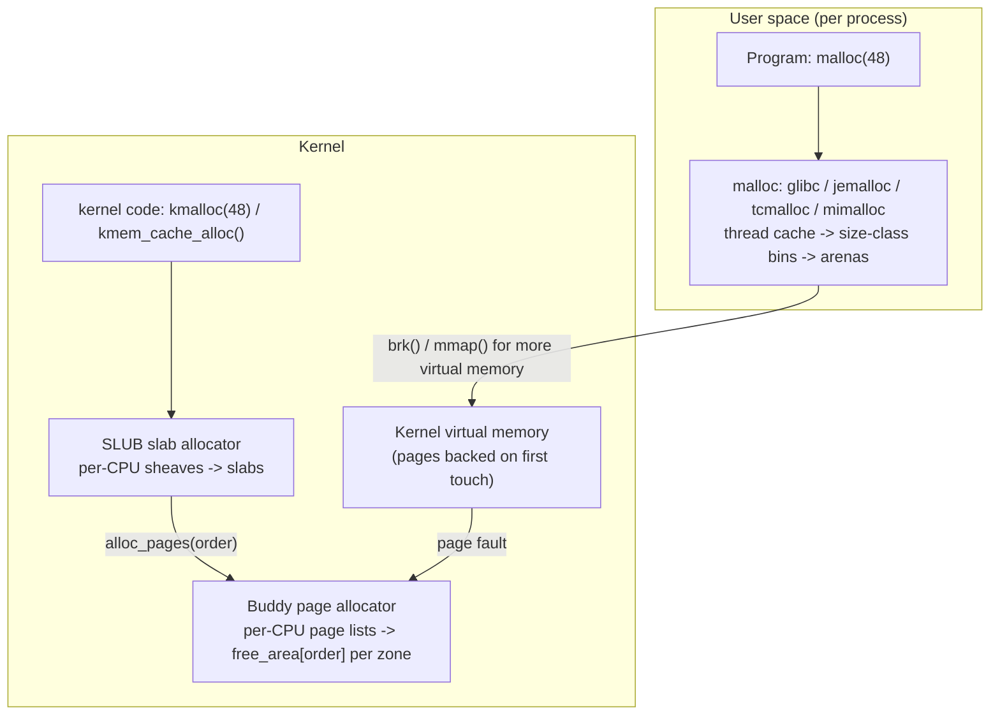
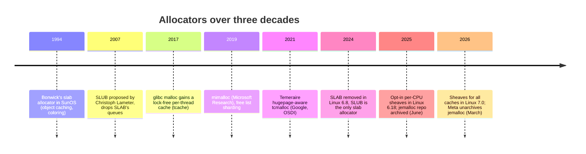
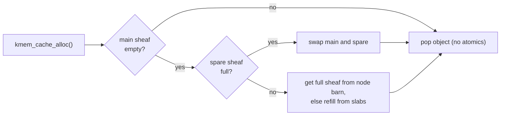

---
tags:
  - operating-systems
  - memory-management
  - allocators
  - linux-kernel
  - slab
  - malloc
status: complete
sources:
  - https://www.kernel.org/doc/Documentation/mm/physical_memory.rst
  - https://www.usenix.org/legacy/publications/library/proceedings/bos94/bonwick.html
  - https://lwn.net/Articles/223411
  - https://lkml.iu.edu/hypermail/linux/kernel/2401.0/03835.html
  - https://lkml.iu.edu/hypermail/linux/kernel/2509.3/05057.html
  - https://lkml.iu.edu/2602.1/02479.html
  - https://lwn.net/Articles/1055693/
  - https://archive.fosdem.org/2026/events/attachments/DPXVYJ-slub-sheaves-update/slides/267397/fosdem-sh_pvi6fpf.pdf
  - https://developers.redhat.com/blog/2017/03/02/malloc-internals-and-you
  - https://usenix.org/conference/osdi21/presentation/hunter
  - https://google.github.io/tcmalloc/temeraire.html
  - https://www.microsoft.com/en-us/research/publication/mimalloc-free-list-sharding-in-action
  - https://engineering.fb.com/2026/03/02/data-infrastructure/investing-in-infrastructure-metas-renewed-commitment-to-jemalloc/
  - https://lists.freebsd.org/archives/cu/2025-June/007847.html
created: 2026-11-26
updated: 2026-11-26
---

## Table Of Contents

---

- [[#TL;DR|TL;DR]]
- [[#The Problem|The Problem]]
- [[#Foundations|Foundations]]
    - [[#Three Layers|Three Layers]]
    - [[#Fragmentation|Fragmentation]]
- [[#How We Got Here|How We Got Here]]
- [[#How It Works|How It Works]]
    - [[#The Buddy Allocator|The Buddy Allocator]]
    - [[#Slab Allocation and SLUB|Slab Allocation and SLUB]]
    - [[#Sheaves|Sheaves]]
    - [[#User-Space malloc|User-Space malloc]]
- [[#Where It Is Now|Where It Is Now]]
- [[#Trade-offs & Open Problems|Trade-offs & Open Problems]]
- [[#Resources|Resources]]
- [[#Related Notes|Related Notes]]

## ***TL;DR***

---

*Memory allocation is a stack of three allocators: a page allocator that hands out physical pages in power-of-two blocks, a slab allocator that carves pages into small kernel objects, and a user-space malloc that carves the process's virtual memory into whatever sizes programs ask for. Every layer fights the same two enemies, lock contention between CPUs and fragmentation.*

- **Pages:** Linux's buddy allocator keeps free blocks by order ($2^k$ pages), splits big blocks to satisfy small requests and merges freed blocks with their "buddy" ([kernel docs](https://www.kernel.org/doc/Documentation/mm/physical_memory.rst)).
- **Objects:** Bonwick's 1994 slab allocator caches ready-made objects of one type ([USENIX 1994](https://www.usenix.org/legacy/publications/library/proceedings/bos94/bonwick.html)); Linux's SLUB descendant is now the only slab allocator, and since Linux 7.0 it fronts every cache with per-CPU "sheaves" ([7.0 slab pull](https://lkml.iu.edu/2602.1/02479.html)).
- **Programs:** glibc malloc, jemalloc, tcmalloc and mimalloc all add per-thread caches over shared arenas; at warehouse scale, Google's hugepage-aware tcmalloc raised throughput 7.7% across 8 applications ([OSDI 2021](https://usenix.org/conference/osdi21/presentation/hunter)).

## ***The Problem***

---

*Programs and the kernel ask for memory in sizes from 8 bytes to gigabytes, millions of times a second, from many CPUs at once, and give it back in a different order. An allocator must be fast, scale across cores and not waste memory, and those three goals pull against each other.*

- **Speed:** allocation is on almost every hot path. glibc's developers found the arena lock alone "turned out to be quite expensive compared to the cost of doing the allocation itself" ([Red Hat](https://developers.redhat.com/blog/2017/03/02/malloc-internals-and-you)).
- **Scalability:** one global free list is one global lock; cache lines bounce between CPUs (see [[Locks and Synchronization]]).
- **Footprint:** every cached-but-free object is memory nobody can use. SLAB's per-CPU and per-node queues on a 1,000-CPU machine tied up "several gigabytes" just in pointers to cached objects ([Lameter, 2007](https://lwn.net/Articles/223411)).
- **Hardware fit:** objects should be cache-aligned, [[NUMA]]-local, and packed into memory that the [[Virtual Memory and Paging|TLB]] can cover with huge pages.

## ***Foundations***

---

*Allocators are layered: each one gets big chunks from the layer below and hands out smaller ones above. The vocabulary that matters is size classes, free lists, per-CPU caches and the two kinds of fragmentation.*

### Three Layers



The kernel's own small allocations go through SLUB; user-space memory reaches the buddy allocator only when a page is first touched (a page fault, see [[Virtual Memory and Paging]]).

### Fragmentation

| Kind | Meaning | Example |
|---|---|---|
| **Internal** | Space wasted inside a block because the block is bigger than the request | A 3-page request rounded up to a 4-page buddy block wastes 1 page (25%) |
| **External** | Enough free memory in total, but not contiguous in the size needed | 1,000 free pages scattered as singletons can't satisfy one 2 MB huge page |

Size classes (fixed sizes like 16, 32, 48, 64 bytes) trade a bounded amount of internal fragmentation for fast lookup and no external fragmentation within a class.

## ***How We Got Here***

---

*Kernel allocators moved from general-purpose free lists to object caches (1994) to simpler, queue-less slabs (2007) to one allocator with per-CPU sheaves (2025-2026). User-space allocators followed the same path toward per-thread caches and, lately, toward hugepage awareness.*



- **Slab (1994):** Bonwick's allocator for SunOS built on "object-caching primitives" that "reduce the cost of allocating complex objects by retaining their state between uses", with object coloring for better cache use, and it responded to global memory pressure ([USENIX 1994](https://www.usenix.org/legacy/publications/library/proceedings/bos94/bonwick.html)).
- **SLUB (2007):** Lameter's "unqueued" slab allocator replaced SLAB's per-CPU, per-node and "alien" queues with one dedicated slab per CPU, and moved slab metadata into `struct page` so a 128-byte object fits exactly 32 times into a 4 KB page ([LWN](https://lwn.net/Articles/223411)).
- **One allocator (2024):** SLAB was deprecated in 6.5 and removed in 6.8 once the 6.6 LTS was out, deleting the 4,026-line `mm/slab.c` ([6.8 slab pull](https://lkml.iu.edu/hypermail/linux/kernel/2401.0/03835.html)).

## ***How It Works***

---

*The buddy allocator gives out power-of-two page blocks using address arithmetic to find merge partners. SLUB turns pages into same-size objects and now caches freed objects in per-CPU arrays. User-space mallocs stack thread caches on top of shared arenas.*

### The Buddy Allocator

Each memory zone (`ZONE_DMA`, `ZONE_DMA32`, `ZONE_NORMAL`, `ZONE_MOVABLE`, ...) keeps a `free_area` array with one free list per **order** $k$, where an order-$k$ block is $2^k$ contiguous pages. Allocation takes the smallest sufficient block and splits it; a freed block merges with its buddy into a larger one ([kernel docs](https://www.kernel.org/doc/Documentation/mm/physical_memory.rst)).

The buddy of a block is found by flipping one bit of its page frame number (PFN):

$$\text{buddy\_pfn} = \text{pfn} \oplus 2^k$$

In words: at order $k$, two blocks are buddies if their addresses differ only in bit $k$, so they came from splitting the same order-$(k{+}1)$ block.

*Worked example:* a driver asks for 3 pages, which rounds up to order 2 (4 pages, 16 KB with 4 KB pages). The smallest free block is order 3 at PFN 8 (pages 8-15). It splits into PFN 8 and its buddy $8 \oplus 4 = 12$; PFN 8 is returned, PFN 12 goes onto the order-2 free list. When PFN 8 is freed, the allocator checks PFN 12: if it is still free and order 2, the two merge back into the order-3 block at PFN 8. One page of the four was wasted (25% internal fragmentation).

To keep CPUs off the zone lock, each zone also has **per-CPU page lists** that absorb frequent single-page allocations and frees and move pages to and from the buddy lists in batches ([kernel docs](https://www.kernel.org/doc/Documentation/mm/physical_memory.rst)).

### Slab Allocation and SLUB

A **cache** (`struct kmem_cache`) serves one object size, for example `task_struct` or the 64-byte `kmalloc` class. It gets whole pages (a **slab**) from the buddy allocator and divides them into equal objects:

```c
/* a subsystem creates a cache once ... */
struct kmem_cache *foo_cache =
    kmem_cache_create("foo", sizeof(struct foo), 0, SLAB_HWCACHE_ALIGN, NULL);

/* ... then allocates and frees objects at high rate */
struct foo *f = kmem_cache_alloc(foo_cache, GFP_KERNEL);
kmem_cache_free(foo_cache, f);
```

In plain words: the subsystem declares "I will allocate many objects of exactly this size", and the allocator keeps pages pre-cut to that size, so allocation is popping a pointer off a free list rather than searching. Generic `kmalloc(n)` uses a set of such caches by size class.

SLUB's original fast path gave each CPU one active slab and a list of partial slabs, and freed objects with a lockless double-word compare-and-swap ([6.18 slab pull](https://lkml.iu.edu/hypermail/linux/kernel/2509.3/05057.html)).

### Sheaves

A **sheaf** is a fixed-capacity array of object pointers. Each CPU has a main and a spare sheaf per cache, so refills and flushes happen a whole sheaf at a time; a per-NUMA-node **barn** holds up to 10 spare full or empty sheaves. Frees from a remote node skip sheaves, avoiding the alien queues that made SLAB costly ([FOSDEM 2026 slides](https://archive.fosdem.org/2026/events/attachments/DPXVYJ-slub-sheaves-update/slides/267397/fosdem-sh_pvi6fpf.pdf)).



The 6.18 pull described this as combining SLAB's simpler, lower-overhead per-CPU caching with SLUB, while avoiding SLAB's remote-free and flushing problems, and making `kfree_rcu()` and preallocation cheaper ([6.18 slab pull](https://lkml.iu.edu/hypermail/linux/kernel/2509.3/05057.html)). The trade-off: objects from sheaves are recently freed and cache-hot, but may come from many different slabs, which can raise memory use and TLB pressure ([LWN](https://lwn.net/Articles/1055693/)).

### User-Space malloc

| Allocator | Key idea | Source |
|---|---|---|
| **glibc malloc** | Multiple arenas (up to 8x cores on 64-bit) so threads rarely share a lock; since 2017 a lock-free per-thread cache (tcache); requests above `M_MMAP_THRESHOLD` go straight to `mmap()` | [Red Hat](https://developers.redhat.com/blog/2017/03/02/malloc-internals-and-you) |
| **jemalloc** | Size-class arenas with per-thread caches; Meta's main allocator, now adding a hugepage allocator (HPA) for transparent huge pages | [Meta](https://engineering.fb.com/2026/03/02/data-infrastructure/investing-in-infrastructure-metas-renewed-commitment-to-jemalloc/) |
| **tcmalloc** | Per-CPU caches; Temeraire pageheap packs allocations into intact hugepages | [Temeraire design](https://google.github.io/tcmalloc/temeraire.html) |
| **mimalloc** | Free list sharding: three free lists per small page for locality and a predictable "temporal cadence" for deferred work | [MSR 2019](https://www.microsoft.com/en-us/research/publication/mimalloc-free-list-sharding-in-action) |

The user-space allocator only manages virtual memory. It asks the kernel for more with `brk()` or `mmap()` and returns it with `munmap()` or `madvise()`; physical pages appear on first touch (see [[Page Cache and Memory Reclaim]] for what the kernel does when memory runs low).

## ***Where It Is Now***

---

*As of November 2026, Linux has a single slab allocator, SLUB, fronted everywhere by sheaves since 7.0. In user space, hugepage awareness is the big lever, and jemalloc is back under active stewardship after a nine-month archive.*

- **Linux 7.0 (2026):** the slab pull "now we enable it [sheaves] for all caches and remove the previous cpu (partial) slab caching mechanism", claiming "lower locking overhead and much more likely fastpath when freeing" ([7.0 slab pull](https://lkml.iu.edu/2602.1/02479.html)). Before merging, testers reported mostly gains with some regressions still under investigation ([FOSDEM 2026](https://archive.fosdem.org/2026/events/attachments/DPXVYJ-slub-sheaves-update/slides/267397/fosdem-sh_pvi6fpf.pdf)).
- **Allocating from anywhere:** 6.18 added a re-entrant `kmalloc_nolock()` for NMI and tracing contexts, expected to let [[eBPF]] drop its own caches ([6.18 slab pull](https://lkml.iu.edu/hypermail/linux/kernel/2509.3/05057.html)).
- **Hugepages in user space:** Temeraire cut TLB miss stalls 6% and fragmentation waste 26% fleet-wide at Google ([OSDI 2021](https://usenix.org/conference/osdi21/presentation/hunter)); Meta's 2026 jemalloc plan puts the same idea (HPA over THP) first, alongside AArch64 tuning ([Meta](https://engineering.fb.com/2026/03/02/data-infrastructure/investing-in-infrastructure-metas-renewed-commitment-to-jemalloc/)).
- **jemalloc's wobble:** the repository was archived in June 2025, prompting FreeBSD, whose libc uses it, to discuss its future ([FreeBSD list](https://lists.freebsd.org/archives/cu/2025-June/007847.html)); in March 2026 Meta unarchived it, citing technical debt from a "gradual shift away from the core engineering principles", after talking with founder Jason Evans ([Meta](https://engineering.fb.com/2026/03/02/data-infrastructure/investing-in-infrastructure-metas-renewed-commitment-to-jemalloc/)).

## ***Trade-offs & Open Problems***

---

*Every cache that makes allocation faster also hides memory from everyone else. The open questions are how big caches should be, when to give memory back, and how to keep huge pages intact.*

| Design choice | Buys | Costs |
|---|---|---|
| Per-CPU / per-thread caches | No locks or atomics on the fast path | Idle memory per CPU or thread; remote frees need special handling |
| Size classes | Fast lookup, no external fragmentation within a class | Internal fragmentation (up to the gap between classes) |
| Power-of-two buddy blocks | O(1) merge partner by bit flip | Up to ~50% internal waste for awkward sizes; external fragmentation of high orders |
| Returning memory eagerly (`madvise`) | Lower RSS | Breaks up huge pages, more page faults later ([Temeraire](https://google.github.io/tcmalloc/temeraire.html)) |
| Hot (recently freed) objects first | Cache-warm memory | Poorer spatial locality, more TLB pressure ([LWN](https://lwn.net/Articles/1055693/)) |

Open problems:
- **Tiered and CXL memory:** which tier should a fresh allocation come from? (see [[CXL and Memory Tiering]]).
- **Security:** heap exploits target allocator metadata; hardening (randomized free lists, separate caches per type) costs speed.
- **Sizing sheaves:** capacity is derived automatically from what CPU slabs used to cache; regressions found by the kernel test robot were still being investigated in early 2026 ([FOSDEM 2026](https://archive.fosdem.org/2026/events/attachments/DPXVYJ-slub-sheaves-update/slides/267397/fosdem-sh_pvi6fpf.pdf)).

## ***Resources***

---

*Read Bonwick for the slab idea, the kernel's physical memory page for the buddy allocator, and the Temeraire paper for why allocators now care about huge pages.*

- [Bonwick, The Slab Allocator: An Object-Caching Kernel Memory Allocator (USENIX Summer 1994)](https://www.usenix.org/legacy/publications/library/proceedings/bos94/bonwick.html)
- [Linux kernel docs: Physical Memory (nodes, zones, buddy, per-CPU lists)](https://www.kernel.org/doc/Documentation/mm/physical_memory.rst)
- [Lameter, SLUB: The unqueued Slab allocator (2007)](https://lwn.net/Articles/223411)
- Slab pull requests: [6.8, SLAB removal](https://lkml.iu.edu/hypermail/linux/kernel/2401.0/03835.html), [6.18, sheaves opt-in](https://lkml.iu.edu/hypermail/linux/kernel/2509.3/05057.html), [7.0, sheaves for all](https://lkml.iu.edu/2602.1/02479.html)
- [Babka, Update on the SLUB allocator sheaves (FOSDEM 2026)](https://archive.fosdem.org/2026/events/attachments/DPXVYJ-slub-sheaves-update/slides/267397/fosdem-sh_pvi6fpf.pdf) and [LWN on the v4 series](https://lwn.net/Articles/1055693/)
- [Red Hat: malloc internals and you](https://developers.redhat.com/blog/2017/03/02/malloc-internals-and-you)
- [Hunter et al., Beyond malloc efficiency to fleet efficiency (OSDI 2021)](https://usenix.org/conference/osdi21/presentation/hunter) and [Temeraire design notes](https://google.github.io/tcmalloc/temeraire.html)
- [Leijen, Zorn, de Moura: Mimalloc, Free List Sharding in Action (2019)](https://www.microsoft.com/en-us/research/publication/mimalloc-free-list-sharding-in-action)
- [Meta: renewed commitment to jemalloc (March 2026)](https://engineering.fb.com/2026/03/02/data-infrastructure/investing-in-infrastructure-metas-renewed-commitment-to-jemalloc/)

## ***Related Notes***

---

- [[Virtual Memory and Paging]]: where user-space allocations become physical pages.
- [[Page Cache and Memory Reclaim]]: what happens when the buddy allocator runs low.
- [[Read-Copy-Update (RCU)]]: `kfree_rcu()` and why sheaves make it cheaper.
- [[Locks and Synchronization]]: the contention per-CPU caches avoid.
- [[CXL and Memory Tiering]]: allocation across memory tiers.
- [[eBPF]]: a heavy user of `kmalloc_nolock()`.
- [[Processes and Threads]]: per-thread caches in user-space allocators.
- [[Hardware Memory Safety]]: allocators that set MTE tags and retag freed memory.
