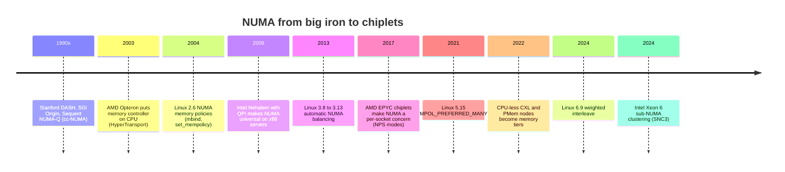
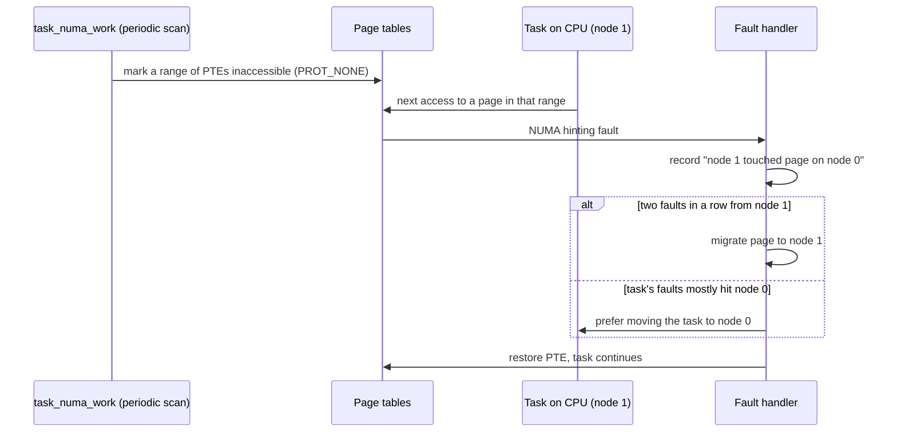

---
tags:
  - operating-systems
  - memory-management
  - numa
  - scheduling
  - linux-kernel
  - hardware
status: complete
sources:
  - https://docs.kernel.org/admin-guide/mm/numa_memory_policy.html
  - https://docs.kernel.org/admin-guide/sysctl/kernel.html
  - https://docs.kernel.org/mm/numa.html
  - https://blogs.oracle.com/linux/post/numa-balancing
  - https://docs.redhat.com/en/documentation/red_hat_enterprise_linux/7/html/virtualization_tuning_and_optimization_guide/sect-Virtualization_Tuning_Optimization_Guide-NUMA-Auto_NUMA_Balancing
  - https://documentation.suse.com/sles/15-SP6/html/SLES-all/cha-tuning-numactl.html
  - https://www.amd.com/content/dam/amd/en/documents/epyc-business-docs/white-papers/AMD-Optimizes-EPYC-Memory-With-NUMA.pdf
  - https://chipsandcheese.com/p/a-look-into-intel-xeon-6s-memory
  - https://phoronix.com/review/xeon-6980p-snc3-hex
  - https://frankdenneman.nl/2022/09/21/sub-numa-clustering
  - https://lwn.net/Articles/956866/
  - https://arxiv.org/pdf/2203.00241
  - https://lwn.net/Articles/1092001/
  - https://lwn.net/Articles/1054030/
  - https://lwn.net/Articles/1079561/
  - https://lwn.net/Articles/1093236/
created: 2026-11-26
updated: 2026-11-26
---

## Table Of Contents

---

- [[#TL;DR|TL;DR]]
- [[#The Problem|The Problem]]
- [[#Foundations|Foundations]]
    - [[#Nodes and Distances|Nodes and Distances]]
    - [[#First Touch|First Touch]]
    - [[#Where the Kernel Is Already Per-Node|Where the Kernel Is Already Per-Node]]
- [[#How We Got Here|How We Got Here]]
- [[#How It Works|How It Works]]
    - [[#Discovering the Topology|Discovering the Topology]]
    - [[#Memory Policies|Memory Policies]]
    - [[#Scheduler Domains|Scheduler Domains]]
    - [[#Automatic NUMA Balancing|Automatic NUMA Balancing]]
    - [[#Doing It by Hand|Doing It by Hand]]
- [[#Where It Is Now|Where It Is Now]]
- [[#Trade-offs & Open Problems|Trade-offs & Open Problems]]
- [[#Resources|Resources]]
- [[#Related Notes|Related Notes]]

## ***TL;DR***
---
*On a NUMA (Non-Uniform Memory Access) machine, each processor has its own memory, and reaching another processor's memory is slower. The OS's job is to keep threads and the memory they use on the same node, and to fix things when they drift apart.*

- **The shape.** Every multi-socket server, and most big single-socket chips, is NUMA: memory controllers are attached to particular sockets or chiplets, and a remote access crosses an interconnect. Firmware reports nodes and their relative *distances* (10 = local; ~20 or more = remote).
- **Default rule.** Linux allocates a page on the node of the CPU that first touches it ("first touch"), and the scheduler prefers keeping tasks inside a node.
- **Policies.** `set_mempolicy()` and `mbind()` let a program bind, prefer, interleave or weight-interleave its memory across nodes; `numactl` and cpusets do the same from outside.
- **Automatic NUMA balancing** (Linux 3.8 to 3.13) samples which node touches each page using deliberate page faults, then moves pages to their users or users to their pages.
- **Now, Nov 2026.** Chiplet CPUs have made NUMA a *within-socket* issue too (AMD NPS modes, Intel sub-NUMA clustering), and [[CXL and Memory Tiering|CXL memory]] arrives as CPU-less NUMA nodes, so NUMA machinery is now also the tiering machinery.

## ***The Problem***
---
*A shared memory bus doesn't scale: past a handful of CPUs, every core waits on the same wires. Splitting memory among processors fixes bandwidth but makes "where is this byte?" a performance question.*

In a UMA (uniform) design, all CPUs share one memory controller, so every access costs the same and every CPU competes for the same bandwidth. Adding cores adds contention. NUMA gives each processor (or group of cores) its own memory controller and DRAM, joined by a coherent interconnect (AMD Infinity Fabric, Intel UPI). Total bandwidth now grows with the number of nodes, *if* each core mostly uses its own node's memory.

When it doesn't:

- **Latency.** A remote load crosses the interconnect, typically adding tens of nanoseconds to a local DRAM access; CXL-attached memory adds 70 to 90 ns or more ([Pond](https://arxiv.org/pdf/2203.00241)).
- **Bandwidth.** The interconnect has less bandwidth than local memory channels, so a node whose threads all read remote memory can saturate the link while local channels sit idle.
- **Contention and coherence.** A cache line bounced between sockets (a shared counter, a lock) costs far more than one bounced between cores on one die. See [[Locks and Synchronization]].

The OS can't see individual memory accesses; the hardware does them. So it must infer locality from indirect signals and act with migrations that themselves cost time.

## ***Foundations***
---
*Four ideas carry the whole topic: nodes with distances, first-touch allocation, per-node kernel data structures, and the two levers the OS has (move the thread, or move the memory).*

### Nodes and Distances

A **node** is a set of CPUs plus the memory closest to them; a node may also have memory and no CPUs (CXL expanders, some HBM or GPU memory). The firmware's distance table gives relative costs:

```
$ numactl --hardware        # example two-socket server
available: 2 nodes (0-1)
node 0 cpus: 0-63
node 0 size: 257000 MB
node 1 cpus: 64-127
node 1 size: 258000 MB
node distances:
node   0   1
  0:  10  21
  1:  21  10
```

In plain words: two nodes, each with 64 CPUs and ~256 GB. A distance of 21 versus 10 says "remote memory is roughly twice as far", a *relative* hint, not a measured latency. Kernels use the numbers mainly to rank nodes.

### First Touch

Linux allocates a physical page lazily, at the first fault (see [[Virtual Memory and Paging]]), and by default on the node of the CPU that faulted. Consequence: **the thread that initialises data decides where it lives.** A program that zeroes a 100 GB array on one thread, then processes it on 128 threads, puts all 100 GB on one node and makes half the threads remote. The fix is to initialise in parallel with the same thread layout as the computation, or use an interleave policy.

### Where the Kernel Is Already Per-Node

The kernel itself is NUMA-shaped: each node has its own `pg_data_t` with zones, free lists, LRU lists and a `kswapd` thread ([[Page Cache and Memory Reclaim]]); slab allocators keep per-node partial lists and, since 2025, per-node "barns" of sheaves ([[Memory Allocators]]); the scheduler builds NUMA levels into its load-balancing domains ([[CPU Scheduling]]); and futexes gained NUMA-aware hashing in 6.16 ([[Locks and Synchronization]]).

## ***How We Got Here***
---
*NUMA began in large research and supercomputer systems, reached commodity servers when AMD put the memory controller on the CPU in 2003, and spread inside single chips with chiplets.*



- **cc-NUMA research** in the 1990s (Stanford DASH, SGI Origin) proved cache-coherent shared memory could scale by distributing memory, with directories to track sharers.
- **Commodity NUMA.** AMD's Opteron (2003) integrated the memory controller, so every multi-socket x86 box became NUMA; Intel followed with Nehalem and QPI (2008).
- **Linux.** NUMA policies (`mbind`, `set_mempolicy`, cpusets) came in the 2.6 series. After two competing designs (AutoNUMA by Andrea Arcangeli and Peter Zijlstra's sched/numa), Mel Gorman's balancing work merged the best of both in 3.8, with task placement and NUMA groups by 3.13. The [Oracle blog](https://blogs.oracle.com/linux/post/numa-balancing) walks through the mechanism: PTEs marked `PROT_NONE` (`MM_CP_PROT_NUMA`) turn the next access into a hinting fault, counted in `/proc/vmstat` as `numa_hint_faults`.
- **Chiplets.** AMD EPYC's multi-die design (2017) made distances vary inside one socket; firmware options like **NPS1/2/4** (nodes per socket) let administrators expose that as 1, 2 or 4 nodes ([AMD white paper](https://www.amd.com/content/dam/amd/en/documents/epyc-business-docs/white-papers/AMD-Optimizes-EPYC-Memory-With-NUMA.pdf)). Intel calls the equivalent **sub-NUMA clustering (SNC)** ([Frank Denneman](https://frankdenneman.nl/2022/09/21/sub-numa-clustering)).

## ***How It Works***
---
*The kernel learns the topology from firmware, places new memory by policy, keeps tasks near their memory through the scheduler's domains, and corrects mistakes with automatic NUMA balancing.*

### Discovering the Topology

On x86 and Arm servers, ACPI tables describe it: **SRAT** maps CPUs and memory ranges to proximity domains, **SLIT** gives the distance matrix, and **HMAT** adds measured latency and bandwidth, which the memory-tier code uses to rank CPU-less nodes ([[CXL and Memory Tiering]]). Device Tree does the same on embedded systems. The result appears under `/sys/devices/system/node/nodeN/` with `cpulist`, `meminfo` and `distance` files.

### Memory Policies

A **memory policy** says which nodes a page may come from. It can apply to a whole task (`set_mempolicy`) or a range of its address space (`mbind`); VMA policies override task policies ([kernel docs](https://docs.kernel.org/admin-guide/mm/numa_memory_policy.html)).

| Mode | Meaning | Typical use |
|---|---|---|
| `MPOL_DEFAULT` / `MPOL_LOCAL` | Allocate on the faulting CPU's node | Almost everything |
| `MPOL_BIND` | Only from these nodes; fail or reclaim rather than spill | Pinning a database to its socket |
| `MPOL_PREFERRED` | Try this node first, fall back anywhere | Soft affinity |
| `MPOL_PREFERRED_MANY` (5.15) | Prefer any of these nodes | Prefer a set, e.g. all HBM nodes |
| `MPOL_INTERLEAVE` | Round-robin pages across nodes | Shared tables every thread reads |
| `MPOL_WEIGHTED_INTERLEAVE` (6.9) | Round-robin in proportion to per-node weights | DRAM plus CXL bandwidth ([LWN](https://lwn.net/Articles/956866/)) |

A small C example that interleaves one big shared table across nodes 0 and 1:

```c
#include <numaif.h>
#include <sys/mman.h>

size_t len = 1UL << 34;                       /* 16 GiB */
void *tab = mmap(NULL, len, PROT_READ | PROT_WRITE,
                 MAP_PRIVATE | MAP_ANONYMOUS, -1, 0);
unsigned long nodes = (1UL << 0) | (1UL << 1); /* nodes 0 and 1 */
mbind(tab, len, MPOL_INTERLEAVE, &nodes, 8 * sizeof(nodes), 0);
/* pages are now spread 0,1,0,1,... as they are first touched */
```

In plain words: reserve 16 GiB of address space, then tell the kernel that every page in it should alternate between node 0 and node 1 when it is first touched, so both nodes' memory channels share the load.

**cpusets** (a cgroup controller) restrict a whole group of tasks to certain CPUs and memory nodes; `numactl --cpunodebind=0 --membind=0 ./app` does the same for one command ([SUSE tuning guide](https://documentation.suse.com/sles/15-SP6/html/SLES-all/cha-tuning-numactl.html)).

### Scheduler Domains

The load balancer works in a hierarchy: SMT siblings, then cores sharing a cache, then the node, then NUMA levels built from the distance table. Balancing is frequent and cheap at the bottom, rare and reluctant at the top, because moving a task across nodes leaves its cache and its memory behind ([[CPU Scheduling]]).

### Automatic NUMA Balancing

Applications rarely set policies, and first touch goes stale as threads move. With `kernel.numa_balancing=1`, the kernel corrects placement itself ([sysctl docs](https://docs.kernel.org/admin-guide/sysctl/kernel.html)):



Details that make it work:

- **Scanning is rate-limited** and adapts: the scan period grows when faults find pages already local, and shrinks when placement is poor.
- **Two-stage filter.** A page migrates only when consecutive hinting faults come from the same node, so a page shared by threads on two nodes doesn't ping-pong.
- **Task placement.** Each task tracks fault counts per node and gets a *preferred node*; the scheduler tries to run it there.
- **NUMA groups.** Tasks that fault on the same pages are grouped, so cooperating threads converge on the same node(s) instead of fighting.

`numa_balancing=2` reuses this machinery for memory tiering, promoting hot pages from slow nodes ([[CXL and Memory Tiering]]).

### Doing It by Hand

Automatic balancing has overhead (scanning, faults, migrations) and reacts over seconds. Latency-critical systems (databases, packet processing, HPC) often switch it off and pin explicitly: threads with `sched_setaffinity` or cpusets, memory with `MPOL_BIND`, NIC queues and interrupts to the NIC's node, hugepages reserved per node ([[Kernel Bypass Networking]]). VMs get *virtual NUMA* topologies that should mirror the host's ([[Virtualization and Hypervisors]]).

**Worked example.** Average latency with a fraction $r$ of accesses remote:

$$L = (1 - r)\,L_{local} + r\,L_{remote}$$

*In words: the average is local and remote latency weighted by how often each happens.* Take $L_{local} = 100$ ns and $L_{remote} = 160$ ns (illustrative two-socket figures). A program with all its data on one node but threads spread over both sees $r = 0.5$: $0.5 \times 100 + 0.5 \times 160 = 130$ ns, 30% slower than all-local. Balancing that gets $r$ down to 0.1 brings it to $0.9 \times 100 + 0.1 \times 160 = 106$ ns. The bandwidth effect is often larger: with the data on one node, the other node's memory channels contribute nothing.

## ***Where It Is Now***
---
*As of November 2026, NUMA is everywhere and getting finer-grained: chiplet CPUs expose several nodes per socket, CPU-less nodes carry CXL and accelerator memory, and the balancing code is being reworked around those cases.*

- **Within-socket NUMA is the norm.** Intel's Xeon 6 (Granite Rapids) defaults to sub-NUMA clustering with three nodes per socket (SNC3), one per compute die with its own L3 slice and four memory channels, or alternatively one unified "HEX" node; Phoronix measured the trade-off on the 128-core Xeon 6980P ([Phoronix](https://phoronix.com/review/xeon-6980p-snc3-hex), [Chips and Cheese](https://chipsandcheese.com/p/a-look-into-intel-xeon-6s-memory)). AMD EPYC keeps NPS1/2/4 modes. More nodes help NUMA-aware software and hurt software that isn't.
- **CPU-less nodes.** CXL expanders, HBM in some CPUs, and GPU or accelerator memory exposed to the kernel all show up as nodes without CPUs, so mempolicies and NUMA balancing now serve tiering too ([[CXL and Memory Tiering]], [[Heterogeneous Memory and GPU Drivers]]).
- **Balancing and tiering are being merged.** AMD's pghot series (v8, Jul 2026) moves NUMA balancing's promotion rate-limiting out of the scheduler, and its "precision mode" records which node touches each slow-tier page so it could take over some NUMA-balancing work; it remains unmerged ([LWN, Sep 2026](https://lwn.net/Articles/1092001/)).
- **Scheduler.** Linux 7.2 added cache-aware scheduling that groups tasks sharing data within one last-level cache, a finer version of the same locality idea ([[CPU Scheduling]]). A June 2026 RFC from Hygon (Jianyong Wu) extends it to *topology-aware* scheduling across NUMA domains; on a Hygon server with six NUMA nodes per socket it reported up to 70% better MySQL point-select throughput ([RFC](https://lwn.net/Articles/1079561/)).
- **Per-workload balancing.** Large fleets often switch automatic NUMA balancing off globally because of its overhead. A January 2026 RFC by Yafang Shao lets a BPF program turn it on and tune it per memory cgroup through a struct_ops hook ([RFC](https://lwn.net/Articles/1054030/)); compare [[sched_ext and Pluggable Scheduling]].
- **Reclaim per node.** With more cores per node, one `kswapd` per node can fall behind. A September 2026 RFC from Intel (Ehab Ababneh) allows several per node; with eight threads, Cassandra throughput rose about 7% ([RFC](https://lwn.net/Articles/1093236/)).
- **Locks.** NUMA-aware locking (CNA, HQ spinlock RFC) is still out of tree; futexes became NUMA-aware in 6.16 ([[Locks and Synchronization]]).

## ***Trade-offs & Open Problems***
---
*Every NUMA decision trades locality against balance: putting everything near its user can overload one node, and spreading things evenly makes everything a little remote.*

| Choice | Gains | Costs |
|---|---|---|
| Local (first touch) | Lowest latency for single-threaded data | Wrong when initialiser ≠ user; one node can fill up |
| Bind | Predictable placement | OOM or reclaim on one node while others are free |
| Interleave | Uses all channels; no hotspots | Every thread is partly remote |
| Automatic balancing | No code changes | Scanning and fault overhead; slow to react; can fight explicit pinning |
| More nodes per socket (SNC/NPS4) | Lower local latency for aware software | Smaller nodes; unaware software sees more remote traffic |

**Open problems.**

- **Shared data has no home.** Pages touched by threads on every node can't be local to all of them; replication (read-only page copies per node) has been proposed repeatedly for kernel text and page tables but isn't general.
- **Cost of finding out.** Hinting faults are a costly sensor; hardware access sampling (AMD IBS, Intel PEBS, CXL hotness units) is cheaper but vendor-specific.
- **Containers and VMs.** Cgroups and virtual machines hide or distort topology, so in-guest policies can be wrong; demotion historically ignored cpuset limits.
- **Many tiers.** Distance as one number can't express "slower but higher bandwidth" or "far but cheap", which is why HMAT data and tiers now sit beside the old SLIT distances.

## ***Resources***
---
*The kernel's NUMA Memory Policy page and `numactl(8)` cover the interfaces; the Oracle and Red Hat pages explain automatic balancing; vendor papers explain the hardware.*

**Kernel and tools**
- [NUMA Memory Policy](https://docs.kernel.org/admin-guide/mm/numa_memory_policy.html): kernel.org.
- [What is NUMA?](https://docs.kernel.org/mm/numa.html): kernel.org mm docs.
- [numa_balancing sysctls](https://docs.kernel.org/admin-guide/sysctl/kernel.html): kernel.org.
- [Tuning with numactl](https://documentation.suse.com/sles/15-SP6/html/SLES-all/cha-tuning-numactl.html): SUSE.

**Automatic NUMA balancing**
- [NUMA balancing](https://blogs.oracle.com/linux/post/numa-balancing): Oracle Linux blog.
- [Automatic NUMA balancing](https://docs.redhat.com/en/documentation/red_hat_enterprise_linux/7/html/virtualization_tuning_and_optimization_guide/sect-Virtualization_Tuning_Optimization_Guide-NUMA-Auto_NUMA_Balancing): Red Hat.

**Hardware**
- [AMD Optimizes EPYC Memory With NUMA](https://www.amd.com/content/dam/amd/en/documents/epyc-business-docs/white-papers/AMD-Optimizes-EPYC-Memory-With-NUMA.pdf): AMD white paper.
- [Sub-NUMA clustering](https://frankdenneman.nl/2022/09/21/sub-numa-clustering): Frank Denneman.
- [A look into Intel Xeon 6's memory subsystem](https://chipsandcheese.com/p/a-look-into-intel-xeon-6s-memory): Chips and Cheese.
- [Xeon 6980P SNC3 vs HEX](https://phoronix.com/review/xeon-6980p-snc3-hex): Phoronix.

**Related reading**
- [Weighted interleave](https://lwn.net/Articles/956866/): LWN.
- [Recent work in memory tiering](https://lwn.net/Articles/1092001/): LWN, Sep 2026.
- [BPF-based NUMA balancing](https://lwn.net/Articles/1054030/): Yafang Shao, RFC, Jan 2026.
- [Topology-aware scheduling](https://lwn.net/Articles/1079561/): Jianyong Wu, RFC, Jun 2026.
- [Multi-threaded kswapd](https://lwn.net/Articles/1093236/): Ehab Ababneh, RFC, Sep 2026.

## Related Notes

- [[CXL and Memory Tiering]] — CPU-less nodes, demotion and promotion built on NUMA machinery.
- [[Virtual Memory and Paging]] — Page faults and PTEs, which first touch and hinting faults rely on.
- [[Memory Allocators]] — Per-node free lists, slabs and sheaves.
- [[Page Cache and Memory Reclaim]] — Per-node LRUs, kswapd and zone reclaim.
- [[CPU Scheduling]] — Scheduler domains and NUMA-aware load balancing.
- [[sched_ext and Pluggable Scheduling]] — BPF schedulers that make their own topology decisions.
- [[Locks and Synchronization]] — Cross-socket cache-line traffic and NUMA-aware locks.
- [[Containers, Namespaces and cgroups]] — cpusets that bind groups to nodes.
- [[Virtualization and Hypervisors]] — Virtual NUMA topologies for guests.
- [[Kernel Bypass Networking]] — Pinning NIC queues, threads and hugepages to one node.
- [[Heterogeneous Memory and GPU Drivers]] — Device memory exposed as NUMA nodes.
