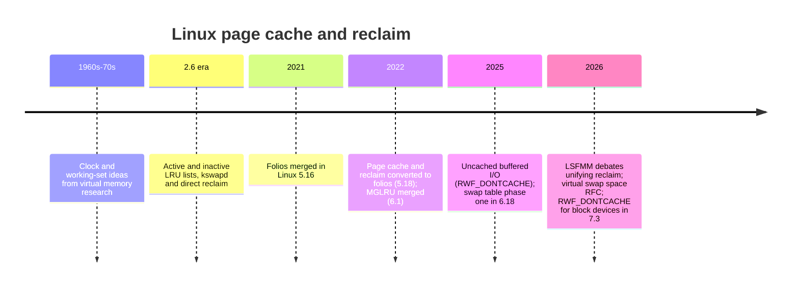
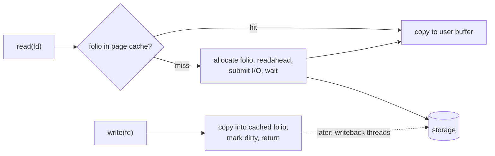
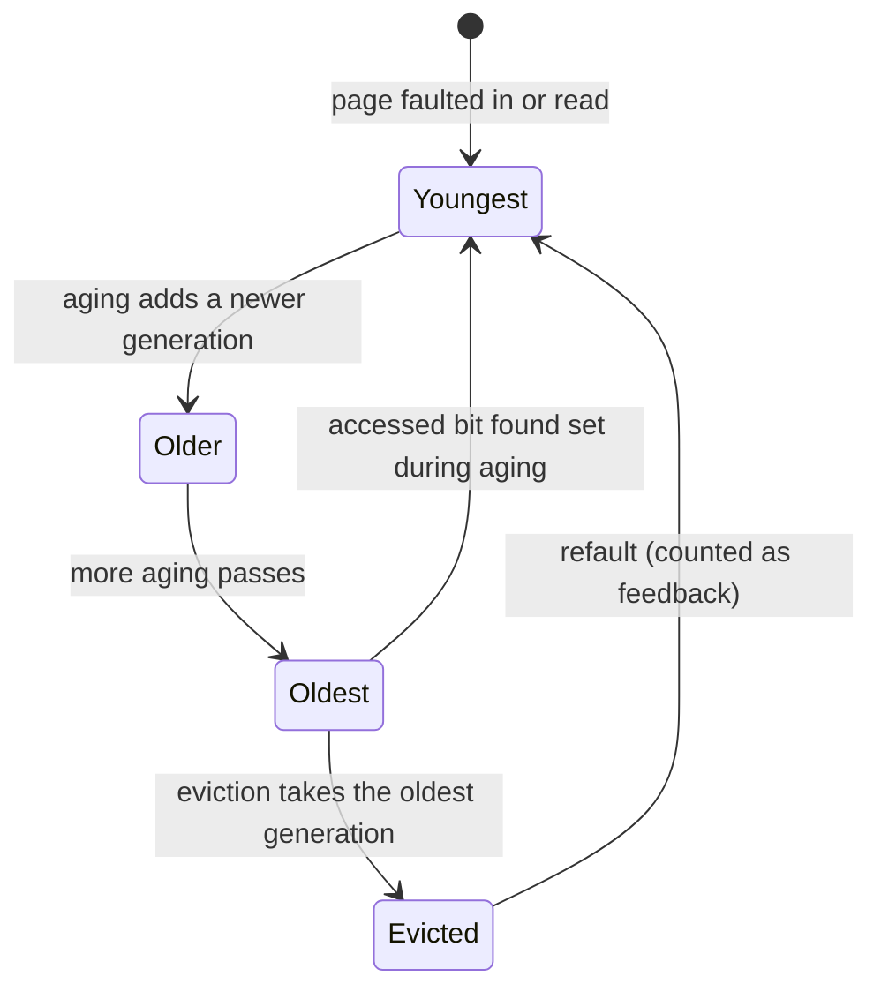

---
tags:
  - operating-systems
  - memory-management
  - page-cache
  - reclaim
  - swap
  - linux-kernel
status: complete
sources:
  - https://www.ece.villanova.edu/~rperry/os/ostep/Chapters/22-vm-beyondphys-policy.pdf
  - https://docs.kernel.org/mm/multigen_lru.html
  - https://lists.infradead.org/pipermail/linux-arm-kernel/2022-January/712275.html
  - https://lwn.net/Articles/1072866/
  - https://blogs.oracle.com/linux/intro-to-folios
  - https://lwn.net/Articles/1056405/
  - https://lkml.iu.edu/2606.1/11896.html
  - https://lwn.net/Articles/1003083
  - https://phoronix.com/review/linux-73-features
created: 2026-11-26
updated: 2026-11-26
---

## Table Of Contents

---

- [[#TL;DR|TL;DR]]
- [[#The Problem|The Problem]]
- [[#Foundations|Foundations]]
    - [[#Why Caching Pays|Why Caching Pays]]
    - [[#Replacement Policies|Replacement Policies]]
- [[#How We Got Here|How We Got Here]]
- [[#How It Works|How It Works]]
    - [[#The Page Cache|The Page Cache]]
    - [[#Who Reclaims, and When|Who Reclaims, and When]]
    - [[#Classic Two-List LRU|Classic Two-List LRU]]
    - [[#Multi-Gen LRU|Multi-Gen LRU]]
    - [[#Swap|Swap]]
- [[#Where It Is Now|Where It Is Now]]
- [[#Trade-offs & Open Problems|Trade-offs & Open Problems]]
- [[#Resources|Resources]]
- [[#Related Notes|Related Notes]]

## ***TL;DR***

---

*The kernel uses all otherwise idle RAM as a cache of file data (the page cache), and when memory runs short it must decide which pages to throw away or write to swap (reclaim). Getting that choice right is the difference between a fast machine and one that stalls, thrashes or kills processes.*

- **Page cache:** file reads and writes go through cached pages in RAM; since Linux 5.16-5.18 the cache is organized in **folios**, which can be larger than 4 KB ([Oracle](https://blogs.oracle.com/linux/intro-to-folios)).
- **Reclaim policy:** true LRU is too expensive, so kernels approximate it with accessed bits ([OSTEP ch. 22](https://www.ece.villanova.edu/~rperry/os/ostep/Chapters/22-vm-beyondphys-policy.pdf)). Linux has two approximations side by side: the classic active/inactive lists and the **Multi-Gen LRU** (MGLRU), which cut kswapd CPU use 40% in Google's fleet ([cover letter](https://lists.infradead.org/pipermail/linux-arm-kernel/2022-January/712275.html)).
- **2026 state:** the two reclaim paths are being untangled ([LWN, May 2026](https://lwn.net/Articles/1072866/)), and swap is being rebuilt around a "swap table" (merged 6.18, up to 5-20% gains) with a proposed virtual swap layer for zswap ([LWN, Feb 2026](https://lwn.net/Articles/1056405/); [vswap RFC](https://lkml.iu.edu/2606.1/11896.html)).

## ***The Problem***

---

*RAM is roughly 100,000 times faster than disk, and there is never enough of it. The OS must keep the pages that will be used soon and drop the rest, without knowing the future and without spending more CPU deciding than it saves.*

Every page of RAM is either used by a process (anonymous memory: heaps, stacks), holding file data (the page cache), used by the kernel itself, or free. Free memory is wasted memory, so Linux fills idle RAM with cached file data. That shifts the hard question to the moment memory is needed: **which page do we give up?**

- A **clean file page** can simply be dropped; it can be read back from the file.
- A **dirty file page** must be written back first.
- An **anonymous page** has no file behind it, so it can only leave RAM by being written to swap (or compressed by zswap).

Choose badly and the evicted page is needed again almost immediately (a **refault**), costing a disk read. Choose badly at scale and the system **thrashes**, paging constantly, until the out-of-memory killer terminates something ([OSTEP ch. 22](https://www.ece.villanova.edu/~rperry/os/ostep/Chapters/22-vm-beyondphys-policy.pdf)).

## ***Foundations***

---

*The value of a cache is set by its miss rate times the cost of a miss, and a disk miss is so expensive that a fraction of a percent matters. Replacement policies try to predict the future from the past: optimal is impossible, LRU is too costly, and real kernels approximate LRU with hardware accessed bits.*

### Why Caching Pays

OSTEP's average memory access time ([ch. 22](https://www.ece.villanova.edu/~rperry/os/ostep/Chapters/22-vm-beyondphys-policy.pdf)):

$$\text{AMAT} = T_M + P_{\text{miss}} \cdot T_D$$

In words: every access pays the memory cost $T_M$, and a fraction $P_{\text{miss}}$ also pays the disk cost $T_D$.

*Worked example (OSTEP's numbers):* $T_M = 100$ ns, $T_D = 10$ ms. A 10% miss rate gives $100\text{ ns} + 0.1 \times 10\text{ ms} \approx 1$ ms. A 99.9% hit rate gives $100\text{ ns} + 0.001 \times 10\text{ ms} = 10.1\ \mu s$, roughly 100 times faster. Going from 90% to 99.9% hits matters more than any CPU optimization. NVMe narrows $T_D$ to tens of microseconds, but the lesson holds.

### Replacement Policies

| Policy | Rule | Verdict |
|---|---|---|
| **Optimal (Belady's MIN)** | Evict the page used furthest in the future | Best possible; needs the future, so only a yardstick |
| **FIFO** | Evict the oldest-loaded page | Ignores use; suffers Belady's anomaly (more memory, more misses) |
| **LRU** | Evict the least recently used page | Matches optimal on many traces; exact tracking on every access is too costly |
| **Clock** | Circular list, hardware "use" bit; the hand clears 1s and evicts the first 0 | Cheap LRU approximation; prefer clean pages over dirty |

All from [OSTEP ch. 22](https://www.ece.villanova.edu/~rperry/os/ostep/Chapters/22-vm-beyondphys-policy.pdf). The hardware piece every real kernel relies on is the **accessed bit** in each page table entry (see [[Virtual Memory and Paging]]): the MMU sets it on access, the OS reads and clears it.

## ***How We Got Here***

---

*Linux's reclaim grew from a clock-like scan into two-list LRU with refault detection, then gained a second, generation-based algorithm in 2022. The data structures underneath moved from 4 KB pages to variable-size folios, and swap is being rebuilt in 2025-2026.*

- **Folios:** a folio is "guaranteed to either be a single page or to be the head page of a compound page", removing head/tail ambiguity. Introduced in 5.16, with page cache and reclaim conversion in 5.18; an early version alone sped kernel builds about 7% ([Oracle](https://blogs.oracle.com/linux/intro-to-folios)).
- **MGLRU:** by early 2022 it had shipped to "tens of millions of Chrome OS users" and "about a million Android users", showing a 40% fleet-wide drop in kswapd CPU on x86 at Google ([MGLRU v6 discussion](https://lists.infradead.org/pipermail/linux-arm-kernel/2022-January/712275.html)). It was merged for Linux 6.1.

## ***How It Works***

---

*File I/O lands in cached folios; background (kswapd) and direct reclaim free memory by aging pages and evicting the coldest. Linux can do the aging with two lists or with generations, and anonymous pages leave RAM through swap.*

### The Page Cache

- Each open file's cached data hangs off its `address_space`, indexed by file offset; `mmap()` maps the same folios into processes, so file reads and mapped access share one copy.
- Writes are **write-back**: `write()` returns once data is in a dirty folio, and writeback flushes it later (or on `fsync()`); see [[File Systems]].
- Large folios let the page cache issue I/O bigger than 4 KB and support file systems with block sizes above 4 KB; the 5.18 page cache and reclaim work reported 24%-241% throughput gains on some workloads ([Oracle](https://blogs.oracle.com/linux/intro-to-folios)).
- **Bypassing the cache:** `O_DIRECT` skips it but imposes alignment rules. `RWF_DONTCACHE` (uncached buffered I/O) uses the cache but drops the folios once a read is copied or a write's writeback completes; Jens Axboe reported about 65% better throughput and no kswapd activity on streaming workloads ([LWN, Dec 2024](https://lwn.net/Articles/1003083)). It is available through `preadv2()`, `pwritev2()` and [[io_uring]].

### Who Reclaims, and When

| Actor | When | Effect on the program |
|---|---|---|
| **kswapd** (one kernel thread per NUMA node) | Free memory falls below a low watermark | Background; the program doesn't wait |
| **Direct reclaim** | An allocation finds too little free memory | The allocating task does reclaim itself and stalls |
| **OOM killer** | Reclaim cannot free enough | A process is killed ([OSTEP](https://www.ece.villanova.edu/~rperry/os/ostep/Chapters/22-vm-beyondphys-policy.pdf)) |

Reclaim runs per **lruvec** (a node, or a memory cgroup within it; see [[Containers, Namespaces and cgroups]]), so a container can be squeezed back to its limit without touching others. Android shows how tight the budget can be: HONOR's phones must fit reclaim into 8.3 ms to avoid dropped frames at 120 fps ([LWN](https://lwn.net/Articles/1072866/)).

### Classic Two-List LRU

Pages sit on an **inactive** list when first used and are promoted to an **active** list if accessed again; reclaim scans the tail of the inactive list. Separate lists for anonymous and file pages are balanced by `swappiness`. Hardware accessed bits are found through reverse mapping (from a page to the page table entries that map it), and evicted pages leave a "shadow" entry so a refault can measure how soon the page was needed again (refault distance) ([LWN](https://lwn.net/Articles/1072866/)).

### Multi-Gen LRU

MGLRU replaces two lists with a sliding window of **generations** (at least `MIN_NR_GENS`, at most `MAX_NR_GENS`) per lruvec ([kernel docs](https://docs.kernel.org/mm/multigen_lru.html)):

- **Aging** creates a new youngest generation by **walking process page tables** (not reverse maps), clearing accessed bits and moving accessed pages to the youngest generation. Bloom filters remember which page-table regions were densely hot, so later walks skip cold regions.
- **Eviction** consumes the oldest generation. Within a generation, pages read through file descriptors are sorted into **tiers** by access count ($\text{tier} = \lceil \log_2 N \rceil$ for $N$ accesses), so a file read once is evicted before one read eight times.
- A **PID-controller-style feedback loop** compares refault rates of anonymous and file pages and tiers, steering eviction toward whichever type refaults less.
- An optional `lru_gen_min_ttl` protects a working set younger than a threshold; if it cannot fit, the OOM killer runs rather than thrashing.

*Worked example of tiers:* a database page read through `read()` 8 times is in tier $\log_2 8 = 3$; a log file scanned once is tier 0. Under pressure, the oldest generation's tier-0 pages ("single-use, unmapped, clean pages", the safest to drop) go first ([kernel docs](https://docs.kernel.org/mm/multigen_lru.html)).

### Swap

Anonymous pages leave RAM by being written to a swap device or file, or compressed into RAM by zswap. Until 6.17, swap state lived in per-64 MB `address_space` XArrays on top of separate ~2 MB swap clusters, two overlapping clustering schemes. Linux 6.18's **swap table** gives each cluster a roughly one-page array of slot states, which Kairui Song measured at "up to ~5-20% performance gain in throughput, RPS or build time" ([LWN](https://lwn.net/Articles/1056405/)).

## ***Where It Is Now***

---

*As of November 2026, Linux reclaim is in a cleanup and redesign phase: two LRU implementations coexist and kernel developers are debating how to merge them, swap is being modernized in installments, and applications get more control over caching.*

- **Two reclaim algorithms, one file:** at LSFMM+BPF in May 2026, Shakeel Butt called reclaim a "mess": `mm/vmscan.c` is over 8,000 lines, about 40% MGLRU-specific code duplicating the classic path. Many distributions enable MGLRU, which Kairui Song called "surprisingly good", but page-cache-heavy workloads can regress. Plans range from splitting the code and agreeing on benchmark workloads to Song's "MGLRU-FG" rework and BPF hooks for reclaim policy ([LWN](https://lwn.net/Articles/1072866/)).
- **Phones lead adoption:** HONOR runs MGLRU on about 70 million devices but reports over-reclaim of file pages (slower camera launch) and asks for tunable aging ([LWN](https://lwn.net/Articles/1072866/)).
- **Swap rebuild:** after the 6.18 swap table, Nhat Pham's virtual swap space RFC v2 (June 2026) lets swapped pages get a virtual entry first and a backend (zswap or disk) later, so zswap no longer needs a disk slot per page and backends can change without page-table walks; it roughly matched baseline performance with about 15% faster freeing in one test ([vswap RFC](https://lkml.iu.edu/2606.1/11896.html)).
- **Uncached I/O spreads:** Linux 7.3 (October 2026) extends `RWF_DONTCACHE` to raw block devices for users such as database servers ([Phoronix](https://phoronix.com/review/linux-73-features)).

## ***Trade-offs & Open Problems***

---

*Reclaim is a prediction problem with a CPU budget: better predictions need more scanning, and more scanning costs the CPU time it was meant to save. No single policy wins on every workload, which is why Linux still carries two.*

| Choice | Benefit | Cost |
|---|---|---|
| Cache aggressively | Fewer disk reads, faster repeat access | Reclaim work later; latency spikes under pressure |
| Reverse-map scanning (classic) | Finds a page's users precisely | Expensive per page on heavily shared memory |
| Page-table walks (MGLRU) | Cheap, sequential, skips cold regions | Needs good heuristics to pick which processes to walk |
| Large folios | Bigger I/O, fewer LRU entries | Coarser eviction: one hot 4 KB piece keeps the whole folio |
| Swap / zswap | Lets cold anonymous memory leave RAM | Disk I/O or CPU for compression; refault latency |

Open problems:
- **Which algorithm survives?** The 2026 debate splits between choosing one implementation and keeping both with shared infrastructure ([LWN](https://lwn.net/Articles/1072866/)).
- **Policy for every workload:** Android wants frame-time budgets, databases want their own caching, servers want throughput; BPF-programmable reclaim is floated but contested.
- **Memory tiers:** with CXL, "evict" becomes "demote to slower memory" (see [[CXL and Memory Tiering]]).
- **Observability:** `/proc/meminfo` active/inactive counts are "jumpy" under MGLRU ([LWN](https://lwn.net/Articles/1072866/)).

## ***Resources***

---

*OSTEP for the policies, the kernel's MGLRU design doc for how Linux does it now, and LWN's 2026 coverage for where it is headed.*

- [OSTEP ch. 22: Beyond Physical Memory: Policies](https://www.ece.villanova.edu/~rperry/os/ostep/Chapters/22-vm-beyondphys-policy.pdf)
- [Linux kernel docs: Multi-Gen LRU design](https://docs.kernel.org/mm/multigen_lru.html)
- [MGLRU v6 discussion (results from Chrome OS, Android, Google fleet)](https://lists.infradead.org/pipermail/linux-arm-kernel/2022-January/712275.html)
- [Oracle Linux blog: Intro to folios](https://blogs.oracle.com/linux/intro-to-folios)
- [LWN: Uncached buffered IO (Dec 2024)](https://lwn.net/Articles/1003083)
- [LWN: Modernizing swapping: introducing the swap table (Feb 2026)](https://lwn.net/Articles/1056405/)
- [LWN: What is to be done about MGLRU? (May 2026)](https://lwn.net/Articles/1072866/)
- [Pham: Virtual Swap Space RFC v2 (June 2026)](https://lkml.iu.edu/2606.1/11896.html)

## ***Related Notes***

---

- [[Virtual Memory and Paging]]: page tables, accessed bits and page faults that reclaim depends on.
- [[Memory Allocators]]: the buddy allocator that reclaim refills.
- [[File Systems]]: writeback and how dirty folios reach storage.
- [[io_uring]]: asynchronous I/O, including uncached buffered I/O.
- [[Containers, Namespaces and cgroups]]: per-cgroup memory limits and reclaim.
- [[CXL and Memory Tiering]]: demotion instead of eviction.
- [[Read-Copy-Update (RCU)]]: lockless page-cache lookups.
