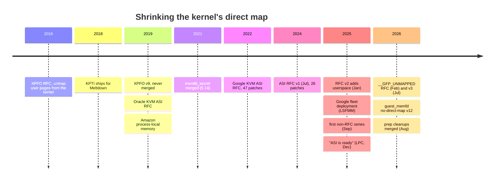
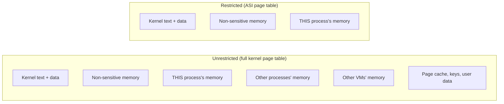
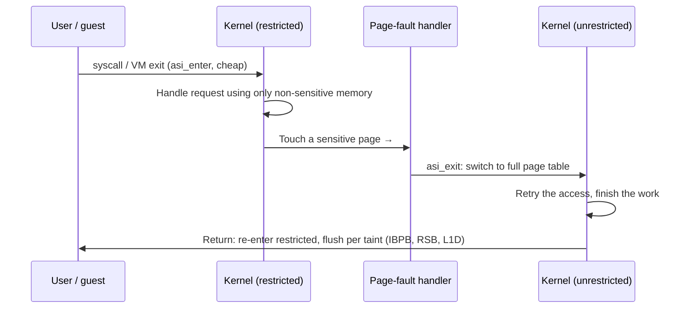

---
tags:
  - operating-systems
  - security
  - linux
  - memory-management
  - transient-execution
  - address-space-isolation
  - kvm
status: draft
sources:
  - https://linuxasi.dev/
  - https://lwn.net/Articles/1064090/
  - https://lwn.net/Articles/700606/
  - https://lore.kernel.org/lkml/20190404013956.GA3365@cisco/
  - https://lkml.rescloud.iu.edu/1905.1/04183.html
  - https://lwn.net/Articles/791069/
  - https://lwn.net/Articles/865256/
  - https://lore.kernel.org/all/87pmmofs83.ffs@tglx/
  - https://lkml.rescloud.iu.edu/2407.1/07141.html
  - https://lkml.iu.edu/hypermail/linux/kernel/2501.1/04842.html
  - https://lwn.net/Articles/1016013/
  - https://lkml.iu.edu/2509.3/00833.html
  - https://lpc.events/event/19/contributions/2029/
  - https://lkml.iu.edu/hypermail/linux/kernel/2601.1/11534.html
  - https://ratatoskr.run/kvm/2026/04/346866
  - https://lkml.iu.edu/hypermail/linux/kernel/2603.2/11777.html
  - https://lwn.net/Articles/1072367/
  - https://lkml.iu.edu/hypermail/linux/kernel/2607.3/03814.html
created: 2026-11-26
updated: 2026-11-26
---

## Table Of Contents

---

- [[#TL;DR|TL;DR]]
- [[#The Problem|The Problem]]
- [[#Foundations|Foundations]]
    - [[#The Direct Map|The Direct Map]]
    - [[#Unmap Instead of Flush|Unmap Instead of Flush]]
- [[#How We Got Here|How We Got Here]]
- [[#How It Works|How It Works]]
    - [[#Two Address Spaces per Process|Two Address Spaces per Process]]
    - [[#Entering and Exiting|Entering and Exiting]]
    - [[#Deciding What Is Sensitive|Deciding What Is Sensitive]]
    - [[#Allocator Changes|Allocator Changes]]
    - [[#The Cost Model|The Cost Model]]
    - [[#Cousins: memfd_secret and guest_memfd|Cousins: memfd_secret and guest_memfd]]
- [[#Where It Is Now|Where It Is Now]]
- [[#Trade-offs & Open Problems|Trade-offs & Open Problems]]
- [[#Resources|Resources]]
- [[#Related Notes|Related Notes]]

## ***TL;DR***
---
*Every speculative-execution leak needs the secret to be mapped in the address space the attacker can steer. Address Space Isolation (ASI) runs most kernel code in a page table that simply leaves other processes' and guests' memory out, so there is nothing for speculation to read.*

- **The idea.** The Linux kernel maps all physical memory into its own address space (the *direct map*). ASI gives the kernel a second, *restricted* view that maps only memory it has marked non-sensitive, runs there by default, and switches to the full view only when it genuinely needs a sensitive page.
- **Why it matters.** Today each [[Transient Execution Attacks and Mitigations|transient execution]] variant gets its own patch: buffer clears, predictor flushes, retpolines, and many of them run on every kernel entry. ASI attacks the common cause instead and could let many of those be turned off.
- **Who's behind it.** Google, led by Brendan Jackman, builds on earlier Oracle, Amazon and Cisco work. A version runs on "a significant subset of Google's fleet" ([LWN, 2025](https://lwn.net/Articles/1016013/)), with Google reporting end-to-end overhead under 5% and often under 1% ([linuxasi.dev](https://linuxasi.dev/)).
- **Status, November 2026.** **Not in mainline.** Preparatory memory-management cleanups were merged in August 2026; the core pieces (`__GFP_UNMAPPED`, the "mermap" ephemeral mapping, guest_memfd direct-map removal) are still under review, and review has been slow.

## ***The Problem***
---
*Since 2018, the kernel's answer to each new speculation bug has been another targeted mitigation. They add up in cost and never get ahead of the next variant.*

Spectre-style attacks trick the CPU into speculatively loading data and leaking it through a cache side channel. The attacker doesn't need a bug in the kernel, just a kernel that *maps* the secret and a way to steer speculation toward it. And the Linux kernel maps everything.

- **The mitigation treadmill.** [[Transient Execution Attacks and Mitigations|The transient execution note]] lists 18 issues Linux tracks, each with its own mitigation; many run on every system call, interrupt or VM exit. Upstream mitigations for AMD's SRSO alone cost about 5% ([linuxasi.dev](https://linuxasi.dev/)).
- **Guests make it worse.** A cloud host runs many tenants' VMs on one kernel. A guest that triggers a VM exit runs host kernel code, with every other guest's memory mapped, while it controls part of the CPU's predictor state.
- **One root cause.** A VUSec analysis cited in the guest_memfd patch series says about 60% of speculative-execution issues would be blocked just by removing guest memory from the host's direct map ([LKML](https://lkml.iu.edu/hypermail/linux/kernel/2601.1/11534.html)).

So the question ASI asks is: instead of stopping speculation reaching secrets, can we stop secrets from being mapped at all?

## ***Foundations***
---
*Two ideas: the kernel maps all of RAM, and a CPU can't speculatively load from an address that has no page-table entry.*

### The Direct Map

On x86-64 Linux, the kernel keeps a linear mapping of all physical memory, so any physical page `p` is reachable at a fixed kernel virtual address ([LWN](https://lwn.net/Articles/1064090/)):

$$
\text{va}(p) = \text{PAGE\_OFFSET} + p
$$

*In plain words: every byte of RAM, including your process's keys and every other VM's memory, has a kernel address that any kernel code path could load from.*

Worked example: with the default 4-level `PAGE_OFFSET` of `0xffff888000000000` (KASLR moves it at boot), physical page `0x1_2345_6000` sits at kernel virtual address `0xffff888123456000`. A speculative gadget in a system call path only needs that address to leak the page.

The direct map is why the kernel is fast: `kmalloc`, the [[Page Cache and Memory Reclaim|page cache]] and [[Memory Allocators|slab caches]] hand out direct-map addresses with no setup. It's also why one speculative gadget anywhere in the kernel can, in principle, reach any page.

### Unmap Instead of Flush

| Mitigation style | Example | What it does | Cost pattern |
|---|---|---|---|
| Flush state | VERW buffer clears, IBPB, RSB stuffing | Erase microarchitectural state on every boundary crossing | Paid on *every* entry/exit |
| Block speculation | Retpolines, `lfence`, IBRS | Stop the CPU predicting through certain branches | Paid on every indirect branch |
| **Unmap** | KPTI, PTE inversion, **ASI** | Leave the secret out of the page tables | Paid only when you *switch* page tables |

KPTI (2018) was the first "unmap" fix: it removed kernel memory from user page tables to stop Meltdown. ASI applies the same idea one level deeper, removing *other people's* memory from the kernel's own page tables.

## ***How We Got Here***
---
*ASI is the latest of several attempts to shrink the direct map. The earlier ones failed on performance; ASI's contribution is a design that pays the cost only on rare paths.*



- **XPFO (2016–2019).** *eXclusive Page Frame Ownership* removed user pages from the direct map while userspace owned them ([LWN](https://lwn.net/Articles/700606/)). Version 9 in April 2019 cost 1.27–1.28× kernel-build system time even after batching TLB flushes, down from 2.61× and 26.37× without them ([LKML](https://lore.kernel.org/lkml/20190404013956.GA3365@cisco/)). It was never merged: unmapping on *every* allocation was too costly.
- **Oracle and Amazon (2019).** Oracle's KVM ASI RFC (May 2019) proposed a restricted address space for VM exits ([LKML](https://lkml.rescloud.iu.edu/1905.1/04183.html)); Amazon proposed process-local kernel memory ([LWN](https://lwn.net/Articles/791069/)).
- **memfd_secret (2021).** A narrower, merged fix: Linux 5.14 lets a process create memory that is removed from the direct map entirely, for keys ([LWN](https://lwn.net/Articles/865256/)).
- **Google's KVM ASI (2022).** Junaid Shahid's 47-patch RFC introduced the core API: `asi_enter`, `asi_exit` and classes of restricted address spaces ([LKML](https://lore.kernel.org/all/87pmmofs83.ffs@tglx/)).
- **"ASI 2024" (July 2024).** Brendan Jackman's rewrite, 26 patches, +1977/−136 lines, kept only the minimum to run KVM guests in a restricted space ([LKML](https://lkml.rescloud.iu.edu/2407.1/07141.html)).
- **RFC v2 (January 2025)** extended protection to userspace processes, not just guests ([LKML](https://lkml.iu.edu/hypermail/linux/kernel/2501.1/04842.html)). Its first numbers were bad: a 4k random-read FIO benchmark lost about 70% on Sapphire Rapids, because page-cache pages were sensitive and every read forced an exit.
- **Fleet and fixes (2025).** At LSFMM 2025, Google said ASI ran on "a significant subset" of its fleet ([LWN](https://lwn.net/Articles/1016013/)). An August 2025 "ASI is fast again" series cut the FIO regression sharply, and in September the first non-RFC series, "mm: ASI direct map management" (21 patches), went to the list ([LKML](https://lkml.iu.edu/2509.3/00833.html)). At Linux Plumbers in December 2025, Jackman's talk argued ASI was ready to move from RFCs to merging ([LPC](https://lpc.events/event/19/contributions/2029/)).

## ***How It Works***
---
*ASI gives each process two kernel page tables, runs in the smaller one by default, and treats a fault on a missing page as the signal to switch. Most of the engineering is in the memory allocator, which must know which pages are safe to leave mapped.*

### Two Address Spaces per Process



*The restricted table is the full one with every sensitive page of anyone else removed. A process's own memory can stay mapped, because it can only leak secrets it already owns.*

Terms from the patch series ([LKML](https://lkml.rescloud.iu.edu/2407.1/07141.html); [linuxasi.dev](https://linuxasi.dev/)):

| Term | Meaning |
|---|---|
| **Restricted address space** | The ASI page table, where the kernel runs by default |
| **Unrestricted address space** | The normal full page table |
| **Class** | A kind of restricted space, e.g. one for KVM guests and one for userspace processes |
| **Domain** | One security context, such as one VM or one process |
| **Taint** | A record of what touched the CPU's predictor and cache state, used to decide which flushes are needed on the way back |

### Entering and Exiting



- **Enter on every kernel entry.** System calls, interrupts and VM exits start in the restricted space, so a speculative gadget reached by the attacker sees only non-sensitive memory.
- **Exit on demand.** If kernel code touches a page that isn't mapped, the page fault handler notices it's an ASI fault, switches to the unrestricted page table (`asi_exit`) and retries. No code needs annotating to *find* the exits; the faults find them.
- **Flush on the way back, only if needed.** Before returning to the attacker's context, the kernel flushes predictor and cache state, but only the kinds the taint tracking says were touched while unrestricted. A system call that never left the restricted space pays nothing.

### Deciding What Is Sensitive

Early designs used an *allowlist*: memory was unmapped unless code marked it safe. The current series flips to a *denylist* by default: allocations are non-sensitive unless they pass `__GFP_SENSITIVE`, and user and guest memory is sensitive by default. This makes the patches far smaller, at the cost of relying on getting the sensitive cases right ([LKML](https://lkml.iu.edu/2509.3/00833.html)).

```c
/* Illustrative, based on the RFC's API names. */
struct page *p = alloc_pages(GFP_KERNEL | __GFP_SENSITIVE, 0);
/* p is removed from the restricted address space. Kernel code that touches
 * it from a system call takes one ASI page fault, switches to the full page
 * table, then continues. */
```

*In plain words: one extra allocation flag decides whether a page shows up in the page table that attacker-reachable kernel code runs on.*

### Allocator Changes

Unmapping a page from a shared page table means a TLB shootdown on every CPU, which is what made XPFO slow. ASI's allocator work avoids doing that often ([LKML](https://lkml.iu.edu/2509.3/00833.html); [LKML](https://lkml.iu.edu/hypermail/linux/kernel/2603.2/11777.html)):

- **Split free lists.** The buddy allocator keeps sensitive and non-sensitive free pages apart (a new `freetype_t`), so most allocations reuse a page already in the right state and change no mappings.
- **Preallocate page tables.** The restricted direct map's page tables are built down to 2 MB granularity at boot, so changing a page's state never has to allocate page-table memory.
- **Disable global pages** in the restricted space, so switching tables also drops stale TLB entries.
- **`__GFP_UNMAPPED`.** A newer flag (RFC February 2026, v2 March, v3 July 2026 as "ALLOC_UNMAPPED and AS_NO_DIRECT_MAP") lets any user ask for pages that are absent from the direct map entirely, generalizing memfd_secret ([LKML](https://lkml.iu.edu/hypermail/linux/kernel/2603.2/11777.html); [LKML](https://lkml.iu.edu/hypermail/linux/kernel/2607.3/03814.html)).
- **mermap (formerly "ephmap").** A small CPU-local, per-mm area for mapping a sensitive page briefly, such as when zeroing it, without exposing it in the shared restricted table.

### The Cost Model

ASI's cost isn't per system call; it's per *exit*. A simple way to see it:

$$
\text{overhead} \approx \frac{N_{\text{exit}} \cdot (c_{\text{switch}} + c_{\text{flush}})}{T}
$$

*In plain words: overhead is how often the kernel has to leave the restricted space in a period of time, multiplied by what each exit and its later flush cost.*

Worked example (illustrative numbers): a server spends one second doing work and leaves the restricted space 20,000 times in it, each switch-plus-flush costing 2 µs. Then overhead ≈ 20,000 × 2 µs / 1 s = 4%. Halve the exits by marking more memory non-sensitive and it drops to 2%. That's why the FIO regression disappeared once the page cache stopped forcing exits, and why Google reports under 5% end-to-end and often under 1% ([linuxasi.dev](https://linuxasi.dev/)).

### Cousins: memfd_secret and guest_memfd

| Mechanism | Scope | Status |
|---|---|---|
| `memfd_secret` | A process asks for secret memory removed from the direct map | Merged, 5.14 (2021) |
| guest_memfd `NO_DIRECT_MAP` | KVM guest memory never in the host direct map | v12 posted Apr 2026, not merged ([ratatoskr](https://ratatoskr.run/kvm/2026/04/346866)) |
| `__GFP_UNMAPPED` | Any kernel allocation unmapped from the direct map | v3 Jul 2026, not merged |
| **ASI** | Everything sensitive, for every process and guest | Not merged |

The guest_memfd work, from Amazon for Firecracker, is the most pragmatic: it removes each [[MicroVMs and Sandboxing|microVM's]] memory from the host direct map, which the series' VUSec citation says covers most speculative issues for guests. The `__GFP_UNMAPPED` v3 series reports Firecracker memory population dropping from 1.04 s to 313 ms (−70%) with its faster mapping path ([LKML](https://lkml.iu.edu/hypermail/linux/kernel/2607.3/03814.html)).

## ***Where It Is Now***
---
*As of November 2026, ASI is deployed in Google's fleet on Google's own kernels, but upstream Linux has only its groundwork. The pieces are on the list; review has been the bottleneck.*

| Date | Event | Source |
|---|---|---|
| Dec 2025 | LPC talk "Address Space Isolation is ready" argues the design questions are solved | [LPC](https://lpc.events/event/19/contributions/2029/) |
| Jan 2026 | guest_memfd direct-map removal v9/v10 (Nikita Kalyazin, Amazon) | [LKML](https://lkml.iu.edu/hypermail/linux/kernel/2601.1/11534.html) |
| Feb–Mar 2026 | `__GFP_UNMAPPED` RFC and v2 | [LKML](https://lkml.iu.edu/hypermail/linux/kernel/2603.2/11777.html) |
| Apr 2026 | guest_memfd v12, 9 of 16 patches reviewed | [ratatoskr](https://ratatoskr.run/kvm/2026/04/346866) |
| May 2026 | LSFMM: slow review, no decisions on merging | [LWN](https://lwn.net/Articles/1072367/) |
| Jul 2026 | v3 "ALLOC_UNMAPPED and AS_NO_DIRECT_MAP", 7 of 26 patches reviewed | [LKML](https://lkml.iu.edu/hypermail/linux/kernel/2607.3/03814.html) |
| Aug 2026 | mm-stable takes only Jackman's preparatory cleanups | mm tree |

- **Not merged.** No ASI enable switch exists in a released kernel as of November 2026. When it lands, the series plans a Kconfig option (`CONFIG_MITIGATION_ADDRESS_SPACE_ISOLATION`) and an `asi=on` boot flag, default off.
- **x86 only.** arm64 support is on the roadmap.
- **Roadmap.** Jackman's LPC 2025 slides lay out the order: mermap, free-list types and `__GFP_UNMAPPED`, the non-sensitive address space and API, KVM and userspace classes, fewer exits, then making it the default and retiring other mitigations, plus SMT handling and arm64 ([LPC](https://lpc.events/event/19/contributions/2029/)). The slides also claim ASI mitigates VMSCAPE (2025), a guest-to-host predictor attack.
- **Elsewhere.** The sources read for this note show no other major OS shipping an equivalent. [[Confidential Computing|Confidential VMs]] solve the host-reads-guest problem with encryption instead, but don't help a process against the kernel it runs on.

## ***Trade-offs & Open Problems***
---
*ASI trades a lot of memory-management complexity for retiring a whole family of mitigations. The open questions are whether mm maintainers will accept that complexity and whether "non-sensitive" can be defined well enough.*

| Approach | Protects against | Cost | Status |
|---|---|---|---|
| Per-variant mitigations | Each known variant | Paid on every entry; grows with each new bug | Shipping |
| KPTI | Meltdown (user reads kernel) | Page-table switch per entry (with PCID, small) | Shipping since 2018 |
| memfd_secret / guest_memfd | Chosen secrets or guest memory | Opt-in; slower mapping | Partly merged |
| **ASI** | Most cross-process and cross-VM speculative leaks | Exits on sensitive access, allocator complexity | Out of tree |
| [[Confidential Computing]] | Host reading a guest | Hardware, attestation, I/O cost | Shipping on clouds |

**Open problems**

- **TLB shootdowns.** Memory-management reviewers have asked whether changing direct-map entries at allocation time scales on large machines; the free-list split reduces it but doesn't remove it.
- **Zeroing cost.** Reviewers pointed out that sensitive pages must be zeroed before reuse as non-sensitive, which mermap must make cheap.
- **The page cache.** File data is sensitive to *somebody*, but treating all of it as sensitive caused the 70% FIO regression; the right policy is still debated.
- **Completeness.** The denylist only helps if every secret-bearing allocation is marked. A forgotten `__GFP_SENSITIVE` silently leaves a secret mapped.
- **Maintenance burden.** Memory management is the most heavily used kernel subsystem, and maintainers have been cautious about the extra states ASI adds to the allocator.
- **What it doesn't stop.** ASI blocks reading *unmapped* data. It doesn't stop leaks of the attacker's own mapped data, architectural bugs, or [[Kernel Security Hardening|data-only exploits]], and SMT siblings sharing a core still need handling.

## ***Resources***
---
*The patch cover letters explain the design best; linuxasi.dev collects them with the slides.*

**Project and talks**
- [linuxasi.dev](https://linuxasi.dev/): Google's ASI project page.
- [Address Space Isolation is ready](https://lpc.events/event/19/contributions/2029/): Brendan Jackman, Linux Plumbers 2025.
- [LSFMM+BPF 2025 on ASI](https://lwn.net/Articles/1016013/) and [2026 follow-up](https://lwn.net/Articles/1072367/): LWN.

**Patch series**
- [ASI RFC, July 2024](https://lkml.rescloud.iu.edu/2407.1/07141.html), [RFC v2, Jan 2025](https://lkml.iu.edu/hypermail/linux/kernel/2501.1/04842.html), [mm: ASI direct map management, Sep 2025](https://lkml.iu.edu/2509.3/00833.html).
- [`__GFP_UNMAPPED` v2](https://lkml.iu.edu/hypermail/linux/kernel/2603.2/11777.html) and [v3](https://lkml.iu.edu/hypermail/linux/kernel/2607.3/03814.html), 2026.
- [guest_memfd direct-map removal](https://lkml.iu.edu/hypermail/linux/kernel/2601.1/11534.html), 2026.

**History**
- [XPFO](https://lwn.net/Articles/700606/), [memfd_secret](https://lwn.net/Articles/865256/), [Google's 2022 KVM ASI RFC](https://lore.kernel.org/all/87pmmofs83.ffs@tglx/): LWN and LKML.

## ***Related Notes***
---
*ASI sits where memory management meets speculative-execution security.*

- [[Transient Execution Attacks and Mitigations]] — The attacks ASI is meant to make structural rather than per-variant.
- [[Virtual Memory and Paging]] — Page tables, TLBs and the direct map.
- [[Memory Allocators]] — The buddy and slab allocators ASI changes.
- [[Page Cache and Memory Reclaim]] — The page cache whose sensitivity drove ASI's worst regression.
- [[System Calls and the User-Kernel Boundary]] — The entry path where ASI switches address spaces.
- [[Interrupts and Exceptions]] — The page-fault path that triggers ASI exits.
- [[Virtualization and Hypervisors]] — VM exits, the first use case.
- [[MicroVMs and Sandboxing]] — Firecracker and guest_memfd's direct-map removal.
- [[Confidential Computing]] — Hardware encryption as another way to keep the host out of a guest.
- [[Kernel Security Hardening]] — Other kernel-wide exploit mitigations.
- [[Hardware Memory Safety]] — Another structural fix, for memory corruption instead of leaks.
- [[NUMA]] — TLB shootdowns and page-table cost on large machines.
