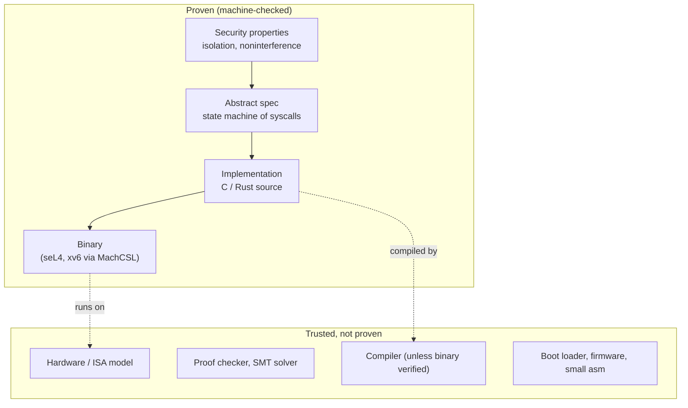
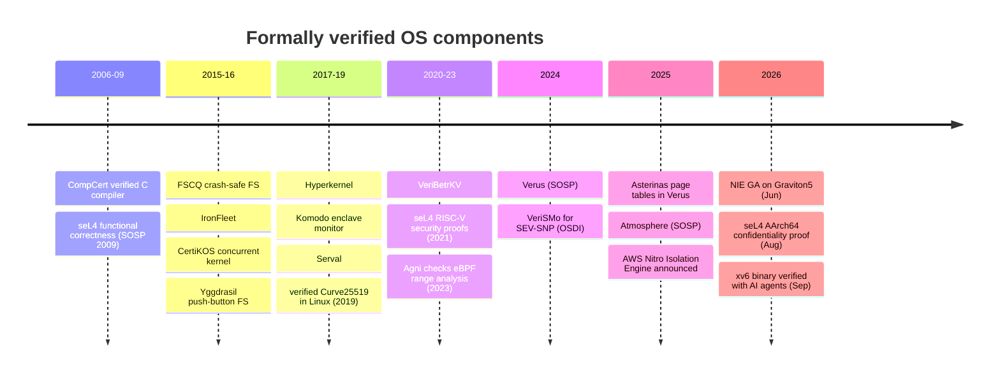

---
tags:
  - operating-systems
  - security
  - formal-verification
  - sel4
  - verus
  - proof-assistants
  - trusted-computing-base
status: complete
sources:
  - https://trustworthy.systems/projects/OLD/l4.verified/numbers
  - https://cacm.acm.org/research/building-certified-concurrent-os-kernels
  - https://6826.csail.mit.edu/2019/papers/hyperkernel.pdf
  - https://6826.csail.mit.edu/2020/papers/serval.pdf
  - https://unsat.cs.washington.edu/projects/yggdrasil
  - https://cacm.acm.org/research/certifying-a-file-system-using-crash-hoare-logic
  - https://www.andrew.cmu.edu/user/bparno/papers/ironfleet.pdf
  - https://www.microsoft.com/en-us/research/project/komodo/
  - https://www.usenix.org/conference/osdi20/presentation/hance
  - https://usenix.org/system/files/osdi24-zhou.pdf
  - https://par.nsf.gov//servlets/purl/10630619
  - https://ece.cmu.edu/news-and-events/story/2024/12/sosp-award.html
  - https://mars-research.github.io/doc/2025-sosp-atmo.pdf
  - https://asterinas.github.io/2025/02/13/towards-practical-formal-verification-for-a-general-purpose-os-in-rust.html
  - https://aws.amazon.com/blogs/compute/aws-nitro-isolation-engine-formally-verifying-the-hypervisor-in-the-aws-nitro-system/
  - https://lists.seas.upenn.edu/pipermail/types-announce/2025/012222.html
  - https://drops.dagstuhl.de/entities/document/10.4230/LIPIcs.ITP.2026.1
  - https://sel4.discourse.group/t/sel4-security-proofs-now-complete-on-aarch64/1074
  - https://trustworthy.systems/publications/papers/Sison_26:sel4s.abstract
  - https://www.usenix.org/system/files/osdi26-he-baoding.pdf
  - https://arxiv.org/abs/2609.04043
  - https://arxiv.org/abs/2409.13082v3
  - https://www.microsoft.com/en-us/research/blog/verifying-rust-cryptography-in-symcrypt-from-standards-to-code/
  - https://runtimeverification.com/blog/verifying-linux-rust-code-from-binder-to-lean4
  - https://rustfoundation.org/?p=120341
  - https://lwn.net/Articles/1087069/
  - https://people.cs.rutgers.edu/~sn349/agni/
  - https://kernel.org/doc/readme/tools-memory-model-README
  - https://lore.kernel.org/20191017190932.1947-27-ard.biesheuvel@linaro.org/
  - https://www-old.cs.utah.edu/~regehr/papers/pldi11-preprint.pdf
  - https://www.darpa.mil/research/programs/pipelined-reasoning-of-verifiers-enabling-robust-systems
  - https://blog.google/security/android-pkvm-certified-sesip-level-5/
created: 2026-11-26
updated: 2026-11-26
---

## Table Of Contents

---

- [[#TL;DR|TL;DR]]
- [[#The Problem|The Problem]]
- [[#Foundations|Foundations]]
    - [[#Specification and Refinement|Specification and Refinement]]
    - [[#What Can Be Proven|What Can Be Proven]]
    - [[#Three Families of Tools|Three Families of Tools]]
    - [[#The Trusted Base of a Proof|The Trusted Base of a Proof]]
- [[#How We Got Here|How We Got Here]]
- [[#How It Works|How It Works]]
    - [[#Interactive Proof — seL4, CertiKOS, FSCQ|Interactive Proof — seL4, CertiKOS, FSCQ]]
    - [[#Push-Button Verification — Hyperkernel, Yggdrasil, Serval|Push-Button Verification — Hyperkernel, Yggdrasil, Serval]]
    - [[#Verified Rust — Verus, VeriSMo, Atmosphere|Verified Rust — Verus, VeriSMo, Atmosphere]]
    - [[#Verifying Pieces of Linux|Verifying Pieces of Linux]]
    - [[#The Cost of a Proof|The Cost of a Proof]]
- [[#Where It Is Now|Where It Is Now]]
- [[#Trade-offs & Open Problems|Trade-offs & Open Problems]]
- [[#Resources|Resources]]
- [[#Related Notes|Related Notes]]

## ***TL;DR***
---
*Testing shows that bugs exist; a machine-checked proof shows that a whole class of bugs does not, relative to a written specification and a short list of trusted assumptions. Verification left the lab in 2025–2026: a production cloud hypervisor, kernel crypto and pieces of Linux's Rust code now carry proofs.*

- **What it is.** You write a *specification* (what the component must do), then prove with a machine-checked tool that the *implementation* only ever does what the spec allows (**refinement**). Memory safety and "no undefined behaviour" usually fall out for free; isolation properties such as *noninterference* are proven on top.
- **Landmarks.** [[Microkernels and seL4|seL4]] (2009) proved a whole kernel in Isabelle/HOL; CertiKOS (2016) did it for a concurrent kernel in Coq; Hyperkernel (2017) and Serval (2019) made proofs *push-button* with SMT solvers; FSCQ (2015) proved a file system crash-safe.
- **The 2024–2026 shift: verified Rust.** Tools like **Verus** let engineers write proofs inside Rust. Rust's ownership removes most heap reasoning, so proof-to-code ratios fell from about **20:1** (seL4) to about **2–5:1** (VeriSMo, Atmosphere) ([Atmosphere, SOSP 2025](https://mars-research.github.io/doc/2025-sosp-atmo.pdf)).
- **In production.** AWS's **Nitro Isolation Engine**, a hypervisor proven in Isabelle/HOL, went GA on all Graviton5 instances in June 2026 ([AWS](https://aws.amazon.com/blogs/compute/aws-nitro-isolation-engine-formally-verifying-the-hypervisor-in-the-aws-nitro-system/)). Linux has shipped formally verified Curve25519 since 2019, and the eBPF verifier's arithmetic is checked by the Agni tool in kernel CI ([Agni](https://people.cs.rutgers.edu/~sn349/agni/)).
- **Late 2026: AI writes proofs.** An MIT team verified the whole xv6 kernel binary against a RISC-V model with AI agents in 102 days ([arXiv, Sept 2026](https://arxiv.org/abs/2609.04043)), and an OSDI 2026 paper had a 7B model prove 77.6% of a seL4 theorem benchmark ([OSDI 2026](https://www.usenix.org/system/files/osdi26-he-baoding.pdf)).
- **What it can't do.** Proofs assume the hardware model, compiler and spec are right. [[Transient Execution Attacks and Mitigations|Speculative side channels]] sit below the ISA model, and seL4's *time protection* proof is still unfinished in 2026.

## ***The Problem***
---
*Kernels, hypervisors and security monitors are the base of every isolation guarantee above them, so one bug there breaks everything. Testing samples a few paths; verification covers all of them, and the numbers show it finds bugs testing misses.*

A monolithic kernel like Linux has tens of millions of lines of C, and its bugs are catalogued weekly (see [[Kernel Security Hardening]]). Hardening makes those bugs harder to exploit; it doesn't remove them. For the *small* components that everything else trusts (a microkernel, a hypervisor's isolation core, a confidential-VM security monitor, a crypto routine, the [[eBPF]] verifier) a stronger promise is possible: a proof that no input sequence can make them violate their spec.

The evidence that proofs find what tests don't:

| System | What happened |
|---|---|
| seL4 | **160** bugs found in the C code; **16** by testing and student projects, **144** during verification ([seL4 numbers](https://trustworthy.systems/projects/OLD/l4.verified/numbers)) |
| CompCert (verified C compiler) | Csmith fuzzing found 325+ bugs in GCC and LLVM; in CompCert it found wrong-code bugs only in the *unverified* front end. The verified middle end had none ([Yang et al., PLDI 2011](https://www-old.cs.utah.edu/~regehr/papers/pldi11-preprint.pdf)) |
| CertiKOS | Verification found an overflow in the ticket lock that broke mutual exclusion ([CACM](https://cacm.acm.org/research/building-certified-concurrent-os-kernels)) |
| VeriSMo | Found a confidentiality flaw in AMD SEV-SNP's page-state handling, reported to AMD in May 2023 and fixed ([OSDI 2024](https://usenix.org/system/files/osdi24-zhou.pdf)) |
| Serval | Found bugs in the Linux BPF JITs (9 RISC-V, 6 x86-32) and in the Keystone enclave monitor ([SOSP 2019](https://6826.csail.mit.edu/2020/papers/serval.pdf)) |

Cost is the counterweight. seL4's team estimated that Common Criteria EAL6 certification runs about **$1,000 per line**, roughly $8.7M for seL4, and gives *less* assurance than the proof did ([seL4 numbers](https://trustworthy.systems/projects/OLD/l4.verified/numbers)). The research question for 15 years has been how to bring proof cost down to where it competes with testing plus certification.

## ***Foundations***
---
*Every verified system has the same skeleton: a spec, an implementation, a proof that one refines the other, and a list of things trusted without proof. The tools differ in how much the human writes and how much a solver does.*

### Specification and Refinement

A **specification** is usually an abstract state machine: a state (for a kernel, sets of processes, pages and capabilities) and the allowed transitions (one per [[System Calls and the User-Kernel Boundary|system call]]). The **implementation** is the real C, Rust or assembly. **Refinement** means every behaviour of the implementation is a behaviour the spec allows.



*Read top to bottom: properties are proven about the spec, the spec is refined by the source, and in the strongest systems the source is refined by the binary. Everything in the lower box is assumed.*

### What Can Be Proven

| Property | Meaning | Example |
|---|---|---|
| **Functional correctness** | Code does exactly what the spec says | seL4 (2009), CertiKOS (2016) |
| **Memory safety / no UB** | No out-of-bounds, use-after-free or undefined behaviour | A corollary of functional correctness in the Nitro Isolation Engine ([types-announce](https://lists.seas.upenn.edu/pipermail/types-announce/2025/012222.html)) |
| **Crash safety** | After any crash and reboot, the file system is in a state the spec allows | FSCQ (2015), Yggdrasil (2016) |
| **Integrity** | One domain's private state is never changed by another's operations | Nitro Isolation Engine |
| **Confidentiality / noninterference** | What one domain can observe is unaffected by another's secrets | seL4 information flow; Atmosphere via *unwinding conditions*: output consistency, step consistency, local respect ([Atmosphere](https://mars-research.github.io/doc/2025-sosp-atmo.pdf)) |
| **Liveness** | Something good eventually happens (a syscall returns, a lock is acquired) | CertiKOS, IronFleet |

Noninterference is the hard one: it's a *hyperproperty* about pairs of executions ("two runs that differ only in a secret look the same to the attacker"), not a property of a single run.

### Three Families of Tools

| Family | Tools | Who does the work | Fits |
|---|---|---|---|
| **Interactive proof assistants** | Isabelle/HOL, Coq/Rocq, Lean 4 | A human writes the proof steps; the checker checks every one | Anything, at high cost (seL4, CertiKOS, FSCQ, Nitro Isolation Engine) |
| **Auto-active (SMT-based)** | Dafny, F*, Verus | The human writes specs, loop invariants and lemmas; Z3 discharges the steps | Systems code in a verification-friendly language |
| **Push-button** | Hyperkernel, Yggdrasil, Serval (Z3, Rosette) | The solver does everything; the *design* is restricted so it can | Small, finite interfaces |

Beside these, **model checking** explores all states of a bounded model (the Linux kernel memory model's herd7 checks litmus tests; Kani checks Rust code up to a bound), and **abstract interpretation** over-approximates every value a program can hold (the [[eBPF]] verifier itself is an abstract interpreter over value ranges and "tnums").

### The Trusted Base of a Proof

A proof is only as good as what it assumes. Two examples, both from the papers:

- **Atmosphere** (Verus) trusts the Verus front end, Z3, rustc and core-library specs, about 700 lines of axioms, about 172 lines of assembly and about 3,000 lines of trusted Rust, plus the boot loader, CPU, firmware and DRAM ([Atmosphere](https://mars-research.github.io/doc/2025-sosp-atmo.pdf)).
- **CertiKOS** (Coq) trusts the Coq checker, the CompCertX assembler, a 450-line syscall spec and a 943-line x86 model, and assumes sequentially consistent atomics rather than real x86 TSO ([CACM](https://cacm.acm.org/research/building-certified-concurrent-os-kernels)).

A short spec is a feature: humans can read 450 lines and convince themselves it says the right thing. They can't do that for 6,500 lines of kernel code.

## ***How We Got Here***
---
*Verified OS work went from one heroic proof (seL4, 2009) to tools that made proof cheaper (SMT, push-button, Rust), and by 2026 to production systems and AI-generated proofs.*



- **2009: seL4.** The first proof that a general-purpose kernel's C code implements its spec: 8,700 lines of C and 600 of ARM assembly, 200,000 lines of Isabelle, about 25 person-years including design ([seL4 numbers](https://trustworthy.systems/projects/OLD/l4.verified/numbers)). Later proofs added binary correctness, integrity and confidentiality. The cost became the field's benchmark.
- **2015–2016: beyond kernels, beyond one core.** FSCQ invented Crash Hoare Logic to prove a file system survives any crash ([CACM](https://cacm.acm.org/research/certifying-a-file-system-using-crash-hoare-logic)). IronFleet proved distributed systems in Dafny, safety and liveness, at 3.7 person-years ([IronFleet](https://www.andrew.cmu.edu/user/bparno/papers/ironfleet.pdf)). CertiKOS mC2 became the first verified *concurrent* kernel with fine-grained locks, in under 2 person-years for the concurrency proof ([CACM](https://cacm.acm.org/research/building-certified-concurrent-os-kernels)).
- **2016–2019: push-button.** Yggdrasil (OSDI 2016 best paper) proved file systems with no manual proof ([Yggdrasil](https://unsat.cs.washington.edu/projects/yggdrasil)). Hyperkernel (SOSP 2017) did the same for an xv6-like kernel by redesigning it so Z3 could finish ([Hyperkernel](https://6826.csail.mit.edu/2019/papers/hyperkernel.pdf)). Serval (SOSP 2019) generalized the trick into a framework for building verifiers from instruction-set interpreters ([Serval](https://6826.csail.mit.edu/2020/papers/serval.pdf)).
- **October 2019: proofs reach Linux.** Formally verified Curve25519 code from HACL\* (Project Everest, 64-bit) and fiat-crypto (32-bit) entered the kernel's `lib/crypto` ([patch](https://lore.kernel.org/20191017190932.1947-27-ard.biesheuvel@linaro.org/)).
- **2024–2025: Rust changes the economics.** Verus (SOSP 2024, Distinguished Artifact Award, [CMU](https://ece.cmu.edu/news-and-events/story/2024/12/sosp-award.html)) verifies Rust with Z3. VeriSMo proved a security module for SEV-SNP [[Confidential Computing|confidential VMs]] at about 2:1 proof-to-code; Asterinas verified its page-table module with Verus (Feb 2025, [Asterinas](https://asterinas.github.io/2025/02/13/towards-practical-formal-verification-for-a-general-purpose-os-in-rust.html)); Atmosphere proved a full microkernel, noninterference included, in under 2.5 person-years.
- **December 2025 – 2026: production and AI.** AWS announced the Nitro Isolation Engine at re:Invent (9 Dec 2025) and shipped it in June 2026; AI agents began writing systems proofs at scale.

## ***How It Works***
---
*The three tool families trade human effort against design freedom. This section shows how each works on real systems, then compares what the proofs cost.*

### Interactive Proof — seL4, CertiKOS, FSCQ

In Isabelle/HOL or Coq the engineer states each lemma and guides the checker through the proof with tactics. Nothing is automatic beyond small steps, but nothing is off-limits either: arbitrary loops, pointers and concurrency can all be handled with enough effort.

**seL4's layering** is the template: an abstract spec in Isabelle, an *executable* spec (originally a Haskell prototype), and the C code parsed into Isabelle. Two refinement proofs connect them (abstract ← executable ← C), and a later translation-validation step connects the C to the compiled ARM binary, which removes the compiler from the trusted base. See [[Microkernels and seL4]] for the kernel itself.

**CertiKOS** instead builds the kernel as a stack of thin layers, each with its own "deep specification", and proves each layer refines the one above, so a 6,500-line kernel needed about 40,000 auxiliary lines plus 50,000 lines of concurrency proof ([CACM](https://cacm.acm.org/research/building-certified-concurrent-os-kernels)).

**FSCQ** adds *crash conditions* to Hoare logic: each operation has a precondition, a postcondition, *and* a description of what the disk may look like if power fails mid-operation. Recovery code is proven to restore a state the spec allows ([CACM](https://cacm.acm.org/research/certifying-a-file-system-using-crash-hoare-logic)). This is the formal version of the journaling arguments in [[File Systems]].

### Push-Button Verification — Hyperkernel, Yggdrasil, Serval

Push-button verification gives up generality to get full automation. **Hyperkernel**'s rules ([paper](https://6826.csail.mit.edu/2019/papers/hyperkernel.pdf)):

- **Finite interface.** Every trap handler terminates in a bounded number of steps; no unbounded loops, so symbolic execution can unroll everything.
- **Verify the LLVM IR**, not the C, so the C front end's semantics don't need modelling.
- **Separate kernel and user address spaces** so the solver never reasons about aliasing between them.
- Single core, no kernel threads, no shared pages.

Result: 7,419 lines of kernel code checked against about 1,000 lines of Python spec in about **15 minutes on 8 cores**, with "several researchers about a year" of effort. Its declarative spec also caught 3 bugs in its own state-machine spec.

**Serval** turns this into a recipe: write an interpreter for an instruction set (RISC-V, x86-32, LLVM, BPF) in Rosette, and symbolic evaluation *lifts* it into a verifier for any code in that language. Porting CertiKOS and Komodo to RISC-V with Serval took about **4 person-weeks** each ([Serval](https://6826.csail.mit.edu/2020/papers/serval.pdf)).

### Verified Rust — Verus, VeriSMo, Atmosphere

Verus is the middle path: specs and proofs live inside Rust as *ghost code* that is erased before compilation, and Z3 checks them. Rust's ownership types already guarantee that a `&mut` reference is the only path to its data, which is exactly the frame reasoning (separation logic) that dominated C proofs.

An illustrative Verus function (written for this note in the syntax the papers use, not run through Verus):

```rust
use vstd::prelude::*;
verus! {
// Spec function: exists only for proofs, never compiled to machine code.
spec fn page_of(addr: nat) -> nat { addr / 4096 }

// Executable function. Z3 proves the `ensures` clauses at compile time.
fn page_index(addr: u64, npages: u64) -> (idx: u64)
    requires addr / 4096 < npages,          // the caller must prove this
    ensures  idx == page_of(addr as nat),   // functional spec
             idx < npages,                  // safety: always in bounds
{
    addr / 4096
}
}
```

*In plain words:* `requires` is a precondition the caller must prove, `ensures` is a postcondition this function guarantees. Any caller that can't show `addr / 4096 < npages` fails to compile under Verus, so an out-of-bounds page index is impossible, not just untested. After verification the ghost code disappears and ordinary `rustc` output remains.

Three systems show the range:

- **VeriSMo** (OSDI 2024) is a security module that runs inside an AMD SEV-SNP guest at the highest privilege level (VMPL0) and manages page validation for the rest of the guest. Proven: functional correctness, information flow, confidentiality and integrity, at about **2:1** proof-to-code, checking in about 6 minutes on 32 cores, with 32 `unsafe` blocks versus 150 in AMD's own unverified SVSM ([OSDI 2024](https://usenix.org/system/files/osdi24-zhou.pdf)).
- **Atmosphere** (SOSP 2025) is a full microkernel proven to refine its spec, memory-safe, leak-free (no memory lost), and isolated including noninterference, at about **3.3:1** (6k code, 20.1k proof and spec lines). The whole proof checks in **3 minutes 29 seconds on one thread**, and its IPC costs 1,058 cycles against seL4's 1,026, so the proof cost little speed ([Atmosphere](https://mars-research.github.io/doc/2025-sosp-atmo.pdf)).
- **AWS Nitro Isolation Engine** (2025–2026) is the production case: a Rust hypervisor core embedded in Isabelle/HOL via a "μRust" model (AutoCorrode), with Iris and Verus used for its locks. It proves functional correctness, confidentiality and integrity for the core VM-lifecycle hypercalls; about **330,000 lines** of models and proofs by ITP 2026 ([Dagstuhl](https://drops.dagstuhl.de/entities/document/10.4230/LIPIcs.ITP.2026.1); [AWS](https://aws.amazon.com/blogs/compute/aws-nitro-isolation-engine-formally-verifying-the-hypervisor-in-the-aws-nitro-system/)).

### Verifying Pieces of Linux

Linux itself is far too large and fast-moving to verify whole. What gets verified is the parts with a crisp spec:

| Piece | What is checked | How |
|---|---|---|
| **eBPF verifier arithmetic** | That the verifier's abstract operators (ranges, tnums) are *sound*: every concrete result lies inside the computed bounds | Agni (CAV 2023) translates the kernel's C into SMT and checks each operator; it found soundness bugs fixed in 2024 and is "used as part of the CI of the Linux kernel" ([Agni](https://people.cs.rutgers.edu/~sn349/agni/)) |
| **Memory ordering** | That lock-free code and RCU patterns are correct under the Linux kernel memory model | LKMM in the "cat" language; herd7 explores every outcome of small litmus tests, klitmus7 runs them on hardware ([README](https://kernel.org/doc/readme/tools-memory-model-README)); see [[Read-Copy-Update (RCU)]] and [[Lock-Free Data Structures and Memory Ordering]] |
| **Crypto** | Functional correctness of Curve25519 | HACL\* and fiat-crypto generated code, merged in 2019 |
| **BPF JITs** | That JIT output matches BPF semantics | Serval (2019) |
| **Rust Binder** | That the deserializer never panics | Translated to Lean 4 via Charon and Aeneas, with AI provers (2026, [Runtime Verification](https://runtimeverification.com/blog/verifying-linux-rust-code-from-binder-to-lean4)) |

The [[Rust in the Linux Kernel|Rust]] work matters most for the future: across 92k lines of kernel Rust, no language feature blocked extraction to Lean, so verified kernel Rust is practical piece by piece.

### The Cost of a Proof

The standard measure is the **proof-to-code ratio**:

$$
r = \frac{L_\text{proof} + L_\text{spec}}{L_\text{code}}
$$

*In plain words: how many lines of proof and specification you write for each line of executable code.* Worked example: Atmosphere has about 20,100 proof-and-spec lines for about 6,000 code lines, so $r \approx 20100 / 6000 \approx 3.3$. seL4, with 200,000 proof lines for about 9,300 lines of C and assembly, has $r \approx 21.5$, roughly the 20:1 usually quoted.

| System | Year | Tool | Ratio | Effort |
|---|---|---|---|---|
| seL4 | 2009 | Isabelle/HOL | ~20:1 | ~25 person-years incl. design; ~11 for the correctness proof (as cited in [Hyperkernel](https://6826.csail.mit.edu/2019/papers/hyperkernel.pdf)) |
| CertiKOS mC2 | 2016 | Coq | 14.9:1 | < 2 py for concurrency |
| NrOS | — | — | 10:1 | — |
| IronFleet | 2015 | Dafny | 7.7:1 (39,253 / 5,114) | 3.7 py |
| SeKVM | — | — | 6.9:1 | — |
| Verus case studies | 2024 | Verus | 5.1:1 | page table, mimalloc allocator, KV store ([NSF PDF](https://par.nsf.gov//servlets/purl/10630619)) |
| Ironclad | — | Dafny | 4.8:1 | — |
| Atmosphere | 2025 | Verus | 3.3:1 | < 2.5 py |
| VeriSMo | 2024 | Verus | ~2:1 | — |

*Ratios other than the cited ones are from Atmosphere's Table 1 ([Atmosphere](https://mars-research.github.io/doc/2025-sosp-atmo.pdf)).*

Solver speed matters for engineers who re-verify on every change: on a doubly linked list benchmark Verus checked in **1.15 s**, against 28.11 s for Dafny, 30.83 s for Creusot and 70.17 s for Low\* ([NSF PDF](https://par.nsf.gov//servlets/purl/10630619)).

## ***Where It Is Now***
---
*As of November 2026, verification is in a production hypervisor, seL4 has full security proofs on 64-bit Arm, and AI is cutting proof effort sharply. Linux itself remains unverified as a whole, but verified pieces keep entering it.*

| Date | Development |
|---|---|
| 11 Jun 2026 | **AWS Nitro Isolation Engine GA** on all Graviton5 instances; PCI and vGIC handling planned next ([AWS](https://aws.amazon.com/blogs/compute/aws-nitro-isolation-engine-formally-verifying-the-hypervisor-in-the-aws-nitro-system/)) |
| Jul 2026 | **OSDI 2026:** a fine-tuned Mistral-7B proves 77.6% of seL4 theorems in the FVEL benchmark vs 40.3% for Isabelle's Sledgehammer alone; estimated 79.8% saving in expert effort when experts give a proof prefix ([OSDI 2026](https://www.usenix.org/system/files/osdi26-he-baoding.pdf)) |
| 13 Jul 2026 | **Microsoft** publishes Lean proofs (via Aeneas) of SymCrypt's Rust ML-KEM and SHA-3, now in Windows Insider builds ([Microsoft Research](https://www.microsoft.com/en-us/research/blog/verifying-rust-cryptography-in-symcrypt-from-standards-to-code/)) |
| 10 Aug 2026 | **LSFMM+BPF 2026:** exploratory proposal to check [[sched_ext and Pluggable Scheduling|sched_ext]] BPF schedulers with Verus; nothing adopted ([LWN](https://lwn.net/Articles/1087069/)) |
| 24 Aug 2026 | **seL4 AArch64 confidentiality proof** completed by Proofcraft; AArch64 now has functional correctness, integrity and confidentiality proofs ([seL4 forum](https://sel4.discourse.group/t/sel4-security-proofs-now-complete-on-aarch64/1074)) |
| 1 Sep 2026 | **Rust standard library contest:** 11,970 functions verified free of undefined-behaviour classes, 989 against full contracts; Kani, ESBMC, VeriFast and Flux run in CI ([Rust Foundation](https://rustfoundation.org/?p=120341)) |
| Sep–Oct 2026 | **xv6 verified to the binary with AI agents:** Kaashoek and Zeldovich (MIT) proved the 6,657-line xv6 kernel correct against a Sail RISC-V model, about 1.6M lines of Rocq/Iris in 102 days; found 11 xv6 bugs and 2 bugs in the Sail model and its extraction ([arXiv](https://arxiv.org/abs/2609.04043)) |
| 2026 | **seL4 Summit:** time protection still in progress; verifying the cross-domain mechanisms is "future work" ([Sison et al.](https://trustworthy.systems/publications/papers/Sison_26:sel4s.abstract)) |

Other threads to watch:

- **LLM proof agents.** AutoVerus had LLM agents prove more than 90% of 150 Verus benchmark tasks ([arXiv](https://arxiv.org/abs/2409.13082v3)). DARPA's 42-month **PROVERS** program aims to make formal methods usable by non-experts and to automate proof repair ([DARPA](https://www.darpa.mil/research/programs/pipelined-reasoning-of-verifiers-enabling-robust-systems)).
- **Certification is not proof.** Android's pKVM hypervisor received SESIP Level 5 in August 2025 ([Google](https://blog.google/security/android-pkvm-certified-sesip-level-5/)), a strong evaluation that doesn't claim formal verification. Keep the two apart when reading vendor claims.
- **eBPF verifier precision patches** from the Agni group went upstream in January and July 2025, making the verifier both sound and less likely to reject safe programs.

## ***Trade-offs & Open Problems***
---
*Proof cost is falling fast, but every proof still rests on a spec, a hardware model and a toolchain that are trusted, and concurrency and timing remain the hardest parts.*

| Approach | Buys | Costs |
|---|---|---|
| Interactive proof (Isabelle, Coq, Lean) | Any property, any code, smallest trusted base | Highest effort; experts only; proofs break when code changes |
| Auto-active (Verus, Dafny) | 2–5:1 ratios; engineers can learn it | Trusts the SMT solver; proofs can become slow or unstable as code grows |
| Push-button (Hyperkernel, Serval) | Near-zero proof effort | Forces a restricted design: finite interfaces, single core, no shared pages |
| Model checking (herd7, Kani) | Fully automatic, finds real bugs | Bounded: proves nothing beyond the bound |
| Testing plus certification | Familiar, flexible | Samples behaviour; misses what seL4's tests missed |

**Open problems**

- **Hardware below the model.** Proofs assume the CPU implements its ISA. [[Transient Execution Attacks and Mitigations|Speculative execution]] and timing channels break isolation without breaking that model; seL4's time protection proof is still incomplete in 2026, and Atmosphere and the Nitro Isolation Engine both trust the hardware.
- **Spec bugs.** A proof shows code matches spec, not that the spec is what you meant. Hyperkernel found bugs in its own spec; the xv6 work found a bug in the Sail RISC-V model itself.
- **Concurrency.** CertiKOS assumed sequential consistency rather than x86 TSO; Atmosphere uses a big kernel lock; Rust std's atomics are still open in the verification contest. Fine-grained [[Locks and Synchronization|locking]] and [[Read-Copy-Update (RCU)|RCU]] remain the frontier.
- **Proof maintenance.** seL4's time-protection work broke many existing proofs. AI repair (PROVERS, the OSDI 2026 work) is the main hope.
- **Partial coverage.** The Nitro Isolation Engine covers core hypercalls; the Binder proof covers one deserializer. "Verified" usually means "this part, these properties".
- **Big monoliths.** Nobody knows how to verify a full Linux. The realistic path is a verified core ([[Microkernels and seL4|microkernel]], hypervisor, security monitor) with the monolith running above it as an untrusted guest, or verified Rust replacing pieces of the monolith one subsystem at a time.

## ***Resources***
---
*Read the seL4 numbers page and the Atmosphere paper for the before and after of proof cost, then the AWS post for what production verification looks like.*

**Papers**
- [Building Certified Concurrent OS Kernels](https://cacm.acm.org/research/building-certified-concurrent-os-kernels): CertiKOS, CACM.
- [Certifying a File System Using Crash Hoare Logic](https://cacm.acm.org/research/certifying-a-file-system-using-crash-hoare-logic): FSCQ, CACM.
- [Hyperkernel: Push-Button Verification of an OS Kernel](https://6826.csail.mit.edu/2019/papers/hyperkernel.pdf): SOSP 2017.
- [Scaling Symbolic Evaluation for Automated Verification of Systems Code with Serval](https://6826.csail.mit.edu/2020/papers/serval.pdf): SOSP 2019.
- [IronFleet: Proving Practical Distributed Systems Correct](https://www.andrew.cmu.edu/user/bparno/papers/ironfleet.pdf): SOSP 2015.
- [VeriSMo: A Verified Security Module for Confidential VMs](https://usenix.org/system/files/osdi24-zhou.pdf): OSDI 2024.
- [Verus: A Practical Foundation for Systems Verification](https://par.nsf.gov//servlets/purl/10630619): SOSP 2024.
- [Atmosphere: Practical Verified Kernels with Rust and Verus](https://mars-research.github.io/doc/2025-sosp-atmo.pdf): SOSP 2025.
- [Neuro-Symbolic Proof Generation for Scaling Systems Software Verification](https://www.usenix.org/system/files/osdi26-he-baoding.pdf): OSDI 2026.
- [Verifying xv6 to the machine model with AI agents (MachCSL)](https://arxiv.org/abs/2609.04043): arXiv, Sept 2026.
- [AutoVerus](https://arxiv.org/abs/2409.13082v3): LLM agents writing Verus proofs.
- [Finding and Understanding Bugs in C Compilers (Csmith)](https://www-old.cs.utah.edu/~regehr/papers/pldi11-preprint.pdf): PLDI 2011.

**Project pages and posts**
- [seL4 verification numbers](https://trustworthy.systems/projects/OLD/l4.verified/numbers) and [seL4 AArch64 security proofs complete](https://sel4.discourse.group/t/sel4-security-proofs-now-complete-on-aarch64/1074).
- [AWS Nitro Isolation Engine](https://aws.amazon.com/blogs/compute/aws-nitro-isolation-engine-formally-verifying-the-hypervisor-in-the-aws-nitro-system/) and its [ITP 2026 paper](https://drops.dagstuhl.de/entities/document/10.4230/LIPIcs.ITP.2026.1).
- [Towards practical formal verification for a general-purpose OS in Rust](https://asterinas.github.io/2025/02/13/towards-practical-formal-verification-for-a-general-purpose-os-in-rust.html): Asterinas, 2025.
- [Agni: verifying the eBPF verifier](https://people.cs.rutgers.edu/~sn349/agni/).
- [Verifying Linux Rust code, from Binder to Lean 4](https://runtimeverification.com/blog/verifying-linux-rust-code-from-binder-to-lean4): Runtime Verification.
- [Verifying Rust cryptography in SymCrypt](https://www.microsoft.com/en-us/research/blog/verifying-rust-cryptography-in-symcrypt-from-standards-to-code/): Microsoft Research, 2026.
- [Linux kernel memory model README](https://kernel.org/doc/readme/tools-memory-model-README).
- [Rust std verification contest results](https://rustfoundation.org/?p=120341): Rust Foundation, 2026.

## ***Related Notes***
---
*These notes cover the systems being verified, the properties proofs are trying to secure, and the tools from other parts of the vault.*

- [[Microkernels and seL4]] — The kernel whose 2009 proof set the bar.
- [[Kernel Architectures]] — Why small trusted cores are the only verifiable ones.
- [[Kernel Security Hardening]] — What an unverified monolith does instead.
- [[Hardware Memory Safety]] — Catching memory bugs in hardware rather than proving them absent.
- [[Address Space Isolation]] — A structural defence against the side channels proofs can't see.
- [[Transient Execution Attacks and Mitigations]] — The attacks below the ISA model.
- [[Confidential Computing]] — VeriSMo and the security monitors inside confidential VMs.
- [[Virtualization and Hypervisors]] — The Nitro Isolation Engine and verified hypervisors.
- [[Rust in the Linux Kernel]] — The language that made Verus-style proofs affordable.
- [[eBPF]] — A verifier in the kernel, and the proofs that check it.
- [[sched_ext and Pluggable Scheduling]] — BPF schedulers, a proposed Verus target.
- [[CPU Scheduling]] — Why scheduler correctness is hard to prove.
- [[File Systems]] — Crash consistency, which FSCQ and Yggdrasil prove.
- [[Read-Copy-Update (RCU)]] — Checked against the Linux kernel memory model.
- [[Lock-Free Data Structures and Memory Ordering]] — Memory models and litmus tests.
- [[Locks and Synchronization]] — Concurrency, the hardest part to prove.
- [[Formal Methods in Practice]] — TLA+, model checking and proofs across distributed systems.
- [[Type Systems and Inference]] — The type theory under Rust's ownership and the proof assistants.
