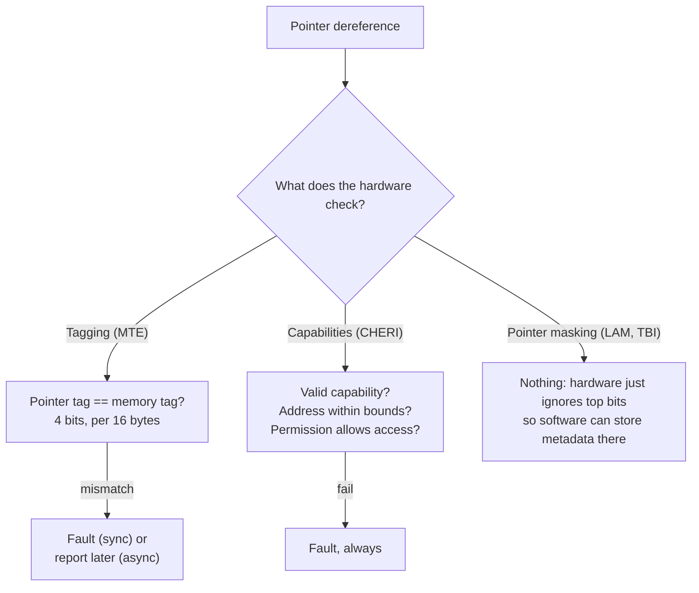
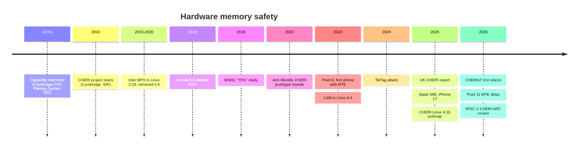
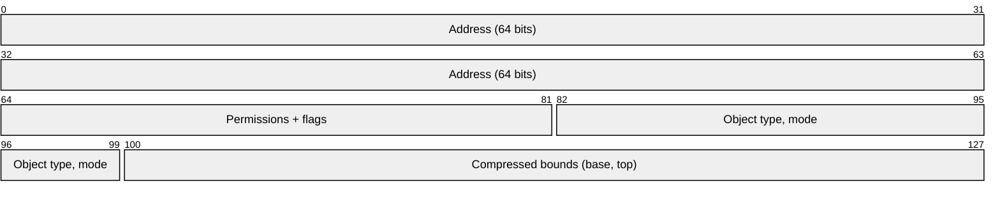

---
tags:
  - operating-systems
  - security
  - memory-safety
  - arm-mte
  - cheri
  - kasan
  - hardware
status: draft
sources:
  - https://msrc.microsoft.com/blog/2019/07/a-proactive-approach-to-more-secure-code/
  - https://www.chromium.org/Home/chromium-security/memory-safety/
  - https://docs.kernel.org/dev-tools/kasan.html
  - https://docs.kernel.org/arch/arm64/memory-tagging-extension.html
  - https://en.wikipedia.org/wiki/Intel_MPX
  - https://arichardson.github.io/riscv-cheri/
  - https://ctsrd-cheri.github.io/morello-early-performance-results/
  - https://lwn.net/Articles/1037974/
  - https://cheriot.org/
  - https://tech.eu/
  - https://github.com/riscv/riscv-cheri/issues/1337
  - https://security.apple.com/blog/memory-integrity-enforcement/
  - https://blog.calif.io/
  - https://googleprojectzero.blogspot.com/2023/11/first-handset-with-mte-on-market.html
  - https://9to5google.com/2025/06/04/android-16-advanced-protection/
  - https://www.androidauthority.com/
  - https://arxiv.org/abs/2406.08719
  - https://www.vusec.net/projects/stickytags/
  - https://lwn.net/Articles/1020476/
  - https://arxiv.org/abs/2610.11525
  - https://www.gov.uk/government/publications/cheri-adoption-and-diffusion-research
created: 2026-11-26
updated: 2026-11-26
---

## Table Of Contents

---

- [[#TL;DR|TL;DR]]
- [[#The Problem|The Problem]]
- [[#Foundations|Foundations]]
    - [[#Two Kinds of Memory Bug|Two Kinds of Memory Bug]]
    - [[#Three Hardware Approaches|Three Hardware Approaches]]
- [[#How We Got Here|How We Got Here]]
- [[#How It Works|How It Works]]
    - [[#Memory Tagging (Arm MTE)|Memory Tagging (Arm MTE)]]
    - [[#MTE in Linux|MTE in Linux]]
    - [[#Capabilities (CHERI)|Capabilities (CHERI)]]
    - [[#The Same Bug Under Each Scheme|The Same Bug Under Each Scheme]]
    - [[#Pointer Masking (LAM and Friends)|Pointer Masking (LAM and Friends)]]
- [[#Where It Is Now|Where It Is Now]]
- [[#Trade-offs & Open Problems|Trade-offs & Open Problems]]
- [[#Resources|Resources]]
- [[#Related Notes|Related Notes]]

## ***TL;DR***
---
*About 70% of serious security bugs in large C and C++ codebases are memory-safety bugs. Hardware memory safety lets the CPU itself catch out-of-bounds and use-after-free accesses, so old C code gets some protection without being rewritten.*

- **Memory tagging (Arm MTE).** Every 16 bytes of memory gets a 4-bit tag, and every pointer carries a 4-bit tag in its unused top bits. A load or store whose tags don't match traps. Cheap and backward-compatible, but *probabilistic*: a random tag matches by chance 1 time in 16.
- **Capabilities (CHERI).** Pointers become 128-bit *capabilities* that carry bounds and permissions, guarded by a hidden validity bit the program can't forge. Out-of-bounds access is *deterministically* impossible; the price is recompiling software and bigger pointers.
- **The kernel's role.** The OS allocates tag storage, sets tags on its own allocations (Linux's hardware-tag KASAN), exposes tagging to processes (`PROT_MTE`, `prctl`), reports faults as signals, and, for CHERI, becomes a capability-aware kernel itself.
- **Late 2026.** MTE is on in production: Apple's Memory Integrity Enforcement (iPhone 17, September 2025) runs it always-on in the kernel and 70+ processes, and Android exposes it on Pixels and in Advanced Protection. CHERI has its first commercial silicon (CHERIoT, March 2026) and a CHERI Linux port, but the RISC-V CHERI standard is still not ratified.

## ***The Problem***
---
*Decades of mitigations have made memory-corruption bugs harder to exploit, but not rarer. Rewriting everything in safe languages will take decades, so the hardware is being asked to help with the code that already exists.*

- **The scale.** Microsoft found about 70% of its CVEs each year were memory-safety issues ([MSRC, 2019](https://msrc.microsoft.com/blog/2019/07/a-proactive-approach-to-more-secure-code/)). Chromium found the same 70% among 912 high or critical bugs, half of them use-after-free ([Chromium](https://www.chromium.org/Home/chromium-security/memory-safety/)).
- **The kernel.** Linux is tens of millions of lines of C. [[Rust in the Linux Kernel|Rust]] covers new drivers, and [[Kernel Security Hardening|hardening]] makes bugs harder to exploit, but neither fixes the existing C.
- **Governments got involved.** The UK backed CHERI with over £80M of public money and about £200M from industry, per a May 2025 government report ([UK DSIT](https://www.gov.uk/government/publications/cheri-adoption-and-diffusion-research)), and US agencies (CISA and NSA) published joint memory-safety guidance in June 2025.
- **Software checkers are too slow for production.** Address sanitizers catch these bugs reliably in testing, but their roughly 2× slowdown and memory cost keep them out of shipping devices. Hardware can make the checks almost free.

## ***Foundations***
---
*Memory-safety bugs come in two shapes, spatial and temporal. The hardware approaches differ in how well and how cheaply they catch each.*

### Two Kinds of Memory Bug

| Kind | Bug | Example |
|---|---|---|
| **Spatial** | Access outside an object's bounds | Buffer overflow, `p[n]` on an `n`-element array |
| **Temporal** | Access to an object after it's freed or before it's allocated | Use-after-free, double free |

Spatial safety needs the pointer to know its bounds. Temporal safety needs the hardware or allocator to know an object is dead, which is harder: some other pointer to the old object may still exist anywhere in memory.

### Three Hardware Approaches



*Tagging is a lock-and-key check; capabilities are an unforgeable pointer with a built-in fence; pointer masking only frees up room for software schemes to build on.*

## ***How We Got Here***
---
*Capabilities go back to the 1960s and 70s; memory tagging is newer. A failed mainstream attempt, Intel MPX, shaped how cautious everyone has been since.*



- **Capability machines.** The idea that a pointer should be an unforgeable token with rights attached dates to 1970s research machines. Cambridge and SRI's **CHERI** project (from 2010) revived it as an extension to existing instruction sets, so C could be recompiled rather than rewritten.
- **Intel MPX: the cautionary tale.** Intel's Memory Protection Extensions added bounds registers for C pointers. They cost about 50% on average and up to 4× in the worst case, broke common C idioms, and missed temporal bugs. Linux supported MPX from 3.19 and removed it in 5.6 ([Wikipedia](https://en.wikipedia.org/wiki/Intel_MPX)); GCC dropped it too.
- **MTE (2018).** Arm defined the Memory Tagging Extension in Armv8.5-A. It took five years to reach a phone: the **Pixel 8** in 2023 was the first production device that could turn it on ([Project Zero](https://googleprojectzero.blogspot.com/2023/11/first-handset-with-mte-on-market.html)).
- **Morello (2022).** Arm built CHERI prototype server boards for researchers, the first large-scale test of CHERI on a real out-of-order core.
- **2025.** Apple launched always-on MTE (MIE) on the iPhone 17, and a CHERI RISC-V core ran a purecap Linux 6.16 port ([LWN](https://lwn.net/Articles/1037974/)).

## ***How It Works***
---
*MTE is a small addition to existing memory that the kernel manages; CHERI changes what a pointer is, so the kernel has to be ported to it.*

### Memory Tagging (Arm MTE)

Per the Linux arm64 documentation ([kernel docs](https://docs.kernel.org/arch/arm64/memory-tagging-extension.html)):

- **Memory tags.** Each 16-byte *granule* of tagged memory has a 4-bit tag, stored by the memory system out of band.
- **Pointer tags.** A pointer carries its 4-bit tag in **bits 59:56**, which Arm's *Top Byte Ignore* already lets the CPU skip during address translation.
- **Instructions.** `IRG` picks a random tag for a pointer; `STG`, `ST2G` and `STZG` set the tag on one or two granules (`STZG` also zeroes them); `DC GVA` tags a whole cache line.
- **Check modes.** *Synchronous* faults on the exact instruction (`SIGSEGV` with `SEGV_MTESERR` and the faulting address); *asynchronous* only sets a flag and reports later (`SEGV_MTEAERR`, no address); *asymmetric* checks reads synchronously and writes asynchronously.

Storage overhead is 4 bits per 16 bytes:

$$
\frac{4\ \text{bits}}{16 \times 8\ \text{bits}} = \frac{4}{128} = 3.125\%
$$

*In plain words: about 3% of RAM goes to tags. On a 16 GB phone that's 512 MB, set aside by the memory controller rather than the OS.*

Detection is probabilistic. With 16 tag values and a random choice per allocation, a stale or wild pointer has a 1-in-16 chance of carrying the right tag by accident:

$$
P(\text{detect}) = 1 - \frac{1}{16} = 93.75\%
$$

*In plain words: each bad access is caught about 15 times in 16. Allocators improve on this by never giving neighbouring objects the same tag, which makes adjacent overflows certain to be caught, and reserving tags for freed memory.*

### MTE in Linux

**For processes.** A process opts in per thread and per mapping ([kernel docs](https://docs.kernel.org/arch/arm64/memory-tagging-extension.html)):

```c
#include <sys/prctl.h>
#include <sys/mman.h>

/* Enable tagged addresses and synchronous tag-check faults. */
prctl(PR_SET_TAGGED_ADDR_CTRL,
      PR_TAGGED_ADDR_ENABLE | PR_MTE_TCF_SYNC |
      (0xfffe << PR_MTE_TAG_SHIFT),   /* tags IRG may generate */
      0, 0, 0);

/* Only mappings created with PROT_MTE have tag storage. */
void *heap = mmap(NULL, 1 << 20, PROT_READ | PROT_WRITE | PROT_MTE,
                  MAP_PRIVATE | MAP_ANONYMOUS, -1, 0);
```

*In plain words: the first call tells the kernel "check my pointers and trap immediately on a mismatch"; the second asks for memory that actually has tags. A tagging allocator like Android's Scudo then sets tags on every `malloc`.*

- `PROT_MTE` works on anonymous and tmpfs/shared-memory mappings.
- A system-wide preference (`/sys/devices/system/cpu/cpuN/mte_tcf_preferred`) lets the admin upgrade or downgrade the mode per CPU.
- Debuggers read and write tags with `PTRACE_PEEKMTETAGS` and `PTRACE_POKEMTETAGS`, and tags are saved with swapped-out pages.

**For the kernel itself.** The kernel's own allocations are checked by **KASAN**, which has three modes ([kernel docs](https://docs.kernel.org/dev-tools/kasan.html)):

| KASAN mode | Mechanism | Meant for |
|---|---|---|
| Generic | Software shadow memory on every access | Debugging (high overhead) |
| Software tags | Pointer tags checked by compiler-inserted code (arm64) | Testing on real workloads |
| **Hardware tags** | MTE does the checks | **Production** use |

Hardware-tag KASAN takes `kasan.mode=sync|async|asymm` at boot, and tag `0xFF` is a match-all tag while `0xFE` marks freed memory. In 2025 Arm's FEAT_MTE_STORE_ONLY, which checks only stores for lower overhead, was queued for arm64 including KVM guests ([LWN](https://lwn.net/Articles/1020476/)).

### Capabilities (CHERI)

On CHERI, a pointer is a **capability**: a 128-bit value (on 64-bit systems) holding the address, compressed bounds, permissions and an object type, plus a **1-bit validity tag** stored out of band that the program cannot set ([RISC-V CHERI spec](https://arichardson.github.io/riscv-cheri/)):



*The 128 bits shown here plus one hidden validity bit make a capability. The field split is simplified; the spec packs permissions and bounds more tightly.*

- **Monotonicity.** Instructions can only *shrink* a capability's bounds or *remove* permissions, never grow them. A pointer to an array can be narrowed to one element, but no code can widen it back.
- **Unforgeable.** Writing ordinary data over a capability clears its validity bit, so an attacker who overwrites a pointer in memory gets an unusable integer.
- **Hybrid vs purecap.** *Hybrid* code mixes normal pointers and capabilities, good for porting step by step. *Purecap* code uses capabilities for every pointer, including the stack and return addresses, for full protection.
- **Kernel work.** A CHERI kernel must keep validity tags intact through swap and copy-on-write, hand processes capabilities instead of raw pointers at `mmap` and `execve`, and check every capability it receives in a system call. [[Microkernels and seL4|seL4's]] software capabilities are a natural fit, and CheriBSD (FreeBSD) has been the reference OS for years.

Costs measured on Morello for SPECint2006: 15.17% slower for unmodified purecap code, 7.72% and 6.28% after compiler and microarchitecture fixes, and an estimated 2.2–3.2% for a mature design ([CTSRD](https://ctsrd-cheri.github.io/morello-early-performance-results/)). Tag storage itself is under 1% of memory, but pointer-heavy programs can use up to 66% more memory because each pointer doubles in size.

### The Same Bug Under Each Scheme

```c
char *p = malloc(32);
p[32] = 'x';      /* (1) one byte past the end */
free(p);
char c = p[0];    /* (2) use after free */
```

| Scheme | (1) Overflow | (2) Use-after-free |
|---|---|---|
| Plain C | Silent corruption | Reads whatever is there now |
| MTE (sync) | Fault, if the next granule has a different tag (allocators ensure it does) | Fault ~15/16 times: `free` retagged the memory |
| CHERI purecap | Fault, always: address outside the capability's bounds | **Not caught** unless the allocator *revokes* old capabilities (sweeps memory to invalidate them) |
| MPX (historical) | Fault | Not caught |

*MTE is weaker but covers both bug kinds; CHERI is airtight on bounds but needs extra revocation machinery for use-after-free. Production CHERI allocators add revocation.*

### Pointer Masking (LAM and Friends)

Intel's **Linear Address Masking** (Linux 6.4), Arm's Top Byte Ignore and RISC-V's pointer-masking extensions (Smmpm, Smnpm, Ssnpm, ratified at v1.0) let the CPU ignore some high pointer bits. They do no checking themselves; they let software tag pointers cheaply, as hardware-assisted sanitizers and some garbage collectors do. They're the foundation tagging needs, not memory safety on their own.

## ***Where It Is Now***
---
*As of November 2026, memory tagging has crossed into consumer devices, led by Apple. CHERI is moving from research to its first products, but the big CPU vendors haven't committed to it.*

**Arm MTE in products**

| Platform | What shipped | Source |
|---|---|---|
| Apple (Sep 2025) | **Memory Integrity Enforcement**: Enhanced MTE in always-on synchronous mode, plus typed allocators (`kalloc_type`, xzone malloc) and tag confidentiality against speculative tag leaks; covers the kernel and over 70 processes on iPhone 17 (A19), later M5 Macs | [Apple Security](https://security.apple.com/blog/memory-integrity-enforcement/) |
| Android 13+ / Pixel 8–10 | Per-app opt-in (`memtagMode`), developer option for full MTE | [Project Zero](https://googleprojectzero.blogspot.com/2023/11/first-handset-with-mte-on-market.html) |
| Android 16 (Jun 2025) | MTE part of Advanced Protection mode | [9to5Google](https://9to5google.com/2025/06/04/android-16-advanced-protection/) |
| GrapheneOS | MTE enabled on supported Pixels since 2023 | GrapheneOS project |
| Pixel 11 (2026) | MTE disabled at launch, reported to return with Android 17 QPR2 around mid-November 2026 | [Android Authority](https://www.androidauthority.com/) |

- **MIE was bypassed anyway.** In May 2026, Calif published a data-only kernel exploit on macOS 26.4.1 on an M5 that works without violating tags ([Calif](https://blog.calif.io/)). Tagging stops pointer misuse, not logic bugs that corrupt data through valid pointers.
- **Side channels on tags.** **TikTag** (2024) used speculative execution to leak MTE tags with over 95% success in under 4 seconds, which lets an attacker forge the right tag ([arXiv](https://arxiv.org/abs/2406.08719)); Apple's tag-confidentiality feature targets exactly this. VUSec's **StickyTags** proposed a different tagging design with 4.0% overhead against 20.2% for a comparable baseline ([VUSec](https://www.vusec.net/projects/stickytags/)).
- **Server costs.** A 2026 database study found MTE in synchronous mode cost Redis about 1% and LevelDB about 7%, while CHERI on Morello cost Redis about 5% and LevelDB about 53% ([arXiv](https://arxiv.org/abs/2610.11525)).

**CHERI**

- **First commercial silicon.** SCI Semiconductor's ICENI, a CHERIoT microcontroller, shipped first silicon in March 2026 ([CHERIoT](https://cheriot.org/)); SCI raised £5M in September 2026 ([tech.eu](https://tech.eu/)). CHERIoT is a small embedded profile with its own RTOS.
- **Linux on CHERI.** Codasip's X730 RISC-V core, with under 5% area and under 5% performance cost, ran a purecap Linux 6.16 in late August 2025; porting KDE needed about 0.02% of its lines changed ([LWN](https://lwn.net/Articles/1037974/)). CHERI Linux is out of tree.
- **Standardization slipped.** The RISC-V CHERI ("RVY") spec was at v0.9.8.2 in May 2026 and is not ratified; RISC-V's Architecture Review Committee was reviewing v0.9.10.1 in November 2026, behind the original 2025 plan ([GitHub](https://github.com/riscv/riscv-cheri/issues/1337)).
- **No x86 CHERI.** Neither Intel nor AMD has announced capability hardware; Arm hasn't committed to CHERI beyond Morello.

## ***Trade-offs & Open Problems***
---
*Tagging is shipping because it's cheap and needs no recompiling, even though it's only probabilistic. CHERI is stronger but asks the whole software stack to move.*

| | Arm MTE | CHERI | Software only (Rust, sanitizers) |
|---|---|---|---|
| Spatial safety | Probabilistic, strong for adjacent overflows | Deterministic | Rust: deterministic in safe code |
| Temporal safety | Probabilistic | Needs revocation | Rust: yes; sanitizers: testing only |
| Recompile needed | No (allocator change only) | Yes, plus porting | Rewrite (Rust) |
| Memory overhead | 3.125% tags | <1% tags, up to 66% bigger pointers | None (Rust) |
| Speed | ~1–7% (sync), less async | ~2–15% on Morello, varies | ~0 (Rust); ~2× (sanitizers) |
| Main weakness | Tag leaks, 1/16 guess | Ecosystem and silicon | Legacy C stays unsafe |

**Open problems**

- **Probabilistic isn't proof.** An attacker who can retry, or leak tags through [[Transient Execution Attacks and Mitigations|speculation]] (TikTag), can beat 4-bit tags. Apple's answer was more hardware; most Android devices don't have it.
- **Async mode's gap.** Asynchronous checking is cheap but reports a fault after the bad access has already happened, so an exploit can finish first.
- **Data-only attacks.** Neither scheme stops corruption through *valid* pointers, as the 2026 MIE bypass shows. [[Kernel Security Hardening]] and [[Formally Verified OS Components|verification]] still matter.
- **CHERI's chicken and egg.** Software won't port without hardware, and the big vendors won't build hardware without software. CHERIoT and Codasip are the test.
- **Temporal safety on CHERI.** Revocation sweeps cost time and memory, and the kernel must cooperate in them.
- **Rust vs hardware.** [[Rust in the Linux Kernel|Rust]] fixes new code at compile time with no hardware; tagging and capabilities protect the old C. Most practitioners see them as complementary, but budget arguments pit them against each other.

## ***Resources***
---
*The Linux documentation explains the kernel interface; Apple's MIE post is the best account of a production deployment.*

**Kernel documentation**
- [Memory Tagging Extension (MTE) in AArch64 Linux](https://docs.kernel.org/arch/arm64/memory-tagging-extension.html).
- [The Kernel Address Sanitizer (KASAN)](https://docs.kernel.org/dev-tools/kasan.html).

**Deployments**
- [Memory Integrity Enforcement](https://security.apple.com/blog/memory-integrity-enforcement/): Apple Security Research, 2025.
- [First handset with MTE on the market](https://googleprojectzero.blogspot.com/2023/11/first-handset-with-mte-on-market.html): Project Zero, 2023.

**CHERI**
- [RISC-V CHERI specification](https://arichardson.github.io/riscv-cheri/).
- [Morello early performance results](https://ctsrd-cheri.github.io/morello-early-performance-results/): Cambridge.
- [CHERI Linux on a RISC-V core](https://lwn.net/Articles/1037974/): LWN, 2025.
- [CHERIoT](https://cheriot.org/).

**Research**
- [TikTag](https://arxiv.org/abs/2406.08719), [StickyTags](https://www.vusec.net/projects/stickytags/), [MTE and CHERI for databases](https://arxiv.org/abs/2610.11525).
- [A proactive approach to more secure code](https://msrc.microsoft.com/blog/2019/07/a-proactive-approach-to-more-secure-code/): MSRC, 2019.

## ***Related Notes***
---
*Hardware memory safety joins language, allocator and kernel defences against memory corruption.*

- [[Kernel Security Hardening]] — Software defences against the same bugs.
- [[Rust in the Linux Kernel]] — Memory safety from the language instead of the hardware.
- [[Memory Allocators]] — Where tags are assigned and freed memory retagged.
- [[Virtual Memory and Paging]] — Top-byte ignore, tagged mappings and tag storage.
- [[Microkernels and seL4]] — Software capabilities, CHERI's natural partner.
- [[Kernel Architectures]] — How cheaper isolation hardware changes OS design.
- [[Unikernels and Library OSes]] — Single-address-space systems that need in-process safety.
- [[Transient Execution Attacks and Mitigations]] — Speculative leaks of MTE tags.
- [[Address Space Isolation]] — Another structural fix, for leaks instead of corruption.
- [[Formally Verified OS Components]] — Proving code correct instead of catching bugs at run time.
- [[Confidential Computing]] — Another job moved from software to the CPU.
- [[Garbage Collection]] — Pointer tagging and safe memory reuse in managed runtimes.
- [[LLVM]] — The compiler that builds purecap CHERI code.
