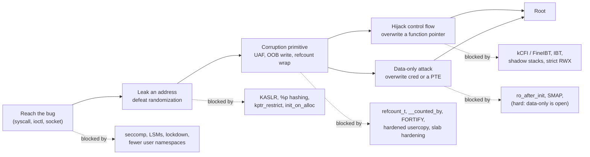
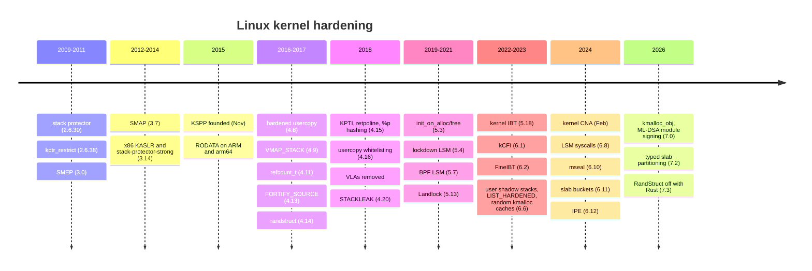

---
tags:
  - operating-systems
  - security
  - kernel-hardening
  - kaslr
  - cfi
  - lsm
  - kspp
status: draft
sources:
  - https://docs.kernel.org/security/self-protection.html
  - https://outflux.net/slides/2016/cs/kspp.pdf
  - https://events19.linuxfoundation.org/wp-content/uploads/2017/12/Overview-and-Recent-Developments-Kernel-Self-Protection-Project_Kees-Cook.pdf
  - https://lwn.net/Articles/693038/
  - https://lwn.net/Articles/786044
  - https://lwn.net/Articles/764325/
  - https://lwn.net/Articles/884297/
  - https://lwn.net/Articles/1011680/
  - https://lwn.net/Articles/1039633/
  - https://lwn.net/Articles/1059772/
  - https://lwn.net/Articles/1067250/
  - https://lore.kernel.org/linux-mm/20190529123812.43089-2-glider@google.com/T/
  - https://lkml.indiana.edu/2210.0/00259.html
  - https://lkml.iu.edu/hypermail/linux/kernel/2401.0/04584.html
  - https://lkml.iu.edu/hypermail/linux/kernel/2602.1/01805.html
  - https://source.android.com/docs/security/test/kcfi
  - https://www.phoronix.com/news/Indirect-Branch-Tracking-5.18
  - https://www.phoronix.com/news/Intel-Shadow-Stack-Linux-6.6
  - https://www.phoronix.com/news/Linux-SLUB-Prevent-Cross-Cache
  - https://phoronix.com/news/Linux-6.12-IPE-LSM-Security
  - https://www.phoronix.com/news/Linux-7.2-Slab
  - https://phoronix.com/news/Linux-7.2-rc3-BPF-Hardening
  - https://www.phoronix.com/news/Linux-7.3-RandStruct-Rust
  - https://phoronix.com/news/Linux-Kernel-CVEs-Nearly-2000
  - https://blog.trailofbits.com/2024/10/25/a-deep-dive-into-linuxs-new-mseal-syscall/
  - https://openwall.com/lists/kernel-hardening/2025/09/05/1
  - https://www.ndss-symposium.org/wp-content/uploads/2026-f862-paper.pdf
  - https://ratatoskr.run/lkml/2026/02/3408257/t
  - https://ratatoskr.run/lkml/2026/04/3512221/t
  - https://ratatoskr.run/linux-kbuild/2026/05/8996852/t
  - https://ratatoskr.run/lkml/2026/09/17499626/t
  - https://tuxcare.com/blog/the-linux-kernel-cve-flood-continues-unabated-in-2025-2/
  - https://linuxiac.com/linux-kernel-7-0-released/
  - https://linuxiac.com/linux-kernel-7-3-is-out-with-new-failfs-scheduler-changes-and-more/
created: 2026-11-26
updated: 2026-11-26
---

## Table Of Contents

---

- [[#TL;DR|TL;DR]]
- [[#The Problem|The Problem]]
- [[#Foundations|Foundations]]
    - [[#The Exploit Chain|The Exploit Chain]]
    - [[#Kill Bugs, Kill Classes, Kill Methods|Kill Bugs, Kill Classes, Kill Methods]]
    - [[#The Four Families of Defence|The Four Families of Defence]]
- [[#How We Got Here|How We Got Here]]
- [[#How It Works|How It Works]]
    - [[#Randomization — KASLR and Friends|Randomization — KASLR and Friends]]
    - [[#Separating Kernel From User — SMEP, SMAP, PAN|Separating Kernel From User — SMEP, SMAP, PAN]]
    - [[#Making Memory Immutable — Strict RWX and ro_after_init|Making Memory Immutable — Strict RWX and ro_after_init]]
    - [[#Killing Bug Classes — refcount_t, Bounds and Initialization|Killing Bug Classes — refcount_t, Bounds and Initialization]]
    - [[#Heap Hardening and Cross-Cache Attacks|Heap Hardening and Cross-Cache Attacks]]
    - [[#Control-Flow Integrity — kCFI, IBT, FineIBT, Shadow Stacks|Control-Flow Integrity — kCFI, IBT, FineIBT, Shadow Stacks]]
    - [[#Policy — LSMs, Lockdown, seccomp, mseal|Policy — LSMs, Lockdown, seccomp, mseal]]
    - [[#What Each Defence Costs|What Each Defence Costs]]
- [[#Where It Is Now|Where It Is Now]]
- [[#Trade-offs & Open Problems|Trade-offs & Open Problems]]
- [[#Resources|Resources]]
- [[#Related Notes|Related Notes]]

## ***TL;DR***
---
*Linux is millions of lines of C and gains thousands of CVEs a year, so bugs will always exist. Hardening accepts that and makes each bug much harder to turn into a working exploit: randomize where things are, forbid the kernel from touching user memory, make code and key data read-only, turn whole bug classes into harmless failures, and check every indirect jump.*

- **The threat model** is an unprivileged local user who has found a kernel bug and wants root. The kernel's own guidance assumes the worst case: that attacker can eventually read and write arbitrary kernel memory ([kernel docs](https://docs.kernel.org/security/self-protection.html)).
- **A real exploit is a chain:** an information leak to defeat randomization, a memory-corruption primitive (use-after-free, out-of-bounds write, refcount overflow), then either a control-flow hijack or a *data-only* attack (overwrite credentials or page tables) to escalate privilege. Each hardening feature breaks one link.
- **The Kernel Self Protection Project (KSPP)**, started by Kees Cook in 2015, has upstreamed most of the defences: KASLR, SMEP/SMAP, strict RWX, `refcount_t`, hardened usercopy, `init_on_alloc`, STACKLEAK, kCFI, randomized slab caches and `__counted_by` bounds checking.
- **Cost:** most features are under 1% on typical workloads; a few (wiping memory on free, STACKLEAK) cost 4–8% on syscall-heavy benchmarks, which is why they're opt-in ([lore](https://lore.kernel.org/linux-mm/20190529123812.43089-2-glider@google.com/T/); [LWN](https://lwn.net/Articles/764325/)).
- **Late 2026:** the bug flood is bigger than ever (Linux 7.3 approached **2,000 CVEs** in one release cycle, [Phoronix](https://phoronix.com/news/Linux-Kernel-CVEs-Nearly-2000)). Allocation moved from size-based to **type-based** (`kmalloc_obj`, compiler allocation tokens in 7.2), cross-cache heap attacks remain the main open gap, and [[Rust in the Linux Kernel|Rust]] now wins when it conflicts with C-only hardening (RandStruct off by default with Rust in 7.3).

## ***The Problem***
---
*Kernel bugs live for years before anyone fixes them, and attackers find them first. Fixing bugs one at a time can't keep up, so the kernel must make the bugs it hasn't found yet unexploitable.*

The numbers that started KSPP, from Kees Cook's analysis of Ubuntu kernel CVEs from 2011–2018 ([LF slides](https://events19.linuxfoundation.org/wp-content/uploads/2017/12/Overview-and-Recent-Developments-Kernel-Self-Protection-Project_Kees-Cook.pdf)):

| Severity | Bugs | Average years from introduction to fix |
|---|---|---|
| Critical | 3 | 5.3 |
| High | 79 | 5.6 |
| Medium | 691 | 5.9 |
| Low | 349 | 6.2 |

*In plain words: a typical kernel bug sits in shipped kernels for over five years.* Attackers watch commits, keep their 0-days private, and only need one working bug; defenders must fix all of them. Cook's summary: "whack-a-mole is not a solution."

The flood has only grown. Since the kernel became its own CVE Numbering Authority in February 2024, it assigns CVEs to most bug fixes: **3,529** in 2024, and about 8–9 per day in early 2025 ([TuxCare](https://tuxcare.com/blog/the-linux-kernel-cve-flood-continues-unabated-in-2025-2/)). Per release, the count rose from about 500 (6.9 to 6.19) to over 1,000 from 7.0 onward, over 1,500 in 7.2 and nearly 2,000 in 7.3 ([Phoronix, Aug 2026](https://phoronix.com/news/Linux-Kernel-CVEs-Nearly-2000)).

Why the kernel is a prime target:

- **It holds everything.** One write to the right `struct cred` makes a process root; one write to a [[Virtual Memory and Paging|page-table entry]] maps any physical memory.
- **It's reachable.** Every [[System Calls and the User-Kernel Boundary|system call]], ioctl, socket option and file system is attack surface for an unprivileged user, and [[Containers, Namespaces and cgroups|unprivileged user namespaces]] expose even more.
- **It's C.** Use-after-free, out-of-bounds access and integer overflow are easy to write and hard to spot in review.

The two alternatives each have limits: [[Formally Verified OS Components|verification]] works only for small cores, and [[Rust in the Linux Kernel|Rust]] removes bug classes only in new code. Hardening protects the 30+ million lines already there.

## ***Foundations***
---
*Hardening is easiest to understand as a map from the steps of an exploit to the defence that blocks each step. The KSPP's guiding rule is to prefer defences that kill a whole class of bugs or a whole exploitation method over fixing individual bugs.*

### The Exploit Chain

"Modern attacks tend to chain more than one flaw" ([Cook, 2016](https://outflux.net/slides/2016/cs/kspp.pdf)). A typical local privilege escalation, with the defence aimed at each step:



*Read it as: every exploit has to get through each column, and each column has its own defences. Data-only attacks are the weakest column because the data an attacker wants (credentials, page tables) must stay writable.*

### Kill Bugs, Kill Classes, Kill Methods

KSPP ranks defences by reach: killing one bug < killing a bug *class* < killing an *exploitation method* ([LF slides](https://events19.linuxfoundation.org/wp-content/uploads/2017/12/Overview-and-Recent-Developments-Kernel-Self-Protection-Project_Kees-Cook.pdf)).

| Level | Example | Effect |
|---|---|---|
| Kill a bug | A one-line fix in a driver | Stops this exploit only |
| Kill a class | `refcount_t` saturation | No refcount overflow anywhere can become a use-after-free |
| Kill a method | SMAP | No exploit can make the kernel read a fake structure from user memory |

The kernel's own principles add that the ideal defence is effective, on by default, needs no opt-in from developers, has no performance cost, doesn't hinder debugging, and has tests. Few meet all six ([kernel docs](https://docs.kernel.org/security/self-protection.html)).

### The Four Families of Defence

The kernel's self-protection doc ([kernel docs](https://docs.kernel.org/security/self-protection.html)) groups everything into four families:

| Family | Idea | Main mechanisms |
|---|---|---|
| **Attack-surface reduction** | Fewer ways in, no writable code | Strict kernel/module RWX, `const` function pointers, `__ro_after_init`, SMEP/SMAP and PXN/PAN, seccomp, module signing, LoadPin |
| **Memory integrity** | Detect or neutralize corruption | Stack canaries, shadow stacks, guard pages, freelist checks, `refcount_t` saturation, integer-overflow detection |
| **Probabilistic defences** | Hide where things are | KASLR, randomized stack and heap bases, randomized struct layout |
| **Information exposure** | Don't hand out secrets | Hashed `%p` pointers (since 4.15), full initialization of memory copied to user space, clearing memory on free, wiping the stack on syscall return |

Probabilistic defences have a weakness the doc states plainly: randomization "makes information leaks more valuable." One leaked pointer and KASLR is gone, which is why [[Transient Execution Attacks and Mitigations|Meltdown-style leaks]] hit it so hard.

## ***How We Got Here***
---
*Linux hardening grew in three waves: early basics (stack protector, NX), the KSPP upstreaming of grsecurity/PaX ideas after 2015, and from 2022 a compiler-driven wave of control-flow integrity, bounds annotations and type-aware allocation.*



- **Before 2015.** Hardening arrived piecemeal: `-fstack-protector` in 2.6.30, `kptr_restrict` in 2.6.38, KASLR on x86 in 3.14 ([Cook, 2016](https://outflux.net/slides/2016/cs/kspp.pdf)). Far stronger patches existed out of tree in **grsecurity/PaX**, but they were maintained as one large set and never upstreamed by their authors.
- **November 2015: KSPP.** Kees Cook started the Kernel Self Protection Project to upstream those ideas in mergeable pieces. Its method was to take a PaX concept, rewrite it to upstream standards, and argue it through review. PaX's `PAX_REFCOUNT` became `refcount_t` ([LWN, 2016](https://lwn.net/Articles/693038/)); PaX's STACKLEAK was upstreamed by Alexander Popov, aimed at 4.20 ([LWN, 2018](https://lwn.net/Articles/764325/)).
- **2018: Meltdown.** [[Transient Execution Attacks and Mitigations|Meltdown]] turned KASLR from a nuisance into a broken promise (any process could read kernel addresses) and brought KPTI. The same release cycle (4.15–4.19) added `%p` hashing, usercopy whitelisting and the removal of all variable-length arrays from the kernel ([LF slides](https://events19.linuxfoundation.org/wp-content/uploads/2017/12/Overview-and-Recent-Developments-Kernel-Self-Protection-Project_Kees-Cook.pdf)).
- **2022–2023: CFI lands.** Intel's Indirect Branch Tracking came to the kernel in 5.18 ([Phoronix](https://www.phoronix.com/news/Indirect-Branch-Tracking-5.18)); Clang's **kCFI** was merged for 6.1 without the old LTO requirement ([pull](https://lkml.indiana.edu/2210.0/00259.html)); **FineIBT** combined the two in 6.2 ([LWN](https://lwn.net/Articles/1011680/)). User-space shadow stacks followed in 6.6 ([Phoronix](https://www.phoronix.com/news/Intel-Shadow-Stack-Linux-6.6)).
- **2024–2026: types and bounds.** The work moved into the compiler: `__counted_by` annotations so flexible arrays carry their length, type-based allocation (`kmalloc_obj`), and compiler-generated allocation tokens to separate object types in the heap.

## ***How It Works***
---
*Each defence targets one step of the chain. This section goes through them in chain order, with the code and costs that make each concrete.*

### Randomization — KASLR and Friends

`CONFIG_RANDOMIZE_BASE` loads the kernel image at a random offset at boot, and modules at a separate random offset ([kernel docs](https://docs.kernel.org/security/self-protection.html)). An attacker who wants to call `commit_creds()` or overwrite `modprobe_path` must first learn where they are.

Entropy is limited: on x86-64 the kernel text slides within a 1 GiB window at 2 MiB alignment.

$$
\text{entropy} = \log_2\!\left(\frac{\text{window}}{\text{alignment}}\right) = \log_2\!\left(\frac{2^{30}}{2^{21}}\right) = 9 \text{ bits}
$$

*In plain words: there are only 512 possible positions, so a blind guess succeeds 1 time in 512, and any single leaked kernel pointer reveals the offset for the whole image.* (The 1 GiB and 2 MiB figures are the standard x86-64 layout; check `Documentation/arch/x86/x86_64/mm.rst` for a specific version.)

**FGKASLR** (function-granular KASLR) shuffled every function separately so one leak reveals only one function. v10 (February 2022) cost about 1 second of extra boot time, about 1% on kernel builds, and grew the compressed image about 15%, and it was never merged ([LWN](https://lwn.net/Articles/884297/)). OpenBSD's **KARL** takes a different route: it relinks the kernel in a random order on every boot.

Supporting measures keep the offset secret: `%p` in `printk` prints hashed values, `kptr_restrict` hides `/proc/kallsyms` addresses, and memory copied to user space is fully initialized so it can't carry stale pointers.

### Separating Kernel From User — SMEP, SMAP, PAN

Before 2011, a classic exploit overwrote a kernel function pointer with the address of attacker code *in user memory*, which the kernel happily executed. Hardware now forbids both halves:

| Feature | Arch | Blocks |
|---|---|---|
| **SMEP** / PXN | x86 / Arm | Kernel *executing* user pages |
| **SMAP** / PAN | x86 / Arm | Kernel *reading or writing* user pages outside explicit `copy_from_user`/`copy_to_user` windows (`stac`/`clac` on x86) |

SMAP also stops "fake object" attacks, where the kernel is tricked into following a pointer to a forged structure in user memory. Intel's 2025 FineIBT+BHI design leans on it: a poisoned pointer with zeroed upper bits looks like a user address, so SMAP traps any speculative use of it ([LWN](https://lwn.net/Articles/1039633/)).

### Making Memory Immutable — Strict RWX and ro_after_init

`CONFIG_STRICT_KERNEL_RWX` and `CONFIG_STRICT_MODULE_RWX` ensure no kernel memory is both writable and executable; JITs and runtime patching (alternatives, static calls, [[eBPF]]) get brief controlled write windows ([kernel docs](https://docs.kernel.org/security/self-protection.html)).

Data that is set once at boot and never again is marked `__ro_after_init`, and tables of function pointers are declared `const`, so the linker places them in read-only sections:

```c
/* Writable only until init finishes, then the page becomes read-only. */
static unsigned long max_cmds __ro_after_init;

/* const: placed in .rodata, so an arbitrary-write bug can't redirect it. */
static const struct file_operations foo_fops = {
        .read  = foo_read,
        .write = foo_write,
};
```

*Why it matters:* function-pointer tables like `file_operations` were the favourite target for control-flow hijacks. Making them `const` means an attacker must corrupt a pointer *to* the table rather than the table itself.

### Killing Bug Classes — refcount_t, Bounds and Initialization

**`refcount_t` (4.11).** Reference counts used to be plain `atomic_t`. An attacker who could trigger an extra "get" 2³² times wrapped the counter to zero, the object was freed while still in use, and a use-after-free followed. `refcount_t` *saturates* instead: on overflow or underflow it pins the count, warns, and never changes again ([LWN](https://lwn.net/Articles/786044)).

```c
struct foo { refcount_t ref; /* ... */ };

refcount_set(&f->ref, 1);
refcount_inc(&f->ref);              /* on overflow: WARN and saturate, never wrap to 0 */
if (refcount_dec_and_test(&f->ref)) /* true only for the genuine last reference */
        kfree(f);
```

*In plain words:* a refcount bug that used to become a use-after-free (exploitable) now becomes a memory leak (harmless). That's killing a bug class: every refcount in the kernel gets the guarantee at once.

**Bounds: `__counted_by` and FORTIFY_SOURCE.** C's flexible array members have no length the compiler knows. `__counted_by(field)` tells it which struct member holds the count, so FORTIFY and UBSAN bounds checks can trap overflows at run time:

```c
struct pkt {
        u16 len;
        u8  data[] __counted_by(len);   /* the compiler now knows data has len elements */
};

p = kmalloc(struct_size(p, data, n), GFP_KERNEL);
p->len = n;          /* must be set before data[] is used */
p->data[i] = x;      /* i >= len traps under CONFIG_UBSAN_BOUNDS / FORTIFY_SOURCE */
```

Thousands of these annotations have been added since 2023; the 7.0 hardening pull (February 2026) added more and a new `__counted_by_ptr` for pointer members ([pull](https://ratatoskr.run/lkml/2026/02/3408257/t)). **Hardened usercopy** checks every `copy_to_user`/`copy_from_user` against the size of the slab object it touches, with only whitelisted regions of each object copyable.

**Initialization.** `init_on_alloc=1` zeroes every page and slab object when allocated; `init_on_free=1` zeroes on free. They kill uninitialized-memory leaks (a common KASLR bypass) and shorten the life of freed secrets ([lore](https://lore.kernel.org/linux-mm/20190529123812.43089-2-glider@google.com/T/)). **STACKLEAK** (now `CONFIG_KSTACK_ERASE`) poisons the used part of the kernel stack at the end of every syscall, so stale stack data can't leak into the next call ([LWN](https://lwn.net/Articles/764325/)).

**Stacks.** `CONFIG_STACKPROTECTOR` puts a canary before the return address; `CONFIG_VMAP_STACK` allocates kernel stacks from vmalloc space with unmapped guard pages, so a stack overflow faults instead of silently overwriting the neighbouring allocation, and `thread_info` moved off the stack into `task_struct`.

### Heap Hardening and Cross-Cache Attacks

Most modern kernel exploits are heap exploits: free an object, then reallocate its memory as a *different* object the attacker controls, and the stale pointer now points into attacker data. The kernel's allocator ([[Memory Allocators|SLUB]]) groups objects into caches by size, so the attacker sprays objects of the same size class.

| Defence | Year | What it does |
|---|---|---|
| Freelist pointer obfuscation, `SLAB_FREELIST_RANDOM` | 4.14 | Free-list pointers are XORed with a secret; allocation order is shuffled |
| `CONFIG_LIST_HARDENED` | 6.6 | Cheap integrity checks on linked-list operations |
| `RANDOM_KMALLOC_CACHES` | 6.6 | Several copies of each kmalloc cache, chosen per call site, so the attacker's spray may land in a different cache |
| `SLAB_BUCKETS` / `kmem_buckets` | 6.11 | Separate caches for allocations whose size the user controls (e.g. `msg_msg`, xattrs) |
| Typed partitioning (`KMALLOC_PARTITION_TYPED`) | 7.2 | Clang 22's `__builtin_infer_alloc_token()` lets the allocator separate pointer-holding types from plain data ([series](https://ratatoskr.run/linux-kbuild/2026/05/8996852/t); [Phoronix](https://www.phoronix.com/news/Linux-7.2-Slab)) |
| `SLAB_VIRTUAL` | RFC 2023, unmerged | Never reuse a slab's virtual addresses for another cache ([Phoronix](https://www.phoronix.com/news/Linux-SLUB-Prevent-Cross-Cache)) |

Attackers answered with **cross-cache** attacks: free *every* object on a slab page, let the page go back to the page allocator, and get it reused by a different cache entirely. Cache separation doesn't help once the page itself changes hands. See [[#Where It Is Now|Where It Is Now]] for how well this works in 2025–2026.

### Control-Flow Integrity — kCFI, IBT, FineIBT, Shadow Stacks

If an attacker overwrites a function pointer, CFI checks the target before the indirect call.

**kCFI** (Clang, 6.1). The compiler places a 32-bit hash of each function's *type* just before the function, and every indirect call site checks that the target's hash matches the expected type ([pull](https://lkml.indiana.edu/2210.0/00259.html)). A pointer meant to call `int (*)(struct file *)` can then only reach functions of that exact type. Android enables it by default in its GKI kernels with "negligible" overhead ([Android](https://source.android.com/docs/security/test/kcfi)).

**IBT** (Intel, 5.18) is the hardware half: every legal indirect-branch target must begin with an `ENDBR64` instruction, otherwise the CPU faults ([Phoronix](https://www.phoronix.com/news/Indirect-Branch-Tracking-5.18)). Coarse (any function is a valid target) but very cheap.

**FineIBT** (6.2) combines them: `ENDBR64` landing pads plus the kCFI type hash checked at the target. The kernel has tens of thousands of indirect-call targets but only about **11,000** distinct function types, so the hash partitions them finely ([LWN](https://lwn.net/Articles/1039633/)). In February 2025 a bypass via the `entry_SYSCALL_64` landing pad was reported; the fix moved part of the check back to the caller and added `cfi=paranoid` and `cfi=bhi` modes ([LWN](https://lwn.net/Articles/1011680/)). **FineIBT+BHI** uses a conditional move to poison the argument register when the hash mismatches, so even *speculative* execution of a wrong target carries a useless pointer, at about 3 cycles versus 15–20 for a branch mispredict.

**Shadow stacks** protect return addresses: the CPU keeps a second, write-protected copy and faults if they differ on `ret`. Linux supports user-space shadow stacks since 6.6 (Tiger Lake or newer, recent AMD) ([Phoronix](https://www.phoronix.com/news/Intel-Shadow-Stack-Linux-6.6)). On Arm, **PAC** signs return addresses and **BTI** marks branch targets, the equivalents of shadow stacks and IBT.

### Policy — LSMs, Lockdown, seccomp, mseal

These shrink what a compromised or malicious process can reach in the first place.

| Mechanism | Purpose |
|---|---|
| **LSMs** (Linux Security Modules) | Hooks on security-relevant operations. SELinux and AppArmor do mandatory access control; Smack and TOMOYO are alternatives; Yama restricts ptrace; LoadPin requires modules from one file system; **Landlock** lets unprivileged processes sandbox themselves; **BPF LSM** runs [[eBPF]] programs on the hooks; **IPE** (6.12) permits execution only from integrity-protected storage like dm-verity ([Phoronix](https://phoronix.com/news/Linux-6.12-IPE-LSM-Security)). Since 6.8, `lsm_list_modules`, `lsm_get_self_attr` and `lsm_set_self_attr` let programs query stacked LSMs ([pull](https://lkml.iu.edu/hypermail/linux/kernel/2401.0/04584.html)). |
| **Lockdown LSM** | Stops even root from modifying the running kernel (`/dev/mem`, unsigned modules, kexec of unsigned images), so a root compromise can't become a kernel compromise; pairs with Secure Boot (see [[Boot Process]]) |
| **Module signing** | Only signed modules load; Linux 7.0 added ML-DSA post-quantum signatures and removed SHA-1 signing ([linuxiac](https://linuxiac.com/linux-kernel-7-0-released/)) |
| **seccomp** | Per-process syscall filter, the base of every container and browser sandbox (see [[System Calls and the User-Kernel Boundary]], [[MicroVMs and Sandboxing]]) |
| **mseal** (6.10) | Seals memory mappings against `mprotect`, `munmap`, `mremap` and destructive `madvise`; from Chrome's V8 team; glibc 2.41+ seals loader regions ([Trail of Bits](https://blog.trailofbits.com/2024/10/25/a-deep-dive-into-linuxs-new-mseal-syscall/)) |

### What Each Defence Costs

| Defence | Measured cost | Source |
|---|---|---|
| `init_on_alloc` | hackbench sys time +7.75%; kernel build wall time −0.13% (noise); Kconfig estimate under 1% typical | [lore](https://lore.kernel.org/linux-mm/20190529123812.43089-2-glider@google.com/T/) |
| `init_on_free` | hackbench +7.62%; kernel build wall +8.38%, sys +24.42%; 3–5% typical | same |
| STACKLEAK | kernel build ~0.85%; hackbench ~4.3% | [LWN](https://lwn.net/Articles/764325/) |
| FineIBT / FineIBT+BHI | under 1% on most benchmarks | [LWN](https://lwn.net/Articles/1039633/) |
| kCFI (Android) | "negligible" | [Android](https://source.android.com/docs/security/test/kcfi) |
| FGKASLR (unmerged) | ~1% kernel build; ~1 s boot; +15% compressed image | [LWN](https://lwn.net/Articles/884297/) |

`init_on_free` hurts more than `init_on_alloc` because freeing touches memory that's often cold in cache, while freshly allocated memory is about to be used anyway.

## ***Where It Is Now***
---
*As of November 2026 the hardening work is mostly in the compiler and the allocator: types and bounds flow into the kernel's memory management, while heap attacks that reuse whole pages are the main gap.*

| Date | Development |
|---|---|
| 5 Sep 2025 | Alexander Popov exploited CVE-2024-50264 (AF_VSOCK use-after-free) on Ubuntu 24.04 with `SLAB_BUCKETS` and `RANDOM_KMALLOC_CACHES` on, and found they made his cross-cache attack *more* stable; without something like `SLAB_VIRTUAL`, the kernel "remains wide-open to cross-cache attacks" ([kernel-hardening list](https://openwall.com/lists/kernel-hardening/2025/09/05/1)) |
| Oct 2025 | Intel presents FineIBT+BHI at Linux Security Summit Europe; GCC kCFI patches posted, not yet merged ([LWN](https://lwn.net/Articles/1039633/)) |
| Feb 2026 (NDSS) | **PCPLOST** manipulates per-CPU page lists with timing to place slabs on adjacent pages: over 90% reliable on Linux 6.8, bypasses `SLAB_VIRTUAL` without guard pages, and shows random kmalloc caches don't address page-level reuse ([paper](https://www.ndss-symposium.org/wp-content/uploads/2026-f862-paper.pdf)) |
| Feb 2026 | `kmalloc_obj()` merged for 7.0: allocations become type-based (`kmalloc_obj(*p)` instead of `kmalloc(sizeof(*p))`), with a treewide conversion of about 20,000 call sites planned ([pull](https://lkml.iu.edu/hypermail/linux/kernel/2602.1/01805.html)) |
| Apr 2026 | **Linux 7.0**: ML-DSA module signatures, SHA-1 module signing removed, BPF filtering of [[io_uring]] operations, Rust no longer experimental ([linuxiac](https://linuxiac.com/linux-kernel-7-0-released/)) |
| Apr 2026 | 7.1 hardening pull: per-task kernel stack offset randomization with one random source across architectures ([pull](https://ratatoskr.run/lkml/2026/04/3512221/t)); 7.1 also makes `/proc/PID/mem` require ptrace rights by default and adds `CLONE_NNP` for `clone3()` ([LWN](https://lwn.net/Articles/1067250/)) |
| Jun 2026 | **Linux 7.2** slab pull: compiler allocation-token partitioning, turning random caches into typed ones ([Phoronix](https://www.phoronix.com/news/Linux-7.2-Slab)) |
| Jul 2026 | 7.2-rc fixes harden the BPF JIT against JIT spraying by flushing branch predictors when JIT memory is reused ([Phoronix](https://phoronix.com/news/Linux-7.2-rc3-BPF-Hardening)) |
| Sep 2026 | 7.3-rc2: **RandStruct off by default when Rust is enabled**, because randstruct doesn't support Rust; RandStruct remains available for C-only builds ([patch](https://ratatoskr.run/lkml/2026/09/17499626/t); [Phoronix](https://www.phoronix.com/news/Linux-7.3-RandStruct-Rust)) |
| Oct 2026 | **Linux 7.3** released: stricter handling of signed BPF programs, AppArmor and Landlock additions ([linuxiac](https://linuxiac.com/linux-kernel-7-3-is-out-with-new-failfs-scheduler-changes-and-more/)) |

**Other operating systems.** Windows runs kernel code-integrity checks inside a hypervisor-isolated environment (HVCI/VBS) and adds kernel Control Flow Guard and kernel shadow stacks; Apple uses KTRR, the Page Protection Layer and PAC on Apple silicon, and since 2025 [[Hardware Memory Safety|memory tagging]] in the kernel; OpenBSD relinks the kernel randomly at boot (KARL). These are noted from vendor docs and not studied in depth here.

## ***Trade-offs & Open Problems***
---
*Every defence costs either speed, memory or compatibility, and each one has been bypassed by attacks that go around rather than through it. The open frontiers are cross-cache heap reuse, data-only attacks and the tension with Rust.*

| Defence | Buys | Costs / limits |
|---|---|---|
| KASLR | Cheap; forces a leak step | ~9 bits of entropy; one leak or a side channel defeats it |
| SMEP/SMAP | Kills user-memory payloads and fake objects | Needs hardware; small cost at uaccess boundaries |
| `refcount_t`, `__counted_by`, FORTIFY | Whole bug classes neutralized | Must be applied to code by hand (annotations, API changes) |
| `init_on_alloc/free`, STACKLEAK | No stale-data leaks | 1–8% on syscall-heavy loads |
| Slab separation | Harder same-cache reuse | Memory fragmentation; cross-cache attacks still work |
| kCFI / FineIBT | Function-pointer hijacks restricted to same-type functions | Same-type confusion still allowed; Clang-only on x86 |
| LSMs, lockdown | Limit damage even after compromise | Policy complexity; root can sometimes still reach drivers |

**Open problems**

- **Cross-cache and page-level reuse.** Popov (2025), PCPLOST (2026) and SLUBStick (USENIX Security 2024) all show that separating caches doesn't stop reusing pages. `SLAB_VIRTUAL` is still unmerged.
- **Data-only attacks.** CFI does nothing when the attacker overwrites a `cred` or a page-table entry instead of a function pointer. Proposals to protect these (read-only credentials, page-table protection) have so far been too invasive for upstream. [[Hardware Memory Safety]] (Apple's MIE) and [[Address Space Isolation]] attack the problem from below.
- **CFI granularity.** Type-hash CFI lets any function of the matching type be called; per-subsystem hashing is under discussion ([LWN](https://lwn.net/Articles/1039633/)).
- **Rust versus C hardening.** Some defences assume C-only code (RandStruct); 7.3 chose Rust. More such conflicts will come as [[Rust in the Linux Kernel|Rust drivers]] grow.
- **Defaults.** Many features are off by default for performance (`init_on_free`, STACKLEAK, randomized caches), so protection depends on what each distribution enables.
- **Speculation.** [[Transient Execution Attacks and Mitigations|Speculative attacks]] leak addresses and data regardless of these defences; FineIBT+BHI is one of the few designs that considers speculation directly.

## ***Resources***
---
*Start with the kernel's self-protection document and Kees Cook's KSPP slides, then follow LWN for each feature as it lands.*

**Kernel documentation and talks**
- [Kernel Self-Protection](https://docs.kernel.org/security/self-protection.html): the kernel's own principles and feature list.
- [KSPP: overview and recent developments](https://events19.linuxfoundation.org/wp-content/uploads/2017/12/Overview-and-Recent-Developments-Kernel-Self-Protection-Project_Kees-Cook.pdf) and [KSPP 2016 slides](https://outflux.net/slides/2016/cs/kspp.pdf): Kees Cook.
- [kCFI in Android](https://source.android.com/docs/security/test/kcfi).

**LWN articles**
- [Reference-count protection](https://lwn.net/Articles/693038/) and [refcount_t saturation](https://lwn.net/Articles/786044).
- [STACKLEAK](https://lwn.net/Articles/764325/).
- [FGKASLR v10](https://lwn.net/Articles/884297/).
- [The FineIBT syscall-entry hole](https://lwn.net/Articles/1011680/) and [FineIBT+BHI at LSS EU 2025](https://lwn.net/Articles/1039633/).
- [Linux 7.1 merge window](https://lwn.net/Articles/1067250/).

**Patches and pulls**
- [init_on_alloc/init_on_free](https://lore.kernel.org/linux-mm/20190529123812.43089-2-glider@google.com/T/) with benchmarks.
- [kCFI pull for 6.1](https://lkml.indiana.edu/2210.0/00259.html); [LSM syscalls for 6.8](https://lkml.iu.edu/hypermail/linux/kernel/2401.0/04584.html); [kmalloc_obj for 7.0](https://lkml.iu.edu/hypermail/linux/kernel/2602.1/01805.html).
- [Hardening pull for 7.0](https://ratatoskr.run/lkml/2026/02/3408257/t) and [7.1](https://ratatoskr.run/lkml/2026/04/3512221/t); [typed slab partitioning](https://ratatoskr.run/linux-kbuild/2026/05/8996852/t); [RandStruct off with Rust](https://ratatoskr.run/lkml/2026/09/17499626/t).

**Attacks**
- [Popov on CVE-2024-50264 and cross-cache attacks](https://openwall.com/lists/kernel-hardening/2025/09/05/1), 2025.
- [PCPLOST](https://www.ndss-symposium.org/wp-content/uploads/2026-f862-paper.pdf), NDSS 2026.

**Where it is now**
- [mseal deep dive](https://blog.trailofbits.com/2024/10/25/a-deep-dive-into-linuxs-new-mseal-syscall/): Trail of Bits.
- [Kernel CVEs nearly 2,000 per release](https://phoronix.com/news/Linux-Kernel-CVEs-Nearly-2000): Phoronix, 2026.

## ***Related Notes***
---
*These notes cover the boundaries hardening defends, the allocator it reshapes, and the alternatives to hardening.*

- [[System Calls and the User-Kernel Boundary]] — The attack surface, SMAP, seccomp and mseal.
- [[Virtual Memory and Paging]] — NX, permission bits and the page tables data-only attacks target.
- [[Memory Allocators]] — SLUB, the allocator heap hardening reshapes.
- [[Processes and Threads]] — `struct cred`, `no_new_privs` and what privilege escalation overwrites.
- [[Transient Execution Attacks and Mitigations]] — Speculative leaks that defeat KASLR.
- [[Address Space Isolation]] — Unmapping secrets, a structural defence.
- [[Hardware Memory Safety]] — MTE and CHERI catching the bugs hardening only contains.
- [[Formally Verified OS Components]] — Proving bugs absent instead of containing them.
- [[Rust in the Linux Kernel]] — Removing bug classes in new code.
- [[Kernel Architectures]] — Why a monolith needs all of this.
- [[Microkernels and seL4]] — The small-TCB alternative.
- [[eBPF]] — BPF LSM, JIT hardening and signed programs.
- [[Containers, Namespaces and cgroups]] — LSM profiles and user namespaces as attack surface.
- [[MicroVMs and Sandboxing]] — seccomp and Landlock as process sandboxes.
- [[Boot Process]] — Secure Boot and lockdown.
- [[Device Drivers and the Driver Model]] — Where most kernel bugs live.
- [[Kernel Observability and Tracing]] — Finding and debugging the bugs.
- [[LLVM]] — The compiler behind kCFI, `__counted_by` and allocation tokens.
