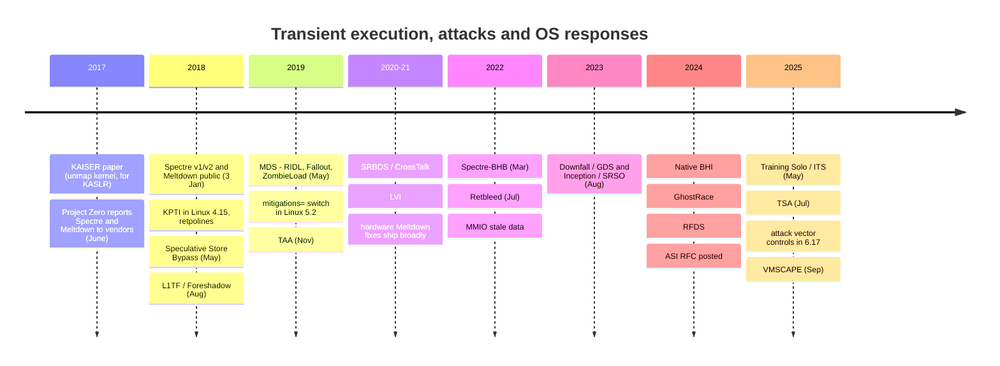
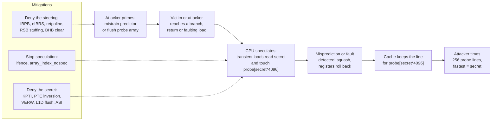
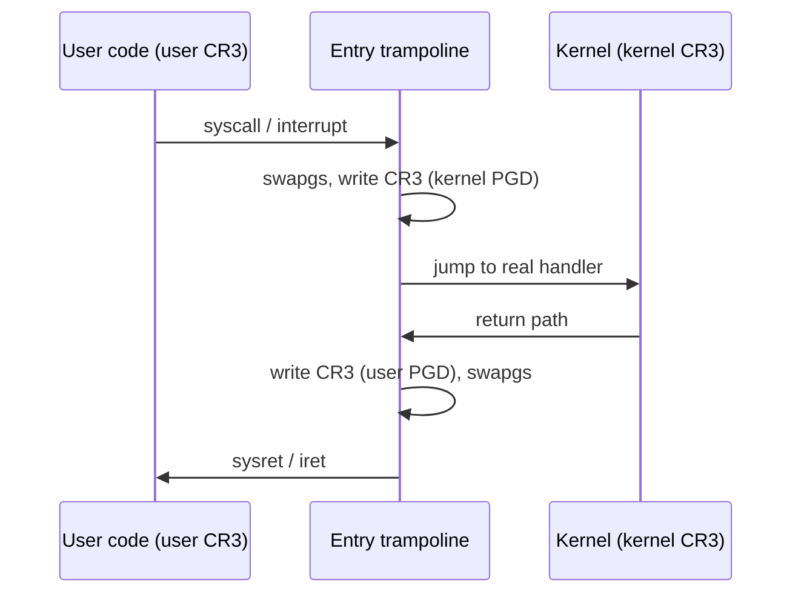

---
tags:
  - operating-systems
  - security
  - spectre
  - meltdown
  - side-channels
  - cpu-microarchitecture
  - kpti
status: complete
sources:
  - https://meltdownattack.com/meltdown.pdf
  - https://spectreattack.com/spectre.pdf
  - https://projectzero.google/2018/01/reading-privileged-memory-with-side.html
  - https://gruss.cc/files/kaiser.pdf
  - https://support.google.com/faqs/answer/7625886
  - https://foreshadowattack.eu/
  - https://mdsattacks.com/
  - https://comsec.ethz.ch/research/microarch/retbleed/
  - https://www.usenix.org/conference/usenixsecurity22/presentation/wikner
  - https://www.vusec.net/projects/bhi-spectre-bhb/
  - https://downfall.page/
  - https://comsec.ethz.ch/research/microarch/inception/
  - https://vusec.net/projects/training-solo
  - https://download.vusec.net/papers/trainingsolo_sp25.pdf
  - https://www.intel.com/content/www/us/en/developer/articles/news/more-information-vmscape.html
  - https://docs.kernel.org/admin-guide/hw-vuln/index.html
  - https://docs.kernel.org/arch/x86/pti.html
  - https://docs.kernel.org/admin-guide/hw-vuln/spectre.html
  - https://docs.kernel.org/admin-guide/hw-vuln/l1tf.html
  - https://docs.kernel.org/admin-guide/hw-vuln/mds.html
  - https://docs.kernel.org/admin-guide/hw-vuln/indirect-target-selection.html
  - https://docs.kernel.org/admin-guide/hw-vuln/vmscape.html
  - https://www.kernel.org/doc/html/v6.17/admin-guide/hw-vuln/attack_vector_controls.html
  - https://www.kernel.org/doc/html/v7.3-rc7/admin-guide/hw-vuln/attack_vector_controls.html
  - https://docs.kernel.org/userspace-api/spec_ctrl.html
  - https://www.brendangregg.com/blog/2018-02-09/kpti-kaiser-meltdown-performance.html
  - https://www.phoronix.com/review/retbleed-benchmark
  - https://lpc.events/event/19/contributions/2029/
  - https://lpc.events/event/18/contributions/1761/
  - https://lkml.iu.edu/hypermail/linux/kernel/2501.1/04842.html
  - https://lkml.iu.edu/hypermail/linux/kernel/2510.0/01762.html
  - https://lkml.iu.edu/2509.3/00833.html
  - https://www.theregister.com/2025/07/09/amd_tsa_side_channel/
  - https://www.amd.com/content/dam/amd/en/documents/resources/bulletin/technical-guidance-for-mitigating-transient-scheduler-attacks.pdf
created: 2026-11-26
updated: 2026-11-26
---

## Table Of Contents

---

- [[#TL;DR|TL;DR]]
- [[#The Problem|The Problem]]
- [[#Foundations|Foundations]]
    - [[#Speculation and the Transient Window|Speculation and the Transient Window]]
    - [[#Covert Channels — Getting the Secret Out|Covert Channels — Getting the Secret Out]]
    - [[#The Two Families|The Two Families]]
- [[#How We Got Here|How We Got Here]]
- [[#How It Works|How It Works]]
    - [[#Spectre v1 — Bounds Check Bypass|Spectre v1 — Bounds Check Bypass]]
    - [[#Spectre v2 — Branch Target Injection and Retpolines|Spectre v2 — Branch Target Injection and Retpolines]]
    - [[#Meltdown and KPTI|Meltdown and KPTI]]
    - [[#L1TF and MDS — Leaks From Buffers and SMT Siblings|L1TF and MDS — Leaks From Buffers and SMT Siblings]]
    - [[#Return and Branch-History Attacks|Return and Branch-History Attacks]]
    - [[#How Linux Organizes the Mitigations|How Linux Organizes the Mitigations]]
- [[#Where It Is Now|Where It Is Now]]
- [[#Trade-offs & Open Problems|Trade-offs & Open Problems]]
- [[#Resources|Resources]]
- [[#Related Notes|Related Notes]]

## ***TL;DR***
---
*Modern CPUs run ahead of themselves and guess. When a guess is wrong the results are thrown away, but traces stay in the caches, and an attacker can read secrets out of those traces. Operating systems now spend real effort, and real performance, closing these leaks one by one.*

- **Transient execution** is work a CPU does speculatively (past a branch it hasn't resolved, or past a fault it hasn't raised yet) and then discards. The architectural results vanish; the **microarchitectural** side effects, mainly which cache lines were loaded, do not.
- **Spectre** (2018) tricks the *victim* into speculatively running code paths it never would architecturally, by mistraining branch predictors. **Meltdown** (2018) lets the *attacker's own* code transiently read memory it has no permission to read, because the permission check lands after the data is already in use ([Lipp et al.](https://meltdownattack.com/meltdown.pdf); [Kocher et al.](https://spectreattack.com/spectre.pdf)).
- **The OS response** is a stack of mitigations at every privilege crossing: [[Virtual Memory and Paging|page-table]] isolation (KPTI) for Meltdown, retpolines and IBRS for branch injection, `array_index_nospec()` for bounds-check bypass, buffer clearing (`VERW`) for MDS, return-stack stuffing on [[Processes and Threads|context switches]], and SMT restrictions for cross-thread leaks.
- **The cost lands on hot paths:** [[System Calls and the User-Kernel Boundary|system calls]], [[Interrupts and Exceptions|interrupts]], context switches and VM exits. Measured overheads range from ~1% to over 800% for KPTI depending on workload ([Gregg, 2018](https://www.brendangregg.com/blog/2018-02-09/kpti-kaiser-meltdown-performance.html)), and up to 14% (AMD) and 39% (Intel) for Retbleed's mitigations in the researchers' tests ([Wikner & Razavi, 2022](https://comsec.ethz.ch/research/microarch/retbleed/)).
- **Late 2026:** it never ended. 2025 brought Training Solo / Indirect Target Selection (ITS), Transient Scheduler Attacks (TSA) and VMSCAPE; Linux 6.17 added **attack vector controls** so admins can mitigate by *threat* (user→kernel, guest→host, …) instead of by CVE, across the 18 issues the kernel now tracks; and Google's **Address Space Isolation (ASI)** is the leading attempt to replace whack-a-mole with a structural fix, though it was not yet merged as of its December 2025 Plumbers talk.

## ***The Problem***
---
*Isolation in an OS rests on the CPU enforcing permissions on every access. Transient execution showed that enforcement is only architectural: the hardware may touch forbidden data first and check afterwards, and the side effects of touching it leak.*

Everything an operating system promises about isolation assumes the CPU honors it:

| Boundary | Enforced by | What transient execution breaks |
|---|---|---|
| User vs kernel | Supervisor bit in page-table entries | Meltdown reads kernel memory from user mode |
| Process vs process | Separate address spaces | Spectre v2 poisons shared branch predictors across processes |
| Guest vs host | EPT / nested paging | L1TF and VMSCAPE leak host or other-guest data |
| Thread vs sibling thread | Nothing (they share a core) | MDS, L1TF and TSA read buffers shared by SMT siblings |
| Sandboxed code vs runtime | Bounds checks in software (JITs, [[eBPF]]) | Spectre v1 runs past the bounds check speculatively |

None of these attacks writes anything or crashes anything. They *read*, slowly but reliably: Meltdown dumped kernel memory at up to **503 KB/s** in the original paper ([Lipp et al.](https://meltdownattack.com/meltdown.pdf)). That is enough to pull out passwords, keys and kernel pointers (which also defeats KASLR; see [[Kernel Security Hardening]]).

The OS can't fix the hardware. What it can do is (1) stop secrets from being *reachable* during speculation (unmap them, clear the buffers), (2) stop the attacker from *steering* speculation (flush or partition predictors), and (3) stop speculation at known dangerous points (barriers). Each costs cycles at exactly the places an OS is most performance-sensitive.

## ***Foundations***
---
*Three ideas carry the whole topic: CPUs execute speculatively, discarded work leaves cache footprints, and timing a memory access reveals that footprint. Every attack is a way to put a secret in the transient window and a way to read the footprint back.*

### Speculation and the Transient Window

An out-of-order core fetches and executes instructions far ahead of the oldest unfinished one, keeping them in a reorder buffer (ROB) until they can **retire** in program order. Two kinds of guessing feed it:

- **Control speculation.** At a conditional branch, indirect jump or return, the CPU predicts the target (pattern history, branch target buffer, return stack buffer) and runs down that path before knowing if it's right.
- **Data / exception speculation.** A load may execute before an older store's address is known (*store bypass*), or before its own permission fault is raised.

If the guess was wrong, or a fault is pending, everything after it is **squashed**: registers roll back, nothing retires. The instructions that ran in between are **transient**. With hundreds of ROB entries on recent cores, the window is long enough for several dependent loads.

### Covert Channels — Getting the Secret Out

Squashing restores registers but not caches. A transient load that brings a line into L1 leaves it there. The attacker encodes the secret in *which* line gets loaded and then times accesses to find it. The standard receiver is **Flush+Reload**:

1. Flush a probe array of 256 lines (one per possible byte value), each a page apart to dodge prefetchers.
2. Trigger the transient access: `probe[secret * 4096]`.
3. Time a read of each of the 256 lines. The one that comes back fast (cache hit, tens of cycles vs a few hundred for DRAM) is the secret byte.

$$
\text{secret} = \arg\min_{v \in \{0,\dots,255\}} t\big(\text{probe}[v \cdot 4096]\big)
$$

*In plain words: the byte value whose probe line loads fastest is the one the transient code touched.* Worked example: timings of 220–300 cycles for 255 lines and **38** cycles for line 0x41 means the leaked byte is `0x41` (`'A'`). Repeating and taking a majority vote removes noise.

Other channels (Prime+Probe, TLB, port contention, power) work the same way with a different "footprint".

### The Two Families

| | **Spectre-type** | **Meltdown-type** |
|---|---|---|
| What is mispredicted | Control flow or data dependence (branches, returns, store-to-load) | A faulting or assisting load that forwards data before the fault |
| Whose code leaks | The victim's, steered by the attacker | The attacker's own code reads forbidden data |
| Examples | v1 bounds check bypass, v2 branch target injection, v4 speculative store bypass, Retbleed, BHI, Inception, ITS, VMSCAPE | Meltdown (v3), L1TF/Foreshadow, MDS (RIDL, Fallout, ZombieLoad), TAA, Downfall, TSA |
| Typical OS mitigation | Barriers, index masking, predictor flush/isolation, retpolines, return thunks | Unmap secrets (KPTI, PTE inversion), clear buffers (`VERW`), flush L1D, disable SMT, microcode |
| Fixed in new hardware? | Mostly *contained* (eIBRS, BHI_DIS_S), not eliminated | Largely fixed in silicon on parts since about 2019 |

## ***How We Got Here***
---
*Since January 2018 a new transient-execution variant has been disclosed every few months. The kernel's mitigation code grew with each wave, and the design question shifted from "patch this CVE" to "which boundaries do I need to defend at all?"*



- **Before 2018.** Cache timing side channels were known for decades (Flush+Reload is from 2014), and KAISER ([Gruss et al., 2017](https://gruss.cc/files/kaiser.pdf)) proposed unmapping the kernel from user page tables to protect KASLR. Nobody had shown that speculation could *read* across privilege lines.
- **January 2018.** Google Project Zero (Jann Horn) had reported the issues to Intel, AMD and Arm on 1 June 2017; Paul Kocher, Daniel Gruss, Moritz Lipp, Yuval Yarom, Daniel Genkin, Michael Schwarz and others found them independently. All were disclosed together ([Project Zero](https://projectzero.google/2018/01/reading-privileged-memory-with-side.html)). KAISER became **KPTI** in Linux 4.15 and was backported; Google published **retpolines** for Spectre v2 ([Google](https://support.google.com/faqs/answer/7625886)); Intel and AMD shipped microcode adding IBRS, IBPB and STIBP controls.
- **2018–2019: the Meltdown family grows.** L1TF/Foreshadow ([Foreshadow](https://foreshadowattack.eu/)) let guests read the L1 cache of their SMT sibling; MDS ([mdsattacks.com](https://mdsattacks.com/)) leaked from fill and store buffers. Mitigations needed microcode (`VERW` clears buffers) plus OS changes, and **SMT** stopped being safe between distrusting tenants. Linux 5.2 added one switch, `mitigations=`, for all of it.
- **2022–2023: the Spectre family comes back.** Hardware eIBRS was supposed to end branch injection, but Spectre-BHB showed *branch history* could still be poisoned across privilege levels ([VUSec](https://www.vusec.net/projects/bhi-spectre-bhb/)), and Retbleed showed *returns* fall back to the attackable branch predictor on some Intel and AMD parts, defeating retpolines ([ETH Zürich](https://comsec.ethz.ch/research/microarch/retbleed/)). Downfall ([downfall.page](https://downfall.page/)) and Inception ([ETH Zürich](https://comsec.ethz.ch/research/microarch/inception/)) followed in 2023.
- **2024–2025: tidying up.** The kernel rewrote its mitigation selection so new variants slot in consistently, then added attack vector controls (6.17). Meanwhile research kept finding holes in domain isolation itself: Training Solo showed an attacker can mistrain the predictor *from inside the victim's own domain* ([VUSec, S&P 2025](https://download.vusec.net/papers/trainingsolo_sp25.pdf)), and VMSCAPE showed a guest can poison the *host's user-space* VMM ([Intel](https://www.intel.com/content/www/us/en/developer/articles/news/more-information-vmscape.html)).

## ***How It Works***
---
*Each subsection takes one class of attack, shows the mechanism in a few lines, then shows what Linux does about it. The theme is the same throughout: deny the secret, deny the steering, or stop speculation at the dangerous spot.*



### Spectre v1 — Bounds Check Bypass

The classic gadget from the Spectre paper ([Kocher et al.](https://spectreattack.com/spectre.pdf)):

```c
if (x < array1_size)
    y = array2[array1[x] * 4096];
```

*In plain words: the attacker calls this many times with valid `x` to train the branch as "taken", flushes `array1_size` from the cache so the check is slow, then passes an out-of-bounds `x`. The CPU predicts "taken", reads `array1[x]` (a secret anywhere in the victim's address space), and uses it to index `array2`, leaving a cache footprint before the check resolves.*

In the kernel, any code that takes an index or pointer from user space is a candidate. Linux's fix is to **clamp the index without a branch** so even speculation can't go out of bounds:

```c
#include <linux/nospec.h>

if (idx < ARRAY_SIZE(table)) {
    idx = array_index_nospec(idx, ARRAY_SIZE(table));
    val = table[idx];
}
```

*In plain words: `array_index_nospec()` computes a mask that is all ones when `idx < size` and zero otherwise, using arithmetic rather than a branch, so a mispredicted path sees index 0 instead of the attacker's value* ([kernel spectre doc](https://docs.kernel.org/admin-guide/hw-vuln/spectre.html)). Other v1 defenses: an `lfence` after `swapgs` on entry, masking user pointers in `copy_from_user()`, and the [[eBPF]] verifier's pointer sanitization.

v1 has no general fix: the gadgets live in ordinary code, so finding them is a static-analysis problem (Smatch, compiler passes, fuzzers), and new ones keep turning up.

### Spectre v2 — Branch Target Injection and Retpolines

Indirect branches (`jmp *%rax`, function pointers, C++ virtual calls) are predicted by the branch target buffer (BTB), which on older parts was shared across privilege levels and processes. The attacker executes branches at addresses that alias the victim's and trains the BTB to send the victim's indirect branch to a **gadget** of the attacker's choosing, which then leaks through the cache.

**Retpoline** replaces each indirect branch with a sequence that the return predictor handles, and that traps speculation in a harmless loop ([Google](https://support.google.com/faqs/answer/7625886)):

```asm
    call  .Ldo_call        # pushes .Lspec_trap as return address
.Lspec_trap:
    pause
    lfence
    jmp   .Lspec_trap      # speculation that predicts "return here" spins
.Ldo_call:
    mov   %rax, (%rsp)     # overwrite return address with real target
    ret                    # architecturally jumps to *%rax
```

*In plain words: the CPU predicts the `ret` will go to `.Lspec_trap` (where the `call` came from), so speculation spins harmlessly; the real target is only taken when the `ret` retires.* The compiler emits calls to `__x86_indirect_thunk_rax` and friends, and the kernel patches them at boot to the best option for the CPU.

Hardware controls, exposed through MSRs and microcode:

| Control | What it does | Where Linux uses it |
|---|---|---|
| **IBRS** / **eIBRS** | Lower-privilege code can't steer higher-privilege indirect branches (eIBRS: set once, always on) | Kernel protection on newer CPUs, instead of retpolines |
| **IBPB** | Flush indirect-branch predictions | Context switch between distrusting processes, VM switch, VMSCAPE (on return to the user-space VMM) |
| **STIBP** | Don't share predictions between SMT siblings | Processes that opt in, or always with `spectre_v2_user=` |
| **RSB stuffing** | Fill the return stack buffer with benign entries | Context switch and VM exit, so returns don't underflow into the BTB |

User space can opt in per process with `prctl(PR_SET_SPECULATION_CTRL, PR_SPEC_INDIRECT_BRANCH, ...)` ([spec_ctrl](https://docs.kernel.org/userspace-api/spec_ctrl.html)).

### Meltdown and KPTI

On affected Intel (and some Arm) cores, a user-mode load of a kernel address faults, but the data is forwarded to dependent instructions *before* the fault is raised. Since Linux mapped all of physical memory into the kernel half of every address space, any byte of RAM was in reach ([Lipp et al.](https://meltdownattack.com/meltdown.pdf)).

**KPTI** (kernel page-table isolation) gives each process two page tables: the full one used in the kernel, and a user one that maps only user memory plus a tiny **trampoline** (entry code, IDT, per-CPU entry stack) ([kernel PTI doc](https://docs.kernel.org/arch/x86/pti.html)). Every kernel entry switches `CR3` to the kernel table, every exit switches back.



The cost is two `CR3` writes per round trip plus TLB refills. **PCID** tags TLB entries per address space so the switch doesn't flush everything, which is why KPTI's cost on PCID-capable CPUs is far lower. A rough model of the direct cost:

$$
\text{overhead} \approx \frac{r \cdot c}{f}
$$

*In plain words: the fraction of CPU time lost is the number of kernel crossings per second ($r$) times the extra cycles each costs ($c$), divided by the clock rate ($f$).* Worked example with illustrative numbers: $r = 100{,}000$ syscalls/s on one core, $c = 400$ extra cycles per round trip, $f = 3\,\text{GHz}$ gives $4\times10^{7} / 3\times10^{9} \approx 1.3\%$. Indirect TLB and cache effects come on top, which is how real workloads reached the tens of percent and, in Gregg's worst case, over 800% ([Gregg](https://www.brendangregg.com/blog/2018-02-09/kpti-kaiser-meltdown-performance.html); see [[System Calls and the User-Kernel Boundary#The KPTI Tax|The KPTI Tax]]).

CPUs with hardware Meltdown fixes report `RDCL_NO`, and `pti=auto` (the default) then leaves KPTI off.

### L1TF and MDS — Leaks From Buffers and SMT Siblings

- **L1TF / Foreshadow** (2018). A page-table entry marked *not present* still had its physical-address bits used speculatively to look up the L1 cache. A guest controlling its own PTEs could read any L1-resident line, including the host's and its sibling thread's ([kernel L1TF doc](https://docs.kernel.org/admin-guide/hw-vuln/l1tf.html)). Linux fixes for bare metal: **PTE inversion** (non-present PTEs store inverted address bits that point at no real memory). For KVM: flush L1D on VM entry, and disable SMT or never co-schedule distrusting guests on sibling threads. See [[Virtualization and Hypervisors]].
- **MDS** (2019): RIDL, Fallout and ZombieLoad sample stale data from line fill buffers, store buffers and load ports ([mdsattacks.com](https://mdsattacks.com/)). Microcode repurposed the old `VERW` instruction to clear these buffers, and Linux executes it on every return to user space and VM entry ([kernel MDS doc](https://docs.kernel.org/admin-guide/hw-vuln/mds.html)). Buffers shared between hyperthreads can't be cleared while the sibling runs, so full mitigation again means `nosmt`.
- **Later variants** (TAA, MMIO stale data, RFDS, AMD's TSA in 2025) reuse the same pattern: microcode plus `VERW`-style clearing at privilege transitions.

### Return and Branch-History Attacks

- **Retbleed** (2022). On Intel Core generations 6–8 and AMD Zen 1, 1+ and 2, a return whose RSB entry underflows (or always, on AMD) is predicted by the BTB, which the attacker can train, so retpolines stopped helping ([ETH Zürich](https://comsec.ethz.ch/research/microarch/retbleed/)). Linux's fixes: IBRS on kernel entry for Intel, and **return thunks** (`jmp2ret`, "untrained return") on AMD that route every kernel `ret` through one location the kernel keeps trained. The researchers measured 14% overhead for AMD's patches and 39% for Intel's; Phoronix called the mitigated performance "painful" ([Phoronix](https://www.phoronix.com/review/retbleed-benchmark)).
- **Spectre-BHB / BHI** (2022, 2024). eIBRS stops *targets* being injected across privilege levels, but the *branch history* that selects a prediction is still shared, so user space can steer kernel predictions ([VUSec](https://www.vusec.net/projects/bhi-spectre-bhb/)). Fixes: a software loop that overwrites the history on entry (`clear_bhb_loop`), or the hardware `BHI_DIS_S` control on newer Intel parts.
- **Inception / SRSO** (2023). On AMD Zen, the attacker can make the CPU believe a `call` happened and plant a return prediction ("phantom" speculation). Linux uses a "safe RET" thunk or IBPB on entry, depending on microcode.
- **ITS** (2025, CVE-2024-28956). On Intel CPUs with eIBRS released before Alder Lake (Skylake-X through Rocket Lake), an attacker can control the prediction of indirect branches and returns that sit in the *lower* half of a cache line, one of the holes Training Solo exploited ([VUSec](https://vusec.net/projects/training-solo); [kernel ITS doc](https://docs.kernel.org/admin-guide/hw-vuln/indirect-target-selection.html)). Linux patches each vulnerable branch site to its own thunk whose branch sits in the *second* half of the line, sends returns to one static safe thunk, routes [[eBPF]] indirect branches through a fixed thunk array, and can use call-depth-tracking RSB stuffing instead (`indirect_target_selection=on|off|vmexit|stuff|force`).

All of these land in the same few instructions at kernel entry and exit, which is why entry code (`entry_64.S`) is now dense with macros like `IBRS_ENTER`, `UNTRAIN_RET` and `CLEAR_BRANCH_HISTORY` (see [[Interrupts and Exceptions]]).

### How Linux Organizes the Mitigations

**Reporting.** Every known issue gets a file under `/sys/devices/system/cpu/vulnerabilities/` saying "Not affected", "Vulnerable" or "Mitigation: …":

```bash
$ grep . /sys/devices/system/cpu/vulnerabilities/*
.../meltdown:Not affected
.../spectre_v1:Mitigation: usercopy/swapgs barriers and __user pointer sanitization
.../spectre_v2:Mitigation: Enhanced / Automatic IBRS; IBPB: conditional; RSB filling; ...
```

*In plain words: read these files to see which mitigations this kernel turned on for this CPU.* (Example output; exact strings vary by CPU and kernel.)

**Control.** Each vulnerability has its own boot option (`pti=`, `spectre_v2=`, `retbleed=`, `mds=`, …), and `mitigations=off|auto|auto,nosmt` sets them all at once ([hw-vuln index](https://docs.kernel.org/admin-guide/hw-vuln/index.html)).

**Attack vector controls** (Linux 6.17, 2025) add a higher-level view: instead of reasoning per CVE, the admin says which *boundaries* need defending, and the kernel turns on only the mitigations relevant to them ([attack vector controls](https://www.kernel.org/doc/html/v6.17/admin-guide/hw-vuln/attack_vector_controls.html)):

| Vector | Protects | Example: safe to turn off when |
|---|---|---|
| user → kernel | Kernel from user processes | Single trusted app on a dedicated box |
| user → user | Processes from each other | All processes are one trust domain |
| guest → host | Hypervisor host from VMs | No untrusted VMs run |
| guest → guest | VMs from each other | One tenant per host |
| cross-thread | Data across SMT siblings | SMT disabled, or core scheduling keeps tenants apart |

On the command line these are switches after the global setting, for example `mitigations=auto,no_user_kernel` or `mitigations=auto,nosmt,no_guest_host,no_guest_guest`. Plain `auto` mitigates cross-thread attacks only partly and leaves SMT on; `auto,nosmt` mitigates fully and may turn SMT off; a per-vulnerability option such as `retbleed=off` still wins over the vectors. The doc's table maps 18 issues (BHI, ITS, GDS, L1TF, MDS, MMIO, Meltdown, Retbleed, RFDS, Spectre v1, Spectre v2, Spectre v2 user, SRBDS, SRSO, SSB, TAA, TSA, VMSCAPE) to the vectors they matter for ([attack vector controls, 7.3-rc7](https://www.kernel.org/doc/html/v7.3-rc7/admin-guide/hw-vuln/attack_vector_controls.html)).

*In plain words: a cloud host running only VMs can keep guest-side protections and drop user-to-user ones; a single-tenant HPC node can drop most of them.* The vectors map to the boundary table in [[#The Problem|The Problem]].

**Scheduling.** Core scheduling (Linux 5.14) lets the scheduler run only mutually trusting tasks on sibling hyperthreads, a middle ground between SMT on and SMT off (see [[CPU Scheduling]]).

## ***Where It Is Now***
---
*As of November 2026, new variants still arrive several times a year, mostly Spectre-type attacks on predictors that hardware "fixed". Mitigation is becoming policy-driven (attack vectors) and structural (address space isolation) rather than one patch per CVE.*

**Recent attacks and kernel responses (dated)**

| When | Attack | Who | What Linux does |
|---|---|---|---|
| May 2025 | Training Solo; Indirect Target Selection (ITS) | VUSec ([S&P 2025](https://download.vusec.net/papers/trainingsolo_sp25.pdf)) | Per-site thunks with the branch in the second half of a cache line, RSB stuffing, fixed thunks for eBPF ([ITS doc](https://docs.kernel.org/admin-guide/hw-vuln/indirect-target-selection.html)) |
| Jul 2025 | Transient Scheduler Attacks (TSA) | AMD, while investigating a Microsoft report ([The Register](https://www.theregister.com/2025/07/09/amd_tsa_side_channel/)) | `VERW` buffer clearing at transitions on affected EPYC and Ryzen parts ([AMD guidance](https://www.amd.com/content/dam/amd/en/documents/resources/bulletin/technical-guidance-for-mitigating-transient-scheduler-attacks.pdf)) |
| Sep 2025 | VMSCAPE (CVE-2025-40300) | ETH Zürich COMSEC ([Intel](https://www.intel.com/content/www/us/en/developer/articles/news/more-information-vmscape.html)) | Between the VM exit and the return to the user-space VMM (QEMU): IBPB, or on some CPUs IBRS or a branch-history clear instead ([VMSCAPE doc](https://docs.kernel.org/admin-guide/hw-vuln/vmscape.html)) |
| Sep 2025 | Attack vector controls | Kernel x86 maintainers | Mitigate by threat model, Linux 6.17 |

**Address Space Isolation (ASI).** Google's ASI ([RFC v1, July 2024](https://lpc.events/event/18/contributions/1761/); [RFC v2, Jan 2025](https://lkml.iu.edu/hypermail/linux/kernel/2501.1/04842.html)) runs most kernel code in a *restricted* address space that doesn't map other processes' or guests' sensitive memory, switching to the full one only when needed. If secrets aren't mapped, no speculation can read them, which could retire many per-variant mitigations at once. In September 2025 the first non-RFC series, "mm: ASI direct map management", went to the list ([LKML](https://lkml.iu.edu/2509.3/00833.html)), with the "ASI is fast again" discussion following ([Oct 2025](https://lkml.iu.edu/hypermail/linux/kernel/2510.0/01762.html)). At Linux Plumbers in December 2025, Brendan Jackman's talk "Address Space Isolation is ready" argued that the big unknowns, including performance for native (not just guest) attackers, were solved and that ASI should move from RFCs to mergeable series ([LPC 2025](https://lpc.events/event/19/contributions/2029/)). ASI was not in mainline as of that talk; the sources read for this note don't show it merged by November 2026. See [[Address Space Isolation]] for how it works and where the patches stand.

**Hardware.** CPUs since roughly 2019 are immune to Meltdown and L1TF, so KPTI and PTE inversion are off by default on them; eIBRS and `BHI_DIS_S` replaced retpolines on new Intel parts. But every year has shown that hardware "fixes" constrain one predictor while another stays shared, so the kernel's software layer keeps growing. The kernel's [hw-vuln index](https://docs.kernel.org/admin-guide/hw-vuln/index.html) now has 18 documents, from Spectre and L1TF to ITS and VMSCAPE.

**Practice.** Cloud providers run with full mitigations and SMT restrictions between tenants. Some HPC and single-tenant users boot with `mitigations=off` for speed; attack vector controls give them a finer choice.

## ***Trade-offs & Open Problems***
---
*Every mitigation trades performance for one closed channel, and the set of channels is open-ended. The hard questions are how much to pay, for which threat model, and whether a structural fix can end the per-variant cycle.*

| Approach | Buys | Costs |
|---|---|---|
| Unmap secrets (KPTI, ASI) | Whole classes of leaks gone at once | Page-table switches on hot paths, complexity in memory management |
| Clear state at transitions (`VERW`, L1D flush, IBPB, RSB stuffing) | Simple, targeted | Cycles on every syscall, interrupt or VM exit |
| Barriers and masking (`lfence`, `array_index_nospec`) | Precise | Each gadget must be found by hand or analysis |
| Disable SMT | Ends cross-thread leaks | Up to ~half the hardware threads; density loss in clouds |
| Hardware controls (eIBRS, BHI_DIS_S) | Fast | Only cover what the vendor foresaw |
| `mitigations=off` | Full speed | Trusts every piece of code on the machine |

**Open problems**

- **Spectre v1 is unsolved in general.** Any bounds check in any privileged code is a potential gadget; there is no complete static analysis, and [[Rust in the Linux Kernel|Rust]]'s memory safety does not stop *speculative* out-of-bounds reads.
- **Domain isolation keeps leaking.** Training Solo and VMSCAPE showed attackers can stay in their own domain or target a different one (the user-space VMM) than the one defended. Threat models built around "kernel vs user" miss these.
- **Verification can't see it.** Proofs of kernels like [[Microkernels and seL4|seL4]] assume a correct ISA; transient execution is below that abstraction. Work on "speculative" semantics and time protection is ongoing.
- **Performance debt compounds.** Each mitigation is small alone, but they stack at the same entry points, making [[System Calls and the User-Kernel Boundary|syscalls]] and [[Interrupts and Exceptions|interrupts]] costlier and pushing designs toward fewer crossings ([[io_uring]], [[Kernel Bypass Networking|kernel bypass]], [[Unikernels and Library OSes|unikernels]]).
- **Sandboxes inside one address space.** JITs, [[eBPF]] and WebAssembly run untrusted code in the same address space as secrets; browsers answered with process-per-site isolation, which kernels can't easily copy.

## ***Resources***
---
*Start with the Meltdown and Spectre papers, then the kernel's hw-vuln documentation for how each variant is mitigated today. LWN and the research groups' project pages cover the newer variants.*

**Papers**
- [Meltdown: Reading Kernel Memory from User Space](https://meltdownattack.com/meltdown.pdf): Lipp et al., USENIX Security 2018.
- [Spectre Attacks: Exploiting Speculative Execution](https://spectreattack.com/spectre.pdf): Kocher et al., IEEE S&P 2019.
- [KASLR is Dead: Long Live KASLR (KAISER)](https://gruss.cc/files/kaiser.pdf): Gruss et al., ESSoS 2017.
- [RETBLEED: Arbitrary Speculative Code Execution with Return Instructions](https://www.usenix.org/conference/usenixsecurity22/presentation/wikner): Wikner & Razavi, USENIX Security 2022.
- [Training Solo: On the Limitations of Domain Isolation Against Spectre-v2 Attacks](https://download.vusec.net/papers/trainingsolo_sp25.pdf): IEEE S&P 2025.

**Disclosures and project pages**
- [Reading privileged memory with a side-channel](https://projectzero.google/2018/01/reading-privileged-memory-with-side.html): Project Zero, Jan 2018.
- [Retpoline: a software construct for preventing branch-target-injection](https://support.google.com/faqs/answer/7625886): Google.
- [Foreshadow](https://foreshadowattack.eu/), [MDS](https://mdsattacks.com/), [BHI](https://www.vusec.net/projects/bhi-spectre-bhb/), [Retbleed](https://comsec.ethz.ch/research/microarch/retbleed/), [Inception](https://comsec.ethz.ch/research/microarch/inception/), [Downfall](https://downfall.page/), [Training Solo](https://vusec.net/projects/training-solo).
- [More information on VMSCAPE](https://www.intel.com/content/www/us/en/developer/articles/news/more-information-vmscape.html): Intel, 2025.
- [Technical guidance for mitigating Transient Scheduler Attacks](https://www.amd.com/content/dam/amd/en/documents/resources/bulletin/technical-guidance-for-mitigating-transient-scheduler-attacks.pdf): AMD, 2025.

**Kernel docs**
- [Hardware vulnerabilities index](https://docs.kernel.org/admin-guide/hw-vuln/index.html): one page per variant, with options and sysfs strings.
- [Page Table Isolation](https://docs.kernel.org/arch/x86/pti.html), [Spectre](https://docs.kernel.org/admin-guide/hw-vuln/spectre.html), [L1TF](https://docs.kernel.org/admin-guide/hw-vuln/l1tf.html), [MDS](https://docs.kernel.org/admin-guide/hw-vuln/mds.html), [ITS](https://docs.kernel.org/admin-guide/hw-vuln/indirect-target-selection.html), [VMSCAPE](https://docs.kernel.org/admin-guide/hw-vuln/vmscape.html).
- [Attack Vector Controls](https://www.kernel.org/doc/html/v6.17/admin-guide/hw-vuln/attack_vector_controls.html): Linux 6.17.
- [Speculation Control (prctl)](https://docs.kernel.org/userspace-api/spec_ctrl.html).

**Performance and where it is now**
- [KPTI/KAISER Meltdown Initial Performance Regressions](https://www.brendangregg.com/blog/2018-02-09/kpti-kaiser-meltdown-performance.html): Brendan Gregg, 2018.
- [Benchmarking the Linux mitigated performance for Retbleed](https://www.phoronix.com/review/retbleed-benchmark): Phoronix, 2022.
- [Address Space Isolation is ready](https://lpc.events/event/19/contributions/2029/): Brendan Jackman, Linux Plumbers 2025.

## ***Related Notes***
---
*These notes cover the boundaries transient execution attacks cross and the kernel paths their mitigations slow down.*

- [[Virtual Memory and Paging]] — Page tables, PCID and why KPTI splits them.
- [[System Calls and the User-Kernel Boundary]] — The entry path that KPTI, IBRS and buffer clearing make more expensive.
- [[Interrupts and Exceptions]] — The other kernel entry path, and FRED.
- [[Processes and Threads]] — Context switches, IBPB and RSB stuffing.
- [[CPU Scheduling]] — Core scheduling to keep distrusting tasks off sibling hyperthreads.
- [[Virtualization and Hypervisors]] — L1TF, MDS and VMSCAPE across the guest-host line.
- [[MicroVMs and Sandboxing]] — Host hardening for multi-tenant microVMs.
- [[eBPF]] — Verifier sanitization against speculative out-of-bounds access.
- [[Kernel Architectures]] — Why side channels ignore architectural boundaries.
- [[Microkernels and seL4]] — Formal proofs and the timing channels they don't cover.
- [[Kernel Security Hardening]] — KASLR, which Meltdown-class leaks defeat.
- [[Formally Verified OS Components]] — Verification and speculative semantics.
- [[Address Space Isolation]] — Unmapping secrets from the kernel as a structural fix.
- [[Confidential Computing]] — Encrypted VMs, and the side channels encryption doesn't stop.
- [[io_uring]] — Fewer syscalls, fewer mitigation tolls.
- [[Unikernels and Library OSes]] — Avoiding the crossings altogether.
