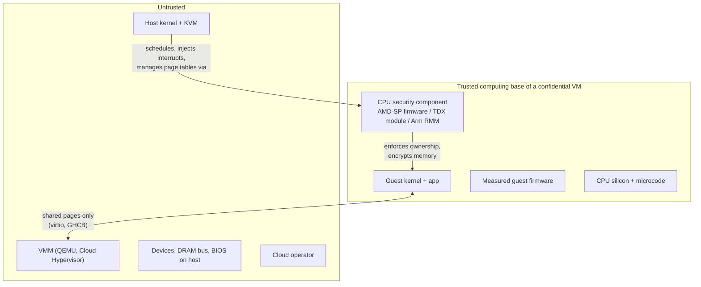
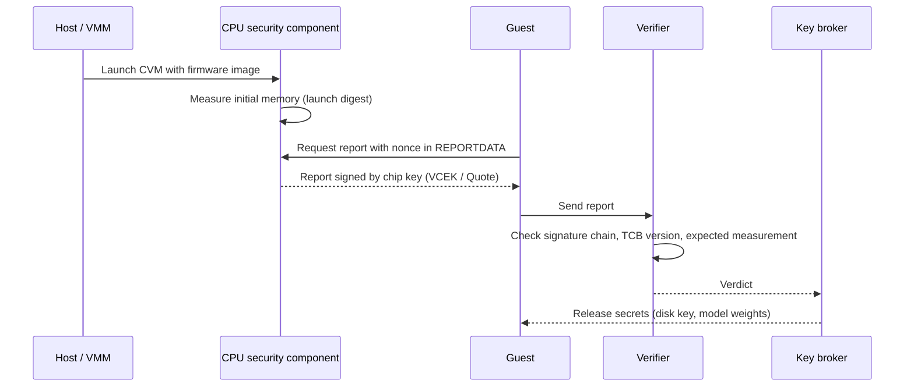
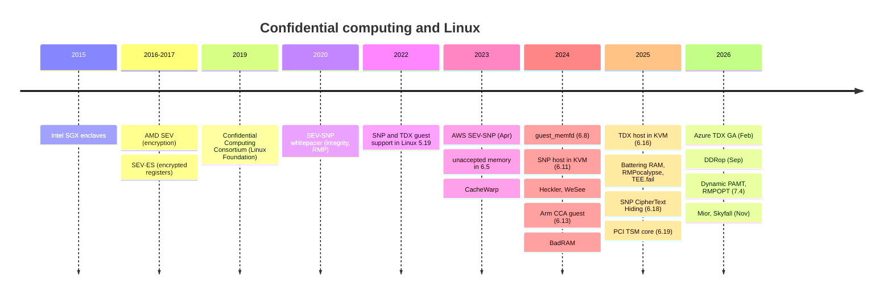

---
tags:
  - operating-systems
  - virtualization
  - security
  - confidential-computing
  - sev-snp
  - tdx
  - arm-cca
  - attestation
status: complete
sources:
  - https://docs.kernel.org/security/snp-tdx-threat-model.html
  - https://kernel.org/doc/html/latest/arch/x86/amd-memory-encryption.html
  - https://kernel.org/doc/html/latest/arch/x86/tdx.html
  - https://docs.kernel.org/6.13/arch/arm64/arm-cca.html
  - https://www.databricks.com/sites/default/files/2023-09/sev-snp-strengthening-vm-isolation-with-integrity-protection-and-more.pdf
  - https://lkml.iu.edu/hypermail/linux/kernel/2111.0/05507.html
  - https://www.phoronix.com/news/UEFI-Unaccepted-Memory-CC-6.5
  - https://www.phoronix.com/news/AMD-EPYC-SEV-SNP-CoCo
  - https://www.phoronix.com/news/Linux-6.11-KVM
  - https://itsfoss.com/news/linux-kernel-6-16/
  - https://phoronix.com/news/Linux-6.18-KVM
  - https://lkml.iu.edu/hypermail/linux/kernel/2512.0/04761.html
  - https://phoronix.com/news/Linux-74-Intel-TDX-Dynamic-PAMT
  - https://www.phoronix.com/news/AMD-RMPOPT-For-Linux-7.4
  - https://phoronix.com/news/Intel-Instruction-Timeout-Linux
  - https://lwn.net/Articles/1001947/
  - https://lwn.net/Articles/1093216/
  - https://lwn.net/Articles/1065081/
  - https://lwn.net/Articles/1094492/
  - https://aws.amazon.com/about-aws/whats-new/2023/04/amazon-ec2-amd-sev-snp
  - https://docs.cloud.google.com/confidential-computing/confidential-vm/docs/release-notes
  - https://learn.microsoft.com/en-us/azure/confidential-computing/virtual-machine-options
  - https://techcommunity.microsoft.com/t5/azure-confidential-computing/announcing-general-availability-of-azure-intel-tdx-confidential/ba-p/4495693
  - https://thehackernews.com/2023/11/cachewarp-attack-new-vulnerability-in.html
  - https://arxiv.org/abs/2404.03387
  - https://arxiv.org/html/2404.03526v1
  - https://www.theregister.com/2024/12/10/amd_secure_vm_tech_undone/
  - https://www.kaspersky.com/blog/wiretap-battering-ram-tee-attacks/54598/
  - https://thehackernews.com/2025/10/rmpocalypse-single-8-byte-write.html
  - https://thehackernews.com/2025/10/new-teefail-side-channel-attack.html
  - https://www.igorslab.de/en/fabricked-eth-researchers-attack-amd-sev-snp-infinity-fabric/
  - https://thehackernews.com/2026/09/new-ddrop-attack-breaks-intel-tdx-and.html
  - https://thehackernews.com/2026/11/new-mior-and-skyfall-attacks-let-rogue.html
  - https://labs.cloudsecurityalliance.org/research/csa-research-note-confidential-ai-inference-tee-limits-20261/
  - https://usenix.org/system/files/osdi24-zhou.pdf
created: 2026-11-26
updated: 2026-11-26
---

## Table Of Contents

---

- [[#TL;DR|TL;DR]]
- [[#The Problem|The Problem]]
- [[#Foundations|Foundations]]
    - [[#Who Is Trusted|Who Is Trusted]]
    - [[#Encrypted Memory and the Shared Bit|Encrypted Memory and the Shared Bit]]
    - [[#Integrity — Why Encryption Isn't Enough|Integrity — Why Encryption Isn't Enough]]
    - [[#Attestation|Attestation]]
- [[#How We Got Here|How We Got Here]]
- [[#How It Works|How It Works]]
    - [[#AMD SEV-SNP|AMD SEV-SNP]]
    - [[#Intel TDX|Intel TDX]]
    - [[#Arm CCA|Arm CCA]]
    - [[#What the Guest Kernel Must Do|What the Guest Kernel Must Do]]
    - [[#I/O, Devices and GPUs|I/O, Devices and GPUs]]
- [[#Where It Is Now|Where It Is Now]]
- [[#Trade-offs & Open Problems|Trade-offs & Open Problems]]
- [[#Resources|Resources]]
- [[#Related Notes|Related Notes]]

## ***TL;DR***
---
*Ordinary virtualization protects the host from its guests. Confidential computing adds the reverse: the CPU encrypts and integrity-protects a VM's memory so that the hypervisor, host kernel and cloud operator can't read or tamper with it. The price is that the guest kernel must now treat its own host as an attacker.*

- **What it is.** A **confidential VM (CVM)** runs with memory encrypted by a per-VM key held in the memory controller, plus hardware checks that stop the host from remapping, replaying or aliasing guest pages. The host still schedules it and does its I/O, but sees only ciphertext.
- **Three designs, one idea.** **AMD SEV-SNP** adds a Reverse Map Table that tracks who owns every 4 KiB page; **Intel TDX** moves VM management into a CPU-run "TDX module" the host can't modify; **Arm CCA** adds a hardware *Realm* world managed by a small Realm Management Monitor.
- **Attestation is the point.** Before giving a CVM secrets, a remote party checks a report signed by the CPU that proves *which* code was launched on *which* patched hardware. Without it, encryption protects nothing you can verify.
- **The guest kernel's new job.** Every value from the host (MMIO, port I/O, CPUID, interrupts, virtio rings, ACPI tables) is untrusted input. Linux's guest-hardening work, bounce buffers and lazy memory acceptance exist for this ([kernel threat model](https://docs.kernel.org/security/snp-tdx-threat-model.html)).
- **Late 2026.** CVMs are generally available on AWS, Azure and Google Cloud, including confidential GPUs; Linux 7.4 adds TDX Dynamic PAMT and AMD RMPOPT; Arm CCA host support and trusted device I/O (TDX Connect, TDISP) are still not merged. Physical interposer attacks costing $10–$1,000 keep breaking the memory encryption, and vendors call physical attacks out of scope.

## ***The Problem***
---
*Data is encrypted at rest and in transit, but it has to be decrypted to compute on it. In a cloud, that means trusting the provider's whole host software stack. Confidential computing aims to take the host out of the trusted computing base.*

In a normal [[Virtualization and Hypervisors|KVM]] cloud, the hypervisor can read any guest page, change register state, inject interrupts and rewrite the guest's disk. Each of these is trusted, alongside every host-kernel bug, every admin with root, and anyone who compels the provider.

Linux's CoCo threat model takes the host and host-side VMM out of the guest's trusted computing base (TCB) because of their huge attack surface, noting this is "not an assumption of malicious intent" ([kernel docs](https://docs.kernel.org/security/snp-tdx-threat-model.html)). The guest's goals:

- Keep its private memory and register state confidential and intact.
- Stop the host escalating privileges into the guest kernel.
- Treat host-supplied firmware, bootloader, kernel and command line as untrusted until attestation verifies them.

What stays *out* of scope matters as much: **denial of service** (the host can always stop running you) and, by vendor choice, most **physical attacks** on the memory bus.

The host controls a long list of inputs the guest must now distrust:

| Host-controlled surface | Why it's dangerous |
|---|---|
| Port I/O, MMIO, PCI config space | Device emulation returns whatever the host wants |
| Hypercalls (generic and CoCo-specific) | Results can be forged |
| Shared memory pages (virtio, bounce buffers) | Contents can change between check and use |
| Injected interrupts and exceptions | Can steer guest control flow (see Heckler, WeSee) |
| Time and entropy sources | Forged values break crypto and protocols |
| Side channels, including [[Transient Execution Attacks and Mitigations|transient execution]] | Host shares the CPU and caches |

## ***Foundations***
---
*Four ideas carry the topic: shrink the TCB, encrypt memory per VM with a shared/private split, add integrity so the host can't play tricks with the page mapping, and prove what's running with attestation.*

### Who Is Trusted

*Before confidential computing, everything in the "Untrusted" box was trusted. The new TCB is the guest itself plus the CPU and its vendor firmware.*

### Encrypted Memory and the Shared Bit

The memory controller encrypts each CVM's private pages with an AES key unique to that VM. Both AMD and Intel use **AES-XTS**, which is *deterministic*: the same plaintext at the same address always produces the same ciphertext. That fact underlies several later attacks ([TEE.fail](https://thehackernews.com/2025/10/new-teefail-side-channel-attack.html)).

But a guest must also share some memory with the host for I/O. So each guest-physical address carries one bit saying private or shared:

- **AMD (C-bit).** A page is encrypted when the "C-bit" is set in its page-table entry. Its position isn't fixed: CPUID leaf `0x8000001F` reports it in `EBX[5:0]` and how many physical-address bits are lost in `EBX[11:6]` ([kernel docs](https://kernel.org/doc/html/latest/arch/x86/amd-memory-encryption.html)).
- **Intel TDX (SHARED bit).** The top bit of the guest physical address width: bit **GPAW−1**, so bit 47 with a 48-bit GPA width and bit **51** with a 52-bit width ([LKML](https://lkml.iu.edu/hypermail/linux/kernel/2111.0/05507.html)).
- **Arm CCA.** The guest's address space is halved: the lower half is protected, the upper half is shared, so a shared page sits at the same address with the highest valid IPA bit set ([kernel docs](https://docs.kernel.org/6.13/arch/arm64/arm-cca.html)).

Worked example (TDX, GPAW = 52): a private page at guest-physical `0x0000_0001_2340_0000` is accessed as shared at

$$
0x1\_2340\_0000 + 2^{51} = 0x0008\_0001\_2340\_0000
$$

*In plain words: setting bit 51 gives the same page frame a second, unencrypted name. The guest converts a page by flipping the bit and telling the hardware, and the host can only ever read the shared alias.*

Linux does this with `set_memory_decrypted()` for pages it wants to share, and keeps a pool of permanently shared **SWIOTLB bounce buffers** for device I/O ([TDX docs](https://kernel.org/doc/html/latest/arch/x86/tdx.html)).

### Integrity — Why Encryption Isn't Enough

The first SEV (2016) only encrypted memory. A malicious hypervisor still controlled the guest's second-level page tables, so it could:

- **Replay**: put back an old ciphertext page (rolling back a counter or key).
- **Remap**: point two guest addresses at the same physical page, or swap pages.
- **Corrupt**: flip ciphertext bits, which garbles plaintext unpredictably but can still crash or confuse code.
- **Read registers**: before SEV-ES, register state was visible on every VM exit.

SEV-ES (2017) encrypted register state on exits; SEV-SNP and TDX add **memory integrity**: the hardware tracks which VM owns each physical page and at which guest address, and refuses any mapping the guest didn't accept ([AMD SNP whitepaper](https://www.databricks.com/sites/default/files/2023-09/sev-snp-strengthening-vm-isolation-with-integrity-protection-and-more.pdf)).

### Attestation

*The host launches the VM but cannot forge the CPU's signature, so the verifier learns exactly what was loaded and on what firmware version before any secret is released.*

- **SEV-SNP.** The AMD Secure Processor signs reports with the **VCEK**, an ECDSA key unique to each chip and its current TCB (firmware) version ([AMD](https://www.databricks.com/sites/default/files/2023-09/sev-snp-strengthening-vm-isolation-with-integrity-protection-and-more.pdf)).
- **TDX.** `TDG.MR.REPORT` returns a TDREPORT with 64 bytes of caller data; a quoting enclave turns it into a remotely verifiable **Quote**. Build-time measurement lives in **MRTD**, runtime measurements in **RTMRs** ([TDX docs](https://kernel.org/doc/html/latest/arch/x86/tdx.html)).
- **Binding.** The Cloud Security Alliance advises tying key release to the CPU TCB version, the launch measurement, GPU attestation and the software build, and rejecting reports below the vendor's patched TCB floor ([CSA](https://labs.cloudsecurityalliance.org/research/csa-research-note-confidential-ai-inference-tee-limits-20261/)).

## ***How We Got Here***
---
*Confidential computing went from process-level enclaves (SGX) to whole VMs, because porting a whole application into an enclave was too hard while lifting an unmodified OS into a CVM was easy.*

- **Enclaves first.** Intel SGX (2015) protected a region of one process. It worked for small secrets but required splitting applications into trusted and untrusted halves, and Intel later dropped it from client CPUs.
- **Whole-VM encryption.** AMD's SEV (2016) took the other route: encrypt an entire VM, so unmodified operating systems and apps run inside. SEV-ES (2017) protected registers; SEV-SNP (2020) added integrity ([AMD](https://www.databricks.com/sites/default/files/2023-09/sev-snp-strengthening-vm-isolation-with-integrity-protection-and-more.pdf)). Intel followed with TDX and Arm with CCA.
- **Linux catches up (2022–2025).** Guest support for SNP and TDX arrived in Linux 5.19. The host side took longer: SNP's x86 host pieces in 6.9 and KVM support in 6.11 ([Phoronix](https://www.phoronix.com/news/AMD-EPYC-SEV-SNP-CoCo); [Phoronix](https://www.phoronix.com/news/Linux-6.11-KVM)), TDX host support in 6.16 in July 2025 ([It's FOSS](https://itsfoss.com/news/linux-kernel-6-16/)). Supporting infrastructure landed in between: **unaccepted memory** (6.5), which made boot 2.5× faster for a 4 GB VM and 4× for 64 GB ([Phoronix](https://www.phoronix.com/news/UEFI-Unaccepted-Memory-CC-6.5)), and **guest_memfd** (6.8), a KVM memory type for private guest memory that the host can't map.
- **Clouds.** AWS offered SEV-SNP from April 2023 ([AWS](https://aws.amazon.com/about-aws/whats-new/2023/04/amazon-ec2-amd-sev-snp)); Google made SNP generally available on N2D and TDX on C3 in 2024 ([Google](https://docs.cloud.google.com/confidential-computing/confidential-vm/docs/release-notes)).
- **Attacks every year.** From CacheWarp (2023) through the 2025–2026 wave of memory-bus interposers, each generation has been broken by someone, usually at a layer vendors left out of scope.

## ***How It Works***
---
*The three architectures differ mainly in who manages the CVM's memory and where that manager lives. The guest-side work in Linux is largely shared.*

| | AMD SEV-SNP | Intel TDX | Arm CCA |
|---|---|---|---|
| Who manages CVM memory | Host hypervisor, checked by the RMP | The **TDX module** in SEAM mode | The **RMM** at EL2 in the Realm world |
| Ownership tracking | Reverse Map Table (one entry per 4 KiB page) | Secure EPT + PAMT | Granule Protection Table |
| Guest accepts pages with | `PVALIDATE` | `TDG.MEM.PAGE.ACCEPT` | RSI calls (set RIPAS) |
| Exits to host via | #VC exception → GHCB | #VE exception → `TDCALL` | RSI / RMI |
| Attestation key | VCEK (per chip + TCB) | Quote via quoting enclave | Realm token |
| Linux guest / host | 5.19 / 6.11 | 5.19 / 6.16 | 6.13 / not merged (Nov 2026) |

### AMD SEV-SNP

- **Reverse Map Table (RMP).** One system-wide table with an entry for every 4 KiB page of DRAM that VMs may use, recording which VM owns it and at which guest address. The CPU checks the RMP *after* every page-table walk, so even a hypervisor that edits nested page tables can't map a guest page anywhere the RMP doesn't allow ([AMD](https://www.databricks.com/sites/default/files/2023-09/sev-snp-strengthening-vm-isolation-with-integrity-protection-and-more.pdf)).
- **Two-step assignment.** The hypervisor assigns a page with `RMPUPDATE`; the *guest* must then run `PVALIDATE`, which only the guest can do. If the hypervisor later remaps the page, its Validated bit clears and the guest's next access takes a #VC exception instead of silently reading the wrong data.
- **VMPLs.** Four privilege levels inside a guest (VMPL0 highest). A small trusted component, a Secure VM Service Module such as COCONUT-SVSM, can run at VMPL0 and offer services like a virtual TPM to the guest kernel at VMPL1–3. **VeriSMo**, a [[Formally Verified OS Components|formally verified]] module of this kind, found a real page-state confidentiality flaw that AMD fixed ([OSDI 2024](https://usenix.org/system/files/osdi24-zhou.pdf)).
- **GHCB and #VC.** When an SEV-ES/SNP guest needs the host (CPUID, MSR, MMIO), its own #VC handler copies only the needed registers into a shared page, the Guest-Host Communication Block, and exits.

### Intel TDX

- **TDX module.** Intel-signed firmware that runs in a new CPU mode, **SEAM**, inside a memory range the host can't touch. The host asks it to create and run trust domains (TDs) with `SEAMCALL`; private memory keys come from MKTME and work only in SEAM ([TDX docs](https://kernel.org/doc/html/latest/arch/x86/tdx.html)).
- **PAMT.** The Physical Address Metadata Table tracks page ownership and costs about **1/256 of RAM (≈0.4%)**. On a 1 TiB host that's 4 GiB reserved whether or not you run TDs, which Linux 7.4's Dynamic PAMT fixes.
- **#VE.** Port I/O, `HLT`, `MONITOR/MWAIT`, `WBINVD`, `VMCALL` and some `CPUID`/MSR accesses raise a **virtualization exception** inside the guest, whose handler emulates them or turns them into a `TDCALL` to the host. Interrupts stay blocked until the handler reads the exception info, so a nested #VE in that window is a double fault.
- **Constraints.** Early TDX parts can silently "poison" a private cache line on a partial write, so S3 sleep and hibernation are disabled while TDX is active. The module can be updated at run time, which changes the TCB version reported in quotes.

### Arm CCA

Armv9's **Realm Management Extension** adds two new worlds beside Normal and Secure: **Root** (firmware) and **Realm** (CVMs). The **Realm Management Monitor (RMM)** runs at EL2 in the Realm world and owns Realm stage-2 page tables; the normal hypervisor drives it through the **RMI** interface. The guest uses **RSI** calls to change the state of its memory (RAM, EMPTY, DEV) and to request attestation ([kernel docs](https://docs.kernel.org/6.13/arch/arm64/arm-cca.html)).

### What the Guest Kernel Must Do

A CVM guest kernel is an ordinary Linux with a new mindset: the hardware it talks to through the host is hostile.

- **Accept memory before use.** TDX and SNP guest memory starts unaccepted; firmware pre-accepts about 512 MB and Linux accepts the rest lazily as it allocates ([TDX docs](https://kernel.org/doc/html/latest/arch/x86/tdx.html)). Without this, boot would touch every page of a large VM.
- **Share explicitly.** Only pages converted with `set_memory_decrypted()` and SWIOTLB bounce buffers are shared; kernel stacks must never be.
- **Harden every input.** Drivers that parse host-provided data (virtio, PCI config space, ACPI) must validate it like network input. The kernel threat model lists malformed and malicious runtime input as primary threats ([kernel docs](https://docs.kernel.org/security/snp-tdx-threat-model.html)).
- **Distrust interrupts and exceptions.** **Heckler** showed that injecting non-timer interrupts at the right moment bypasses OpenSSH and sudo authentication on both SNP and TDX ([arXiv](https://arxiv.org/abs/2404.03387)). **WeSee** injected a #VC exception (vector 29) into an SNP guest whose handler trusted the host's claimed exit reason, yielding arbitrary kernel read/write and a root shell ([arXiv](https://arxiv.org/html/2404.03526v1)).
- **Distrust time and randomness.** SNP's **Secure TSC** (6.18) gives the guest a timestamp counter the host can't skew.

### I/O, Devices and GPUs

Bounce buffers mean every byte of device I/O is copied between private and shared memory, a cost of CVMs on I/O-heavy workloads. The fix is **trusted device I/O**: a device that authenticates itself and encrypts its PCIe link (PCIe IDE) can be admitted into the CVM via the TDISP protocol and DMA straight into private memory. Linux 6.19 merged the PCI/TSM core, AMD's SEV-TIO link encryption and TDISP skeletons ([pull](https://lkml.iu.edu/hypermail/linux/kernel/2512.0/04761.html)); Intel's **TDX Connect** is still being posted in pieces ([LWN](https://lwn.net/Articles/1065081/); [LWN](https://lwn.net/Articles/1094492/)).

**Confidential GPUs** extend the TCB to an accelerator: NVIDIA H100 and later GPUs run in a CC mode attested alongside the CVM, and clouds sell them paired with SNP or TDX (see [[Where It Is Now]] below). Data moves between CPU and GPU through encrypted bounce buffers until trusted I/O matures. See [[Heterogeneous Memory and GPU Drivers]] for the driver side.

## ***Where It Is Now***
---
*As of November 2026, CVMs are a standard cloud product on all three hyperscalers, confidential GPUs are available, and Linux is finishing host support. Hardware attacks on the memory bus are the main source of bad news.*

**Linux kernel**

| Release | Change |
|---|---|
| 6.18 (late 2025) | SNP CipherText Hiding, Secure TSC, Secure AVIC ([Phoronix](https://phoronix.com/news/Linux-6.18-KVM)) |
| 6.19 (early 2026) | PCI/TSM core, AMD SEV-TIO link encryption, IDE/DOE helpers, TDISP bind and guest-request skeletons ([pull](https://lkml.iu.edu/hypermail/linux/kernel/2512.0/04761.html)) |
| 7.4 (merge window Oct 2026, release expected Dec 2026) | **TDX Dynamic PAMT** allocates PAMT in 2 MB chunks on demand instead of an all-or-nothing 0.4% of RAM, and TDX reports quote-buffer sizes because fixed 128 KB buffers are too small for post-quantum quotes ([Phoronix](https://phoronix.com/news/Linux-74-Intel-TDX-Dynamic-PAMT)); **AMD RMPOPT** for Zen 6 "Venice" ([Phoronix](https://www.phoronix.com/news/AMD-RMPOPT-For-Linux-7.4)); Intel Instruction Timeout and Bus Lock exits so TD guests can't stall the host ([Phoronix](https://phoronix.com/news/Intel-Instruction-Timeout-Linux)) |
| Not merged | **Arm CCA KVM host**: v17 posted 8 Sep 2026 as a trimmed first chunk of five that can't yet run Realms ([LWN](https://lwn.net/Articles/1093216/)). **TDX Connect**: VT-d trusted-DMA groundwork posted 15 Sep 2026 ([LWN](https://lwn.net/Articles/1094492/)) |

**Clouds**

- **Azure** made TDX CVMs (DCesv6, DCedsv6, ECesv6, ECedsv6) generally available on 26 Feb 2026, using its OpenHCL paravisor and the first local NVMe for Azure CVMs, with about 5× throughput over the previous SCSI generation ([Microsoft](https://techcommunity.microsoft.com/t5/azure-confidential-computing/announcing-general-availability-of-azure-intel-tdx-confidential/ba-p/4495693)). It also sells SNP families and an SNP + H100 confidential GPU size ([Microsoft Learn](https://learn.microsoft.com/en-us/azure/confidential-computing/virtual-machine-options)).
- **Google Cloud** added TDX on C3 local-SSD (2 Sep 2026) and C4 (23 Sep 2026), SEV live migration on C3D (7 Apr 2026), H100 under TDX (July 2025) and RTX PRO 6000 under SEV (7 Aug 2026), and shipped TDX firmware fixes in February and August 2026 ([Google](https://docs.cloud.google.com/confidential-computing/confidential-vm/docs/release-notes)).
- **AWS** has offered SEV-SNP since 2023.

**Attacks, 2025–2026**

| When | Attack | What it did | Cost |
|---|---|---|---|
| Oct 2025 | **Battering RAM** | DDR4 interposer breaks SGX and SEV-SNP | ~€50 ([Kaspersky](https://www.kaspersky.com/blog/wiretap-battering-ram-tee-attacks/54598/)) |
| Oct 2025 | **RMPocalypse** (CVE-2025-0033) | A race during RMP initialization; one 8-byte overwrite breaks SNP ([THN](https://thehackernews.com/2025/10/rmpocalypse-single-8-byte-write.html)) | software |
| Oct 2025 | **TEE.fail** | First DDR5 interposer; extracted keys from TDX and from SNP with CipherText Hiding, and forged attestation ([THN](https://thehackernews.com/2025/10/new-teefail-side-channel-attack.html)) | < $1,000 |
| 2025 | **Fabricked** (CVE-2025-54510) | Rerouting Infinity Fabric MMIO gives SNP memory access and forged attestation ([Igor's Lab](https://www.igorslab.de/en/fabricked-eth-researchers-attack-amd-sev-snp-infinity-fabric/)) | software |
| Sep 2026 | **DDRop** (CCS 2026) | DDR5 interposer silently drops writes; on TDX it read and altered a victim's private memory and forged its launch measurement, with narrower effects on SEV-SNP; needs host control and brief physical access ([THN](https://thehackernews.com/2026/09/new-ddrop-attack-breaks-intel-tdx-and.html)) | ~$159 |
| Nov 2026 | **Mior** (CVE-2026-0462) | A host with BIOS control and a PCIe device rewrites SNP's protection tables during startup, then reads and writes guest memory through debug commands (1,000 of 1,000 tries on a Zen 5 EPYC 9135) and can forge attestation | software |
| Nov 2026 | **Skyfall** (CVE-2026-40671) | Builds on Transient Scheduler Attacks to recover a guest's saved registers and a disk-encryption key on Zen 3 and Zen 4 ([THN](https://thehackernews.com/2026/11/new-mior-and-skyfall-attacks-let-rogue.html)) | software |

Intel's response to DDRop was "out of scope, but not out of mind," with no CVE; TDX's optional cryptographic-integrity mode blocks part of it. AMD's firmware fixes for Skyfall and Mior were scheduled for November and December 2026. And in November 2026 a TEE-based AI inference service was breached through a remote-code-execution bug in its model-serving engine: the CVM worked, but the software inside it was the weak point ([CSA](https://labs.cloudsecurityalliance.org/research/csa-research-note-confidential-ai-inference-tee-limits-20261/)).

## ***Trade-offs & Open Problems***
---
*CVMs remove the host from the TCB on paper, but the host still controls scheduling, interrupts, I/O and the physical machine. Most open problems sit on those remaining paths.*

| Choice | Buys | Costs |
|---|---|---|
| Confidential VM vs normal VM | Host and operator can't read guest memory | Attestation infrastructure; bounce-buffer I/O; vendor TCB updates to track |
| Whole VM vs enclave (SGX) | Unmodified OS and apps | Much larger TCB: the whole guest kernel |
| SNP (host manages, RMP checks) vs TDX (module manages) | SNP: simpler host role; TDX: host can't even see page mappings | SNP: RMP memory and checks; TDX: PAMT memory, no S3/hibernate |
| Paravisor (OpenHCL, SVSM) | Unmodified guests, vTPM | More code in the TCB |
| Bounce buffers vs trusted I/O | Works with any device | Copies on every I/O until TDISP lands |

**Open problems**

- **Physical attacks.** Deterministic AES-XTS with no freshness check keeps falling to cheap bus interposers (BadRAM ~$10, Battering RAM ~€50, DDRop ~$159, TEE.fail < $1,000). Vendors keep them out of scope; customers who rent a shared machine can't easily rule them out.
- **The host's remaining powers.** Interrupt injection, exception handling and the #VC/#VE paths are a recurring guest-hardening surface (Heckler, WeSee). The guest kernel wasn't written to distrust its hardware, and auditing every driver is unfinished.
- **Firmware patch levels.** Attestation shows the TCB version, but verifiers must actually enforce minimums; the CSA advises getting written confirmation of host BIOS updates.
- **Side channels.** A CVM shares cores and caches with the host; [[Transient Execution Attacks and Mitigations|transient execution]] and Skyfall-style leaks bypass encryption entirely. [[Address Space Isolation|Unmapping guest memory from the host]] helps against software, not against the CPU leaking.
- **TCB creep.** Confidential AI adds GPUs, drivers and serving engines to the trusted base, and the 2026 inference-cloud breach shows the software inside the CVM is now the weak link.
- **Arm and devices.** Arm CCA host support and trusted device I/O are still landing upstream, so the ecosystem is x86-only in practice in 2026.

## ***Resources***
---
*The kernel's threat-model and TDX documents explain the guest's job best; the AMD whitepaper explains SNP's integrity design. The attacks are best read in the original disclosures.*

**Kernel documentation**
- [Confidential Computing in Linux for x86 virtualization (threat model)](https://docs.kernel.org/security/snp-tdx-threat-model.html).
- [Intel Trust Domain Extensions (TDX)](https://kernel.org/doc/html/latest/arch/x86/tdx.html).
- [AMD Memory Encryption](https://kernel.org/doc/html/latest/arch/x86/amd-memory-encryption.html).
- [Arm Confidential Compute Architecture](https://docs.kernel.org/6.13/arch/arm64/arm-cca.html).

**Vendor and design**
- [AMD SEV-SNP: Strengthening VM Isolation with Integrity Protection and More](https://www.databricks.com/sites/default/files/2023-09/sev-snp-strengthening-vm-isolation-with-integrity-protection-and-more.pdf): AMD whitepaper, 2020.
- [VeriSMo: A Verified Security Module for Confidential VMs](https://usenix.org/system/files/osdi24-zhou.pdf): OSDI 2024.
- [Azure TDX confidential VMs GA](https://techcommunity.microsoft.com/t5/azure-confidential-computing/announcing-general-availability-of-azure-intel-tdx-confidential/ba-p/4495693): Microsoft, 2026.
- [Google Confidential VM release notes](https://docs.cloud.google.com/confidential-computing/confidential-vm/docs/release-notes).

**Kernel news**
- [Linux 6.18 KVM](https://phoronix.com/news/Linux-6.18-KVM), [PCI TSM for 6.19](https://lkml.iu.edu/hypermail/linux/kernel/2512.0/04761.html), [TDX Dynamic PAMT for 7.4](https://phoronix.com/news/Linux-74-Intel-TDX-Dynamic-PAMT), [Arm CCA host v17](https://lwn.net/Articles/1093216/).

**Attacks**
- [Heckler](https://arxiv.org/abs/2404.03387) and [WeSee](https://arxiv.org/html/2404.03526v1), 2024.
- [BadRAM](https://www.theregister.com/2024/12/10/amd_secure_vm_tech_undone/), [TEE.fail](https://thehackernews.com/2025/10/new-teefail-side-channel-attack.html), [DDRop](https://thehackernews.com/2026/09/new-ddrop-attack-breaks-intel-tdx-and.html), [Mior and Skyfall](https://thehackernews.com/2026/11/new-mior-and-skyfall-attacks-let-rogue.html).
- [CSA: confidential AI inference and TEE limits](https://labs.cloudsecurityalliance.org/research/csa-research-note-confidential-ai-inference-tee-limits-20261/), 2026.

## ***Related Notes***
---
*These notes cover the virtualization CVMs build on, the memory machinery they change, and the other isolation techniques they are compared with.*

- [[Virtualization and Hypervisors]] — KVM, nested paging and the hypervisor CVMs distrust.
- [[MicroVMs and Sandboxing]] — Lightweight VMs, often run as CVMs (Kata, Firecracker).
- [[Containers, Namespaces and cgroups]] — Confidential containers wrap pods in CVMs.
- [[Virtual Memory and Paging]] — Page tables and the shared/private bit.
- [[Interrupts and Exceptions]] — #VC, #VE and interrupt-injection attacks.
- [[Transient Execution Attacks and Mitigations]] — Side channels that encryption doesn't stop.
- [[Address Space Isolation]] — Removing guest memory from the host's direct map.
- [[Formally Verified OS Components]] — VeriSMo and verified security monitors.
- [[Kernel Security Hardening]] — Hardening the guest kernel against hostile inputs.
- [[Hardware Memory Safety]] — Another place hardware takes over a software job.
- [[Heterogeneous Memory and GPU Drivers]] — Confidential GPUs and device memory.
- [[Device Drivers and the Driver Model]] — Drivers that must now distrust their devices.
- [[Boot Process]] — Measured boot, the start of the attestation chain.
- [[Cryptography]] — AES-XTS, ECDSA signatures and post-quantum quotes.
