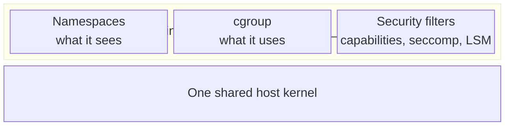
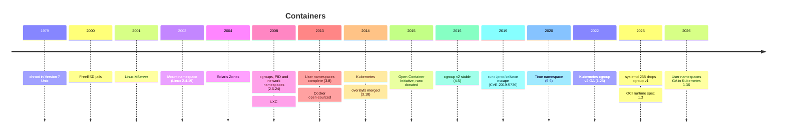
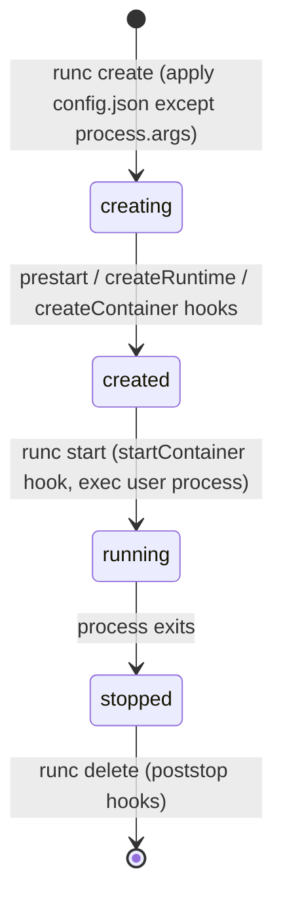

---
tags:
  - operating-systems
  - linux
  - containers
  - namespaces
  - cgroups
  - isolation
status: draft
sources:
  - https://man7.org/linux/man-pages/man7/namespaces.7.html
  - https://man7.org/linux/man-pages/man7/user_namespaces.7.html
  - https://man7.org/linux/man-pages/man2/pivot_root.2.html
  - https://man7.org/linux/man-pages/man2/seccomp.2.html
  - https://lwn.net/Articles/531114/
  - https://docs.kernel.org/admin-guide/cgroup-v2.html
  - https://docs.kernel.org/filesystems/overlayfs.html
  - https://lwn.net/Articles/236032/
  - https://papers.freebsd.org/2000/phk-jails/
  - https://blog.jessfraz.com/post/containers-zones-jails-vms/
  - https://queue.acm.org/detail.cfm?id=3301253
  - https://bsdimp.blogspot.com/2020/06/whither-chroot.html
  - https://www.redhat.com/en/blog/history-containers
  - https://www.usenix.org/conference/lisa-04/solaris-zones-operating-system-support-consolidating-commercial-workloads
  - https://kernelnewbies.org/Linux_2_6_24
  - https://kernelnewbies.org/Linux_3.18
  - https://kernelnewbies.org/Linux_4.5
  - https://kernelnewbies.org/Linux_4.15
  - https://kernelnewbies.org/Linux_4.20
  - https://kernelnewbies.org/Linux_5.6
  - https://www.infoq.com/news/2013/03/Docker
  - https://opencontainers.org/about/overview/
  - https://github.com/opencontainers/runtime-spec/blob/main/runtime.md
  - https://cos.googlesource.com/third_party/runc/+show/refs/heads/upstream/release-1.4/libcontainer/README.md
  - https://chromium.googlesource.com/external/github.com/docker/runc/+show/master/libcontainer/nsenter/README.md
  - https://openwall.com/lists/oss-security/2019/02/11/2
  - https://lwn.net/Articles/961086
  - https://www.cncf.io/blog/2025/11/28/runc-container-breakout-vulnerabilities-a-technical-overview/
  - https://openwall.com/lists/oss-security/2026/06/13/2
  - https://lwn.net/Articles/1038458/
  - https://opencontainers.org/posts/blog/2025-11-04-oci-runtime-spec-v1-3/
  - https://containerd.io/releases/
  - https://www.docker.com/blog/docker-engine-version-29/
  - https://www.kubernetes.dev/resources/keps/5573/
  - https://kubernetes.io/blog/2026/04/23/kubernetes-v1-36-userns-ga/
  - https://www.kubernetes.dev/resources/keps/127/
  - https://www.kubernetes.dev/resources/keps/2570/
  - https://kubernetes.io/blog/2026/08/26/Kubernetes-v1-37-release/
  - https://www.kubernetes.io/blog/2026/01/30/new-cgroup-v1-to-v2-cpu-conversion-formula/
  - https://bugs.openjdk.org/browse/JDK-8370492
  - https://kubernetes.io/blog/2026/10/06/kubernetes-cgroups-v2-shift/
created: 2026-11-26
updated: 2026-11-26
---

## Table Of Contents

---

- [[#TL;DR|TL;DR]]
- [[#The Problem|The Problem]]
- [[#Foundations|Foundations]]
    - [[#A Container Is Just a Process|A Container Is Just a Process]]
    - [[#Namespaces Change What a Process Can See|Namespaces Change What a Process Can See]]
    - [[#User Namespaces and Rootless Containers|User Namespaces and Rootless Containers]]
    - [[#cgroups Change What a Process Can Use|cgroups Change What a Process Can Use]]
- [[#How We Got Here|How We Got Here]]
- [[#How It Works|How It Works]]
    - [[#Building a Container by Hand|Building a Container by Hand]]
    - [[#What runc Does|What runc Does]]
    - [[#Image Layers and overlayfs|Image Layers and overlayfs]]
    - [[#The Security Layers on Top|The Security Layers on Top]]
    - [[#From a Kubernetes Pod Spec to cgroup Files|From a Kubernetes Pod Spec to cgroup Files]]
- [[#Where It Is Now|Where It Is Now]]
- [[#Trade-offs & Open Problems|Trade-offs & Open Problems]]
- [[#Resources|Resources]]
- [[#Related Notes|Related Notes]]

## ***TL;DR***
---
*Linux has no "container" object. A container is an ordinary process that the kernel shows a private view of the system (namespaces), limits in what it can consume (cgroups), roots in its own filesystem (pivot_root plus overlayfs), and restricts with security filters (capabilities, seccomp, an LSM). Runtimes like runc assemble these pieces from a JSON spec.*

- **Namespaces** isolate what a process *sees*: eight types (mount, UTS, IPC, PID, network, user, cgroup, time), each created with a `CLONE_NEW*` flag on `clone()` or `unshare()`.
- **cgroups** control what a process *uses*: CPU weight and quota, memory limits and protection, I/O bandwidth, process counts. cgroup v2 (stable since Linux 4.5, 2016) is one unified tree of directories whose files are the knobs (`cpu.max`, `memory.max`).
- **Containers vs VMs.** All containers share one host kernel. Startup is a fork and exec, overhead is near zero, and density is high; the cost is that a kernel bug or a runtime bug is a path to the host. runc has had escape-class bugs in 2019, 2024, November 2025 and June 2026.
- **The stack.** Kubernetes → kubelet → CRI runtime (containerd, CRI-O) → OCI runtime (runc, crun) → kernel. The OCI specs (2015) standardise image and runtime formats.
- **Late 2026.** cgroup v1 is on its way out: systemd 258 removed it (September 2025), and the Kubernetes kubelet refuses to start on it by default since 1.35. **User namespaces in pods went GA in Kubernetes 1.36** (April 2026), so container root no longer has to be host root.

## ***The Problem***
---
*People wanted to pack many applications onto one machine, each believing it had the machine to itself and none able to starve the others, without paying for a full virtual machine and a second kernel per application.*

A [[Virtualization and Hypervisors|virtual machine]] gives strong isolation but costs a guest kernel's memory, a boot, and exits on every privileged operation. For running many copies of trusted-ish services, that is a lot of overhead. The alternative is to have *one* kernel serve many isolated groups of processes.

That needs two separate things:

1. **Isolation of view.** A process in group A shouldn't see group B's processes, files, network interfaces, hostname or users. The original idea is FreeBSD's jails: split one kernel into environments while keeping UNIX's simple root model, so root inside a jail is root only there ([Kamp & Watson, 2000](https://papers.freebsd.org/2000/phk-jails/)).
2. **Control of resources.** Group A shouldn't be able to take all the CPU, memory or disk bandwidth. Google's engineers proposed cgroups in 2007 to "track or limit" resources per group of processes ([Menage, LWN](https://lwn.net/Articles/236032/)).

Linux built these as separate, composable primitives rather than one feature. Jessie Frazelle's point is that this is the key difference from Solaris Zones and BSD jails, which were *designed* as isolation units: Linux containers are assembled, so their isolation is only as good as the assembly ([Frazelle, 2017](https://blog.jessfraz.com/post/containers-zones-jails-vms/)).

## ***Foundations***
---
*Three kernel features make a container: namespaces for what it sees, cgroups for what it uses, and a changed root filesystem for what files it has. Everything else (images, runtimes, orchestrators) is tooling to set these up consistently.*

### A Container Is Just a Process

*There is no container in the kernel's data structures, only processes with particular namespace pointers, a cgroup membership, a root directory, and security settings.*



runc's libcontainer README lists exactly these ingredients: a rootfs, the namespaces to create, the mounts (`proc`, a tmpfs `/dev`, `devpts`, `shm`, `mqueue`, read-only `sysfs`), cgroups, capability sets, masked and read-only paths, user ID maps and resource limits ([libcontainer](https://cos.googlesource.com/third_party/runc/+show/refs/heads/upstream/release-1.4/libcontainer/README.md)). You can see a process's container-ness in `/proc/<pid>/ns/` and `/proc/<pid>/cgroup`, like any other process attribute ([[Processes and Threads]]).

### Namespaces Change What a Process Can See

*Each namespace type wraps one global resource so that processes inside get their own instance of it. They are created when a process is cloned or unshares, and they live as long as something references them.*

| Namespace | Flag | Isolates | Since |
|---|---|---|---|
| Mount | `CLONE_NEWNS` | Mount points (the filesystem tree) | 2.4.19 (2002), the first |
| UTS | `CLONE_NEWUTS` | Hostname, NIS domain name | 2.6.19 |
| IPC | `CLONE_NEWIPC` | System V IPC, POSIX message queues | 2.6.19 |
| PID | `CLONE_NEWPID` | Process IDs (first process is PID 1 inside) | 2.6.24 (2008) |
| Network | `CLONE_NEWNET` | Interfaces, routes, firewall, ports | 2.6.24 to ~2.6.29 |
| User | `CLONE_NEWUSER` | User and group IDs, capabilities | complete in 3.8 (2013) |
| Cgroup | `CLONE_NEWCGROUP` | The visible root of the cgroup tree | 4.6 (2016) |
| Time | `CLONE_NEWTIME` | Boot-time and monotonic clocks | 5.6 (2020) |

Sources: [namespaces(7)](https://man7.org/linux/man-pages/man7/namespaces.7.html); [Kerrisk, LWN 2013](https://lwn.net/Articles/531114/); [kernelnewbies 5.6](https://kernelnewbies.org/Linux_5.6).

Three system calls manage them:

- **`clone(2)`** with `CLONE_NEW*` flags starts a child in new namespaces.
- **`unshare(2)`** moves the *calling* process into new namespaces.
- **`setns(2)`** joins an existing namespace, given a file descriptor for one of the `/proc/<pid>/ns/*` entries. This is how `docker exec` and `nsenter` get "inside" a running container.

Each `/proc/<pid>/ns/*` entry is a symlink like `net:[4026531992]`; two processes in the same namespace show the same number, and holding the file open or bind-mounting it keeps the namespace alive with no process in it ([namespaces(7)](https://man7.org/linux/man-pages/man7/namespaces.7.html)). The time namespace exists so that a container can be [[Time and Clocks|checkpointed and moved]] to another host without its monotonic clock jumping.

### User Namespaces and Rootless Containers

*A user namespace maps a range of IDs inside to a different range outside, so a process can be root (UID 0) in its namespace while being an ordinary user on the host.*

From [user_namespaces(7)](https://man7.org/linux/man-pages/man7/user_namespaces.7.html):

- **ID maps.** A line in `/proc/<pid>/uid_map` reads `inside outside count`. `0 100000 65536` means UIDs 0–65535 inside are 100000–165535 outside. An unprivileged process may write only a single line mapping its own ID; wider ranges need the setuid helpers `newuidmap`/`newgidmap`.
- **Capabilities are scoped.** Root inside has capabilities only over resources its user namespace owns. Loading kernel modules, setting the system clock, `mknod` and mounting block-device filesystems still need the *initial* namespace.
- **No privilege needed.** Since 3.8, an unprivileged user can create a user namespace, and with it every other namespace type, because the user namespace is created first and its root owns the rest. This is what makes rootless containers (Podman, rootless Docker) possible.

The catch: unprivileged user namespaces let any user reach kernel code paths that used to require root, which has made them a recurring source of kernel exploits. Some distributions restrict them for that reason.

### cgroups Change What a Process Can Use

*A cgroup is a directory in a special filesystem; putting a process's PID in its `cgroup.procs` file puts it under that directory's limits, and child directories subdivide them.*

cgroup v2 is a single hierarchy mounted at `/sys/fs/cgroup` ([kernel docs](https://docs.kernel.org/admin-guide/cgroup-v2.html)). Rules:

- `cgroup.controllers` lists available controllers; writing `+cpu +memory` to `cgroup.subtree_control` enables them for children. Control flows top-down.
- **No internal processes:** once a cgroup hands controllers to its children, processes live only in the leaves. This makes resource distribution unambiguous.

The main knobs:

| Controller | File | Meaning |
|---|---|---|
| cpu | `cpu.weight` | Relative share under contention (1–10000, default 100) |
| cpu | `cpu.max` | Hard quota: `$MAX $PERIOD` in µs (default `max 100000`, no limit) |
| memory | `memory.min` / `memory.low` | Hard / best-effort protection from reclaim |
| memory | `memory.high` | Throttle and reclaim hard above this; never OOM-kills |
| memory | `memory.max` | Hard limit; if reclaim fails, the cgroup's OOM killer runs |
| memory | `memory.oom.group` | Kill the whole cgroup together on OOM |
| io | `io.max` / `io.weight` | Bandwidth/IOPS caps per device; relative share |
| pids | `pids.max` | Cap on processes; `fork()` beyond it fails with `EAGAIN` |
| cpuset | `cpuset.cpus` | Which CPUs (and NUMA nodes) it may use |
| (all) | `cpu/memory/io.pressure` | Pressure stall information: how long tasks waited |

Memory protection and reclaim interact with the kernel's [[Page Cache and Memory Reclaim]]; CPU weight and quota are enforced by the [[CPU Scheduling|scheduler]].

## ***How We Got Here***
---
*Containers grew from chroot (1979) through BSD jails and Solaris Zones to Linux's piecemeal namespaces and Google's cgroups. Docker (2013) didn't add kernel features; it made them easy to package and ship, and the OCI (2015) turned its formats into standards.*



- **chroot** was system call 61 in Version 7 Unix in 1979; it changes only the root directory, and root can escape it ([bsdimp](https://bsdimp.blogspot.com/2020/06/whither-chroot.html)).
- **Jails and Zones.** FreeBSD jails (2000) and Solaris Zones (2004, [LISA](https://www.usenix.org/conference/lisa-04/solaris-zones-operating-system-support-consolidating-commercial-workloads)) were full OS-level isolation designs.
- **Linux, one piece at a time.** The mount namespace arrived in 2002; UTS and IPC in 2.6.19; PID namespaces and Google's "Task Control Groups" in 2.6.24, January 2008 ([kernelnewbies](https://kernelnewbies.org/Linux_2_6_24)). cgroups began as Paul Menage's "process containers" built out of cpusets ([LWN](https://lwn.net/Articles/236032/)). User namespaces took until 3.8 in 2013.
- **Docker** (March 2013) combined LXC, AUFS layered filesystems and cgroups behind a simple CLI and image format ([InfoQ](https://www.infoq.com/news/2013/03/Docker)). Its contribution was packaging: an image you build once and run anywhere.
- **Standards.** The Open Container Initiative launched in June 2015 with Docker's runc as the reference runtime ([OCI](https://opencontainers.org/about/overview/)). Kubernetes (2014) grew out of Google's Borg ([Red Hat](https://www.redhat.com/en/blog/history-containers); see [[Cluster Scheduling]]).
- **cgroup v2.** v1 let each controller have its own hierarchy, which made combined policies incoherent. The unified v2 was declared stable in 4.5 (March 2016) with only memory and io, gained the cpu controller in 4.15 (2018) and PSI in 4.20 ([kernelnewbies 4.5](https://kernelnewbies.org/Linux_4.5), [4.15](https://kernelnewbies.org/Linux_4.15), [4.20](https://kernelnewbies.org/Linux_4.20)).

## ***How It Works***
---
*Starting a container is a choreographed sequence of system calls: create namespaces, set ID maps, build and switch to a new root, create and join a cgroup, drop privileges, install filters, and exec the application.*

### Building a Container by Hand

*About forty lines of C give you a process that thinks it's PID 1 on a machine called "box" with its own root filesystem.*

```c
static int child(void *rootfs) {
    sethostname("box", 3);                                   /* private, thanks to CLONE_NEWUTS */
    mount(NULL, "/", NULL, MS_REC | MS_PRIVATE, NULL);       /* don't leak mounts back to the host */
    mount(rootfs, rootfs, NULL, MS_BIND | MS_REC, NULL);     /* new root must be a mount point */
    chdir(rootfs);
    syscall(SYS_pivot_root, ".", ".");                       /* swap roots; old root stacked on top */
    umount2(".", MNT_DETACH);                                /* detach the old root entirely */
    mount("proc", "/proc", "proc", 0, NULL);                 /* a /proc for the new PID namespace */
    execl("/bin/sh", "sh", NULL);                            /* this shell is PID 1 */
    return 1;
}

int main(int argc, char **argv) {
    static char stack[1 << 20];
    pid_t pid = clone(child, stack + sizeof stack,
                      CLONE_NEWPID | CLONE_NEWUTS | CLONE_NEWNS | SIGCHLD, argv[1]);
    waitpid(pid, NULL, 0);
}
```

**In plain words:** `clone` creates a child in new PID, UTS and mount namespaces. The child renames its host, makes its mounts private, turns the target directory into a mount point, and uses `pivot_root(".", ".")` to make it the root, a trick the man page documents for avoiding a temporary directory ([pivot_root(2)](https://man7.org/linux/man-pages/man2/pivot_root.2.html)). Unmounting the old root means nothing of the host filesystem is reachable. Mounting a fresh `/proc` makes `ps` show only the container's processes. Run as root; to run unprivileged, add `CLONE_NEWUSER` and have the parent write `0 <your-uid> 1` to the child's `uid_map`. Missing are a cgroup, capability drops and seccomp, which is exactly the gap between a toy and runc.

### What runc Does

*runc implements the OCI runtime spec: given a bundle (a root filesystem plus `config.json`), it creates the container, runs hooks, and execs the process, in a fixed lifecycle.*

The OCI lifecycle ([runtime spec](https://github.com/opencontainers/runtime-spec/blob/main/runtime.md)):



Inside `create`, runc has a peculiar first step. Go programs are multi-threaded from birth, and `setns`/`unshare` behave badly in multi-threaded processes, so runc runs a small C constructor (`nsexec`) *before* the Go runtime starts. It reads setup instructions from a pipe, joins or creates the namespaces, writes ID maps and reports the child's PID ([nsenter README](https://chromium.googlesource.com/external/github.com/docker/runc/+show/master/libcontainer/nsenter/README.md)). Then `runc init` sets up the root filesystem and mounts, joins the cgroup, applies capabilities and other security settings, and finally execs the user's program ([libcontainer](https://cos.googlesource.com/third_party/runc/+show/refs/heads/upstream/release-1.4/libcontainer/README.md)).

### Image Layers and overlayfs

*An image is a stack of read-only layers; overlayfs merges them into one tree and adds a writable layer on top, so a hundred containers from one image share one copy on disk and in the page cache.*

From the [overlayfs docs](https://docs.kernel.org/filesystems/overlayfs.html) (merged in Linux 3.18, December 2014):

```
mount -t overlay overlay \
  -o lowerdir=/layers/app:/layers/runtime:/layers/base,upperdir=/c1/upper,workdir=/c1/work \
  /c1/rootfs
```

- **`lowerdir`**: read-only layers, leftmost on top.
- **`upperdir`**: the container's writable layer. `workdir` is scratch space on the same filesystem.
- **Copy-up:** the first write to a lower file copies it to the upper layer. With `metacopy`, a `chmod` copies only metadata.
- **Whiteouts:** deleting a lower file creates a marker (a 0/0 character device or an xattr) in the upper layer that hides it. Opaque directories hide a whole lower directory.

Because lower layers are shared, their pages in the page cache are shared too, a large part of why containers are dense. See [[File Systems]].

### The Security Layers on Top

*Namespaces and cgroups isolate, but they don't stop a process from calling dangerous kernel interfaces. Three more layers narrow what container root can do.*

| Layer | What it does |
|---|---|
| **Capabilities** | Split root's power into ~40 pieces; runtimes drop most (e.g. keep `NET_BIND_SERVICE`, drop `SYS_ADMIN`, `SYS_MODULE`) |
| **seccomp-bpf** | A BPF filter on every system call; Docker's default profile blocks dozens of rarely needed ones. `seccomp()` syscall since 3.17; needs `no_new_privs` or `CAP_SYS_ADMIN` ([seccomp(2)](https://man7.org/linux/man-pages/man2/seccomp.2.html)) |
| **LSMs** | AppArmor or SELinux profiles confine file, network and capability use by label |
| **Masked / read-only paths** | Hide or freeze `/proc/kcore`, `/proc/sysrq-trigger`, `/sys/firmware` and similar |
| **User namespaces** | Make container root an unprivileged host UID, so an escape lands as nobody |

Frazelle argues a well-crafted seccomp profile can approach hypervisor-level attack-surface reduction ([ACM Queue, 2018](https://queue.acm.org/detail.cfm?id=3301253)); [[MicroVMs and Sandboxing]] covers the alternatives when it can't. See also [[Kernel Security Hardening]].

### From a Kubernetes Pod Spec to cgroup Files

*Kubernetes resource requests and limits are, in the end, numbers written into cgroup files by the kubelet and the container runtime.*

| Pod spec | cgroup v2 file | Effect |
|---|---|---|
| `resources.limits.cpu: 500m` | `cpu.max = 50000 100000` | At most 50 ms of CPU per 100 ms period; then throttled |
| `resources.requests.cpu: 250m` | `cpu.weight` (from v1 shares 256) | Share under contention |
| `resources.limits.memory: 1Gi` | `memory.max = 1073741824` | OOM kill above it |
| `resources.requests.memory` (Memory QoS) | `memory.min` (Guaranteed) or `memory.low` (Burstable) | Protected from reclaim ([KEP-2570](https://www.kubernetes.dev/resources/keps/2570/)) |

**Worked example 1: CPU throttling.** A single-threaded request handler needs 120 ms of CPU, in a container limited to 500m (50 ms per 100 ms). It runs 50 ms, is throttled for the rest of the period, runs 50 ms, is throttled again, then runs its last 20 ms: about $100 + 100 + 20 = 220$ ms of wall time for 120 ms of work, even on an idle machine. A limit throttles; it doesn't kill.

**Worked example 2: shares to weight.** Kubernetes thinks in cgroup v1 "shares" (1024 per CPU), so 250m becomes $1024 \times 0.25 = 256$ shares, which must be converted to a v2 weight. The original linear mapping was

$$
w = 1 + \frac{(s - 2) \times 9999}{262142}
$$

**In plain English:** squeeze v1's range of 2–262144 shares linearly into v2's 1–10000. For $s = 1024$ (one full CPU) that gives $w \approx 40$, not the v2 default of 100, and for $s = 256$ it gives $w \approx 10$. So a container requesting one CPU got *less* weight than an ordinary systemd service at 100. The 2026 fix uses a quadratic in $\log_2 s$:

$$
w = 10^{\left(\frac{(\log_2 s)^2}{612} + \frac{125}{612}\log_2 s - \frac{7}{34}\right)}
$$

For $s = 1024$, $\log_2 s = 10$: the exponent is $100/612 + 1250/612 - 7/34 = 2.0$, so $w = 100$. For $s = 256$, $\log_2 s = 8$: the exponent is $\approx 1.53$, so $w \approx 34$ ([Kubernetes, Jan 2026](https://www.kubernetes.io/blog/2026/01/30/new-cgroup-v1-to-v2-cpu-conversion-formula/); [OpenJDK](https://bugs.openjdk.org/browse/JDK-8370492)).

## ***Where It Is Now***
---
*As of November 2026, cgroup v2 is effectively mandatory, user namespaces are finally a default-safe option in Kubernetes, and runc keeps getting escape bugs through `/proc` and mount races.*

**cgroup v1 is ending.**

- **systemd 258** (September 2025) "completely removes" cgroup v1 support ([LWN](https://lwn.net/Articles/1038458/)).
- **Kubernetes 1.35** (December 2025): the kubelet refuses to start on cgroup v1 unless `FailCgroupV1=false`; code removal no earlier than 1.38 ([KEP-5573](https://www.kubernetes.dev/resources/keps/5573/)).
- **containerd** deprecated cgroup v1 as of 2.2, with removal targeted for May 2029; 2.3 is the current long-term release (April 2026) ([containerd](https://containerd.io/releases/)).

**User namespaces in pods** went **GA in Kubernetes 1.36** (23 April 2026), set with `hostUsers: false`, after alpha in 1.25 ([Kubernetes](https://kubernetes.io/blog/2026/04/23/kubernetes-v1-36-userns-ga/)). They need Linux 6.3+ and idmapped mounts so volumes show the right owners ([KEP-127](https://www.kubernetes.dev/resources/keps/127/)). Kubernetes 1.37 (August 2026) moved Memory QoS (mapping requests to `memory.min`/`memory.low`) and rootless kubelets to beta ([release](https://kubernetes.io/blog/2026/08/26/Kubernetes-v1-37-release/); [KEP-2570](https://www.kubernetes.dev/resources/keps/2570/)).

**Specs and engines.** OCI runtime spec 1.3 (November 2025) added FreeBSD jails as a platform, network device and memory-policy fields ([OCI](https://opencontainers.org/posts/blog/2025-11-04-oci-runtime-spec-v1-3/)). Docker Engine 29 (November 2025) made the containerd image store the default ([Docker](https://www.docker.com/blog/docker-engine-version-29/)).

**Escapes.** The runtime, not just the kernel, is attack surface:

| Date | CVE | How |
|---|---|---|
| Feb 2019 | CVE-2019-5736 | Container overwrote the host's runc binary through `/proc/self/exe` ([oss-security](https://openwall.com/lists/oss-security/2019/02/11/2)) |
| Jan 2024 | CVE-2024-21626 "Leaky Vessels" | Leaked fd to host `/sys/fs/cgroup`; working directory `/proc/self/fd/7/` reached the host filesystem ([LWN](https://lwn.net/Articles/961086)) |
| Nov 2025 | CVE-2025-31133, -52565, -52881 | Mount races and symlink swaps defeat runc's protection of `/proc` writes (e.g. reach `core_pattern`); crun and youki had similar flaws ([CNCF](https://www.cncf.io/blog/2025/11/28/runc-container-breakout-vulnerabilities-a-technical-overview/)) |
| Jun 2026 | CVE-2026-41579 | Malicious image's `/dev` symlink lets runc create or delete a few host files ([oss-security](https://openwall.com/lists/oss-security/2026/06/13/2)) |

The common mitigation in every case: user namespaces, non-root container processes, and an LSM.

## ***Trade-offs & Open Problems***
---
*Containers win on speed and density by sharing the kernel; every weakness follows from that same sharing.*

| | Containers | VMs / microVMs |
|---|---|---|
| Startup | Fork + exec (milliseconds) | Boot a kernel (~100 ms microVM, seconds full VM) |
| Memory overhead | Near zero; page cache shared across layers | A guest kernel per instance |
| Isolation boundary | Host kernel's ~400 system calls plus the runtime | Hypervisor and a few virtual devices |
| Kernel choice | Host's kernel only | Any guest kernel |
| Resource control | Fine-grained, live-adjustable (cgroups) | Coarser (vCPUs, RAM size) |

**Open problems.**

- **Shared-kernel attack surface.** Any kernel bug reachable by a system call the container may make is a potential escape. Unprivileged user namespaces widen what's reachable even as they shrink the damage of an escape. This is why multi-tenant platforms run untrusted code in [[MicroVMs and Sandboxing|gVisor or microVMs]] instead.
- **Noisy neighbours.** cgroups divide CPU time and memory but not caches, memory bandwidth or many kernel locks. CPU limits throttle in 100 ms periods, which hurts tail latency (worked example above). `memory.high` throttling could livelock workloads, which is why Kubernetes Memory QoS's planned 1.28 beta was cancelled ([KEP-2570](https://www.kubernetes.dev/resources/keps/2570/)).
- **Memory accounting.** Hitting `memory.max` invokes the OOM killer inside the container; kernel memory and page cache are charged in ways that can surprise; and translating v1-era numbers to v2 skewed CPU priorities until 2026.
- **Rootless limits.** Inside a user namespace you still can't load modules, set the time, `mknod` or mount block devices, and idmapped mounts need recent kernels and filesystem support.
- **Migration.** systemd and Kubernetes have left cgroup v1 behind; old distributions and kernels are stranded.

## ***Resources***
---
*Michael Kerrisk's namespace man pages and LWN series are the reference for namespaces, the kernel's cgroup-v2 document for resource control, and Frazelle's essays for the design argument. The OCI runtime spec shows how the pieces are assembled.*

**Reference**
- [namespaces(7)](https://man7.org/linux/man-pages/man7/namespaces.7.html) and [user_namespaces(7)](https://man7.org/linux/man-pages/man7/user_namespaces.7.html): Michael Kerrisk, man7.org.
- [Namespaces in operation, part 1](https://lwn.net/Articles/531114/): Kerrisk, LWN, Jan 2013.
- [Control Group v2](https://docs.kernel.org/admin-guide/cgroup-v2.html): kernel.org.
- [Overlay Filesystem](https://docs.kernel.org/filesystems/overlayfs.html): kernel.org.
- [pivot_root(2)](https://man7.org/linux/man-pages/man2/pivot_root.2.html), [seccomp(2)](https://man7.org/linux/man-pages/man2/seccomp.2.html): man7.org.
- [OCI runtime spec lifecycle](https://github.com/opencontainers/runtime-spec/blob/main/runtime.md): Open Container Initiative.

**History and design**
- [Jails: Confining the omnipotent root](https://papers.freebsd.org/2000/phk-jails/): Kamp & Watson, 2000.
- [Containers: Generic Process Containers](https://lwn.net/Articles/236032/): Paul Menage, LWN, 2007.
- [Setting the Record Straight: containers vs. Zones vs. Jails vs. VMs](https://blog.jessfraz.com/post/containers-zones-jails-vms/): Jessie Frazelle, 2017.
- [Security for the Modern Age](https://queue.acm.org/detail.cfm?id=3301253): Frazelle, ACM Queue, 2018.
- [A History of Containers](https://www.redhat.com/en/blog/history-containers): Red Hat, 2015.

**Where it is now**
- [runc container breakout vulnerabilities](https://www.cncf.io/blog/2025/11/28/runc-container-breakout-vulnerabilities-a-technical-overview/): CNCF, Nov 2025.
- [KEP-5573: Remove cgroup v1 support](https://www.kubernetes.dev/resources/keps/5573/): SIG Node.
- [Kubernetes v1.36: User Namespaces GA](https://kubernetes.io/blog/2026/04/23/kubernetes-v1-36-userns-ga/): Kubernetes, Apr 2026.
- [The Shift to cgroup v2 in Kubernetes](https://kubernetes.io/blog/2026/10/06/kubernetes-cgroups-v2-shift/): Kubernetes, Oct 2026.

## Related Notes

- [[Virtualization and Hypervisors]] — The heavier isolation model containers were built to avoid.
- [[MicroVMs and Sandboxing]] — gVisor, Firecracker and Kata: container interfaces with VM-grade isolation.
- [[Processes and Threads]] — Containers are processes; namespaces are fields of the task.
- [[System Calls and the User-Kernel Boundary]] — The shared-kernel interface seccomp filters.
- [[CPU Scheduling]] — How `cpu.weight` and `cpu.max` are enforced.
- [[Page Cache and Memory Reclaim]] — What `memory.low`, `memory.high` and `memory.max` steer.
- [[Memory Allocators]] — Kernel memory charged to cgroups.
- [[File Systems]] — overlayfs, mount trees and the VFS.
- [[eBPF]] — The BPF machinery behind seccomp filters and container networking.
- [[Kernel Security Hardening]] — Capabilities, LSMs and namespaces as defences.
- [[Kernel Architectures]] — Why a shared monolithic kernel is the trust boundary.
- [[Cluster Scheduling]] — Kubernetes and Borg, which schedule containers across machines.
- [[Time and Clocks]] — The clocks the time namespace virtualizes.
