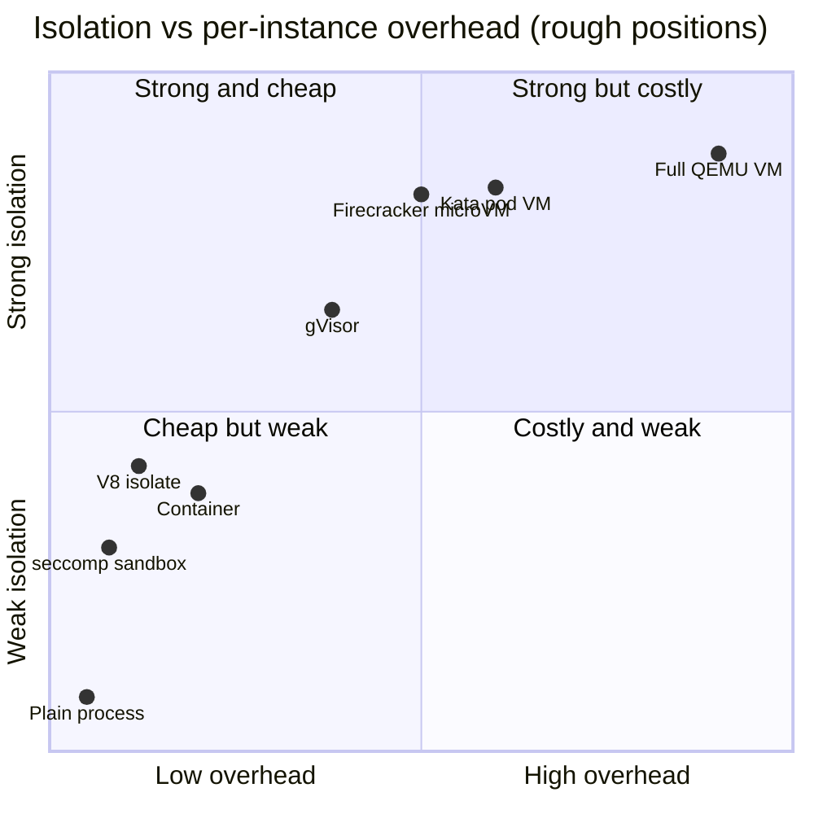
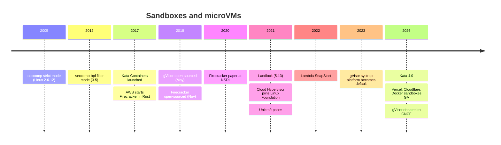
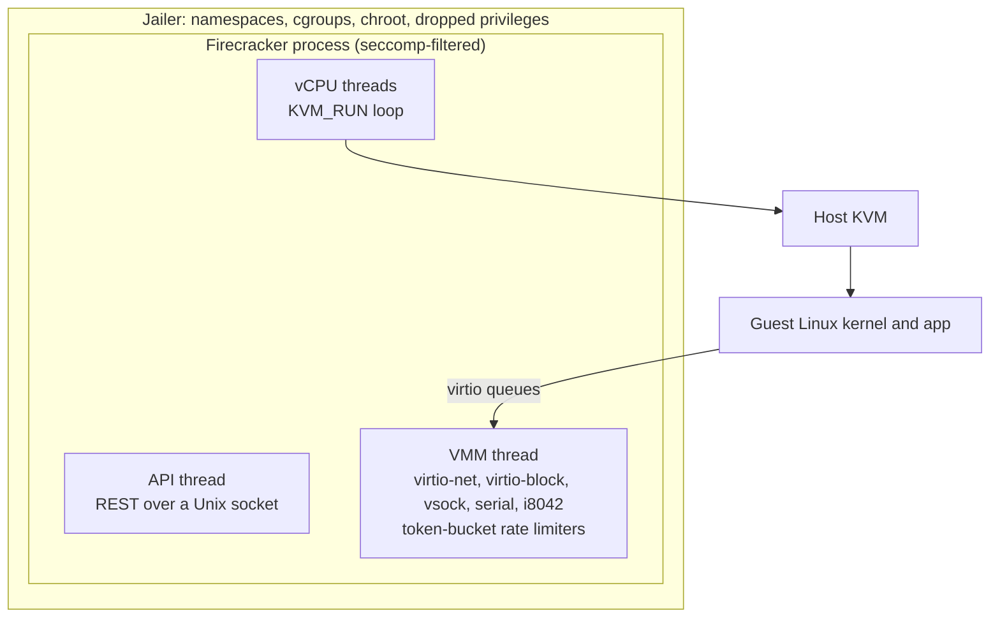
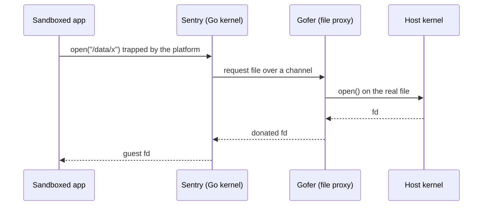

---
tags:
  - operating-systems
  - virtualization
  - sandboxing
  - firecracker
  - gvisor
  - isolation
status: draft
sources:
  - https://www.usenix.org/conference/nsdi20/presentation/agache
  - https://github.com/firecracker-microvm/firecracker/blob/main/docs/design.md
  - https://github.com/firecracker-microvm/firecracker/blob/main/SPECIFICATION.md
  - https://github.com/firecracker-microvm/firecracker/blob/main/docs/prod-host-setup.md
  - https://raw.githubusercontent.com/firecracker-microvm/firecracker/main/docs/snapshotting/snapshot-support.md
  - https://arxiv.org/abs/2102.12892
  - https://aws.amazon.com/about-aws/whats-new/2018/11/firecracker-lightweight-virtualization-for-serverless-computing
  - https://aws.amazon.com/blogs/opensource/firecracker-open-source-secure-fast-microvm-serverless
  - https://aws.amazon.com/about-aws/whats-new/2022/11/aws-lambda-snapstart-java-functions
  - https://aws.amazon.com/security/security-bulletins/2026-015-aws
  - https://github.com/firecracker-microvm/firecracker/issues/849
  - https://gvisor.dev/docs/
  - https://gvisor.dev/docs/user_guide/compatibility/linux/amd64/
  - https://gvisor.dev/docs/architecture_guide/platforms/
  - https://gvisor.dev/docs/architecture_guide/performance/
  - https://gvisor.dev/blog/2023/04/28/systrap-release/
  - https://cloud.google.com/blog/products/identity-security/open-sourcing-gvisor-a-sandboxed-container-runtime
  - https://docs.kernel.org/userspace-api/seccomp_filter.html
  - https://lwn.net/Articles/475019/
  - https://www.man7.org/conf/lpc2015/limiting_kernel_attack_surface_with_seccomp-LPC_2015-Kerrisk.pdf
  - https://docs.kernel.org/userspace-api/landlock.html
  - https://chromium.googlesource.com/chromium/src/+/HEAD/sandbox/linux/README.md
  - https://chromium.googlesource.com/crosvm/crosvm/+/HEAD/README.md
  - https://github.com/rust-vmm/community
  - https://www.qemu.org/docs/master/system/i386/microvm.html
  - https://openstack.org/news/view/365/kata-containers-project-launches-to-build-secure-container-infrastructure
  - https://raw.githubusercontent.com/kata-containers/kata-containers/main/docs/design/architecture/README.md
  - https://katacontainers.io/blog/kata-containers-4-0-0-release-overview/
  - https://linuxfoundation.org/press/press-release/linux-foundation-to-host-the-cloud-hypervisor-project-creating-a-performant-lightweight-virtual-machine-monitor-for-modern-cloud-workloads
  - https://phoronix.com/news/Cloud-Hypervisor-54
  - https://arxiv.org/abs/2104.12721
  - https://opensource.googleblog.com/2026/11/sandboxing-untrusted-ai-agents-at-scale.html
  - https://modal.com/blog/modal-gvisor-maintainer
  - https://gvisor.dev/blog/2026/04/23/scaling-agentic-rl-sandboxes-to-the-millions-with-gvisor-at-tencent/
  - https://infoq.com/news/2026/09/gke-pod-snapshots-benchmarks
  - https://vercel.com/blog/vercel-sandbox-is-now-generally-available
  - https://blog.cloudflare.com/sandbox-ga
  - https://developers.cloudflare.com/workers/reference/how-workers-works/
  - https://www.docker.com/blog/why-microvms-the-architecture-behind-docker-sandboxes/
  - https://arxiv.org/html/2606.08433
  - https://bytecodealliance.org/articles/WASI-0.3
created: 2026-11-26
updated: 2026-11-26
---

## Table Of Contents

---

- [[#TL;DR|TL;DR]]
- [[#The Problem|The Problem]]
- [[#Foundations|Foundations]]
    - [[#The Isolation Spectrum|The Isolation Spectrum]]
    - [[#Attack Surface Is the Unit of Measure|Attack Surface Is the Unit of Measure]]
- [[#How We Got Here|How We Got Here]]
- [[#How It Works|How It Works]]
    - [[#Firecracker — A VMM With Almost Nothing In It|Firecracker — A VMM With Almost Nothing In It]]
    - [[#Snapshots and Fast Restore|Snapshots and Fast Restore]]
    - [[#gVisor — A Kernel Written in Go, in User Space|gVisor — A Kernel Written in Go, in User Space]]
    - [[#Kata Containers — A VM Per Pod|Kata Containers — A VM Per Pod]]
    - [[#Process Sandboxes — seccomp-bpf and Landlock|Process Sandboxes — seccomp-bpf and Landlock]]
- [[#Where It Is Now|Where It Is Now]]
- [[#Trade-offs & Open Problems|Trade-offs & Open Problems]]
- [[#Resources|Resources]]
- [[#Related Notes|Related Notes]]

## ***TL;DR***
---
*Containers share the host kernel, so running strangers' code in them is risky; full VMs are safe but slow and heavy. MicroVMs and sandboxes sit between: they keep a container's speed and density while putting a much smaller, harder boundary between untrusted code and the host.*

- **MicroVMs** (Firecracker, Cloud Hypervisor, QEMU's `microvm`) are real KVM virtual machines with almost every device removed. Firecracker is about 50k lines of Rust, boots a Linux guest in under 125 ms, costs under 5 MiB per VM, and lets one host start up to 150 microVMs per second ([NSDI 2020](https://www.usenix.org/conference/nsdi20/presentation/agache)). It runs AWS Lambda and Fargate.
- **gVisor** takes the other route: a kernel reimplemented in Go that runs in user space and answers the sandboxed program's system calls itself, so the program never talks to the host kernel directly ([gVisor](https://gvisor.dev/docs/)).
- **Kata Containers** puts each Kubernetes pod in its own lightweight VM behind the normal container interface.
- **Process sandboxes** (seccomp-bpf, Landlock, Chromium's sandbox) don't virtualize anything; they just forbid system calls and file access a program shouldn't need.
- **Late 2026.** AI agents running generated code are the new driver. Google donated gVisor to the CNCF in November 2026; Modal, Tencent, Vercel, E2B, Cloudflare and Docker all ship sandboxes built on gVisor or microVMs; snapshot-and-restore is the key trick for agents that sit idle 90–95% of the time ([Google](https://opensource.googleblog.com/2026/11/sandboxing-untrusted-ai-agents-at-scale.html)).

## ***The Problem***
---
*Serverless and agent platforms run code they did not write and cannot inspect, for thousands of customers on the same machines. They need VM-grade isolation at container-grade cost.*

A [[Containers, Namespaces and cgroups|container]] stops at the host kernel's system-call interface: roughly 400 entry points into millions of lines of C. Any reachable kernel bug is a way out, and container runtimes have had their own escapes. A [[Virtualization and Hypervisors|traditional VM]] is much safer, but QEMU alone is over 1.4 million lines, it emulates decades of legacy hardware, and booting a guest takes seconds.

When AWS built Lambda, it ran each customer's functions in a separate EC2 instance-class VM, which wasted resources because a function might need 128 MB for a few hundred milliseconds. The Firecracker paper lists what a multi-tenant serverless platform needs at once ([Agache et al., 2020](https://files.usenix.org/s3fs-public/cdn/nsdi20-paper-agache.pdf)):

| Requirement | Why |
|---|---|
| Isolation | Strangers' code on the same host, including side channels |
| Overhead and density | Thousands of small functions per server |
| Performance | Near bare-metal speed |
| Compatibility | Run ordinary Linux binaries unchanged |
| Fast switching | Start new instances and tear down old ones constantly |
| Soft allocation | Overcommit CPU and memory, since most functions idle |

Neither containers nor full VMs met all six. The same list now describes AI-agent sandboxes, which add long idle periods and the need to pause and resume a whole session.

## ***Foundations***
---
*Isolation technologies trade how much of the host is exposed against how much each instance costs. Moving the boundary further from the host kernel buys safety and costs overhead or compatibility.*

### The Isolation Spectrum

*From weakest to strongest boundary: plain processes, process sandboxes, containers, user-space kernels, microVMs, full VMs. Language runtimes like V8 isolates and WebAssembly are a separate axis that isolates inside one process.*



| Approach | Boundary the attacker faces | Startup | Per-instance memory | Compatibility |
|---|---|---|---|---|
| seccomp / Landlock | A filtered host syscall list | Instant | ~0 | Program must tolerate denials |
| Container | Full host kernel, namespaced | ms | ~0 | Linux binaries |
| gVisor | Sentry (Go) plus a few host syscalls | ~100s of ms | Tens of MB | Most Linux syscalls (292 of 385 on amd64) |
| Firecracker | KVM plus ~50k lines of Rust VMM | <125 ms | <5 MiB VMM plus guest | Linux guests only |
| Kata | KVM plus a VMM, one VM per pod | ~1 s | Guest kernel per pod | Full Linux, GPUs in 4.0 |
| V8 isolate | JavaScript engine | ~ms | A few MB | JS and Wasm only |

### Attack Surface Is the Unit of Measure

*A boundary is only as strong as the code that has to be correct for it to hold. Every design here shrinks that code, then runs what is left with the fewest privileges possible.*

- **Shrink the interface.** Firecracker emulates five devices instead of hundreds. gVisor lets its Sentry make only a small, filtered set of host system calls.
- **Write it in a safer language.** Firecracker, Cloud Hypervisor and crosvm are Rust; gVisor is Go. Both rule out most memory-safety bugs in the boundary code itself (see [[Rust in the Linux Kernel]]).
- **Defence in depth.** Firecracker runs its VMM process under a jailer that applies namespaces, cgroups, chroot and a seccomp filter, so a VMM bug still lands in a box. crosvm puts each virtual device in its own sandboxed process.
- **Kernel attack surface still counts.** A microVM's guest is untrusted but the host's KVM module isn't; KVM bugs are the residual risk.

## ***How We Got Here***
---
*Process sandboxes came first (seccomp 2005, Chromium 2008). Serverless demanded something stronger, and 2017–2018 brought Kata, gVisor and Firecracker within a year of each other. AI agents made 2026 the year sandboxes became a product category.*



- **seccomp.** Strict mode (only `read`, `write`, `exit`, `sigreturn`) arrived in 2.6.12 in 2005; Will Drewry's BPF filter mode landed in 3.5 in 2012 for Chrome's sandbox ([Kerrisk, LPC 2015](https://www.man7.org/conf/lpc2015/limiting_kernel_attack_surface_with_seccomp-LPC_2015-Kerrisk.pdf); [LWN](https://lwn.net/Articles/475019/)).
- **Kata Containers** (December 2017) merged Intel Clear Containers and Hyper runV under the OpenStack Foundation ([OpenStack](https://openstack.org/news/view/365/kata-containers-project-launches-to-build-secure-container-infrastructure)).
- **gVisor** was open-sourced by Google on 2 May 2018, implementing about 200 system calls at launch ([Google Cloud](https://cloud.google.com/blog/products/identity-security/open-sourcing-gvisor-a-sandboxed-container-runtime)).
- **Firecracker.** AWS began it in fall 2017, starting from ChromeOS's crosvm and choosing Rust for safety ([AWS](https://aws.amazon.com/blogs/opensource/firecracker-open-source-secure-fast-microvm-serverless)), and open-sourced it at re:Invent in November 2018 ([AWS](https://aws.amazon.com/about-aws/whats-new/2018/11/firecracker-lightweight-virtualization-for-serverless-computing)). Shared crates from crosvm, Firecracker and Cloud Hypervisor became the [rust-vmm](https://github.com/rust-vmm/community) project.
- **Snapshots.** Lambda SnapStart (November 2022) restored Java functions from a Firecracker snapshot for up to 10x faster cold starts ([AWS](https://aws.amazon.com/about-aws/whats-new/2022/11/aws-lambda-snapstart-java-functions)).
- **Unikernels** pursued the same goal by making the guest tiny; Unikraft (EuroSys 2021) showed sub-millisecond boots ([arXiv](https://arxiv.org/abs/2104.12721)). See [[Unikernels and Library OSes]].

## ***How It Works***
---
*Two families: microVMs keep the hardware boundary and shrink the software around it; user-space kernels and process sandboxes keep a software boundary and shrink what crosses it.*

### Firecracker — A VMM With Almost Nothing In It

*Firecracker is a KVM user-space VMM that emulates only what a cloud Linux guest needs: a network card, a disk, a host socket, a serial console and a keyboard controller used only to reset the VM.*

From the [design doc](https://github.com/firecracker-microvm/firecracker/blob/main/docs/design.md):



- **No BIOS, no PCI (originally), no legacy devices.** The VMM loads the kernel directly and boots it. The paper's seccomp filter allowed 24 system calls and 30 ioctls for the whole VMM ([paper](https://files.usenix.org/s3fs-public/cdn/nsdi20-paper-agache.pdf)).
- **Published targets.** Its [SPECIFICATION](https://github.com/firecracker-microvm/firecracker/blob/main/SPECIFICATION.md) promises ≤5 MiB memory overhead, a VMM startup cost of 8 CPU-ms, guest CPU over 95% of bare metal, and up to 14.5 Gbps networking and 1 GiB/s storage.
- **Host hardening.** The [production guide](https://github.com/firecracker-microvm/firecracker/blob/main/docs/prod-host-setup.md) asks hosts to disable SMT, KSM and swap and enable side-channel mitigations, because a VM boundary means little if the CPU leaks across it ([[Transient Execution Attacks and Mitigations]]).

A microVM is configured with a handful of API calls, then started:

```sh
curl --unix-socket /tmp/fc.sock -X PUT http://localhost/boot-source \
  -d '{"kernel_image_path":"vmlinux","boot_args":"console=ttyS0 reboot=k panic=1"}'
curl --unix-socket /tmp/fc.sock -X PUT http://localhost/drives/rootfs \
  -d '{"drive_id":"rootfs","path_on_host":"rootfs.ext4","is_root_device":true,"is_read_only":false}'
curl --unix-socket /tmp/fc.sock -X PUT http://localhost/machine-config \
  -d '{"vcpu_count":1,"mem_size_mib":128}'
curl --unix-socket /tmp/fc.sock -X PUT http://localhost/actions \
  -d '{"action_type":"InstanceStart"}'
```

**In plain words:** tell the VMM which kernel to boot and with what command line, attach a disk image as the root filesystem, size the VM at one vCPU and 128 MiB, then start it. There is no firmware stage or device probing, which is where most of a normal VM's boot time goes.

**Rate limiting.** Each virtio device can sit behind a token bucket so one tenant can't saturate the host's disk or network. Tokens refill continuously up to a bucket size:

$$
T(t + \Delta t) = \min\bigl(B,\; T(t) + r\,\Delta t\bigr)
$$

**In plain English:** the bucket holds at most $B$ tokens and gains $r$ per second; each byte (or operation) spends one, and when the bucket is empty the device waits. With $B = 50$ MB and $r = 10$ MB/s, a guest that has been idle can burst 50 MB at once, but sustained traffic settles at 10 MB/s, and after a full burst it takes 5 seconds to refill.

### Snapshots and Fast Restore

*Instead of booting, restore a VM from a saved image of its memory and device state; memory pages load lazily on first touch, so restore takes milliseconds.*

- Firecracker saves guest memory and VMM state to files and restores from them, typically mapping memory from the file so untouched pages never load ([snapshot docs](https://raw.githubusercontent.com/firecracker-microvm/firecracker/main/docs/snapshotting/snapshot-support.md)).
- **The uniqueness problem.** Two VMs restored from one snapshot share random-number-generator state, UUIDs and TLS session data, which can be catastrophic for cryptography. Brooker et al. analyse this ([arXiv 2021](https://arxiv.org/abs/2102.12892)); the fix is a virtual device (VMGenID, and VMClock in Linux 7.0) that tells the guest it was cloned so it can reseed.
- **Agents.** Google reports AI agents idle 90–95% of the time, so GKE Pod Snapshots (GA May 2026) and Agent Substrate checkpoint idle sandboxes and restore them in under 500 ms ([Google](https://opensource.googleblog.com/2026/11/sandboxing-untrusted-ai-agents-at-scale.html); [InfoQ](https://infoq.com/news/2026/09/gke-pod-snapshots-benchmarks)).

### gVisor — A Kernel Written in Go, in User Space

*gVisor intercepts every system call a sandboxed program makes and handles it in the Sentry, a Linux-compatible kernel written in Go; the Sentry itself may make only a small, seccomp-filtered set of host system calls.*

From the [gVisor docs](https://gvisor.dev/docs/):



- **Sentry** implements processes, memory, signals, networking (its own TCP/IP stack, netstack) and the VFS. On amd64 it implements 292 of 385 Linux system calls ([compatibility](https://gvisor.dev/docs/user_guide/compatibility/linux/amd64/)).
- **Gofer** mediates file access, so the Sentry needn't open host files itself.
- **Platforms** decide how system calls are intercepted: **systrap** (the default since mid-2023; uses seccomp `SECCOMP_RET_TRAP` and a shared-memory fast path), **KVM** (Sentry runs as a guest kernel, best on bare metal), and the deprecated **ptrace** ([platforms](https://gvisor.dev/docs/architecture_guide/platforms/); [systrap](https://gvisor.dev/blog/2023/04/28/systrap-release/)).
- **Cost.** Syscall-heavy and I/O-heavy workloads pay most, because every call crosses into the Sentry; compute-bound code runs at native speed ([performance guide](https://gvisor.dev/docs/architecture_guide/performance/)).

gVisor ships as `runsc`, an OCI runtime, so Docker or Kubernetes can use it in place of runc with one setting.

### Kata Containers — A VM Per Pod

*Kata keeps the container interface (CRI, OCI) but runs each pod inside its own lightweight VM, with an agent inside the guest creating the actual containers.*

From the [architecture doc](https://raw.githubusercontent.com/kata-containers/kata-containers/main/docs/design/architecture/README.md): containerd talks to a Kata shim (shim-v2), which starts a VM with a choice of VMMs (QEMU, Cloud Hypervisor, Firecracker, Dragonball) and talks over ttRPC on vsock to `kata-agent`, a Rust program in the guest that creates namespaces and cgroups there. Container files are shared into the VM with virtio-fs. Kata 4.0 (July 2026) made the Rust runtime with the built-in Dragonball VMM the default and added GPU passthrough ([Kata](https://katacontainers.io/blog/kata-containers-4-0-0-release-overview/)).

### Process Sandboxes — seccomp-bpf and Landlock

*The cheapest sandbox is a process that has given up its right to make most system calls or touch most files. It doesn't isolate the kernel, but it shrinks how much of it is reachable.*

```c
struct sock_filter filter[] = {
    BPF_STMT(BPF_LD  | BPF_W | BPF_ABS, offsetof(struct seccomp_data, nr)),
    BPF_JUMP(BPF_JMP | BPF_JEQ | BPF_K, __NR_read,       3, 0),
    BPF_JUMP(BPF_JMP | BPF_JEQ | BPF_K, __NR_write,      2, 0),
    BPF_JUMP(BPF_JMP | BPF_JEQ | BPF_K, __NR_exit_group, 1, 0),
    BPF_STMT(BPF_RET | BPF_K, SECCOMP_RET_KILL_PROCESS),
    BPF_STMT(BPF_RET | BPF_K, SECCOMP_RET_ALLOW),
};
struct sock_fprog prog = { .len = 6, .filter = filter };
prctl(PR_SET_NO_NEW_PRIVS, 1, 0, 0, 0);
syscall(SYS_seccomp, SECCOMP_SET_MODE_FILTER, 0, &prog);
```

**In plain words:** load the system-call number from the `seccomp_data` the kernel hands the filter; if it is `read`, `write` or `exit_group`, jump to "allow"; otherwise kill the process. `no_new_privs` must be set first so a filtered process can't regain privileges by running a setuid program. A real filter would also check the architecture field, since syscall numbers differ between ABIs.

From the [kernel docs](https://docs.kernel.org/userspace-api/seccomp_filter.html):

- Filters see only the syscall number, architecture, instruction pointer and raw argument values. They **can't dereference pointers**, so they can't check a file path, only that `open` was called.
- When several filters stack, the most restrictive verdict wins (`KILL_PROCESS` over `TRAP` over ... over `ALLOW`).
- The docs are blunt: seccomp "is not a sandbox", but a tool for reducing kernel attack surface, to be combined with other mechanisms.

**Landlock** (Linux 5.13) fills the path gap: an unprivileged process can restrict its own file-system access (and in later ABIs, TCP ports and signals) with three system calls, `landlock_create_ruleset`, `landlock_add_rule` and `landlock_restrict_self` ([Landlock](https://docs.kernel.org/userspace-api/landlock.html)). **Chromium's Linux sandbox** combines a user/PID/network-namespace layer with a seccomp-bpf layer per process type ([Chromium](https://chromium.googlesource.com/chromium/src/+/HEAD/sandbox/linux/README.md)). See [[Kernel Security Hardening]] and [[eBPF]].

## ***Where It Is Now***
---
*As of November 2026, running AI agents' code is the main reason new sandboxes ship. gVisor and microVMs dominate, snapshot-restore is standard, and GPUs are the hard unsolved case for microVMs.*

**AI-agent sandboxes**

| Platform | Built on | Late-2026 note |
|---|---|---|
| Google Agent Substrate, GKE Agent Sandbox | gVisor | Both donated to the CNCF as Sandbox projects, 5 Nov 2026; restore under 500 ms ([Google](https://opensource.googleblog.com/2026/11/sandboxing-untrusted-ai-agents-at-scale.html)) |
| Modal | gVisor | Became a gVisor maintainer; 40M+ containers a day, ~25 ms boot, ~12 MB overhead ([Modal](https://modal.com/blog/modal-gvisor-maintainer), 11 Nov 2026) |
| Tencent | gVisor | Millions of sandboxes for reinforcement-learning rollouts ([gVisor blog](https://gvisor.dev/blog/2026/04/23/scaling-agentic-rl-sandboxes-to-the-millions-with-gvisor-at-tencent/), Apr 2026) |
| Vercel Sandbox | Firecracker | GA 30 Jan 2026 ([Vercel](https://vercel.com/blog/vercel-sandbox-is-now-generally-available)) |
| Cloudflare Sandboxes | Cloudflare's container platform; Workers use V8 isolates | GA 13 Apr 2026 ([Cloudflare](https://blog.cloudflare.com/sandbox-ga); [Workers](https://developers.cloudflare.com/workers/reference/how-workers-works/)) |
| Docker Sandboxes | Docker's own microVM VMM | 16 Apr 2026 ([Docker](https://www.docker.com/blog/why-microvms-the-architecture-behind-docker-sandboxes/)) |
| E2B, Daytona | Firecracker and others | Agent-focused sandbox services |

**Projects**

- **Firecracker** added an optional PCI transport, which brought **CVE-2026-5747**, an out-of-bounds write fixed in 1.15.1 and 1.14.4 on 7 April 2026 ([AWS](https://aws.amazon.com/security/security-bulletins/2026-015-aws)). GPU passthrough still has "no known path" in Firecracker's design ([issue 849](https://github.com/firecracker-microvm/firecracker/issues/849)).
- **Cloud Hypervisor** (Linux Foundation since December 2021) released v54 in October 2026 ([Phoronix](https://phoronix.com/news/Cloud-Hypervisor-54)).
- **Kata 4.0** (July 2026): Rust runtime and Dragonball by default, GPU passthrough.
- **WebAssembly.** WASI 0.3, with native async, was ratified in June 2026 ([Bytecode Alliance](https://bytecodealliance.org/articles/WASI-0.3)), making Wasm a lighter-weight option for code that can be compiled to it.

**Evidence.** A 2026 comparative study counted escape-class bugs over 24 months: runc had four container-escape CVEs, gVisor had three CVEs and none of them were escapes ([arXiv 2606.08433](https://arxiv.org/html/2606.08433)).

## ***Trade-offs & Open Problems***
---
*Every option buys isolation with something: boot time, memory, syscall speed, compatibility or GPU access. Pick by what the untrusted code needs to do.*

| | Containers | gVisor | Firecracker microVM | Kata |
|---|---|---|---|---|
| Strength of boundary | Host kernel | Sentry + filtered host syscalls | KVM + tiny VMM | KVM + VMM |
| Syscall-heavy workloads | Native | Slowest | Near native (guest kernel) | Near native |
| Memory per instance | ~0 | Tens of MB | <5 MiB + guest kernel | Guest kernel + agent |
| GPUs | Yes | Limited (nvproxy) | No known path | Yes in 4.0 |
| Needs hardware virtualization | No | No (systrap) | Yes (KVM, often bare metal) | Yes |
| Linux compatibility | Full | ~76% of syscalls | Full guest Linux | Full |

**Open problems.**

- **Nested virtualization.** MicroVMs need KVM; inside a cloud VM that means nested virtualization, which is slower and not always offered. gVisor's systrap avoids this, which is part of why it spread.
- **GPUs and accelerators.** Passing a GPU into a microVM reintroduces a huge driver and DMA attack surface; AI workloads want GPUs and isolation at once.
- **Side channels.** A VM boundary doesn't stop cache or [[Transient Execution Attacks and Mitigations|speculative-execution]] leaks between tenants on the same core; hosts disable SMT or pin tenants to cores, losing density.
- **Snapshot safety.** Cloned VMs must notice they were cloned before using randomness; guests and libraries are still catching up.
- **Memory overcommit.** Idle microVMs hold guest memory that the host can't easily reclaim; balloon devices, free-page reporting and snapshots help but add complexity (see [[Page Cache and Memory Reclaim]]).
- **The boundary moves.** Every feature added for compatibility (PCI, GPUs, more syscalls) grows the attack surface these designs exist to shrink, as Firecracker's 2026 PCI bug showed.

## ***Resources***
---
*The Firecracker paper is the best single read; gVisor's architecture guide is the best explanation of the user-space-kernel approach. The kernel's seccomp and Landlock docs cover process sandboxes.*

**Papers**
- [Firecracker: Lightweight Virtualization for Serverless Applications](https://www.usenix.org/conference/nsdi20/presentation/agache): Agache et al., NSDI 2020.
- [Restoring Uniqueness in MicroVM Snapshots](https://arxiv.org/abs/2102.12892): Brooker et al., 2021.
- [Unikraft: Fast, Specialized Unikernels the Easy Way](https://arxiv.org/abs/2104.12721): Kuenzer et al., EuroSys 2021.
- [Comparative study of container sandboxes](https://arxiv.org/html/2606.08433): arXiv, 2026.

**Docs**
- [Firecracker design](https://github.com/firecracker-microvm/firecracker/blob/main/docs/design.md) and [specification](https://github.com/firecracker-microvm/firecracker/blob/main/SPECIFICATION.md).
- [gVisor documentation](https://gvisor.dev/docs/) and [platforms guide](https://gvisor.dev/docs/architecture_guide/platforms/).
- [Kata Containers architecture](https://raw.githubusercontent.com/kata-containers/kata-containers/main/docs/design/architecture/README.md).
- [Seccomp BPF](https://docs.kernel.org/userspace-api/seccomp_filter.html) and [Landlock](https://docs.kernel.org/userspace-api/landlock.html): kernel.org.
- [Chromium Linux sandbox](https://chromium.googlesource.com/chromium/src/+/HEAD/sandbox/linux/README.md).
- [QEMU microvm machine type](https://www.qemu.org/docs/master/system/i386/microvm.html).

**Where it is now**
- [Sandboxing untrusted AI agents at scale](https://opensource.googleblog.com/2026/11/sandboxing-untrusted-ai-agents-at-scale.html): Google, Nov 2026.
- [Why microVMs: the architecture behind Docker Sandboxes](https://www.docker.com/blog/why-microvms-the-architecture-behind-docker-sandboxes/): Docker, Apr 2026.

## Related Notes

- [[Virtualization and Hypervisors]] — KVM, VMMs and hardware virtualization that microVMs build on.
- [[Containers, Namespaces and cgroups]] — The shared-kernel model these sandboxes harden or replace.
- [[Unikernels and Library OSes]] — Shrinking the guest instead of the VMM.
- [[System Calls and the User-Kernel Boundary]] — The interface seccomp filters and gVisor reimplements.
- [[Kernel Architectures]] — gVisor is effectively a second kernel layered on the first.
- [[Microkernels and seL4]] — Minimal trusted code as a design principle.
- [[Rust in the Linux Kernel]] — Memory-safe languages for boundary code.
- [[eBPF]] — The classic BPF that seccomp filters are written in.
- [[Kernel Security Hardening]] — LSMs, Landlock and attack-surface reduction.
- [[Transient Execution Attacks and Mitigations]] — Side channels that cross VM boundaries.
- [[Page Cache and Memory Reclaim]] — Reclaiming memory from idle guests.
- [[Kernel Bypass Networking]] — virtio and device paths microVMs use for I/O.
