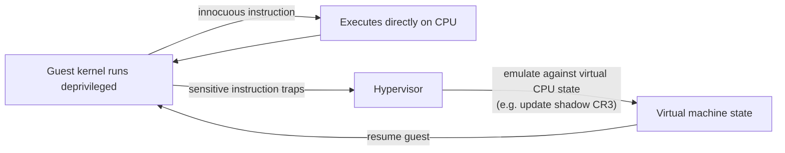
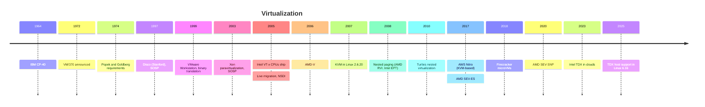

---
tags:
  - operating-systems
  - virtualization
  - hypervisors
  - kvm
  - vt-x
  - confidential-computing
status: draft
sources:
  - https://course.ece.cmu.edu/~ece845/docs/p412-popek.pdf
  - https://blog.acolyer.org/2016/02/19/formal-requirements-for-virtualizable-third-generation-architectures/
  - https://apps.dtic.mil/sti/pdfs/AD0772809.pdf
  - https://www.usenix.org/legacy/events/sec2000/full_papers/robin/robin_html/
  - https://infoscience.epfl.ch/record/183742?ln=en
  - https://www.cs.princeton.edu/courses/archive/fall05/cos518/papers/xen.pdf
  - https://pdos.csail.mit.edu/6.1810/2019/readings/adams06vmware.pdf
  - https://course.ece.cmu.edu/~ece845/sp13/docs/vt-overview-itj06.pdf
  - https://cdrdv2-public.intel.com/774497/326019-sdm-vol-3c.pdf
  - https://courses.physics.illinois.edu/ece598ms/fa2019/papers/paper223.pdf
  - https://www.cs.columbia.edu/~nieh/pubs/isca2016_armvirt.pdf
  - https://lwn.net/Articles/658511
  - https://docs.kernel.org/6.12/virt/kvm/api.html
  - https://static.usenix.org/event/usenix05/tech/freenix/bellard.html
  - https://ozlabs.org/~rusty/virtio-spec/virtio-paper.pdf
  - https://lkml.iu.edu/hypermail/linux/kernel/0911.1/00670.html
  - https://docs.kernel.org/PCI/pci-iov-howto.html
  - https://docs.kernel.org/next/driver-api/vfio.html
  - https://learn.microsoft.com/en-us/windows-server/virtualization/hyper-v/architecture
  - https://www.vm.ibm.com/history/timeline.html
  - https://pdos.csail.mit.edu/6.1810/2006/readings/bugnion97disco.pdf
  - https://www.usenix.org/legacy/events/nsdi05/tech/clark.html
  - https://www.intel.com/pressroom/archive/releases/2005/20051114comp.htm
  - https://lwn.net/Articles/221116/
  - https://www.usenix.org/conference/osdi10/turtles-project-design-and-implementation-nested-virtualization
  - https://docs.aws.amazon.com/whitepapers/latest/security-design-of-aws-nitro-system/the-nitro-system-journey.html
  - https://www.allthingsdistributed.com/2020/09/reinventing-virtualization-with-nitro.html
  - https://www.usenix.org/conference/nsdi20/presentation/agache
  - https://www.sas.com/content/dam/SAS/documents/marketing-whitepapers-ebooks/third-party-whitepapers/en/amd-sev-snp-strengthening-vm-isolation-with-integrity-protection-and-more.pdf
  - https://docs.kernel.org/6.16/arch/x86/tdx.html
  - https://www.phoronix.com/news/Linux-6.11-KVM
  - https://itsfoss.com/news/linux-kernel-6-16.md
  - https://phoronix.com/news/Linux-6.18-KVM
  - https://phoronix.com/news/Linux-74-Intel-TDX-Dynamic-PAMT
  - https://docs.kernel.org/6.13/arch/arm64/arm-cca.html
  - https://lkml.iu.edu/2607.1/16227.html
  - https://cloud.google.com/blog/products/identity-security/from-clicks-to-clusters-confidential-computing-expands-with-intel-tdx
  - https://techcommunity.microsoft.com/t5/azure-confidential-computing/announcing-general-availability-of-azure-intel-tdx-confidential/ba-p/4495693
  - https://www.securityweek.com/confidential-vms-hacked-via-new-ahoi-attacks/amp/
  - https://thehackernews.com/2025/10/50-battering-ram-attack-breaks-intel.html
  - https://labs.cloudsecurityalliance.org/research/csa-research-note-mior-skyfall-sev-snp-confidential-ai-20261/
  - https://www.theregister.com/2023/12/12/vmware_broadcom_licensing_changes/
  - https://www.virtualizationhowto.com/2026/09/leaving-vmware-just-got-harder-after-broadcom-pulled-vddk-downloads/
  - https://www.theregister.com/a/5307466
  - https://proxmox.com/en/news/press-releases/proxmox-virtual-environment-9-0
  - https://www.techtarget.com/searchitoperations/news/366643085/Enterprises-fleeing-Broadcom-move-to-OpenShift-Virtualization
  - https://www.cncf.io/announcements/2026/11/10/cloud-native-computing-foundation-announces-kubevirt-graduation/
  - https://docs.kernel.org/admin-guide/hw-vuln/l1tf.html
created: 2026-11-26
updated: 2026-11-26
---

## Table Of Contents

---

- [[#TL;DR|TL;DR]]
- [[#The Problem|The Problem]]
- [[#Foundations|Foundations]]
    - [[#The Popek and Goldberg Rules|The Popek and Goldberg Rules]]
    - [[#Trap and Emulate|Trap and Emulate]]
    - [[#Why x86 Broke the Rules|Why x86 Broke the Rules]]
    - [[#Type 1 and Type 2|Type 1 and Type 2]]
- [[#How We Got Here|How We Got Here]]
- [[#How It Works|How It Works]]
    - [[#CPU — VT-x Root and Non-Root Modes|CPU — VT-x Root and Non-Root Modes]]
    - [[#Memory — Shadow Paging to Nested Paging|Memory — Shadow Paging to Nested Paging]]
    - [[#KVM and QEMU|KVM and QEMU]]
    - [[#IO — Emulation, virtio, Passthrough|IO — Emulation, virtio, Passthrough]]
    - [[#The Cost of a VM Exit|The Cost of a VM Exit]]
    - [[#Live Migration|Live Migration]]
- [[#Where It Is Now|Where It Is Now]]
    - [[#Confidential VMs|Confidential VMs]]
    - [[#The Move Off VMware|The Move Off VMware]]
- [[#Trade-offs & Open Problems|Trade-offs & Open Problems]]
- [[#Resources|Resources]]
- [[#Related Notes|Related Notes]]

## ***TL;DR***
---
*A hypervisor runs whole operating systems as guests, giving each the illusion of its own machine while keeping real control of the hardware. Since 2005, CPUs do most of the work themselves (Intel VT-x, AMD-V, nested paging), so a modern hypervisor like KVM is mostly a scheduler and memory manager that handles the rare cases the hardware hands it.*

- **The requirement.** Popek and Goldberg (1974): a VM must behave like the real machine (*equivalence*), the hypervisor must keep control of resources (*resource control*), and most instructions must run directly on the CPU (*efficiency*). That's possible if every *sensitive* instruction is also *privileged*, so it traps.
- **x86's flaw.** About 17 x86 instructions were sensitive but didn't trap ([Robin & Irvine, 2000](https://www.usenix.org/legacy/events/sec2000/full_papers/robin/robin_html/)). VMware worked around it with binary translation (1999); Xen by modifying the guest OS (paravirtualization, 2003); Intel and AMD fixed it in hardware (2005–2006).
- **How it works today.** The guest kernel runs in ring 0 of a special *non-root* mode. Sensitive events cause a **VM exit** to the hypervisor, which handles them and resumes the guest. **Nested paging** (EPT/NPT) lets hardware translate guest memory, at the cost of up to **24** memory references per TLB miss instead of 4.
- **The Linux stack.** KVM (in Linux since 2.6.20, 2007) turns the kernel into a hypervisor; a user-space VMM (QEMU, Firecracker, Cloud Hypervisor) creates VMs through `ioctl`s on `/dev/kvm` and emulates devices. Fast I/O uses **virtio** paravirtual devices or hands real hardware to the guest with **SR-IOV/VFIO**.
- **Late 2026.** *Confidential VMs* (AMD SEV-SNP, Intel TDX) that protect guests from the hypervisor itself are generally available on all three big clouds and upstream in Linux; Broadcom's VMware licensing changes are pushing enterprises to KVM-based platforms (Proxmox, OpenShift Virtualization, KubeVirt, which graduated in the CNCF in November 2026).

## ***The Problem***
---
*Running several operating systems on one machine means each must think it owns the hardware, while something underneath actually does. The hard part is doing that safely and almost as fast as bare metal.*

A kernel expects to control everything: page tables, interrupts, I/O devices, the privileged CPU state. Put two kernels on one machine and each would overwrite the other. A hypervisor (or *virtual machine monitor*, VMM) must:

- **Intercept** every operation that touches real machine state and apply it to that guest's *virtual* state instead.
- **Contain** each guest so a bug or attack in one can't reach another or the host.
- **Stay out of the way** for everything else, or the guest runs at emulator speed.

Why bother: consolidation (many lightly loaded servers on one host), isolation for multi-tenant clouds, snapshots and live migration of whole machines, and running different OSes side by side. Every public cloud instance is a VM, and lighter forms of the same idea power [[MicroVMs and Sandboxing]].

## ***Foundations***
---
*The theory was settled in 1974: if every instruction that touches machine state traps when run unprivileged, you can build an efficient hypervisor by running the guest unprivileged and emulating whatever traps. The history of x86 virtualization is the history of working around a CPU that broke that rule.*

### The Popek and Goldberg Rules

*Instructions fall into three classes, and virtualization is easy exactly when the dangerous ones are a subset of the ones that trap.*

From Popek and Goldberg, CACM 1974 ([paper](https://course.ece.cmu.edu/~ece845/docs/p412-popek.pdf); [summary](https://blog.acolyer.org/2016/02/19/formal-requirements-for-virtualizable-third-generation-architectures/)):

| Class | Definition | x86 examples |
|---|---|---|
| **Privileged** | Traps in user mode, runs in supervisor mode | `LGDT`, `MOV CR3`, `HLT` |
| **Sensitive** | *Control-sensitive*: changes resources or processor mode. *Behaviour-sensitive*: result depends on mode or memory location | `POPF` (silently ignores the interrupt flag in user mode), `SGDT` |
| **Innocuous** | Neither | `ADD`, `MOV` between registers, most of the instruction set |

**Theorem 1:** an efficient, equivalent, resource-controlling VMM can be built if "the set of sensitive instructions for that computer is a subset of the privileged instructions."

### Trap and Emulate

*Run the guest kernel deprivileged; let innocuous instructions run natively; catch every sensitive one as a trap and emulate it against the virtual CPU.*



The efficiency rule is that "a statistically dominant subset" of instructions runs natively ([Robin & Irvine](https://www.usenix.org/legacy/events/sec2000/full_papers/robin/robin_html/)). Since only a small fraction of instructions are sensitive, the guest runs at near-native speed, and the hypervisor's [[Interrupts and Exceptions|trap handling]] does the rest. IBM's VM/370 worked exactly this way in 1972.

### Why x86 Broke the Rules

*On classic x86, some instructions behave differently in user mode instead of trapping, so a deprivileged guest kernel would silently do the wrong thing.*

Robin and Irvine concluded in 2000 that "the Intel processor is not virtualizable according to Goldberg's hardware rules": seventeen instructions were sensitive but not privileged ([USENIX Security 2000](https://www.usenix.org/legacy/events/sec2000/full_papers/robin/robin_html/)). Two classic cases:

- **`POPF`** in user mode silently skips changing the interrupt-enable flag. A guest kernel trying to disable interrupts would think it had, and the hypervisor would never know.
- **`SGDT`/`SIDT`/`SMSW`/`PUSH CS`** reveal real privileged state (where the real descriptor tables are, what ring the code runs in) without trapping, so the guest can see it's been moved.

Intel's 2006 overview names the structural problems: *ring aliasing* (a guest can observe its real privilege level) and *ring compression* (in 64-bit mode, paging can't separate rings 0–2, so the guest kernel must share ring 3 with its own applications) ([Neiger et al.](https://course.ece.cmu.edu/~ece845/sp13/docs/vt-overview-itj06.pdf)).

Three answers followed:

| Approach | Idea | Cost |
|---|---|---|
| **Binary translation** (VMware, 1999) | Scan guest kernel code before it runs; rewrite the problem instructions into safe sequences; run user code directly | Complex translator; segmentation tricks to protect the VMM ([Bugnion et al.](https://infoscience.epfl.ch/record/183742?ln=en)) |
| **Paravirtualization** (Xen, 2003) | Modify the guest kernel to call the hypervisor (*hypercalls*) instead of using sensitive instructions | Guest must be ported: ~2,995 lines for Linux, ~4,620 for Windows XP ([Xen paper](https://www.cs.princeton.edu/courses/archive/fall05/cos518/papers/xen.pdf)) |
| **Hardware assist** (VT-x 2005, AMD-V 2006) | Add a new CPU mode where sensitive operations exit to the hypervisor | Exits were expensive at first ([Adams & Agesen](https://pdos.csail.mit.edu/6.1810/2019/readings/adams06vmware.pdf)) |

### Type 1 and Type 2

*Goldberg's 1973 thesis split hypervisors by what they run on; the line has blurred since.*

- **Type I:** "runs on a bare machine" ([Goldberg, 1973](https://apps.dtic.mil/sti/pdfs/AD0772809.pdf)). Xen, VMware ESXi, Hyper-V.
- **Type II:** runs "under the host operating system". VMware Workstation, VirtualBox.

KVM fits neither neatly: it is a module that turns the general-purpose Linux kernel *into* a Type 1 hypervisor. Hyper-V is Type 1 but puts a privileged Windows "root partition" beside it, the "only partition that has direct access to physical memory and devices"; guests get synthetic devices over VMBus ([Microsoft](https://learn.microsoft.com/en-us/windows-server/virtualization/hyper-v/architecture)). Xen's dom0 is the same idea.

## ***How We Got Here***
---
*Virtualization was invented for 1960s mainframes, forgotten on PCs, reinvented by VMware and Xen around 2000, then absorbed into the CPU and the Linux kernel. Each step moved work from software into hardware.*



- **Mainframes.** CP-40 (1964) and CP-67 (1967) at IBM led to VM/370, announced 2 August 1972 ([IBM](https://www.vm.ibm.com/history/timeline.html)). Mainframe CPUs were designed to trap correctly.
- **Disco (1997).** Stanford's Disco ran commodity OSes on a ccNUMA machine with at most 16% overhead and became the seed of VMware ([paper](https://pdos.csail.mit.edu/6.1810/2006/readings/bugnion97disco.pdf)).
- **Hardware arrives, slowly paying off.** Intel shipped the first VT-x desktop CPUs on 14 November 2005 ([Intel](https://www.intel.com/pressroom/archive/releases/2005/20051114comp.htm)). VMware's own 2006 study found first-generation VT-x "rarely improves performance" over binary translation, because exits were costly and there was still no hardware help for page tables ([Adams & Agesen, ASPLOS 2006](https://pdos.csail.mit.edu/6.1810/2019/readings/adams06vmware.pdf)). Nested paging fixed the second problem in 2008.
- **KVM.** Linux 2.6.20 (4 February 2007) merged KVM ([LWN](https://lwn.net/Articles/221116/)). Because the hardware did the hard part, KVM could be small and reuse Linux's scheduler and memory manager.
- **Clouds.** AWS started on Xen, where virtualization overhead reached up to 30%; it moved work onto dedicated Nitro cards from 2013 and, with C5 in 2017, replaced Xen with a "minimized hypervisor based on KVM" ([Vogels](https://www.allthingsdistributed.com/2020/09/reinventing-virtualization-with-nitro.html); [AWS](https://docs.aws.amazon.com/whitepapers/latest/security-design-of-aws-nitro-system/the-nitro-system-journey.html)).

## ***How It Works***
---
*A modern VM uses three hardware features (a guest CPU mode, nested page tables, an IOMMU) plus a small kernel module and a user-space process that emulates whatever hardware can't do directly.*

### CPU — VT-x Root and Non-Root Modes

*VT-x adds a second set of privilege rings: the guest gets a real ring 0 in "non-root" mode, and anything the hypervisor wants to see causes a VM exit to "root" mode.*

From Intel's 2006 overview ([Neiger et al.](https://course.ece.cmu.edu/~ece845/sp13/docs/vt-overview-itj06.pdf)):

- **VMX root operation** is for the hypervisor; **non-root operation** runs the guest at its intended privilege level, so the guest kernel really is in ring 0.
- The **VMCS** (virtual machine control structure), one per virtual CPU, holds:
    - a *guest-state area* saved and loaded on each transition (control registers, segment state, interrupt state; not the general-purpose registers);
    - a *host-state area* loaded on exit;
    - *execution controls*: which events cause exits (external interrupts, specific I/O ports via a bitmap, specific MSRs, CR0/CR4 bits, exceptions).
- **VM entry** (the `VMLAUNCH` and `VMRESUME` instructions, [Intel SDM Vol. 3C](https://cdrdv2-public.intel.com/774497/326019-sdm-vol-3c.pdf)) loads guest state and can inject a virtual interrupt.
- **VM exit** saves guest state, loads host state, and records an *exit reason* and *qualification* (e.g. "MOV to CR3, from register RAX").

AMD's equivalent, SVM, uses `VMRUN`, `#VMEXIT` and a VMCB. This turns the bitmaps in the VMCS into a policy knob: the hypervisor chooses which operations it needs to see.

### Memory — Shadow Paging to Nested Paging

*A guest has its own page tables mapping its virtual addresses to what it thinks are physical addresses. The hypervisor must add a second translation to real memory, either in software (shadow pages) or in hardware (nested paging).*

Two address translations must compose:

- **Guest virtual → guest physical** (the guest's page tables, see [[Virtual Memory and Paging]]).
- **Guest physical → host physical** (the hypervisor's mapping).

| Technique | How | Cost |
|---|---|---|
| **Shadow page tables** | Hypervisor keeps hidden tables mapping guest-virtual straight to host-physical; write-protects the guest's tables and traps every change to keep them in sync | VM exits on every guest page-table update, context switch and page fault |
| **Nested paging** (AMD NPT/RVI, Intel EPT) | Hardware walks both sets of tables on a TLB miss | No exits for page-table updates; much longer TLB-miss walks |

The cost of a nested walk, from AMD's 2008 analysis ([Bhargava et al., ASPLOS 2008](https://courses.physics.illinois.edu/ece598ms/fa2019/papers/paper223.pdf)):

$$
\text{refs}_{2D} = n \cdot m + n + m
$$

**In plain English:** with $n$ guest page-table levels and $m$ host levels, *every* guest page-table entry is itself a guest-physical address that must be translated through all $m$ host levels before it can be read, and so must the final address.

**Worked example.** With 4-level tables on both sides: $4 \times 4 + 4 + 4 = 24$ memory references for one TLB miss, versus 4 natively, six times more. With 5-level tables on both sides: $5 \times 5 + 5 + 5 = 35$. This is why huge pages matter even more inside VMs: a 2 MB page removes a level from each walk, giving $3 \times 3 + 3 + 3 = 15$, and why hardware caches intermediate translations.

### KVM and QEMU

*KVM is a kernel module that runs a virtual CPU when asked; everything else (the machine's devices, its firmware, the management API) lives in a user-space VMM process.*

A VM is a process, and each virtual CPU is a thread inside it, scheduled by the normal Linux scheduler ([[Processes and Threads]], [[CPU Scheduling]]). The user-space side talks to KVM through file descriptors ([LWN, 2015](https://lwn.net/Articles/658511); [KVM API](https://docs.kernel.org/6.12/virt/kvm/api.html)):

```c
int kvm  = open("/dev/kvm", O_RDWR);
int vm   = ioctl(kvm, KVM_CREATE_VM, 0);
void *mem = mmap(NULL, 0x1000, PROT_READ|PROT_WRITE, MAP_SHARED|MAP_ANONYMOUS, -1, 0);
struct kvm_userspace_memory_region region = {
    .slot = 0, .guest_phys_addr = 0x1000, .memory_size = 0x1000, .userspace_addr = (uint64_t)mem,
};
ioctl(vm, KVM_SET_USER_MEMORY_REGION, &region);   /* guest RAM is just our memory */
int vcpu = ioctl(vm, KVM_CREATE_VCPU, 0);
struct kvm_run *run = mmap(NULL, ioctl(kvm, KVM_GET_VCPU_MMAP_SIZE, 0),
                           PROT_READ|PROT_WRITE, MAP_SHARED, vcpu, 0);
/* ... set registers with KVM_SET_SREGS / KVM_SET_REGS ... */
for (;;) {
    ioctl(vcpu, KVM_RUN, 0);                     /* enter the guest until an exit KVM can't handle */
    switch (run->exit_reason) {
    case KVM_EXIT_IO:                            /* guest wrote to an I/O port: emulate the device */
        if (run->io.port == 0x3f8) putchar(*((char *)run + run->io.data_offset));
        break;
    case KVM_EXIT_HLT:
        return 0;                                /* guest halted */
    }
}
```

**In plain words:** create a VM, give it a page of our own memory as its RAM, create one virtual CPU, and loop calling `KVM_RUN`. KVM enters the guest with `VMLAUNCH`/`VMRESUME` and handles most exits itself in the kernel (page faults, timers, many MSRs). Only exits it can't handle, like an access to an emulated serial port, return to user space, where the VMM plays the device. Here the "device" is a serial port at 0x3f8 that prints characters.

QEMU began in 2005 as a portable emulator with its own dynamic binary translator ([Bellard, USENIX 2005](https://static.usenix.org/event/usenix05/tech/freenix/bellard.html)); with KVM it became the device model around the `KVM_RUN` loop. Smaller VMMs (Firecracker, Cloud Hypervisor, crosvm) replace QEMU with far less code; see [[MicroVMs and Sandboxing]].

### IO — Emulation, virtio, Passthrough

*I/O is where VMs lose most performance, because every device register access is a potential exit. The answers are to exit less (virtio), to exit into the kernel instead of user space (vhost), or not to exit at all (passthrough).*

| Method | How | Speed | Flexibility |
|---|---|---|---|
| **Full emulation** | VMM emulates a real device (e1000 NIC, IDE disk); every register access exits | Slow | Any guest works unmodified |
| **virtio** | Paravirtual device; guest driver and VMM share ring buffers in guest memory | Fast | Needs virtio drivers (standard in Linux, Windows drivers available) |
| **vhost** | virtio backend inside the host kernel instead of the VMM process | Faster | Same as virtio |
| **Passthrough (VFIO + SR-IOV)** | Real device (or a hardware slice of one) assigned to the guest; DMA isolated by the IOMMU | Near native | Hard to live-migrate; device must support it |

**virtio** came from the observation that Linux had at least eight hypervisors, each with its own block, network and console drivers ([Russell, 2008](https://ozlabs.org/~rusty/virtio-spec/virtio-paper.pdf)). A *virtqueue* has three parts in guest memory: a **descriptor table** (buffer address, length, flags), an **available ring** the guest writes, and a **used ring** the host writes. The guest "kicks" the host only when needed; both sides can suppress notifications, because each kick is an exit. **vhost-net** (2009) moved the backend into the host kernel, removing up to four system calls or exits per packet ([Tsirkin](https://lkml.iu.edu/hypermail/linux/kernel/0911.1/00670.html)).

**SR-IOV** makes "one physical device appear as multiple virtual devices": a Physical Function exposes Virtual Functions, each with its own PCI identity ([kernel docs](https://docs.kernel.org/PCI/pci-iov-howto.html)). **VFIO** gives a user-space process (the VMM) IOMMU-protected access to a device, so the guest's driver programs the hardware directly and the IOMMU stops its DMA from touching anyone else's memory ([VFIO docs](https://docs.kernel.org/next/driver-api/vfio.html)). This is how VMs get GPUs and line-rate NICs; see [[Kernel Bypass Networking]].

### The Cost of a VM Exit

*Each exit is a full world switch: save one machine's state, load another's, and back. It costs hundreds to thousands of cycles, so the game is to exit rarely.*

| Measurement | Cycles | Source |
|---|---|---|
| VM entry, Pentium 4 (2006) | 2,409 | [Adams & Agesen](https://pdos.csail.mit.edu/6.1810/2019/readings/adams06vmware.pdf) |
| VM entry, Core 2 Duo | 937 | same |
| Native page fault, Pentium 4 (for scale) | 1,093 | same |
| Hypercall round trip, KVM x86 (Xeon E5-2450) | 1,300 | [Dall et al., ISCA 2016](https://www.cs.columbia.edu/~nieh/pubs/isca2016_armvirt.pdf) |
| Hypercall round trip, Xen x86 | 1,228 | same |
| Hypercall round trip, Xen ARM | 376 | same |

**Worked example.** At 2.1 GHz, a 1,300-cycle round trip is about $1300 / 2.1 \times 10^9 \approx 0.62\ \mu s$. A vCPU taking 50,000 exits a second (an emulated NIC under load can) spends $50{,}000 \times 0.62\ \mu s = 31\ ms$ per second exiting, **3.1%** of its time, before counting the work done in the handler or the cache and TLB pollution from switching. Halve the exits with virtio's notification suppression and it halves. Hardware features keep removing exit causes: posted interrupts and AMD's AVIC deliver interrupts without exits (AVIC is on by default on Zen 4 and later since Linux 6.18, [Phoronix](https://phoronix.com/news/Linux-6.18-KVM)).

### Live Migration

*Because a VM's whole state is memory plus a few registers and device states, it can be moved between hosts while running.*

Pre-copy migration copies memory while the guest runs, re-copies pages it dirtied, and repeats until the remaining set is small; then it pauses briefly, copies the rest and resumes on the target. The 2005 Xen implementation reached downtime "as low as 60ms" ([Clark et al., NSDI 2005](https://www.usenix.org/legacy/events/nsdi05/tech/clark.html)). It's how clouds patch hosts without rebooting customers. It works badly with passthrough devices, whose state lives in hardware the VMM can't read.

## ***Where It Is Now***
---
*As of November 2026, the frontier is protecting guests from the hypervisor itself (confidential computing), while the market is reshaped by enterprises leaving VMware for KVM-based platforms.*

### Confidential VMs

*Traditional virtualization protects the host from guests. Confidential computing adds the reverse: memory encryption and integrity checks that keep even a malicious hypervisor or cloud operator out of a guest.*

The full design, attestation and guest-kernel side are covered in [[Confidential Computing]].

| Technology | Vendor | Protects | Linux status |
|---|---|---|---|
| **SEV-SNP** | AMD (SEV 2016, SEV-ES 2017, SNP 2020) | Encrypted memory plus a Reverse Map Table that blocks the hypervisor from remapping, replaying or aliasing guest pages ([AMD](https://www.sas.com/content/dam/SAS/documents/marketing-whitepapers-ebooks/third-party-whitepapers/en/amd-sev-snp-strengthening-vm-isolation-with-integrity-protection-and-more.pdf)) | KVM host support in 6.11 (2024, [Phoronix](https://www.phoronix.com/news/Linux-6.11-KVM)) |
| **TDX** | Intel | "Trust domains" isolated from the VMM by a CPU-run TDX module ([kernel docs](https://docs.kernel.org/6.16/arch/x86/tdx.html)) | KVM host support in 6.16 (Jul 2025, [It's FOSS](https://itsfoss.com/news/linux-kernel-6-16.md)) |
| **CCA (Realms)** | Arm | Realm VMs managed by a separate monitor | Guest support since 6.13 ([docs](https://docs.kernel.org/6.13/arch/arm64/arm-cca.html)); KVM host support still out of tree (v15 series, Jul 2026, [LKML](https://lkml.iu.edu/2607.1/16227.html)) |

Recent changes:

- **Linux 6.18** (late 2025) added SEV-SNP CipherText Hiding and Secure TSC, and CET virtualization ([Phoronix](https://phoronix.com/news/Linux-6.18-KVM)).
- **Linux 7.4** (merge window October 2026) adds TDX *Dynamic PAMT*, removing a fixed reservation of about 0.4% of RAM, and enumerable attestation-quote sizes for larger post-quantum quotes ([Phoronix](https://phoronix.com/news/Linux-74-Intel-TDX-Dynamic-PAMT)).
- **Clouds.** Google Cloud made TDX on C3 generally available in 10 regions, plus confidential H100 GPUs (August 2025, [Google](https://cloud.google.com/blog/products/identity-security/from-clicks-to-clusters-confidential-computing-expands-with-intel-tdx)); Azure made its v6 TDX VM families generally available (February 2026, [Microsoft](https://techcommunity.microsoft.com/t5/azure-confidential-computing/announcing-general-availability-of-azure-intel-tdx-confidential/ba-p/4495693)); AWS has offered SEV-SNP since 2023.
- **Attacks keep coming.** Heckler and WeSee (2024) abused the hypervisor's control of interrupt injection against SNP and TDX guests ([SecurityWeek](https://www.securityweek.com/confidential-vms-hacked-via-new-ahoi-attacks/amp/)). Battering RAM (September 2025) broke SEV-SNP and SGX with a sub-$50 DDR4 interposer; vendors consider physical attacks out of scope ([The Hacker News](https://thehackernews.com/2025/10/50-battering-ram-attack-breaks-intel.html)). AMD advisories in November 2026 cover *Mior*, which lets a malicious host forge SNP attestation measurements, and *Skyfall*, which leaks guest register state (reported by the [Cloud Security Alliance](https://labs.cloudsecurityalliance.org/research/csa-research-note-mior-skyfall-sev-snp-confidential-ai-20261/); vendor bulletins not checked here).

### The Move Off VMware

*Broadcom's 2023 acquisition of VMware changed its licensing, and three years later the migration to KVM-based stacks is a major enterprise project.*

- **December 2023.** Broadcom ended perpetual licences and cut the portfolio to two bundles ([The Register](https://www.theregister.com/2023/12/12/vmware_broadcom_licensing_changes/)).
- **August–September 2026.** Public downloads of VMware's VDDK disk library were pulled, breaking agentless migration tools in Red Hat MTV, Azure Migrate and Nutanix Move; Proxmox's built-in importer was unaffected ([VirtualizationHowto](https://www.virtualizationhowto.com/2026/09/leaving-vmware-just-got-harder-after-broadcom-pulled-vddk-downloads/)).
- **November 2026.** Broadcom launched a cheaper "vSphere Express" for up to 128 cores ([The Register](https://www.theregister.com/a/5307466)).
- **Where people go.** Proxmox VE 9.0 (August 2025, Debian 13, kernel 6.14, QEMU 10) ([Proxmox](https://proxmox.com/en/news/press-releases/proxmox-virtual-environment-9-0)); OpenShift Virtualization, where Emirates NBD has moved more than 9,000 VMs ([TechTarget, 2026](https://www.techtarget.com/searchitoperations/news/366643085/Enterprises-fleeing-Broadcom-move-to-OpenShift-Virtualization)); and KubeVirt, which runs VMs as Kubernetes pods and **graduated in the CNCF on 10 November 2026** ([CNCF](https://www.cncf.io/announcements/2026/11/10/cloud-native-computing-foundation-announces-kubevirt-graduation/)). All three are KVM and QEMU underneath.

## ***Trade-offs & Open Problems***
---
*VMs give the strongest isolation commodity systems offer, at the price of running a second kernel per workload and paying for every boundary crossing. Most open problems are about where that boundary leaks.*

| Choice | You get | You pay |
|---|---|---|
| Full VM | Strong isolation, any OS, live migration | A guest kernel's memory and boot time per VM; exits |
| Paravirtual devices (virtio) | Fast I/O, migratable | Guest drivers; still some exits |
| Passthrough (VFIO/SR-IOV) | Near-native I/O, GPUs | IOMMU groups bound what can be split; hard to migrate |
| Nested paging | No exits on page-table updates | Up to 24 references per TLB miss |
| Confidential VM | Protection from the host | Attestation complexity; I/O through bounce buffers; new attack surface |
| Containers instead | Low overhead, fast start | Shared kernel; see [[Containers, Namespaces and cgroups]] |

**Open problems.**

- **Side channels.** L1TF (2018) let a guest read L1 cache data belonging to whatever ran on its sibling hyperthread, bypassing EPT; mitigations flush L1 on every VM entry (1–50% cost) or disable SMT, which Linux doesn't do by default ([kernel docs](https://docs.kernel.org/admin-guide/hw-vuln/l1tf.html)). See [[Transient Execution Attacks and Mitigations]].
- **Trusting the untrusted host.** Confidential VMs still let the hypervisor schedule them, inject interrupts and control I/O; Heckler, Mior and Skyfall show that the attestation and interrupt paths are the soft spots. Physical attacks are out of scope by vendor choice.
- **Nested virtualization.** x86 has no architectural support for a hypervisor inside a VM; KVM emulates it. Turtles reached 6–8% overhead over one level ([OSDI 2010](https://www.usenix.org/conference/osdi10/turtles-project-design-and-implementation-nested-virtualization)), but it's needed more than ever (CI runners, sandboxes inside cloud VMs).
- **I/O vs migration.** Passthrough devices and encrypted confidential-VM memory both defeat classic pre-copy migration.
- **Noisy neighbours.** VMs share caches, memory bandwidth and the host's I/O; isolation of performance is weaker than isolation of state.
- **Formal assurance.** Hypervisors are large and run with full privilege; microkernel hypervisors like seL4's aim to shrink that base ([[Microkernels and seL4]], [[Formally Verified OS Components]]).

## ***Resources***
---
*Popek and Goldberg for the theory, Adams and Agesen for why early hardware virtualization disappointed, the Xen paper for paravirtualization, and LWN's KVM API article to build a toy VMM in an afternoon.*

**Foundations**
- [Formal Requirements for Virtualizable Third Generation Architectures](https://course.ece.cmu.edu/~ece845/docs/p412-popek.pdf): Popek & Goldberg, CACM 1974 ([summary](https://blog.acolyer.org/2016/02/19/formal-requirements-for-virtualizable-third-generation-architectures/)).
- [Architectural Principles for Virtual Computer Systems](https://apps.dtic.mil/sti/pdfs/AD0772809.pdf): Goldberg, PhD thesis, 1973.
- [Analysis of the Intel Pentium's Ability to Support a Secure Virtual Machine Monitor](https://www.usenix.org/legacy/events/sec2000/full_papers/robin/robin_html/): Robin & Irvine, USENIX Security 2000.

**Systems papers**
- [Disco](https://pdos.csail.mit.edu/6.1810/2006/readings/bugnion97disco.pdf): Bugnion et al., SOSP 1997.
- [Bringing Virtualization to the x86 Architecture with the Original VMware Workstation](https://infoscience.epfl.ch/record/183742?ln=en): Bugnion et al., ACM TOCS 2012.
- [Xen and the Art of Virtualization](https://www.cs.princeton.edu/courses/archive/fall05/cos518/papers/xen.pdf): Barham et al., SOSP 2003.
- [A Comparison of Software and Hardware Techniques for x86 Virtualization](https://pdos.csail.mit.edu/6.1810/2019/readings/adams06vmware.pdf): Adams & Agesen, ASPLOS 2006.
- [Intel Virtualization Technology overview](https://course.ece.cmu.edu/~ece845/sp13/docs/vt-overview-itj06.pdf): Neiger et al., Intel Technology Journal 2006.
- [Accelerating Two-Dimensional Page Walks for Virtualized Systems](https://courses.physics.illinois.edu/ece598ms/fa2019/papers/paper223.pdf): Bhargava et al., ASPLOS 2008.
- [Live Migration of Virtual Machines](https://www.usenix.org/legacy/events/nsdi05/tech/clark.html): Clark et al., NSDI 2005.
- [The Turtles Project](https://www.usenix.org/conference/osdi10/turtles-project-design-and-implementation-nested-virtualization): Ben-Yehuda et al., OSDI 2010.
- [ARM Virtualization: Performance and Architectural Implications](https://www.cs.columbia.edu/~nieh/pubs/isca2016_armvirt.pdf): Dall et al., ISCA 2016.
- [virtio: Towards a De-Facto Standard for Virtual I/O Devices](https://ozlabs.org/~rusty/virtio-spec/virtio-paper.pdf): Russell, 2008.

**Hands-on and docs**
- [Using the KVM API](https://lwn.net/Articles/658511): Josh Triplett, LWN, 2015.
- [KVM API](https://docs.kernel.org/6.12/virt/kvm/api.html), [VFIO](https://docs.kernel.org/next/driver-api/vfio.html), [Intel TDX](https://docs.kernel.org/6.16/arch/x86/tdx.html): kernel.org.
- [The Nitro System journey](https://docs.aws.amazon.com/whitepapers/latest/security-design-of-aws-nitro-system/the-nitro-system-journey.html): AWS whitepaper.
- [Reinventing virtualization with the AWS Nitro System](https://www.allthingsdistributed.com/2020/09/reinventing-virtualization-with-nitro.html): Werner Vogels, 2020.

## Related Notes

- [[MicroVMs and Sandboxing]] — Firecracker and friends: VMs cut down to container speed.
- [[Containers, Namespaces and cgroups]] — Isolation that shares the kernel instead of virtualizing hardware.
- [[Virtual Memory and Paging]] — The page tables nested paging stacks two of.
- [[Interrupts and Exceptions]] — Traps, the mechanism trap-and-emulate is built on.
- [[System Calls and the User-Kernel Boundary]] — Privilege rings and mode switches, which VM exits generalize.
- [[Processes and Threads]] — A KVM VM is a process, a vCPU is a thread.
- [[CPU Scheduling]] — How vCPU threads share physical cores.
- [[Kernel Architectures]] — Where hypervisors sit relative to monolithic and microkernels.
- [[Microkernels and seL4]] — Small, verified hypervisors.
- [[Unikernels and Library OSes]] — Single-application guests that only run on a hypervisor.
- [[Kernel Bypass Networking]] — SR-IOV and VFIO give VMs direct NIC access.
- [[Transient Execution Attacks and Mitigations]] — L1TF, MDS and other cross-VM leaks.
- [[Kernel Security Hardening]] — Defences inside the host kernel KVM relies on.
- [[Confidential Computing]] — Guests protected from the hypervisor: SEV-SNP, TDX and Arm CCA.
- [[Rust in the Linux Kernel]] — Rust is also the language of the newer VMMs.
- [[Cluster Scheduling]] — Placing VMs and containers across a fleet.
- [[GPU Cluster Infrastructure]] — GPUs passed through to VMs in AI clouds.
